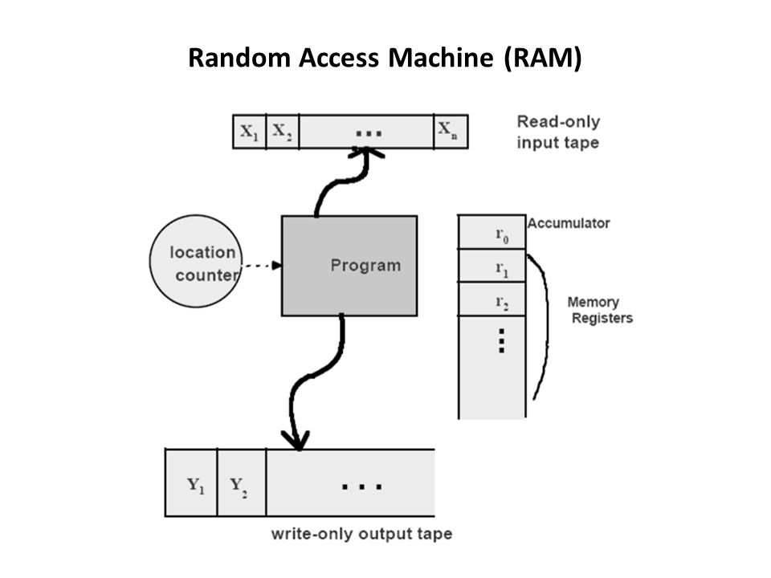
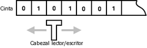
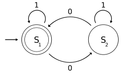
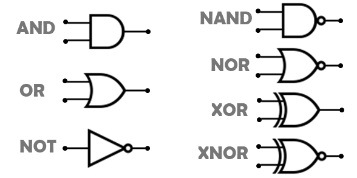
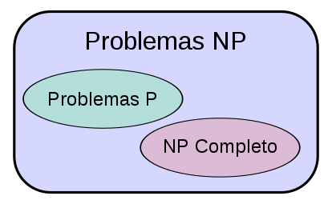

---
# Copyright (c) 2026 Angela Villota, and collaborators from the CyED block
# Licensed under the PolyForm Noncommercial License 1.0.0.
# Commercial use is prohibited without prior written authorization.
title: "Complejidad temporal y espacial: Estudio 2"
---

# Complejidad temporal y espacial: Estudio 2

Segunda pasada sobre el análisis de complejidad de [Crecimiento de funciones y Análisis de algoritmos](index.md), con tres piezas que no cubrió el primer estudio: diagramas de los modelos de cómputo, demostraciones formales con constantes $c$ y $n_0$ explícitas sobre los mismos algoritmos clásicos (con su complejidad espacial), y un cuarto método para Fibonacci que baja el tiempo a $O(\log n)$.

---

## Modelos de cómputo

**Máquina de acceso aleatorio (RAM).** Separa la cinta de entrada, la de salida y los registros de memoria; el programa lee de una, escribe en la otra y usa los registros como memoria de trabajo. Cada acceso a un registro cuesta un paso, sin importar cuál.



**Máquina de Turing.** Una única cinta hace de entrada, salida y memoria de trabajo a la vez. Un cabezal lee y escribe sobre la cinta y se mueve una celda a la izquierda o a la derecha en cada paso.



**Autómata finito.** Sin cinta de trabajo: solo estados y transiciones. Cada símbolo de entrada mueve al autómata de un estado a otro; no hay memoria más allá del estado actual.



**Circuitos combinacionales.** El modelo más restringido: entradas y salidas binarias, conectadas por compuertas lógicas sin memoria ni ciclos.



**Clases de complejidad.** Todo problema en $P$ se resuelve en tiempo polinómico; $NP$ contiene además los problemas cuya solución se puede *verificar* en tiempo polinómico. Los $NP$-completos son el subconjunto de $NP$ al que se reduce cualquier otro problema de $NP$: si uno de ellos cayera en $P$, todo $NP$ caería en $P$.



---

## Cotas formales: $c$ y $n_0$ explícitos

El Estudio 1 clasificó estos mismos algoritmos por su orden de crecimiento. Aquí se exhiben la constante $c$ y el umbral $n_0$ que hacen cierta cada cota, y se agrega el análisis de complejidad **espacial** que el primer estudio no cubrió.

### Búsqueda lineal: $\Theta(n)$ en el peor caso

```java
public static int buscar(int[] arr, int objetivo) {
    for (int i = 0; i < arr.length; i++) {
        if (arr[i] == objetivo) {
            return i; //Elemento encontrado
        }
    }
    return -1; //No encontrado
}
```

En el peor caso el ciclo recorre las $n$ posiciones sin encontrar el objetivo, así que $T(n) = n$ comparaciones.

- **Cota superior $O$:** con $c=2$ y $n_0=1$, $T(n) = n \leq 2n$ para todo $n \geq 1$.
- **Cota inferior $\Omega$:** con $c=1$ y $n_0=1$, $T(n) = n \geq 1 \cdot n$ para todo $n \geq 1$.
- Como $T(n)=O(n)$ y $T(n)=\Omega(n)$: $T(n) = \Theta(n)$.

**Espacio:** `arr` es la entrada, no cuenta como auxiliar. Solo existe la variable `i`, de tamaño fijo. Espacio auxiliar $O(1)$.

### Búsqueda binaria: $O(\log n)$ en el peor caso

```java
public static int buscarIterativo(int[] arr, int objetivo) {
    int inicio = 0, fin = arr.length - 1;
    while (inicio <= fin) {
        int medio = inicio + (fin - inicio) / 2;
        if (arr[medio] == objetivo) return medio;
        else if (arr[medio] < objetivo) inicio = medio + 1;
        else fin = medio - 1;
    }
    return -1;
}
```

Cada iteración descarta la mitad del rango restante, así que el número de iteraciones para llegar a un rango de tamaño 1 es $\log_2 n$. Para $n=16$: como máximo $\log_2 16 = 4$ comparaciones.

**Espacio:** la versión iterativa de arriba usa tres variables fijas (`inicio`, `fin`, `medio`), independientes de $n$: espacio $O(1)$. Una versión recursiva de la misma búsqueda agregaría un *frame* por cada mitad descartada, subiendo el espacio a $O(\log n)$. Misma complejidad temporal, distinto costo espacial según cómo se implemente.

### Ordenamiento burbuja: por qué el mejor caso necesita un flag

```java
public static void ordenar(int[] arr) {
    int n = arr.length;
    for (int i = 0; i < n - 1; i++) {
        boolean huboIntercambio = false;
        for (int j = 0; j < n - i - 1; j++) {
            if (arr[j] > arr[j + 1]) {
                int temp = arr[j];
                arr[j] = arr[j + 1];
                arr[j + 1] = temp;
                huboIntercambio = true;
            }
        }
        if (!huboIntercambio) {
            break; //ya está ordenado, no hace falta seguir recorriendo
        }
    }
}
```

Sin la variable `huboIntercambio`, el ciclo externo siempre completa sus $n-1$ pasadas, sin importar si el arreglo ya llegó ordenado: el mejor caso sería $O(n^2)$, igual que el peor. La variable es la que hace cierto que un arreglo ya ordenado termine en una sola pasada:

- **Mejor caso — $O(n)$:** arreglo ya ordenado. La primera pasada completa sus $n-1$ comparaciones, no encuentra ningún intercambio, y `huboIntercambio` corta el ciclo externo.
- **Peor caso — $O(n^2)$:** arreglo en orden inverso. $(n-1)+(n-2)+\cdots+1 = \frac{n(n-1)}{2} = O(n^2)$ comparaciones e intercambios.

**Espacio:** ordena *in-place*; solo usa `temp` y `huboIntercambio`, de tamaño fijo. Espacio auxiliar $O(1)$.

### Quicksort: la misma elección de pivote gobierna tiempo y espacio

```java
public static void quicksort(int[] arr, int izq, int der) {
    if (izq < der) {
        int pi = particion(arr, izq, der);
        quicksort(arr, izq, pi - 1);
        quicksort(arr, pi + 1, der);
    }
}

private static int particion(int[] arr, int izq, int der) {
    int pivote = arr[der];
    int i = izq - 1;
    for (int j = izq; j < der; j++) {
        if (arr[j] < pivote) {
            i++;
            int temp = arr[i];
            arr[i] = arr[j];
            arr[j] = temp;
        }
    }
    int temp = arr[i + 1];
    arr[i + 1] = arr[der];
    arr[der] = temp;
    return i + 1;
}
```

Quicksort ordena *in-place* (no reserva un arreglo auxiliar como MergeSort), pero cada llamada recursiva agrega un *frame* a la pila. La profundidad de esa pila depende de qué tan balanceada queda la partición, y esa misma partición es la que determina el tiempo:

- **Partición balanceada** (pivote cerca de la mediana): recursión de profundidad $O(\log n)$ → espacio $O(\log n)$; tiempo $O(n \log n)$.
- **Partición desbalanceada** (pivote siempre el mínimo o el máximo): la recursión degenera en una cadena de $n$ llamadas anidadas → espacio $O(n)$; tiempo $O(n^2)$.

La elección de pivote no solo cambia cuántas comparaciones se hacen: cambia cuánta memoria de pila se consume, con el mismo patrón bueno/malo en ambos casos.

---

## Fibonacci por exponenciación de matrices: $O(\log n)$

El Estudio 1 dejó a Fibonacci en tres variantes: recursiva ($O(2^n)$), iterativa con arreglo ($O(n)$ tiempo, $O(n)$ espacio) y optimizada ($O(n)$ tiempo, $O(1)$ espacio). Existe una cuarta que baja el tiempo por debajo de lineal.

La identidad clave: la matriz $\begin{pmatrix}1&1\\1&0\end{pmatrix}$ elevada a la $n$ tiene a $F(n+1)$ en la esquina superior izquierda. Elevar una matriz a la $n$ no exige $n$ multiplicaciones: con **exponenciación rápida**, `potencia(M, n)` calcula `potencia(M, n/2)` una sola vez y la eleva al cuadrado, en vez de multiplicar `M` por sí misma $n$ veces.

```java
public static long fibonacciMatriz(int n) {
    if (n <= 1) return n;
    long[][] base = {{1, 1}, {1, 0}};
    long[][] resultado = potencia(base, n - 1);
    return resultado[0][0];
}

private static long[][] potencia(long[][] m, int exp) {
    if (exp == 0) {
        return new long[][]{{1, 0}, {0, 1}}; //matriz identidad
    }
    if (exp == 1) {
        return m;
    }
    long[][] mitad = potencia(m, exp / 2);
    long[][] cuadrado = multiplicar(mitad, mitad);
    if (exp % 2 == 0) {
        return cuadrado;
    }
    return multiplicar(cuadrado, m);
}

private static long[][] multiplicar(long[][] a, long[][] b) {
    return new long[][]{
            {a[0][0] * b[0][0] + a[0][1] * b[1][0], a[0][0] * b[0][1] + a[0][1] * b[1][1]},
            {a[1][0] * b[0][0] + a[1][1] * b[1][0], a[1][0] * b[0][1] + a[1][1] * b[1][1]}
    };
}
```

`potencia` se llama a sí misma una vez por nivel, con el exponente a la mitad, y hace un número constante de multiplicaciones de matrices $2\times2$ por nivel:

$$
T(n) = T(n/2) + O(1) \;\Rightarrow\; T(n) = O(\log n)
$$

**Espacio:** $O(\log n)$ por la pila de recursión de `potencia` (se puede bajar a $O(1)$ escribiéndola de forma iterativa, igual que se hizo con Fibonacci optimizado).

### Comparación ampliada

| Método | Tiempo | Espacio |
|---|---|---|
| Recursivo | $O(2^n)$ | $O(n)$ (pila de recursión) |
| Iterativo con arreglo | $O(n)$ | $O(n)$ |
| Optimizado | $O(n)$ | $O(1)$ |
| Exponenciación de matrices | $O(\log n)$ | $O(\log n)$ |

El método de matrices es el más rápido de los cuatro; para valores de $n$ muy grandes, es la opción a preferir sobre la versión optimizada $O(n)$.

---

## Proyecto descargable

Los cinco algoritmos de esta página (búsqueda lineal, búsqueda binaria, ordenamiento burbuja, quicksort y las cuatro variantes de Fibonacci) en un proyecto Maven con menú interactivo y pruebas JUnit 5.

::::{grid} 1
:::{card} 📥 ComplejidadTemporalYEspacial.zip
Incluye `pom.xml`, el código fuente (`src/main/java`) con un `Main.java` de menú interactivo, las pruebas (`src/test/java`) y un `README.md` por algoritmo con su análisis de complejidad temporal y espacial detallado.

```bash
mvn compile
mvn test
mvn exec:java
```

{download}`Descargar ComplejidadTemporalYEspacial.zip <files/ComplejidadTemporalYEspacial.zip>`
:::
::::

---

*Contenido adaptado del material de clase de Marlon Gómez.*
