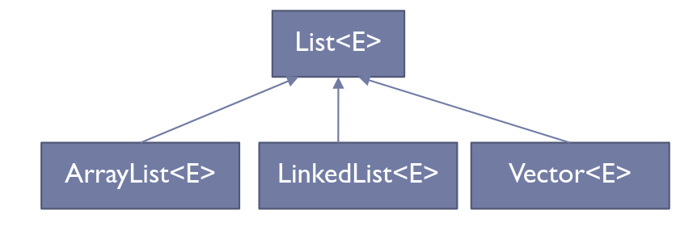
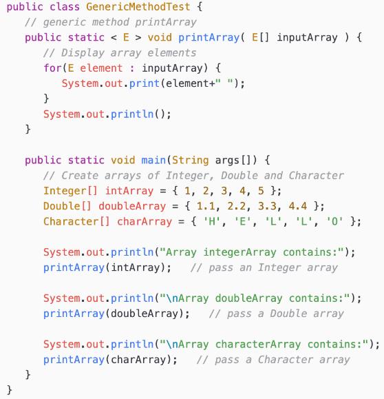

---
# Copyright (c) 2026 Angela Villota, and collaborators from the CyED block
# Licensed under the PolyForm Noncommercial License 1.0.0.
# Commercial use is prohibited without prior written authorization.
title: "Unidad 3: Generics"
---

# Unidad 3: Generics

## Introducción

¿Por qué Generics?

:::{dropdown} Generics
- Generics permite que, al definir una clase, interfaz o método, se puedan utilizar tipos (clases o interfaces) como parámetros.
- Busca independizar el proceso del tipo de datos sobre los que se aplica.
- Definición de modelos generales.
:::

¿Y esto qué acarrea?

Al utilizar parámetros en la definición de clases, interfaces y métodos, se provee una nueva manera de reutilizar código.

Entonces, ¿cuáles son los beneficios de un código que usa Generics y otro que no?

:::{dropdown} Beneficios
- Chequeos de tipos más rigurosos en tiempo de compilación.
- Eliminación de casts.
- Implementación de algoritmos genéricos.
:::

Ejemplo 1, parte 1: clase genérica `Caja`.

```java
public class Caja<T> {
    private T contenido;
    public void setContenido(T contenido) {
        this.contenido = contenido;
    }
    public T getContenido() {
        return contenido;
    }
}
```

Ejemplo 1, parte 2: uso de la clase genérica `Caja` en `main`.

```java
public class Main {
    public static void main(String[] args) {
        Caja<String> cajaDeTextos = new Caja<>();
        cajaDeTextos.setContenido("Usando Generics");
        System.out.println(cajaDeTextos.getContenido());

        Caja<Integer> cajaDeNumeros = new Caja<>();
        cajaDeNumeros.setContenido(123);
        System.out.println(cajaDeNumeros.getContenido());
    }
}
```

Adivine qué clase viene utilizando hace un tiempo y cumple con ser genérica...

:::{dropdown} Respuesta
`ArrayList` es genérica.

```java
public class Main {
    public static void main(String[] args) {
        ArrayList<String> nombres = new ArrayList<>();
        nombres.add("Ana");
        nombres.add("Juan");
        nombres.add("Luis");
        System.out.println(nombres);

        ArrayList<Integer> numeros = new ArrayList<>();
        numeros.add(10);
        numeros.add(20);
        numeros.add(30);
        System.out.println(numeros);
    }
}
```
:::

¿Se pueden utilizar tipos primitivos al utilizar Generics?

:::{dropdown} Consideraciones
- No se pueden utilizar con primitivos pero sí con las clases que corresponden con ellos (clases wrapper).
- No se puede hacer un genérico tipo `int` pero sí un `Integer`.
- Autoboxing a las clases wrappers (conversión automática que realiza el compilador entre un tipo de dato primitivo, como `int`, y su clase contenedora correspondiente, como `Integer`).
:::

¿Qué relación puede existir entre sobrecarga de métodos y generics?

:::{dropdown} Generics y sobrecarga de métodos
- Si las operaciones realizadas por varios métodos sobrecargados son idénticas, pueden codificarse de manera compacta utilizando un método genérico.
- Con base en los tipos de los argumentos que se pasan al método genérico, el compilador maneja cada llamada al método de manera apropiada.
- Además de establecer las llamadas a los métodos, el compilador determina si las operaciones en el cuerpo del método se pueden aplicar a los elementos del tipo almacenado en el argumento de la clase genérica (arreglo, `ArrayList`).
:::

## Tipos genéricos

Ejemplo de clase NO genérica:

```java
public class Caja {
    private Object objeto;
    public void setObjeto(Object objeto) {
        this.objeto = objeto;
    }
    public Object getObjeto() {
        return objeto;
    }
}
```

¿Qué problemas se pueden presentar al utilizar la clase no genérica anterior?

:::{dropdown} Problemas clase NO genérica
- No se puede verificar en tiempo de compilación cómo se utiliza la clase.
- Una parte del código puede ubicar un tipo de objeto en la `Caja` y esperar que se retorne un objeto de ese mismo tipo, mientras que, por error, en otra parte del código se le puede pasar otro tipo de objeto, generando un error en tiempo de ejecución.
:::

---

### ¿Error en tiempo de compilación o en tiempo de ejecución?

¿Qué es mejor, un error en tiempo de compilación o en tiempo de ejecución?

- Un error en tiempo de compilación.
- Los errores en tiempo de compilación son más fáciles de encontrar.

---

¿Cómo se declara una clase genérica?

:::{dropdown} Declaración clase genérica
- Al momento de declarar la clase, luego del nombre de ésta, se especifican los parámetros de tipos delimitados por `< >`.
- Los objetos a ser utilizados dentro de la clase se reemplazan por el tipo de parámetro de entrada.
- Estas variables de tipo pueden ser de cualquier tipo no primitivo.
- El mismo procedimiento puede utilizarse para declarar interfaces genéricas.
:::

¿Cuál sería la versión genérica del ejemplo previo?

:::{dropdown} Respuesta
Sería precisamente el primer ejemplo visto:

```java
public class Caja<T> {
    private T tipo;
    public void setTido(T tipo) {
        this.tipo = tipo;
    }
    public T getTipo() {
        return tipo;
    }
}
```
:::

¿Cómo se declara una variable de tipo genérica?

:::{dropdown} Declaraciones variables genéricas
- `Caja<Integer> cajaEnteros;`
- `Caja<Double> cajaReales;`
- `Caja<String> cajaString;`
- `Caja< Caja<String> > cajaCajaString;`
:::

¿Cómo se crea un objeto de tipo genérico?

:::{dropdown} Instanciar objetos tipo genéricos
- `Caja<Integer> cajaEnteros = new Caja<Integer>();`
- `Caja<Integer> cajaEnteros = new Caja<>();`
:::

¿Pero por qué es válido `Caja<Integer> cajaEnteros = new Caja<>();`?

:::{dropdown} Instanciar objetos tipo genéricos
- Al invocar el constructor de una clase genérica se pueden reemplazar los argumentos de tipo con un conjunto vacío siempre y cuando el compilador pueda determinarlos o inferirlos a partir del contexto.
- Como este conjunto vacío se denota como `< >` se denomina notación diamante.
:::

¿Puede una clase tener múltiples parámetros de tipos?

:::{dropdown} Múltiples parámetros de tipos
- Sí.
- `Terna<`$T_1,T_2,T_3$`> terna;`
:::

**Ejercicio:** Declare la clase genérica `Terna` (con 7 métodos, constructor, 3 getters y 3 setters) que implemente la interfaz `ITerna`. Posteriormente declare variables de tipo `Terna` e instáncielas utilizando distintos argumentos de tipo.

:::{dropdown} Solución
```java
public interface ITerna<T1,T2,T3> {
    public T1 obtenerPrimero();
    public T2 obtenerSegundo();
    public T3 obtenerTercero();
}
public class Terna<T1,T2,T3> implements ITerna<T1,T2,T3> {
    private T1 primero;
    private T2 segundo;
    private T3 tercero;
    public Terna(T1 primero, T2 segundo, T3 tercero) {
        this.primero = primero;
        this.segundo = segundo;
        this.tercero = tercero ;
    }
    public T1 obtenerPrimero() {
        return primero;
    }
    public T2 obtenerSegundo() {
        return segundo;
    }
    public T3 obtenerTercero() {
        return tercero;
    }
}
```
:::

---

### Terna con múltiples constructores

Una variante de la clase `Terna` puede ofrecer varios constructores según qué campos se conocen al momento de crear el objeto, además de un constructor de copia:

```java
interface ITerna<T, U, V> {
    T getFirst();
    U getSecond();
    V getThird();
    void setFirst(T first);
    void setSecond(U second);
    void setThird(V third);
}

class Terna<T, U, V> implements ITerna<T, U, V> {
    private T first;
    private U second;
    private V third;

    // Constructor 1: Constructor vacío
    public Terna() {
        this.first = null;
        this.second = null;
        this.third = null;
    }

    // Constructor 2: Un solo parámetro (solo first)
    public Terna(T first) {
        this.first = first;
        this.second = null;
        this.third = null;
    }

    // Constructor 3: Dos parámetros (first y second)
    public Terna(T first, U second) {
        this.first = first;
        this.second = second;
        this.third = null;
    }

    // Constructor 4: Tres parámetros (first, second y third)
    public Terna(T first, U second, V third) {
        this.first = first;
        this.second = second;
        this.third = third;
    }

    // Constructor 5: Solo second y third
    public Terna(U second, V third) {
        this.first = null;
        this.second = second;
        this.third = third;
    }

    // Constructor 6: Solo first y third
    public Terna(T first, V third) {
        this.first = first;
        this.second = null;
        this.third = third;
    }

    // Constructor 7: Inicialización con otro objeto de tipo Terna
    public Terna(Terna<T, U, V> otraTerna) {
        this.first = otraTerna.first;
        this.second = otraTerna.second;
        this.third = otraTerna.third;
    }

    // Getters
    @Override
    public T getFirst() {
        return first;
    }

    @Override
    public U getSecond() {
        return second;
    }

    @Override
    public V getThird() {
        return third;
    }

    // Setters
    @Override
    public void setFirst(T first) {
        this.first = first;
    }

    @Override
    public void setSecond(U second) {
        this.second = second;
    }

    @Override
    public void setThird(V third) {
        this.third = third;
    }

    // Método para mostrar la terna
    public void mostrarTerna() {
        System.out.println("(" + first + ", " + second + ", " + third + ")");
    }
}
```

Uso en `main` con distintos tipos y constructores:

```java
public class Main {
    public static void main(String[] args) {
        // Instanciaciones con distintos tipos de datos
        Terna<Integer, String, Double> terna1 = new Terna<>(1, "Hola", 3.14);
        Terna<String, Boolean, Character> terna2 = new Terna<>("Texto", true, 'A');
        Terna<Double, Integer, String> terna3 = new Terna<>(9.8, 42, "Ejemplo");

        // Instanciaciones usando distintos constructores
        Terna<Integer, String, Double> terna4 = new Terna<>(5);
        Terna<Integer, String, Double> terna5 = new Terna<>(5, "Mundo");
        Terna<Integer, String, Double> terna6 = new Terna<>(null, "Test", 2.71);
        Terna<Integer, String, Double> terna7 = new Terna<>(terna1); // Copia de otra terna

        // Mostrar valores de las ternas
        System.out.print("Terna 1: ");
        terna1.mostrarTerna();

        System.out.print("Terna 2: ");
        terna2.mostrarTerna();

        System.out.print("Terna 3: ");
        terna3.mostrarTerna();

        System.out.print("Terna 4: ");
        terna4.mostrarTerna();

        System.out.print("Terna 5: ");
        terna5.mostrarTerna();

        System.out.print("Terna 6: ");
        terna6.mostrarTerna();

        System.out.print("Terna 7 (Copia de Terna 1): ");
        terna7.mostrarTerna();

        // Modificación de valores
        terna1.setFirst(99);
        terna1.setSecond("Modificado");
        terna1.setThird(2.71);
        System.out.print("Terna 1 modificada: ");
        terna1.mostrarTerna();
    }
}
```

---

¿Cuál sería una interfaz genérica estándar de Java?



**Ejemplo:** uso de `List` genérico.

```java
public class TestArrayList {
    public static void main(String[] args) {
        List<Figura> lista = new ArrayList<Figura>();
        lista.add(new Circulo());
        Figura f = lista.get(0);
        Circulo c = (Circulo) lista.get(0);
    }
}
```

¿Se pueden restringir los tipos genéricos?

:::{dropdown} Restricción de tipos genéricos
- Se pueden restringir los tipos genéricos de tal manera que se pueda trabajar con un tipo específico y sus subtipos.
- Para establecer el límite superior, se coloca después del nombre del parámetro de tipo la palabra clave `extends` y el nombre de la clase o interfaz que representa dicha restricción.
- El `extends` se utiliza para clases e interfaces.
:::

**Ejemplo:** restricción de tipo genérico en Java.

```java
public class CajaNumeros<T extends Number> {
    private T dato;
    public T darElemento() {
        return dato;
    }
    public void modificarDato(T dato) {
        this .dato = dato;
    }
}
```

## Tipos raw

¿Qué es el tipo raw o crudo?

:::{dropdown} Tipo raw
- Es el nombre de una clase o interfaz genérica cuando no se le pasa ningún argumento de tipo.
- `Caja cajaCruda = new Caja();`
- En este caso, `Caja` es un tipo raw de `Caja<T>`.
- Un tipo de clase o interfaz no genérica no es un tipo raw.
:::

¿Qué advertencias se pueden presentar al utilizar tipos raw?

:::{dropdown} Advertencias tipo raw
Se presenta una advertencia ya que a un tipo parametrizado se le asigna un tipo raw.

```java
Caja cajaCruda = new Caja();
Caja<Integer> intCaja = cajaCruda;
```

Se presenta una advertencia pues el tipo raw se salta los chequeos de tipo genérico y así pasa su manejo de código inseguro a tiempo de ejecución.

```java
Caja<String> stringCaja = new Caja<>();
Caja cajaCruda = stringCaja;
cajaCruda.modificar(8);
```
:::

## Métodos genéricos

¿Qué son los métodos genéricos?

:::{dropdown} Métodos genéricos
- Son aquellos métodos que introducen su propio tipo de parámetros.
- Es similar a la declaración de tipo genérica, pero el alcance del parámetro está limitado al método donde se declara.
- Se admiten métodos genéricos estáticos y no estáticos, al igual que constructores genéricos.
- La sintaxis de un método genérico incluye un parámetro de tipo entre `< >` y aparece antes del tipo de retorno del método.
:::



¿Se puede utilizar el operador relacional (`<`, `>`, etc.) con tipos referenciados?

:::{dropdown} Operador relacional
- No, sin embargo, es posible comparar dos objetos de la misma clase, si esa clase implementa a la interfaz genérica `Comparable<T>`.
- Los objetos de clases que implementan `Comparable<T>` tienen el método `compareTo(T t)`.
- Todas las clases de envoltura de tipos para tipos primitivos implementan a `Comparable<T>`.
- Un beneficio de implementar la interfaz genérica `Comparable<T>` es que los objetos de clases que implementan esta interfaz pueden utilizarse con métodos de ordenamiento y búsqueda sobre las clases `Collections`.
:::

**Ejemplo:** interfaz `Comparable`.

```java
public class Libro implements Comparable<Libro> {
    private String titulo;
    private double precio;

    public Libro(String titulo, double precio) {
        this.titulo = titulo;
        this.precio = precio;
    }

    public String getTitulo() { return titulo; }
    public double getPrecio() { return precio; }

    @Override
    public int compareTo(Libro otroLibro) {
        return Double.compare(this.precio, otroLibro.precio);
    }
}
```

**Ejemplo:** uso de la interfaz `Comparable` en `main`.

```java
public class Main {
    public static void main(String[] args) {
        List<Libro> libros = new ArrayList<>();
        libros.add(new Libro("Java Avanzado", 35.99));
        libros.add(new Libro("Python desde cero", 24.50));
        libros.add(new Libro("Introducción a la IA", 40.75));

        Collections.sort(libros);

        for (Libro libro : libros) {
            System.out.println(libro.getTitulo() + " - $" + libro.getPrecio());
        }
    }
}
```

---

### Método genérico `printArray`

El diagrama de la diapositiva anterior corresponde a un método genérico estático que imprime los elementos de un arreglo de cualquier tipo:

```java
public class GenericMethodTest {
    // método genérico printArray
    public static <E> void printArray(E[] inputArray) {
        // recorrer los elementos del arreglo
        for (E element : inputArray) {
            System.out.print(element + " ");
        }
        System.out.println();
    }

    public static void main(String args[]) {
        // Crear arreglos de Integer, Double y Character
        Integer[] intArray = {1, 2, 3, 4, 5};
        Double[] doubleArray = {1.1, 2.2, 3.3, 4.4};
        Character[] charArray = {'H', 'E', 'L', 'L', 'O'};

        System.out.println("Array integerArray contains:");
        printArray(intArray); // pasa un arreglo de Integer

        System.out.println("Array doubleArray contains:");
        printArray(doubleArray); // pasa un arreglo de Double

        System.out.println("Array characterArray contains:");
        printArray(charArray); // pasa un arreglo de Character
    }
}
```

### Método genérico con restricción: ordenamiento por inserción

Un método genérico también puede restringir su parámetro de tipo con `extends`, para poder invocar operaciones propias de esa restricción (como `compareTo`) dentro del cuerpo del método:

```java
class GenericInsertionSorter {
    public <T extends Comparable<T>> void sort(T[] elems) {
        int size = elems.length;
        for (int outerLoopIdx = 1; outerLoopIdx < size; outerLoopIdx++) {
            for (int innerLoopIdx = outerLoopIdx; innerLoopIdx > 0; innerLoopIdx--) {
                if (elems[innerLoopIdx - 1].compareTo(elems[innerLoopIdx]) > 0) {
                    T temp = elems[innerLoopIdx - 1];
                    elems[innerLoopIdx - 1] = elems[innerLoopIdx];
                    elems[innerLoopIdx] = temp;
                }
            }
        }
    }
}
```

Como `T extends Comparable<T>`, el compilador garantiza que cualquier tipo usado con `GenericInsertionSorter` tiene el método `compareTo`, sin importar de qué tipo concreto se trate.

---

## Wildcards

¿Qué son los comodines o wildcards en Generics?

:::{dropdown} Wildcards
- El signo de interrogación `?`, también denominado comodín o wildcard, representa un tipo no conocido.
- Un comodín de tipo parametrizado es una instancia de un tipo genérico donde al menos un argumento de tipo es un wildcard.
- Ejemplos: `Collection<?>`, `List<? extends Number>`, `Pair<String,?>`.
- Los comodines pueden utilizarse en gran variedad de situaciones, como tipo del parámetro, campo o variable local.
- Los wildcard nunca se utilizan como un argumento de tipo para una invocación de un método genérico o una creación de una instancia de una clase genérica.
:::

**Ejemplo:** wildcard.

```java
public class WildcardDemo {
    public static void imprimirLista(List<?> lista) {
        for (Object elem : lista) {
            System.out.println(elem);
        }
    }

    public static void main(String[] args) {
        List<String> palabras = Arrays.asList("hola", "mundo");
        List<Integer> numeros = Arrays.asList(1, 2, 3);

        imprimirLista(palabras);
        imprimirLista(numeros);
    }
}
```

## Lo no permitido por Generics

¿Qué no permite Generics?

:::{dropdown} Lo no permitido por Generics
- No se puede definir un miembro de una clase como estático genérico parametrizado. Cualquier intento de este tipo produce un error de compilación, pues hace una referencia estática a un tipo `T` no estático.
- No se pueden crear instancias de tipo `T` (tipo genérico).
- Generics no es compatible con tipos de datos primitivos. Aunque sí se pueden utilizar las clases wrappers en lugar de los tipos de datos primitivos y luego usar los primitivos cuando se pasan los valores.
- No se puede crear una clase Excepción genérica.
:::

## Ejemplos

### Ejemplo: Pila Genérica

Para convertir nuestra clase `Pila` vista en la sesión, en una clase genérica que pueda manejar cualquier tipo de dato (no solo enteros), se debe usar genéricos (`<T>`) y cambiar el arreglo de `int[]` a un arreglo de `T[]`.

Como en Java no se pueden crear arreglos genéricos directamente, hay un truco con un arreglo de `Object` y un casting.

```java
public class PilaGenerica<T> {
  private T[] arreglo;
  private int top;
  private int size;


  public PilaGenerica(int n) {
    this.arreglo = (T[]) new Object[n];
    this.top = 0;
    this.size = n;
}
```

```java
public void Push(T x) throws IndexOutOfBoundsException {
    if(this.top < this.size) {
      this.arreglo[top] = x;
      this.top++;
    } else {
      throw new StackOverflowError();
    }
  }
```

```java
  public T Pop() throws IndexOutOfBoundsException {
    if(this.top > 0) {
      this.top--;
      return this.arreglo[top];
    } else {
      throw new IndexOutOfBoundsException();
    }
  }
```

```java
public T[] getArreglo() {
    return arreglo;
  }

  public int getTop() {
    return top;
  }

  public int getSize() {
    return size;
  }
```

```java
  public void setArreglo(T[] arreglo) {
    this.arreglo = arreglo;
  }

  public void setTop(int top) {
    this.top = top;
  }

  public void setSize(int size) {
    this.size = size;
  }
```

### Ejemplo: Pila con Caja Genérica

```java
public class PilaCaja<T> {
  private Caja<T>[] arreglo;
  private int top;
  private int size;

  @SuppressWarnings("unchecked")
  public PilaCaja(int n) {
    this.arreglo = (Caja<T>[]) new Caja[n]; // arreglo genérico
    this.top = 0;
    this.size = n;
  }

```

```java
public void Push(Caja<T> caja) throws IndexOutOfBoundsException {
    if (this.top < this.size) {
      this.arreglo[top] = caja;
      this.top++;
    } else {
      throw new StackOverflowError();
    }
  }
```

```java
public Caja<T> Pop() throws IndexOutOfBoundsException {
    if (this.top > 0) {
      this.top--;
      return this.arreglo[top];
    } else {
      throw new IndexOutOfBoundsException();
    }
  }

```

```java
public Caja<T>[] getArreglo() {
    return arreglo;
  }

  public int getTop() {
    return top;
  }

  public int getSize() {
    return size;
  }
```

```java
  public void setArreglo(Caja<T>[] arreglo) {
    this.arreglo = arreglo;
  }

  public void setTop(int top) {
    this.top = top;
  }

  public void setSize(int size) {
    this.size = size;
  }
```

### Ejemplo: Pila con Caja Genérica y Wildcard

Para crear una clase `PilaCajaGenericaWildcard` que sea una pila que no sea genérica en sí misma, pero cuyo contenido sea objetos de la clase genérica `Caja<T>`, lo que se puede hacer es:

- Declarar la pila con arreglo de `Caja<?>[]` para poder contener cajas con cualquier tipo (`?` es wildcard).
- Así la pila almacena distintas `Caja<T>`, cada una con diferente tipo, como `Caja<String>`, `Caja<Integer>`, etc.
- Los métodos `Push` y `Pop` manipulan objetos `Caja<?>`.

```java
public class PilaCajaGenericaWildcard {
  private Caja<?>[] arreglo;
  private int top;
  private int size;

  public PilaCajaGenericaWildcard(int n) {
    this.arreglo = (Caja<?>[]) new Caja<?>[n];
    this.top = 0;
    this.size = n;
  }
}
```

```java
public void Push(Caja<?> caja) throws IndexOutOfBoundsException {
    if (this.top < this.size) {
      this.arreglo[top] = caja;
      this.top++;
    } else {
      throw new StackOverflowError();
    }
  }
```

```java
public Caja<?> Pop() throws IndexOutOfBoundsException {
    if (this.top > 0) {
      this.top--;
      return this.arreglo[top];
    } else {
      throw new IndexOutOfBoundsException();
    }
  }
```

```java
public Caja<?>[] getArreglo() {
    return arreglo;
  }

  public int getTop() {
    return top;
  }

  public int getSize() {
    return size;
  }
```

```java
  public void setArreglo(Caja<?>[] arreglo) {
    this.arreglo = arreglo;
  }

  public void setTop(int top) {
    this.top = top;
  }

  public void setSize(int size) {
    this.size = size;
  }
```

---

### Listas enlazadas genéricas

Una *lista enlazada* (*Linked List*) es una estructura de datos lineal y dinámica donde los elementos (*nodos*) están conectados mediante punteros o referencias en lugar de ocupar posiciones contiguas en memoria.

Cada nodo contiene:
- Un *dato* (*valor almacenado*).
- Una *referencia al siguiente nodo* en la lista (y, en la versión doble, también al anterior).

**Antes de los genéricos: una lista de `Object`**

```java
public class Node {
    public Object data;
    public Node next;

    public Node(Object data) {
        this.data = data;
        this.next = null;
    }
}
```

Con `Object`, la lista acepta cualquier cosa, incluso mezclada, y cada lectura exige un *cast* que el compilador no puede verificar: `(String) lista.getHead().data` compila igual si adentro hay un `Integer`, y el error solo aparece en tiempo de ejecución.

**Con genéricos: el compilador atrapa el error antes de ejecutar**

:::{dropdown} 📂 ListaEnlazadaSimple — `NodeG<T>` y `ListG<T>`

```java
package listasimple.Generica;

public class NodeG<T> {
    public T data;
    public NodeG<T> next;

    public NodeG(T data) {
        this.data = data;
        this.next = null;
    }
}
```

```java
package listasimple.Generica;

public class ListG<T> {
    private NodeG<T> head;

    public ListG() {
        this.head = null;
    }

    public void add(T data) {
        NodeG<T> newNode = new NodeG<>(data);
        if (head == null) {
            head = newNode;
        } else {
            NodeG<T> current = head;
            while (current.next != null) {
                current = current.next;
            }
            current.next = newNode;
        }
    }

    public void remove(T data) {
        if (head == null) {
            return;
        }
        if (head.data.equals(data)) {
            head = head.next;
            return;
        }
        NodeG<T> current = head;
        while (current.next != null && !current.next.data.equals(data)) {
            current = current.next;
        }
        if (current.next != null) {
            current.next = current.next.next;
        }
    }

    public boolean isEmpty() {
        return head == null;
    }

    public int size() {
        int count = 0;
        NodeG<T> current = head;
        while (current != null) {
            count++;
            current = current.next;
        }
        return count;
    }

    public NodeG<T> getHead() {
        return head;
    }
}
```

`ListG<Integer>` y `ListG<String>` comparten el mismo código, pero `intList.add("texto")` no compila: el tipo se fija una sola vez, en la declaración.
:::

:::{dropdown} 📂 ListaEnlazadaDoble — `NodeG<T>` con `prev` y `next`

`ListaG<T>` mantiene `head` y `tail`, así que insertar en cualquiera de los dos extremos y leer el último elemento son operaciones $O(1)$ en vez de recorrer toda la lista.

```java
package ListaDoble.Generica;

public class NodeG<T> {
    T data;
    NodeG<T> next;
    NodeG<T> prev;

    NodeG(T data) {
        this.data = data;
        this.next = null;
        this.prev = null;
    }
}
```

```java
package ListaDoble.Generica;

import java.util.ArrayList;
import java.util.List;
import java.util.NoSuchElementException;
import java.util.Objects;

public class ListaG<T> {
    private NodeG<T> head;
    private NodeG<T> tail;
    private int size;

    public void insertAtStart(T data) {
        NodeG<T> nuevo = new NodeG<>(data);
        if (head == null) {
            head = tail = nuevo;
        } else {
            nuevo.next = head;
            head.prev = nuevo;
            head = nuevo;
        }
        size++;
    }

    public void insertAtEnd(T data) {
        NodeG<T> nuevo = new NodeG<>(data);
        if (tail == null) {
            head = tail = nuevo;
        } else {
            nuevo.prev = tail;
            tail.next = nuevo;
            tail = nuevo;
        }
        size++;
    }

    //Elimina la primera ocurrencia de data; si no existe, no hace nada
    public void remove(T data) {
        NodeG<T> actual = head;
        while (actual != null) {
            if (Objects.equals(actual.data, data)) {
                if (actual.prev != null) {
                    actual.prev.next = actual.next;
                } else {
                    head = actual.next;
                }
                if (actual.next != null) {
                    actual.next.prev = actual.prev;
                } else {
                    tail = actual.prev;
                }
                size--;
                return;
            }
            actual = actual.next;
        }
    }

    public T getHeadData() {
        if (head == null) throw new NoSuchElementException("La lista está vacía");
        return head.data;
    }

    public T getTailData() {
        if (tail == null) throw new NoSuchElementException("La lista está vacía");
        return tail.data;
    }

    public boolean contains(T data) {
        NodeG<T> actual = head;
        while (actual != null) {
            if (Objects.equals(actual.data, data)) return true;
            actual = actual.next;
        }
        return false;
    }

    public int size() {
        return size;
    }

    public boolean isEmpty() {
        return size == 0;
    }

    public List<T> recorrerAdelante() {
        List<T> resultado = new ArrayList<>(size);
        for (NodeG<T> actual = head; actual != null; actual = actual.next) {
            resultado.add(actual.data);
        }
        return resultado;
    }

    public List<T> recorrerAtras() {
        List<T> resultado = new ArrayList<>(size);
        for (NodeG<T> actual = tail; actual != null; actual = actual.prev) {
            resultado.add(actual.data);
        }
        return resultado;
    }
}
```
:::

::::{grid} 1
:::{card} 📥 Descargar las listas enlazadas genéricas
Dos proyectos Maven independientes, cada uno con su `pom.xml` y sus pruebas JUnit 5.

{download}`ListaEnlazadaSimple.zip <files/ListaEnlazadaSimple.zip>` — incluye además la versión sin genéricos (con `Object`) para comparar.

{download}`ListaEnlazadaDoble.zip <files/ListaEnlazadaDoble.zip>`
:::
::::

### Un `Gestor<T>` genérico para distintos modelos de datos

Un mismo `Gestor<T>` (envoltorio sobre una `ListaEnlazada<T>` genérica) administra ciudadanos, estudiantes y productos sin duplicar una sola línea: agregar, buscar, obtener y eliminar se escriben **una vez**, y el compilador se encarga de que un `Gestor<Ciudadano>` nunca acepte un `Producto`.

:::{dropdown} 📂 estructuras — `Nodo<T>` y `ListaEnlazada<T>`

```java
package estructuras;

public class Nodo<T> {
    private T dato;
    private Nodo<T> siguiente;

    public Nodo(T dato) {
        this.dato = dato;
        this.siguiente = null;
    }

    public T getDato() {
        return dato;
    }

    public void setDato(T dato) {
        this.dato = dato;
    }

    public Nodo<T> getSiguiente() {
        return siguiente;
    }

    public void setSiguiente(Nodo<T> siguiente) {
        this.siguiente = siguiente;
    }
}
```

```java
package estructuras;

public class ListaEnlazada<T> {
    private Nodo<T> cabeza;
    private int size;

    public ListaEnlazada() {
        this.cabeza = null;
        this.size = 0;
    }

    public void agregar(T dato) {
        Nodo<T> nuevoNodo = new Nodo<>(dato);
        if (cabeza == null) {
            cabeza = nuevoNodo;
        } else {
            Nodo<T> actual = cabeza;
            while (actual.getSiguiente() != null) {
                actual = actual.getSiguiente();
            }
            actual.setSiguiente(nuevoNodo);
        }
        size++;
    }

    public T obtener(int indice) {
        validarIndice(indice);
        Nodo<T> actual = cabeza;
        for (int i = 0; i < indice; i++) {
            actual = actual.getSiguiente();
        }
        return actual.getDato();
    }

    public T eliminar(int indice) {
        validarIndice(indice);
        T datoEliminado;
        if (indice == 0) {
            datoEliminado = cabeza.getDato();
            cabeza = cabeza.getSiguiente();
        } else {
            Nodo<T> actual = cabeza;
            for (int i = 0; i < indice - 1; i++) {
                actual = actual.getSiguiente();
            }
            datoEliminado = actual.getSiguiente().getDato();
            actual.setSiguiente(actual.getSiguiente().getSiguiente());
        }
        size--;
        return datoEliminado;
    }

    public int buscar(T dato) {
        Nodo<T> actual = cabeza;
        int indice = 0;
        while (actual != null) {
            if (actual.getDato().equals(dato)) return indice;
            actual = actual.getSiguiente();
            indice++;
        }
        return -1;
    }

    public int size() {
        return size;
    }

    public boolean estaVacia() {
        return size == 0;
    }

    //Centraliza la validación: evita duplicar el if en cada método
    private void validarIndice(int indice) {
        if (indice < 0 || indice >= size) {
            throw new IndexOutOfBoundsException(
                    "Índice " + indice + " fuera de rango. Tamaño actual: " + size
            );
        }
    }

    @Override
    public String toString() {
        if (estaVacia()) return "[ lista vacía ]";
        StringBuilder sb = new StringBuilder("[");
        Nodo<T> actual = cabeza;
        while (actual != null) {
            sb.append(actual.getDato());
            if (actual.getSiguiente() != null) sb.append(" -> ");
            actual = actual.getSiguiente();
        }
        return sb.append("]").toString();
    }
}
```
:::

:::{dropdown} 📂 gestor — `Gestor<T>` envuelve la lista, no la reimplementa

```java
package gestor;

import estructuras.ListaEnlazada;

public class Gestor<T> {
    private final ListaEnlazada<T> lista;

    public Gestor() {
        this.lista = new ListaEnlazada<>();
    }

    public void agregar(T elemento) {
        lista.agregar(elemento);
    }

    public T obtener(int indice) {
        return lista.obtener(indice);
    }

    public int buscar(T elemento) {
        return lista.buscar(elemento);
    }

    public T eliminar(int indice) {
        return lista.eliminar(indice);
    }

    public int size() {
        return lista.size();
    }

    @Override
    public String toString() {
        return lista.toString();
    }
}
```
:::

:::{dropdown} 📂 modelos y main — tres tipos de datos, un solo `Gestor`

`buscar` delega en `equals()` de `T`, así que cada modelo define su propia igualdad: `Ciudadano` y `Producto` comparan por código, `Estudiante` por código de matrícula.

```java
package main;

import gestor.Gestor;
import modelos.Ciudadano;
import modelos.Estudiante;
import modelos.Producto;

public class Main {
    public static void main(String[] args) {
        Gestor<Ciudadano> ciudadanos = new Gestor<>();
        ciudadanos.agregar(new Ciudadano("1001", "Ana", "Pérez"));
        ciudadanos.agregar(new Ciudadano("1002", "Luis", "Gómez"));
        System.out.println("Ciudadanos: " + ciudadanos);
        System.out.println("Índice de cédula 1002: " + ciudadanos.buscar(new Ciudadano("1002", "", "")));

        Gestor<Estudiante> estudiantes = new Gestor<>();
        estudiantes.agregar(new Estudiante(2024001, "Marlon", "Gómez", "Ingeniería de Sistemas"));
        estudiantes.agregar(new Estudiante(2024002, "Sara", "Ruiz", "Matemáticas"));
        System.out.println("\nEstudiantes: " + estudiantes);
        System.out.println("Eliminado: " + estudiantes.eliminar(0));
        System.out.println("Estudiantes tras eliminar: " + estudiantes);

        Gestor<Producto> productos = new Gestor<>();
        productos.agregar(new Producto("P01", "Teclado", 120000));
        productos.agregar(new Producto("P02", "Mouse", 45000));
        System.out.println("\nProductos: " + productos);
        System.out.println("Tamaño: " + productos.size());
    }
}
```

`Ciudadano.equals` compara por `cedula`; `Estudiante.equals` por `codigo`; `Producto.equals` por `codigoProducto`. Cada modelo también sobreescribe `hashCode` a partir del mismo campo: sin eso, dos objetos "iguales" por `equals()` podrían no encontrarse en un `HashSet` o `HashMap`, que primero comparan por `hashCode`.
:::

::::{grid} 1
:::{card} 📥 GestorGenerics.zip
Proyecto Maven completo: `Gestor<T>`, `ListaEnlazada<T>`, los tres modelos (`Ciudadano`, `Estudiante`, `Producto`) y sus pruebas JUnit 5.

{download}`Descargar GestorGenerics.zip <files/GestorGenerics.zip>`
:::
::::

---

## Más estructuras genéricas aplicadas

Cuatro estructuras de datos genéricas, cada una resolviendo un problema aplicado distinto.

### Diccionario: una tabla hash genérica `TablaHash<K,V>`

`Diccionario` guarda palabras y definiciones, pero no implementa el almacenamiento: delega en `TablaHashInterfaz<String,String>`. La tabla hash en sí es completamente genérica sobre `<K,V>` y usa **encadenamiento separado**: cada cubeta del arreglo es una `LinkedList<Entrada<K,V>>`, así que las claves cuyo hash cae en el mismo índice se acumulan en la misma lista en vez de sobrescribirse. Cuando el factor de carga supera 0.75, la tabla duplica su capacidad y redistribuye todas las entradas (`rehash`), lo que mantiene el promedio de $O(1)$ por operación a medida que crece.

:::{dropdown} 📂 estructuras — `TablaHash<K,V>` con encadenamiento separado

```java
package estructuras;

public interface TablaHashInterfaz<K, V> {
    void insertar(K clave, V valor);
    V obtener(K clave);
    void eliminar(K clave);
    void actualizar(K clave, V nuevoValor);
    boolean contiene(K clave);
    int size();
    boolean estaVacia();
}
```

```java
package estructuras;

import java.util.ArrayList;
import java.util.LinkedList;
import java.util.List;

public class TablaHash<K, V> implements TablaHashInterfaz<K, V> {

    private static final int CAPACIDAD_INICIAL = 16;
    private static final double FACTOR_CARGA_MAX = 0.75;

    private List<LinkedList<Entrada<K, V>>> cubetas;
    private int size;

    public TablaHash() {
        cubetas = crearCubetas(CAPACIDAD_INICIAL);
        size = 0;
    }

    @Override
    public void insertar(K clave, V valor) {
        verificarClave(clave);
        if ((double) (size + 1) / cubetas.size() > FACTOR_CARGA_MAX) {
            rehash();
        }
        int indice = obtenerIndice(clave);
        LinkedList<Entrada<K, V>> cubeta = cubetas.get(indice);
        if (cubeta == null) {
            cubeta = new LinkedList<>();
            cubetas.set(indice, cubeta);
        }
        for (Entrada<K, V> entrada : cubeta) {
            if (entrada.getClave().equals(clave)) {
                entrada.setValor(valor);
                return;
            }
        }
        cubeta.add(new Entrada<>(clave, valor));
        size++;
    }

    @Override
    public V obtener(K clave) {
        verificarClave(clave);
        int indice = obtenerIndice(clave);
        LinkedList<Entrada<K, V>> cubeta = cubetas.get(indice);
        if (cubeta != null) {
            for (Entrada<K, V> entrada : cubeta) {
                if (entrada.getClave().equals(clave)) {
                    return entrada.getValor();
                }
            }
        }
        return null;
    }

    @Override
    public void eliminar(K clave) {
        verificarClave(clave);
        int indice = obtenerIndice(clave);
        LinkedList<Entrada<K, V>> cubeta = cubetas.get(indice);
        if (cubeta != null) {
            boolean eliminado = cubeta.removeIf(entrada -> entrada.getClave().equals(clave));
            if (eliminado) {
                size--;
            }
        }
    }

    @Override
    public void actualizar(K clave, V nuevoValor) {
        verificarClave(clave);
        int indice = obtenerIndice(clave);
        LinkedList<Entrada<K, V>> cubeta = cubetas.get(indice);
        if (cubeta != null) {
            for (Entrada<K, V> entrada : cubeta) {
                if (entrada.getClave().equals(clave)) {
                    entrada.setValor(nuevoValor);
                    return;
                }
            }
        }
        throw new IllegalArgumentException("La clave '" + clave + "' no existe en la tabla.");
    }

    @Override
    public boolean contiene(K clave) {
        verificarClave(clave);
        return obtener(clave) != null;
    }

    @Override
    public int size() {
        return size;
    }

    @Override
    public boolean estaVacia() {
        return size == 0;
    }

    //Indice de cubeta para una clave; el AND con 0x7FFFFFFF limpia el bit de
    //signo para evitar indices negativos si hashCode() es negativo
    private int obtenerIndice(K clave) {
        return (clave.hashCode() & 0x7FFFFFFF) % cubetas.size();
    }

    //Duplica la capacidad y redistribuye todas las entradas
    private void rehash() {
        int nuevaCapacidad = cubetas.size() * 2;
        List<LinkedList<Entrada<K, V>>> nuevasCubetas = crearCubetas(nuevaCapacidad);
        for (LinkedList<Entrada<K, V>> cubeta : cubetas) {
            if (cubeta != null) {
                for (Entrada<K, V> entrada : cubeta) {
                    int nuevoIndice = (entrada.getClave().hashCode() & 0x7FFFFFFF) % nuevaCapacidad;
                    if (nuevasCubetas.get(nuevoIndice) == null) {
                        nuevasCubetas.set(nuevoIndice, new LinkedList<>());
                    }
                    nuevasCubetas.get(nuevoIndice).add(entrada);
                }
            }
        }
        cubetas = nuevasCubetas;
    }

    private List<LinkedList<Entrada<K, V>>> crearCubetas(int capacidad) {
        List<LinkedList<Entrada<K, V>>> lista = new ArrayList<>(capacidad);
        for (int i = 0; i < capacidad; i++) {
            lista.add(null);
        }
        return lista;
    }

    private void verificarClave(K clave) {
        if (clave == null) {
            throw new IllegalArgumentException("La clave no puede ser null.");
        }
    }

    //Par clave-valor almacenado en una cubeta; la clave es inmutable
    private static class Entrada<K, V> {
        private final K clave;
        private V valor;

        Entrada(K clave, V valor) {
            this.clave = clave;
            this.valor = valor;
        }

        K getClave() { return clave; }
        V getValor() { return valor; }
        void setValor(V nuevoValor) { this.valor = nuevoValor; }
    }
}
```
:::

::::{grid} 1
:::{card} 📥 Diccionario.zip
Proyecto Maven completo: `TablaHash<K,V>` genérica, `Diccionario`, `ui.Main` con una demostración funcional y pruebas JUnit 5.

{download}`Descargar Diccionario.zip <files/Diccionario.zip>`
:::
::::

### Editor de texto: deshacer/rehacer con dos pilas intercambiables

`EditorTexto` guarda cada estado anterior del texto en `pilaDeshacer` y los estados deshechos en `pilaRehacer`. Ambas pilas se declaran como `Interfaz<String>`, nunca como una clase concreta, así que las dos implementaciones del paquete (`pila`, respaldada por `ArrayList`, y `pilalistaenlazada`, respaldada por una lista enlazada propia) son intercambiables sin tocar `EditorTexto`: basta con cambiar el `import`.

:::{dropdown} 📂 pilalistaenlazada — `Pila<T>` respaldada por lista enlazada

```java
package pilalistaenlazada;

public interface Interfaz<T> {
    void apilar(T elemento);
    T desapilar();
    T tope();
    boolean estaVacia();
    int size();
    void clear();
}
```

```java
package pilalistaenlazada;

public class Pila<T> implements Interfaz<T> {

    private Nodo<T> cabeza;
    private int size;

    public Pila() {
        this.cabeza = null;
        this.size = 0;
    }

    @Override
    public void apilar(T elemento) {
        Nodo<T> nuevoNodo = new Nodo<>(elemento);
        nuevoNodo.siguiente = cabeza;
        cabeza = nuevoNodo;
        size++;
    }

    @Override
    public T desapilar() {
        if (estaVacia()) {
            return null;
        }
        T dato = cabeza.dato;
        cabeza = cabeza.siguiente;
        size--;
        return dato;
    }

    @Override
    public T tope() {
        if (estaVacia()) {
            return null;
        }
        return cabeza.dato;
    }

    @Override
    public boolean estaVacia() {
        return cabeza == null;
    }

    @Override
    public int size() {
        return size;
    }

    @Override
    public void clear() {
        cabeza = null;
        size = 0;
    }
}
```
:::

:::{dropdown} 📂 editor — `EditorTexto` depende solo de `Interfaz<String>`

```java
package editor;

//import pila.Pila;
//import pila.Interfaz;

import pilalistaenlazada.Pila;
import pilalistaenlazada.Interfaz;

public class EditorTexto implements EditorTextoInterfaz {

    private StringBuilder texto;
    private final Interfaz<String> pilaDeshacer;
    private final Interfaz<String> pilaRehacer;

    public EditorTexto() {
        this.texto = new StringBuilder();
        this.pilaDeshacer = new Pila<>();
        this.pilaRehacer = new Pila<>();
    }

    @Override
    public void escribir(String textoNuevo) {
        this.pilaDeshacer.apilar(this.texto.toString());
        this.texto.append(textoNuevo);
        this.pilaRehacer.clear(); //se limpia la pila de rehacer al escribir nuevo texto
    }

    @Override
    public void deshacer() {
        if (!this.pilaDeshacer.estaVacia()) {
            this.pilaRehacer.apilar(this.texto.toString());
            this.texto = new StringBuilder(this.pilaDeshacer.desapilar());
        }
    }

    @Override
    public void rehacer() {
        if (!this.pilaRehacer.estaVacia()) {
            this.pilaDeshacer.apilar(this.texto.toString());
            this.texto = new StringBuilder(this.pilaRehacer.desapilar());
        }
    }

    @Override
    public String obtenerTextoActual() {
        return this.texto.toString();
    }
}
```

Los imports comentados de `pila.*` marcan a propósito el punto exacto donde se cambiaría de implementación: comentar las dos líneas activas y descomentar estas dos basta para pasar de la pila con lista enlazada a la pila con `ArrayList`, sin tocar el resto de la clase.
:::

::::{grid} 1
:::{card} 📥 EditorTexto.zip
Proyecto Maven completo: las dos implementaciones de `Pila<T>` (`ArrayList` y lista enlazada), `EditorTexto`, `ui.Main` y pruebas JUnit 5 para ambas pilas.

{download}`Descargar EditorTexto.zip <files/EditorTexto.zip>`
:::
::::

### Sistema de impresión: `Cola<T>` FIFO y `ColaPrioridad<T>` juntas

Una `Impresora` combina dos estructuras genéricas: una `Cola<T>` FIFO para trabajos regulares y una `ColaPrioridad<T>` (lista enlazada ordenada por prioridad de inserción) para trabajos urgentes. Cuando llega un trabajo con prioridad, `Impresora` interrumpe el trabajo en curso, lo reencola al final de la cola regular, y procesa primero toda la cola de prioridad.

:::{dropdown} 📂 cola y colaPrioridad — dos estructuras genéricas, un mismo patrón de nodo enlazado

```java
package cola;

public interface ColaInterfaz<T> {
    void encolar(T elemento);
    T desencolar();
    T frente();
    boolean estaVacia();
    int size();
}
```

```java
package cola;

public class Cola<T> implements ColaInterfaz<T> {

    private NodoCola<T> cabeza;
    private NodoCola<T> cola;
    private int tamano;

    @Override
    public void encolar(T elemento) {
        NodoCola<T> nuevoNodo = new NodoCola<>(elemento);
        if (estaVacia()) {
            cabeza = nuevoNodo;
        } else {
            cola.siguiente = nuevoNodo;
        }
        cola = nuevoNodo;
        tamano++;
    }

    @Override
    public T desencolar() {
        if (estaVacia()) {
            return null;
        }
        T dato = cabeza.dato;
        cabeza = cabeza.siguiente;
        tamano--;
        if (cabeza == null) {
            cola = null;
        }
        return dato;
    }

    @Override
    public T frente() {
        return estaVacia() ? null : cabeza.dato;
    }

    @Override
    public boolean estaVacia() {
        return cabeza == null;
    }

    @Override
    public int size() {
        return tamano;
    }
}
```

`ColaPrioridad<T>` inserta cada elemento ya ordenado por prioridad (menor prioridad primero), así que `eliminar` siempre saca el frente en $O(1)$, a costa de que `insertar` recorra la lista para encontrar su posición: $O(n)$.

```java
package colaPrioridad;

public class ColaPrioridad<T> implements ColaPrioridadInterfaz<T> {

    private NodoPrioridad<T> cabeza;
    private int tamano;

    @Override
    public void insertar(T elemento, int prioridad) {
        NodoPrioridad<T> nuevoNodo = new NodoPrioridad<>(elemento, prioridad);
        if (estaVacia() || prioridad < cabeza.prioridad) {
            nuevoNodo.siguiente = cabeza;
            cabeza = nuevoNodo;
        } else {
            NodoPrioridad<T> actual = cabeza;
            while (actual.siguiente != null && actual.siguiente.prioridad <= prioridad) {
                actual = actual.siguiente;
            }
            nuevoNodo.siguiente = actual.siguiente;
            actual.siguiente = nuevoNodo;
        }
        tamano++;
    }

    @Override
    public T eliminar() {
        if (estaVacia()) {
            return null;
        }
        T dato = cabeza.dato;
        cabeza = cabeza.siguiente;
        tamano--;
        return dato;
    }

    @Override
    public T frente() {
        return estaVacia() ? null : cabeza.dato;
    }

    @Override
    public boolean estaVacia() {
        return cabeza == null;
    }

    @Override
    public int size() {
        return tamano;
    }
}
```
:::

::::{grid} 1
:::{card} 📥 SistemaImpresion.zip
Proyecto Maven completo: `Cola<T>`, `ColaPrioridad<T>`, `Impresora` y un menú interactivo (`ui.Main`), con pruebas JUnit 5 para ambas colas.

{download}`Descargar SistemaImpresion.zip <files/SistemaImpresion.zip>`
:::
::::

### Gestor de tareas: un heap mínimo con tipo acotado (`<T extends TareaInterfaz<E>>`)

`HeapMinimo<T extends TareaInterfaz<E>, E>` es el ejemplo más avanzado de esta página: no es genérico sobre *cualquier* `T`, sino sobre cualquier `T` que sepa reportar su propia prioridad. El límite `extends TareaInterfaz<E>` es lo que le permite a `HeapMinimo` llamar `heap.get(indice).obtenerPrioridad()` sin conocer `Tarea` en absoluto.

El heap se guarda en un `ArrayList` sin punteros explícitos: el nodo en el índice `i` tiene a su padre en `(i-1)/2` y a sus hijos en `2i+1` y `2i+2`. `agregar` inserta al final y "sube" el elemento intercambiándolo con su padre mientras sea menor; `extraerMinimo` mueve el último elemento a la raíz y lo "baja" hasta restaurar la propiedad de heap. Ambas operaciones son $O(\log n)$, porque en el peor caso recorren la altura del árbol.

:::{dropdown} 📂 colaprioridad y tareas — heap mínimo con límite genérico

```java
package tareas;

public interface TareaInterfaz<T> {
    int obtenerPrioridad();
    T obtenerDatos();
}
```

```java
package colaprioridad;

import tareas.TareaInterfaz;
import java.util.ArrayList;
import java.util.List;

public class HeapMinimo<T extends TareaInterfaz<E>, E> {
    private final List<T> heap;

    public HeapMinimo() {
        heap = new ArrayList<>();
    }

    public void agregar(T tarea) {
        heap.add(tarea);
        subir(heap.size() - 1);
    }

    public T extraerMinimo() {
        if (heap.isEmpty()) {
            return null;
        }
        T minimo = heap.getFirst();
        int ultimoIndice = heap.size() - 1;
        heap.set(0, heap.get(ultimoIndice));
        heap.remove(ultimoIndice);
        bajar(0);
        return minimo;
    }

    public boolean estaVacio() {
        return heap.isEmpty();
    }

    private void subir(int indice) {
        int padre = (indice - 1) / 2;
        while (indice > 0 && heap.get(indice).obtenerPrioridad() < heap.get(padre).obtenerPrioridad()) {
            intercambiar(indice, padre);
            indice = padre;
            padre = (indice - 1) / 2;
        }
    }

    private void bajar(int indice) {
        int hijoIzquierdo, hijoDerecho, minimo;
        while (true) {
            hijoIzquierdo = 2 * indice + 1;
            hijoDerecho = 2 * indice + 2;
            minimo = indice;
            if (hijoIzquierdo < heap.size() && heap.get(hijoIzquierdo).obtenerPrioridad() < heap.get(minimo).obtenerPrioridad()) {
                minimo = hijoIzquierdo;
            }
            if (hijoDerecho < heap.size() && heap.get(hijoDerecho).obtenerPrioridad() < heap.get(minimo).obtenerPrioridad()) {
                minimo = hijoDerecho;
            }
            if (minimo == indice) {
                break;
            }
            intercambiar(indice, minimo);
            indice = minimo;
        }
    }

    private void intercambiar(int i, int j) {
        T temp = heap.get(i);
        heap.set(i, heap.get(j));
        heap.set(j, temp);
    }
}
```
:::

**Por qué un heap y no la lista enlazada ordenada de `SistemaImpresion`:** la lista ordenada de la sección anterior extrae el mínimo en $O(1)$ pero inserta en $O(n)$. El heap logra $O(\log n)$ en **ambas** operaciones, una mejora real cuando se insertan y extraen elementos con frecuencia similar, como en un gestor de tareas donde continuamente llegan tareas nuevas mientras se procesan las existentes. La lista ordenada solo ganaría si las inserciones fueran mucho menos frecuentes que las extracciones.

::::{grid} 1
:::{card} 📥 GestorTareas.zip
Proyecto Maven completo: `HeapMinimo<T extends TareaInterfaz<E>, E>`, `Tarea`, un menú interactivo (`gestor.GestorTareas`) y pruebas JUnit 5.

{download}`Descargar GestorTareas.zip <files/GestorTareas.zip>`
:::
::::

---

Continúa con los [ejercicios de Generics](exercises.md).

*Material adaptado del material original de los profesores Andrés Aristizábal y Marlon Gomez.*
