---
# Copyright (c) 2026 Angela Villota, and collaborators from the CyED block
# Licensed under the PolyForm Noncommercial License 1.0.0.
# Commercial use is prohibited without prior written authorization.
title: "Unidad 3: TAD"
---

# Unidad 3: TAD

## ¿Qué es un Tipo Abstracto de Dato (TAD)?

Intuitivamente, ¿qué es un tipo abstracto de datos (TAD)?

:::{dropdown} TAD
Es la conjunción de variables, operaciones y aserciones que modela un dominio de datos.
:::

¿Cuál es la diferencia entre TAD y tipo de dato?

:::{dropdown} TAD
- A diferencia de un tipo de dato, un TAD es especificado de forma precisa.
- Diseñado independiente de cualquier implementación.
:::

---

### Desacoplado

Un TAD bien diseñado oculta su representación interna detrás de sus operaciones; el desacoplamiento aplica la misma idea entre clases: una clase de alto nivel depende de una abstracción (una interfaz o clase abstracta), no de una implementación concreta, así que esa implementación se puede cambiar sin tocar el código que la usa.

Vea el desarrollo completo, con el proyecto Java descargable, en [Desacoplamiento: Inyección de dependencias](../Desacoplamiento/index.md).

---

## ¿Por qué nace la noción de TAD?

:::{dropdown} TAD
- Los lenguajes de programación traen de forma nativa un conjunto de tipos que son útiles pero desafortunadamente insuficientes para resolver todo tipo de problemas.
  - Si se quisiese tomar los datos de todos los empleados de una empresa y realizar consultas y reportes, resultaría muy ineficiente crear una variable para cada dato de cada empleado.
:::

## ¿Cuáles son sus características esenciales?

:::{dropdown} TAD
- Independiente de un lenguaje.
- Descriptivo.
- Ajustado a las necesidades del diseñador.
  - Por ello no es raro encontrar diferentes definiciones de listas, colas, árboles, etc.
:::

## ¿Cuáles son los componentes comunes de un TAD?

:::{dropdown} Componentes
- La estructura del TAD (representación).
- Colección de operaciones.
- Conjunto de axiomas (para el TAD y cada una de las operaciones).
:::

---

### ¿Cuáles son los componentes comunes de un TAD?

- **Estructura del TAD** (representación).
- **Colección de operaciones**.
- **Conjunto de axiomas** (para el TAD y cada una de las operaciones).

---

## ¿Cómo se especifica un TAD de manera formal?

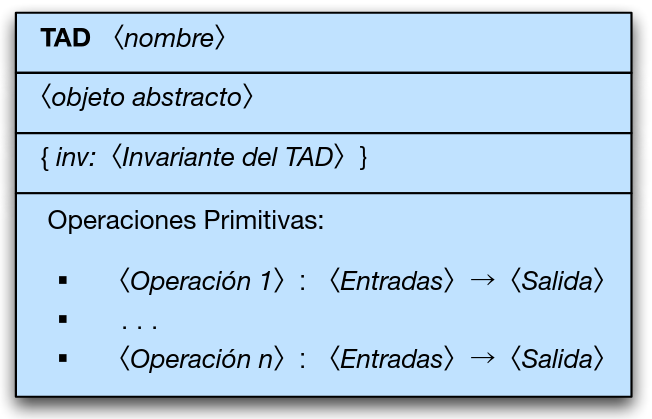

## ¿Cuáles son los elementos de esta especificación formal?

:::{dropdown} Elementos
- Nombre
  - Único y que lo identifique plenamente.
- Objeto abstracto.
  - Representado de manera matemática o gráfica.
  - Pueda usarse para referenciarse en formalismos y notaciones de operaciones.
- Invariante
  - Serie de condiciones que no varían nunca al interior del TAD.
:::

:::{dropdown} Listado de operaciones
- Aquellas operaciones que pueden realizarse con los objetos del tipo del TAD.
- Se especifican con las entradas a ellas y la salida que retornará el proceso.
- Adicionalmente, para cada una de las operaciones se debe escribir su comportamiento a manera de aserciones.
  - Una para mostrar qué se debe cumplir antes de ejecutar la operación (precondición).
  - Otra para decir cómo queda el sistema después de terminar el proceso (postcondición).
:::

---

### ¿Cuáles son los elementos de esta especificación formal?

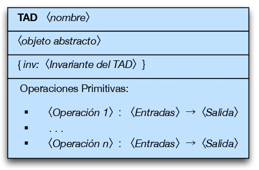

- **Nombre**
  - Único y que lo identifique plenamente.
- **Objeto abstracto**
  - Representado de manera matemática o gráfica.
  - Puede usarse para referenciarse en formalismos y notaciones de operaciones.
- **Invariante**
  - Serie de condiciones que no varían nunca al interior del TAD.

### Listado de operaciones

- Aquellas operaciones que pueden realizarse con los objetos del tipo del TAD.
- Se especifican con las entradas y la salida que retornará el proceso.
- Adicionalmente, para cada una de las operaciones se debe escribir su comportamiento a manera de aserciones.
  - **Precondición**: lo que se debe cumplir antes de ejecutar la operación.
  - **Poscondición**: cómo queda el sistema después de terminar el proceso.

---

## ¿Cómo se describen formalmente las operaciones?

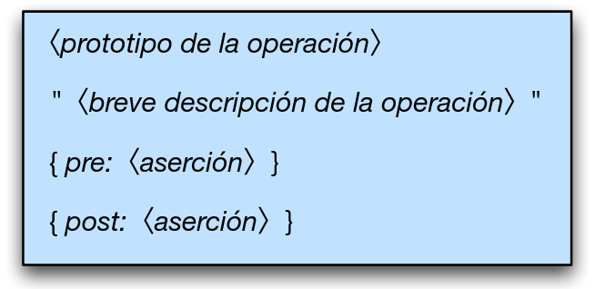

---

### ¿Cómo se describen formalmente las operaciones?

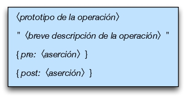

---

## ¿Por qué han de definirse formalmente las precondiciones y poscondiciones?

:::{dropdown} Razones
- El formalismo describe el propósito de la operación sin lugar a ambigüedades y con mucha exactitud.
- La formalidad acerca el diseño a la implementación (entre más formal sea el diseño del TAD más fácil será concretizarlo en algún lenguaje de programación).
:::

---

### ¿Por qué las precondiciones y poscondiciones deben definirse formalmente?

- El formalismo describe el propósito de la operación sin ambigüedades y con exactitud.
- La formalidad acerca el diseño a la implementación (entre más formal sea el diseño del TAD, más fácil será concretizarlo en un lenguaje de programación).

---

## Ejemplo: TAD Empleado

- Suponga que una compañía tiene la información de Nombre, Foto, Documento de identidad, Cargo y Salario por cada empleado.
- Si se quisiera almacenar estos datos sería desastroso usar una variable por cada dato o empleado.
- Una forma eficiente es crear un tipo de dato Empleado para guardar la información.
- El objeto abstracto de este nuevo tipo de dato podría verse como un carné donde se encuentran la información del empleado.
- La invariante del TAD es una propiedad que hace respetar la ley que dice que ninguna persona puede ganarse un salario menor al salario mínimo mensual vigente reglamentado por el gobierno.

---

### Ejemplo: TAD Empleado

- Una compañía tiene la información de Nombre, Foto, Documento de identidad, Cargo y Salario por cada empleado.
- Usar una variable por cada dato o empleado sería ineficiente.
- Una forma eficiente es crear un **tipo de dato Empleado** para guardar la información.
- El objeto abstracto de este nuevo tipo de dato podría verse como un carné donde se encuentra la información del empleado.
- La **invariante del TAD** es una propiedad que hace respetar la ley de que ninguna persona puede ganar un salario menor al salario mínimo mensual vigente.

---

## Primera aproximación al TAD Empleado

¿Cuál sería la primera aproximación al TAD Empleado?

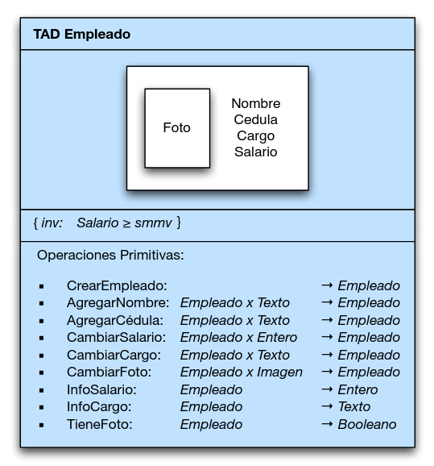

---

### Primera aproximación al TAD Empleado

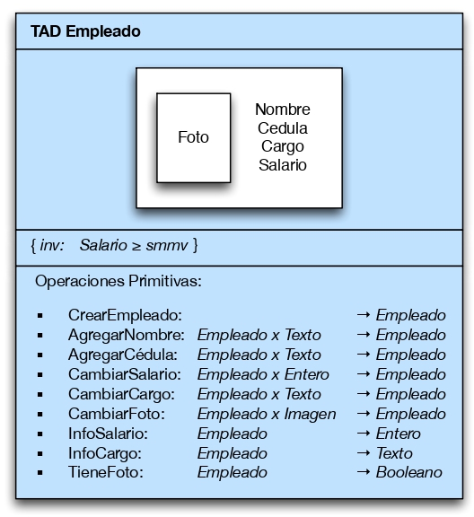

---

### Operaciones formales de la primera aproximación

¿Cómo se describe formalmente la operación CrearEmpleado?

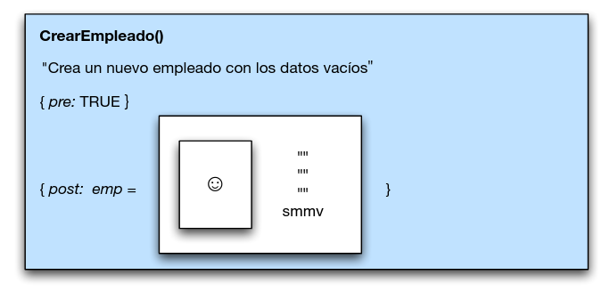

¿Cómo se describe formalmente la operación AgregarNombre?

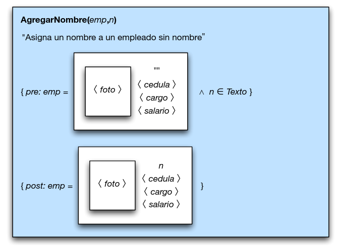

¿Cómo se describe formalmente la operación AgregarCedula?

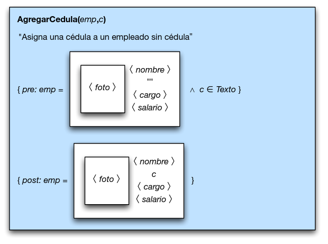

¿Cómo se describe formalmente la operación CambiarSalario?

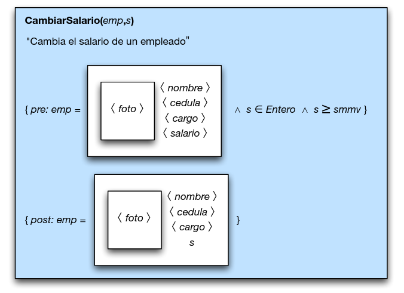

¿Cómo se describe formalmente la operación CambiarCargo?

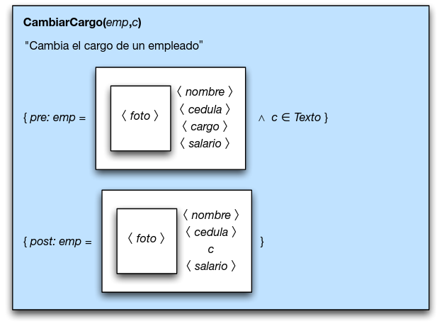

¿Cómo se describe formalmente la operación CambiarFoto?

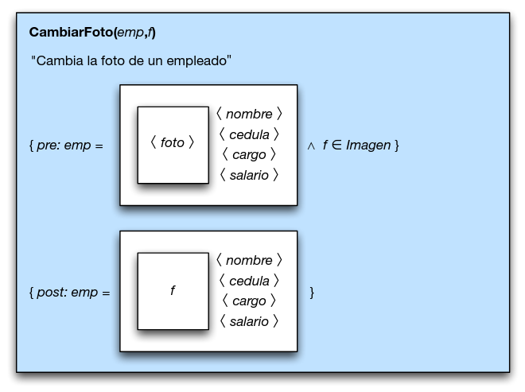

¿Cómo se describe formalmente la operación InfoSalario?

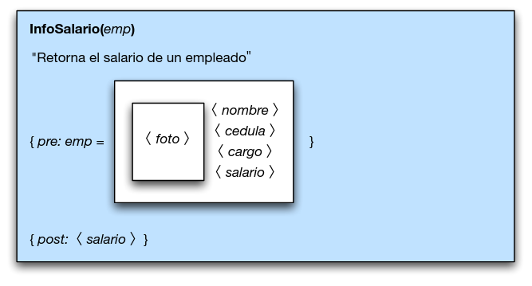

¿Cómo se describe formalmente la operación InfoCargo?

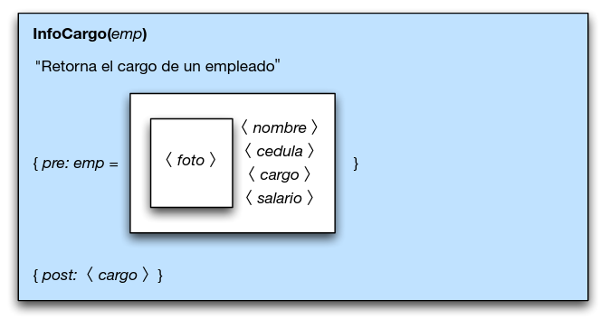

¿Cómo se describe formalmente la operación TieneFoto?

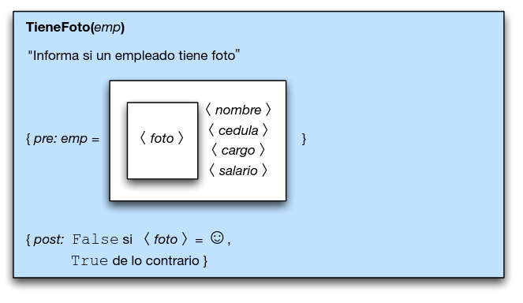

---

### Operaciones formales de la primera aproximación

Las operaciones formales de esta primera aproximación son: **CrearEmpleado**, **AgregarNombre**, **AgregarCedula**, **CambiarSalario**, **CambiarCargo**, **CambiarFoto**, **InfoSalario**, **InfoCargo** y **TieneFoto**. Su especificación formal (prototipo, precondición y poscondición) coincide con la mostrada en la sección principal.

---

## ¿Cuál es el problema con la primera aproximación que dimos al TAD Empleado?

:::{dropdown} Problema
- Debido a que el objeto abstracto es una imagen, resulta de cierta manera incómoda su traducción a un lenguaje de programación en el momento de ser implementado el TAD.
- Al definir el objeto abstracto como una tupla, su traducción a la mayoría de lenguajes de programación sería más directa.
:::

---

### Problema con la primera aproximación al TAD Empleado

- Debido a que el objeto abstracto es una imagen, resulta incómoda su traducción a un lenguaje de programación.
- Al definir el objeto abstracto como una **tupla**, su traducción a la mayoría de lenguajes de programación sería más directa.

---

## Segunda aproximación al TAD Empleado

¿Cuál sería la segunda aproximación al TAD Empleado?

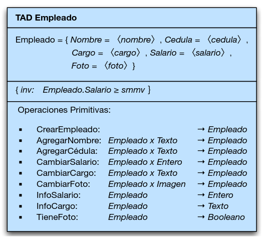

---

### Segunda aproximación al TAD Empleado

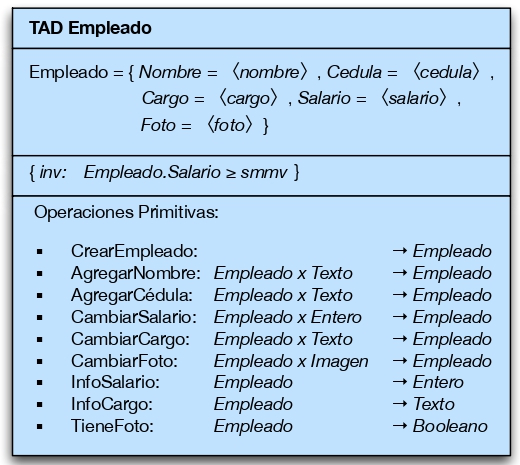

---

### Operaciones formales de la segunda aproximación

¿Cómo se describe formalmente la operación CrearEmpleado?

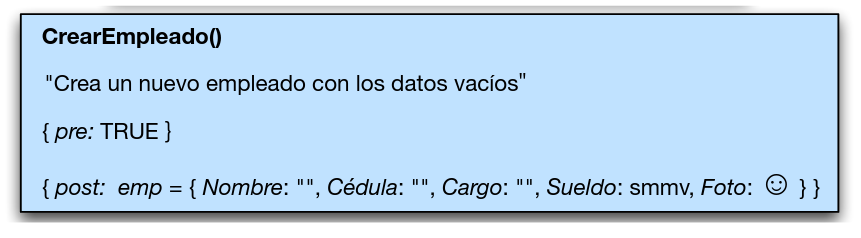

¿Cómo se describe formalmente la operación AgregarNombre?

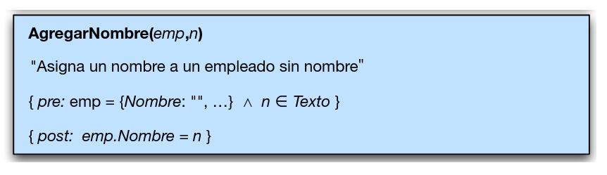

¿Cómo se describe formalmente la operación AgregarCedula?

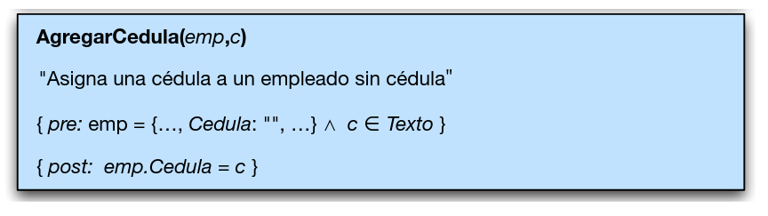

¿Cómo se describe formalmente la operación CambiarSalario?

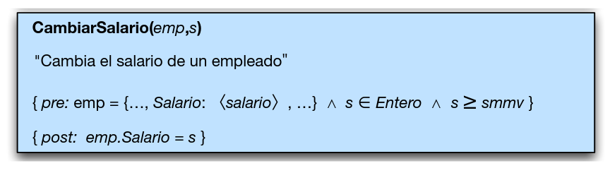

¿Cómo se describe formalmente la operación CambiarCargo?

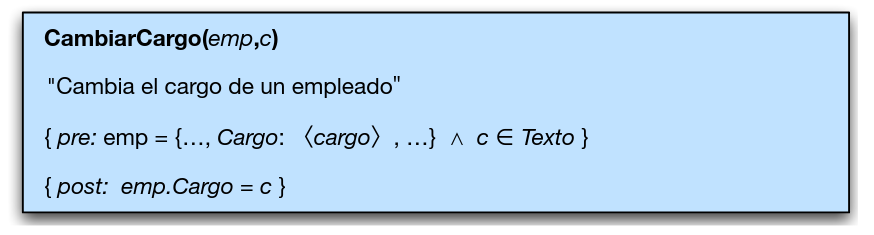

¿Cómo se describe formalmente la operación CambiarFoto?

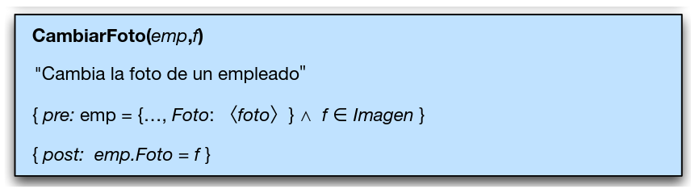

¿Cómo se describe formalmente la operación InfoSalario?

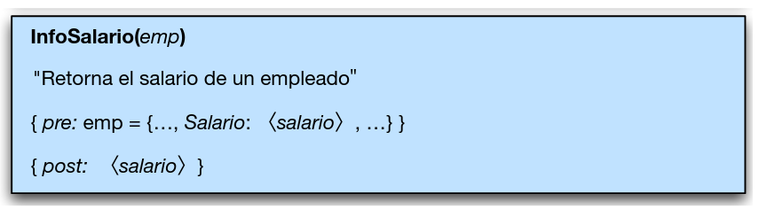

¿Cómo se describe formalmente la operación InfoCargo?

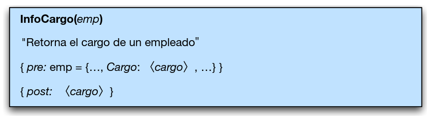

¿Cómo se describe formalmente la operación TieneFoto?

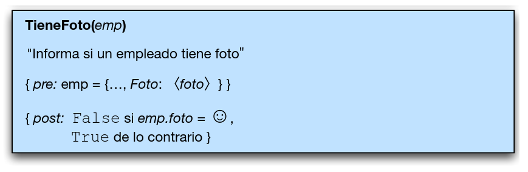

---

### Operaciones formales de la segunda aproximación

Al representar el objeto abstracto como una tupla, la traducción de cada operación a Java (constructor, *setters*, *getters*) es directa: **CrearEmpleado**, **AgregarNombre**, **AgregarCedula**, **CambiarSalario**, **CambiarCargo**, **CambiarFoto**, **InfoSalario**, **InfoCargo** y **TieneFoto** conservan la misma especificación de precondición/poscondición mostrada en la sección principal, ahora sobre los campos de la tupla `Empleado`.

---

## ¿En qué se dividen las operaciones primitivas de un TAD?

:::{dropdown} Clasificación
- Principales
  - Constructoras
  - Modificadoras
  - Analizadoras
- Secundarias
  - Destructoras
  - Persistencia
:::

---

### ¿En qué se dividen las operaciones primitivas de un TAD?

- **Principales**
  - Constructoras
  - Modificadoras
  - Analizadoras
- **Secundarias**
  - Destructoras
  - Persistencia

---

Continúa con los [ejercicios de TAD](exercises.md).

*Material adaptado del material original de los profesores Andrés Aristizábal y Marlon Gomez.*
