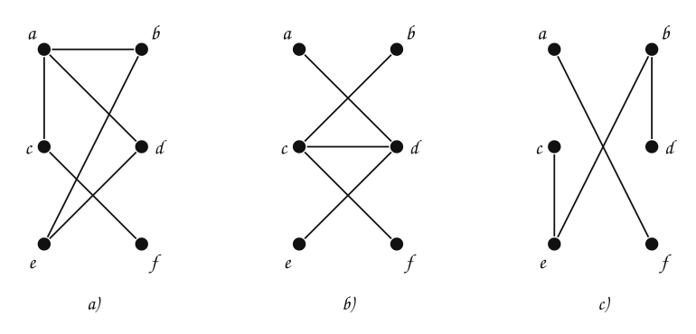
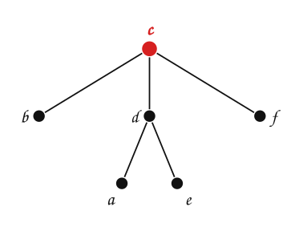
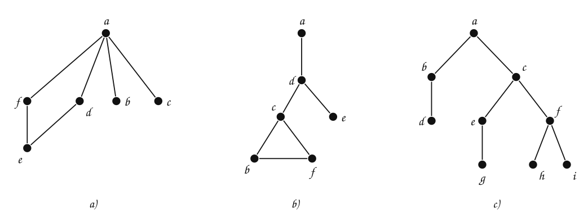
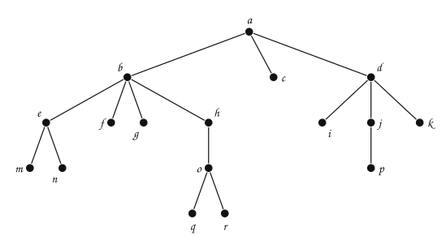
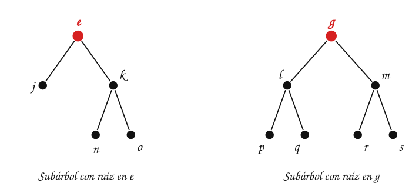

---
# Copyright (c) 2026 Angela Villota, and collaborators from the CyED block
# Licensed under the PolyForm Noncommercial License 1.0.0.
# Commercial use is prohibited without prior written authorization.
title: "Árboles: Ejercicios"
---

# Árboles: Ejercicios

Use esta página después de leer el [material de estudio de árboles](index.md). Cada ejercicio trae **pistas** y una **solución general**; intente resolverlo antes de abrirlas.

---

### Ejercicio 1

Indique cuáles de los siguientes grafos son árboles. Para los que lo sean, dibújelos como árbol con raíz en algún vértice.

:::{admonition} Pistas
:class: dropdown
- Revise las dos condiciones por separado: ¿es conexo?, ¿tiene circuitos?
- Cuente: con $6$ vértices, un árbol tiene exactamente $5$ aristas.
:::

:::{admonition} Solución general
:class: dropdown
- a) **No** es árbol: tiene el circuito $a \to d \to e \to b \to a$.
- b) **Es** un árbol. Con raíz en $c$:

- c) **No** es árbol: no es conexo (tiene $4$ aristas y $6$ vértices; no hay camino de $a$ a $b$).
:::

### Ejercicio 2

Indique cuáles de los siguientes grafos son árboles.

:::{admonition} Pistas
:class: dropdown
- En los dos primeros, busque un camino que vuelva al vértice de partida sin repetir aristas.
:::

:::{admonition} Solución general
:class: dropdown
- a) **No**: circuito $a \to f \to e \to d \to a$.
- b) **No**: circuito $c \to b \to f \to c$.
- c) **Sí**: es un árbol con raíz en $a$.
:::

### Ejercicio 3

Dado el siguiente árbol, indique:

- La raíz del árbol
- El padre de $i$
- Los hijos de $b$
- Las hojas del árbol
- La profundidad de $n$
- La profundidad de $a$
- La aridad de $j$
- La aridad de $a$

:::{admonition} Pistas
:class: dropdown
- La profundidad es la longitud del camino desde la raíz: la raíz tiene profundidad $0$.
- La aridad es el número de hijos; una hoja tiene aridad $0$.
:::

:::{admonition} Solución general
:class: dropdown
Raíz $a$; padre de $i$: $d$; hijos de $b$: $e$, $f$; hojas: $k$, $m$, $f$, $g$, $h$, $i$, $n$; profundidad de $n$: $3$; profundidad de $a$: $0$; aridad de $j$: $1$; aridad de $a$: $3$.
:::

### Ejercicio 4

Dado el siguiente árbol, indique:

- El padre de $g$
- Los hijos de $d$
- Las hojas del árbol
- La profundidad de $r$
- La profundidad de $p$
- La aridad de $b$
- La aridad de $p$
- La altura y el peso del árbol

:::{admonition} Pistas
:class: dropdown
- $c$ no tiene hijos: también es hoja, aunque esté arriba.
- La altura se cuenta en nodos: longitud de la rama más larga más $1$.
:::

:::{admonition} Solución general
:class: dropdown
Padre de $g$: $b$; hijos de $d$: $i$, $j$, $k$; hojas: $m$, $n$, $f$, $g$, $q$, $r$, $c$, $i$, $p$, $k$; profundidad de $r$: $4$; profundidad de $p$: $3$; aridad de $b$: $4$; aridad de $p$: $0$. La rama más larga es $\langle a, b, h, o, q \rangle$: altura $5$. Peso: $17$.
:::

### Ejercicio 5

Indique cuáles de los siguientes árboles son $n$-arios completos y cuáles $n$-arios (con el menor $n$ posible):

:::{admonition} Pistas
:class: dropdown
- Encuentre la mayor aridad: ese es el $n$.
- Después revise si **todos** los nodos internos tienen exactamente esa aridad.
:::

:::{admonition} Solución general
:class: dropdown
- a) **Binario**, no completo: hay un nodo interno con un solo hijo.
- b) **$3$-ario completo**: los cuatro nodos internos tienen $3$ hijos.
- c) **$5$-ario completo**: los tres nodos internos tienen $5$ hijos.
- d) **$4$-ario**, no completo: hay nodos internos con $2$ y $3$ hijos.
:::

### Ejercicio 6

Para el árbol $T$ de la pregunta de la sección 4 del material de estudio (el de raíz $a$ con hijos $b$ y $c$), dibuje el subárbol con raíz en $e$ y el subárbol con raíz en $g$. ¿Cuántas hojas tiene cada uno?

:::{admonition} Pistas
:class: dropdown
- El subárbol con raíz en $v$ tiene a $v$ y a **todos** sus descendientes, no solo a sus hijos.
:::

:::{admonition} Solución general
:class: dropdown

El subárbol con raíz en $e$ tiene $3$ hojas ($j$, $n$, $o$) y el de raíz en $g$ tiene $4$ ($p$, $q$, $r$, $s$).
:::

### Ejercicio 7

Siga el árbol de decisión para ordenar tres elementos con $a = 3$, $b = 2$, $c = 5$. Luego con $a = 9$, $b = 4$, $c = 1$. ¿Cuántas comparaciones hace en cada caso?

:::{admonition} Pistas
:class: dropdown
- En cada nodo se compara y se baja por la rama que corresponde a la respuesta.
:::

:::{admonition} Solución general
:class: dropdown
- $a = 3, b = 2, c = 5$: $a > b$, luego $a < c$: hoja $c > a > b$. Dos comparaciones: el orden es $b, a, c$.
- $a = 9, b = 4, c = 1$: $a > b$, $a > c$, $b > c$: hoja $a > b > c$. Tres comparaciones: el orden es $c, b, a$.
:::

### Ejercicio 8

Use el árbol de decisión del golf para decidir si se juega en cada uno de estos días. Luego verifique con la tabla de ejemplos.

- Lluvioso, temperatura media, humedad alta, con viento.
- Nublado, temperatura alta, humedad normal, sin viento.
- Soleado, temperatura baja, humedad alta, sin viento.

:::{admonition} Pistas
:class: dropdown
- La primera pregunta del árbol es el ambiente. Algunas variables (la temperatura) no aparecen en el árbol.
:::

:::{admonition} Solución general
:class: dropdown
- Lluvioso, con viento: **N**. La tabla tiene «lluvia, media, alta, sí, N».
- Nublado: **P** sin preguntar más. La tabla tiene «nublado, alta, normal, no, P».
- Soleado, humedad alta: **N**. La tabla no tiene ese día exacto; el árbol generaliza los ejemplos.
:::

### Ejercicio 9

Un torneo de tenis por eliminación directa empieza con $64$ jugadores. Cada partido es un nodo interno de un árbol binario completo cuyas hojas son los jugadores. ¿Cuántos partidos se juegan? ¿Cuántas rondas? Haga lo mismo para un torneo en que cada partido es entre $3$ jugadores y empieza con $81$.

:::{admonition} Pistas
:class: dropdown
- Use $n = m \cdot i + 1$ y que $n = i + \text{hojas}$.
- Cada ronda es un nivel del árbol.
:::

:::{admonition} Solución general
:class: dropdown
Con $m = 2$: $i + 64 = 2i + 1$, así que $i = 63$ partidos; $64 = 2^6$, así que $6$ rondas. Con $m = 3$: $i + 81 = 3i + 1$, así que $i = 40$ partidos; $81 = 3^4$, así que $4$ rondas.
:::

### Ejercicio 10

Escriba en pseudocódigo, en dos niveles, los algoritmos `NIVEL(T, e)` (la profundidad del elemento $e$, o $-1$ si no está) y `LISTA-HOJAS(T)` (la lista de las hojas). Indique cuál de los dos patrones sigue cada uno.

:::{admonition} Pistas
:class: dropdown
- `NIVEL` puede pasar el nivel actual como parámetro del algoritmo del segundo nivel.
- `LISTA-HOJAS` acumula en una lista que se pasa como parámetro.
:::

:::{admonition} Solución general
:class: dropdown
`NIVEL`: descenso recursivo. Se baja por los hijos con $nivel + 1$ y se retorna apenas se encuentra. `LISTA-HOJAS`: recorrido total. Cada hoja se agrega a la lista y cada nodo interno delega en todos sus hijos. Con el árbol de la sección 4 del material de estudio, `NIVEL(T, r)` es $4$ y `LISTA-HOJAS(T)` devuelve sus $10$ hojas.
:::

### Ejercicio 11

Implemente un árbol $n$-ario genérico con las operaciones buscar, peso, número de hojas, altura, insertar un elemento dado su padre y eliminar un elemento (solo si es hoja). Pruébelo con los árboles de los Ejercicios 3 y 4.

---

*Material adaptado del material original de los profesores Oscar Bedoya y Andrés Aristizábal.*
