---
# Copyright (c) 2026 Angela Villota, and collaborators from the CyED block
# Licensed under the PolyForm Noncommercial License 1.0.0.
# Commercial use is prohibited without prior written authorization.
title: "Unidad 4: Árboles"
---

# Unidad 4: Árboles

## 1. El problema

Hay $6$ ciudades y se quiere tender cable para que **todas se puedan comunicar**, directamente o pasando por otras. **¿Cuál es el menor número de cables necesario? ¿Qué forma tiene la red?**

Pruebe con $3$ y con $4$ ciudades antes de seguir.

:::{admonition} Respuesta
:class: dropdown
Hacen falta $n - 1$ cables: $5$ para $6$ ciudades. Con menos, alguna ciudad queda aislada. Con exactamente $n - 1$ cables y todo comunicado, la red **no tiene circuitos**: si tuviera uno, se podría quitar un cable del circuito y todo seguiría comunicado, así que no sería el mínimo.

Una red conexa y sin circuitos es un **árbol**.
:::

## 2. Árbol

**Árbol.** Un árbol es un grafo **conexo** que **no tiene circuitos**.

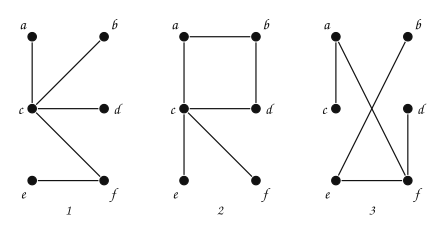

> **¿Por qué el segundo no es un árbol?**

:::{admonition} Respuesta
:class: dropdown
Tiene el circuito $a \to b \to d \to c \to a$:

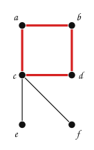

El primero y el tercero son conexos y no tienen circuitos. En el tercero las aristas $\{a, f\}$ y $\{b, e\}$ se cruzan en el dibujo, pero un cruce no es un vértice: no forma circuito.
:::

Dos hechos que se usan todo el tiempo:

- Entre cada par de vértices de un árbol hay **un único** camino simple.
- Un árbol con $n$ vértices tiene exactamente $n - 1$ aristas.

### Árbol con raíz

En un árbol se puede escoger un vértice como **raíz** y dibujar el árbol colgando de él. El mismo árbol da dibujos distintos según la raíz:

:::::{admonition} El mismo árbol con raíces distintas
::::{tab-set}
:::{tab-item} Paso 1
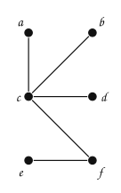

> Un árbol: conexo y sin circuitos.

:::
:::{tab-item} Paso 2
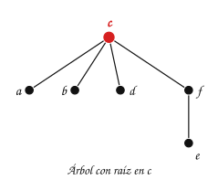

> Se escoge $c$ como raíz: se toma $c$ y se dejan colgar los demás vértices, cada uno debajo del vértice por el que se llega a él desde $c$.

:::
:::{tab-item} Paso 3
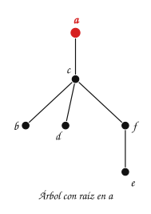

> Se escoge $a$ como raíz: se toma $a$ y se dejan colgar los demás vértices, cada uno debajo del vértice por el que se llega a él desde $a$.

:::
:::{tab-item} Paso 4
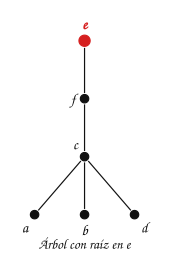

> Se escoge $e$ como raíz: se toma $e$ y se dejan colgar los demás vértices, cada uno debajo del vértice por el que se llega a él desde $e$.

:::
::::
:::::

Desde aquí, «árbol» quiere decir árbol con raíz, dibujado con la raíz arriba.

## 3. El árbol $n$-ario: una estructura recursiva

**Árbol $n$-ario.** Es una estructura **recursiva** en la que cada elemento puede tener **cualquier número** de subárboles $n$-arios asociados. Generaliza al árbol binario.

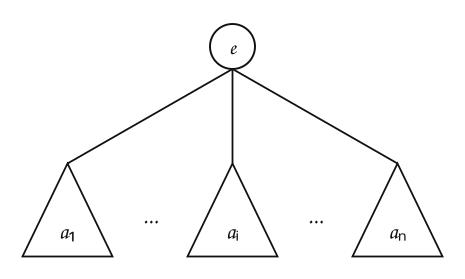

En un árbol $n$-ario el orden de los subárboles **no importa**: no hace falta saber cuál es el primero o el último, solo que es un subárbol.

## 4. Terminología

Los términos se leen sobre este árbol:

:::::{admonition} Terminología sobre un árbol
::::{tab-set}
:::{tab-item} Paso 1
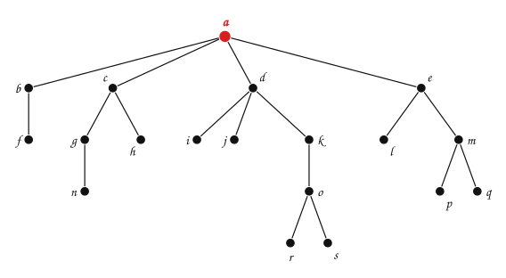

> $a$ es la **raíz** del árbol: el nodo inicial, el único sin padre.

:::
:::{tab-item} Paso 2
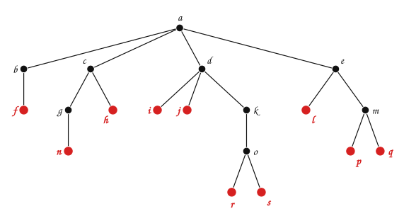

> $f$, $n$, $h$, $i$, $j$, $r$, $s$, $l$, $p$, $q$ son las **hojas** del árbol: no tienen hijos.

:::
:::{tab-item} Paso 3
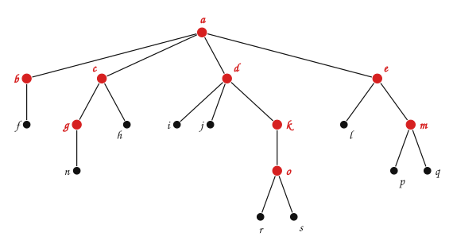

> $b$, $g$, $c$, $o$, $k$, $d$, $m$, $e$, $a$ son los **nodos internos**: tienen al menos un hijo.

:::
:::{tab-item} Paso 4
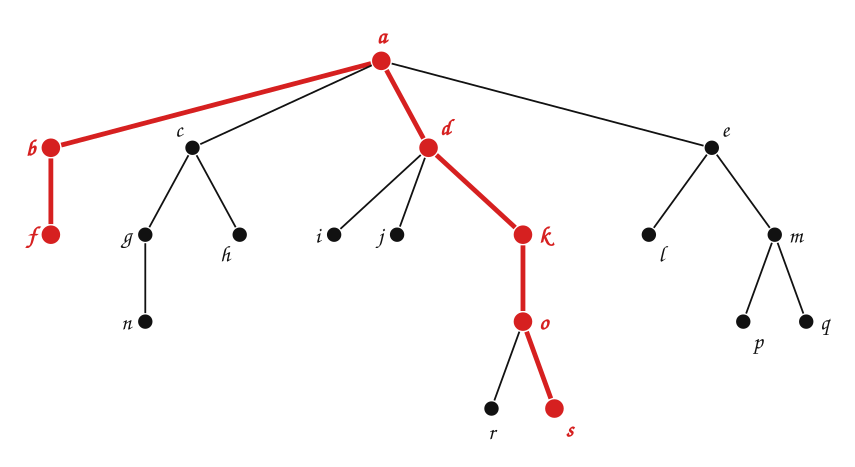

> Un camino desde la raíz hasta una hoja es una **rama**: $a \to b \to f$ y $a \to d \to k \to o \to s$ son dos de las $10$ ramas.

:::
:::{tab-item} Paso 5
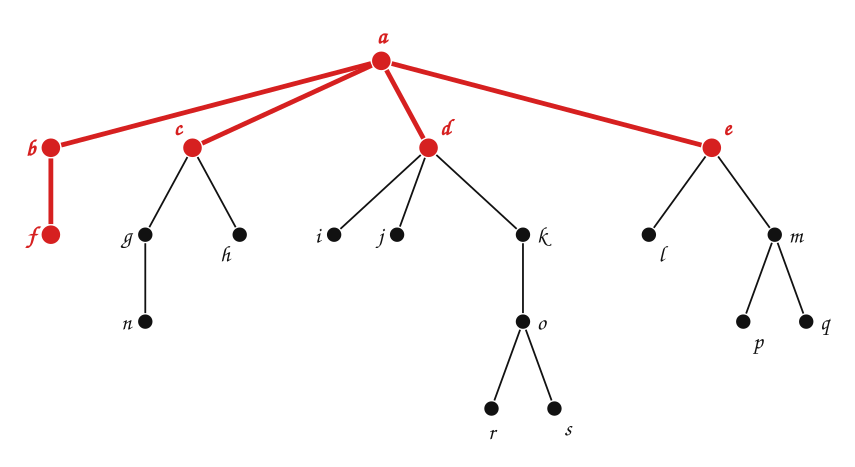

> $a$ es el **padre** de $b, c, d, e$, y $b$ es el padre de $f$. $b, c, d, e$ son los **hijos** de $a$ (sus descendientes directos); $f$ es el hijo de $b$.

:::
:::{tab-item} Paso 6
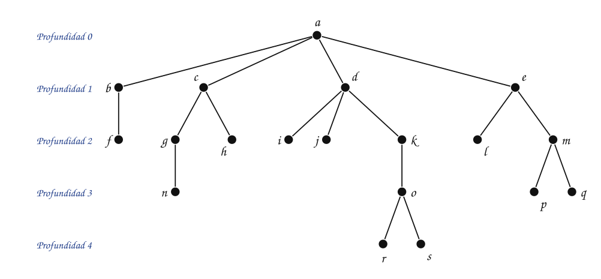

> La **profundidad** de un nodo es la longitud del camino desde la raíz: $a$ tiene profundidad $0$; $b, c, d, e$, profundidad $1$; $o$, profundidad $3$; $r$ y $s$, profundidad $4$.

:::
:::{tab-item} Paso 7
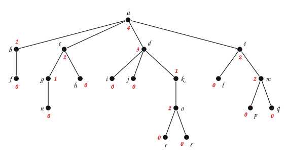

> Cada nodo tiene una **aridad** u **orden**: la cantidad de hijos. La de $a$ es $4$, la de $d$ es $3$, la de $g$ es $1$ y la de cualquier hoja es $0$.

:::
::::
:::::

En resumen:

| Término | Significado | En el árbol |
|---|---|---|
| **nodo** | elemento del árbol | $a, b, \dots, s$ |
| **raíz** | nodo inicial del árbol; no tiene padre | $a$ |
| **hoja** | nodo sin hijos | $f$, $n$, $h$, $i$, $j$, $r$, $s$, $l$, $p$, $q$ |
| **nodo interno** | nodo con al menos un hijo | $a$, $b$, $c$, $g$, $d$, $k$, $o$, $e$, $m$ |
| **padre** de $v$ | el nodo justo encima de $v$ | el padre de $f$ es $b$ |
| **hijos** de $v$ | los nodos justo debajo de $v$ | los hijos de $a$ son $b, c, d, e$ |
| **camino** de $E_1$ a $E_2$ | secuencia $\langle N_1, \dots, N_k \rangle$ con $N_1 = E_1$, $N_k = E_2$ y $N_i$ padre de $N_{i+1}$ | $\langle a, d, k \rangle$ |
| **longitud** de un camino | número de elementos de la secuencia menos $1$ | la de $\langle a, d, k \rangle$ es $2$ |
| **ancestro** / **descendiente** | si hay camino de $E_1$ a $E_2$, $E_1$ es ancestro de $E_2$ y $E_2$ es descendiente de $E_1$ | $d$ es ancestro de $r$ |
| **rama** | camino de la raíz a una hoja | $\langle a, d, k, o, s \rangle$ |
| **profundidad** (nivel) de $v$ | longitud del camino de la raíz a $v$ | la de $k$ es $2$ |
| **aridad** u **orden** de $v$ | número de hijos (subárboles) de $v$ | la de $d$ es $3$; una hoja tiene orden $0$ |
| **orden del árbol** | el mayor orden de sus elementos | $4$ |
| **altura** | longitud de la rama más larga, más $1$ | $5$ |
| **peso** | número de nodos del árbol | $19$ |

Un camino no siempre existe entre dos elementos: de $b$ a $d$ no hay camino, porque $b$ no es ancestro de $d$. Como cada hoja es el final de exactamente una rama, un árbol tiene **tantas ramas como hojas**.

Dado el siguiente árbol, indique:


- La raíz del árbol
- El padre de $e$
- Los hijos de $g$
- Las hojas del árbol
- La profundidad de $m$
- La profundidad de $b$
- La aridad de $c$
- La aridad de $j$

:::{admonition} Respuesta
:class: dropdown
- La raíz del árbol: $a$
- El padre de $e$: $b$
- Los hijos de $g$: $l$, $m$
- Las hojas del árbol: $h$, $i$, $j$, $n$, $o$, $f$, $p$, $q$, $r$, $s$
- La profundidad de $m$: $3$
- La profundidad de $b$: $1$
- La aridad de $c$: $2$
- La aridad de $j$: $0$
:::

## 5. Árboles $n$-arios y $n$-arios completos

> **¿Cuál es la aridad de los nodos internos de cada árbol?**

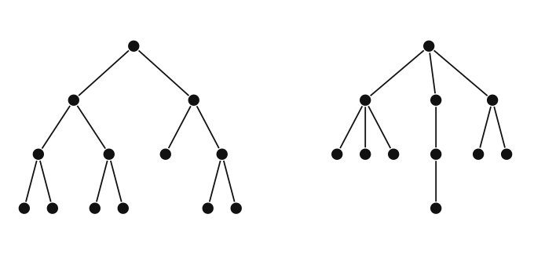

:::{admonition} Respuesta
:class: dropdown
En el de la izquierda **todos** los nodos internos tienen aridad $2$. En el de la derecha hay nodos internos de aridad $1$, $2$ y $3$.
:::

- **Árbol $n$-ario completo.** Cada nodo interno tiene **exactamente** $n$ hijos. El de la izquierda es $2$-ario completo.
- **Árbol $n$-ario.** Cada nodo interno tiene **a lo sumo** $n$ hijos. El de la derecha es $3$-ario. Un árbol $2$-ario se llama **binario**.

Indique cuáles de los siguientes árboles son $n$-arios completos y cuáles $n$-arios (con el menor $n$ posible):


:::{admonition} Respuesta
:class: dropdown
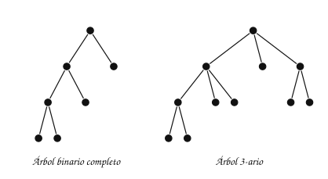

El primero es **binario completo**: sus tres nodos internos tienen $2$ hijos. El segundo es **$3$-ario**: la raíz y su primer hijo tienen $3$ hijos, pero hay nodos internos con $2$.
:::

### Contar nodos

Un árbol $m$-ario completo con $i$ nodos internos tiene $n = m \cdot i + 1$ nodos: cada nodo interno aporta $m$ hijos, y el único nodo que no es hijo de nadie es la raíz.

> **¿Cuántos nodos tiene un árbol $3$-ario completo con $4$ nodos internos? ¿Cuántas hojas?**

:::{admonition} Respuesta
:class: dropdown
$n = 3 \cdot 4 + 1 = 13$ nodos, de los cuales $13 - 4 = 9$ son hojas.
:::

## 6. Subárboles

**Subárbol.** Un nodo junto con todos sus descendientes. Sobre el árbol $T$ de la pregunta de la sección 4:

:::::{admonition} Subárboles de T
::::{tab-set}
:::{tab-item} Paso 1
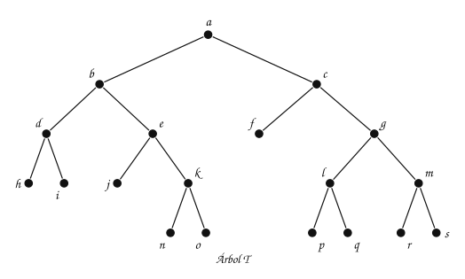

> El árbol $T$.

:::
:::{tab-item} Paso 2
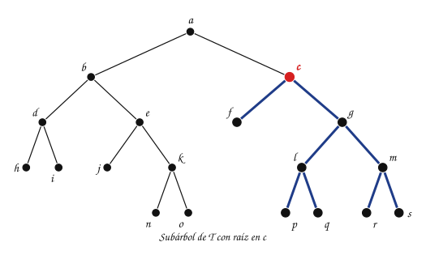

> El subárbol con raíz en $c$ tiene a $c$ y a todos sus descendientes: $c$, $f$, $g$, $l$, $p$, $q$, $m$, $r$, $s$.

:::
:::{tab-item} Paso 3
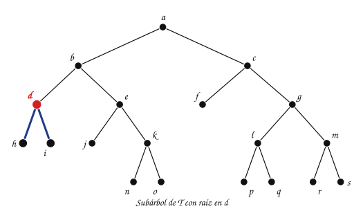

> El subárbol con raíz en $d$ tiene a $d$ y a todos sus descendientes: $d$, $h$, $i$. Es un subárbol de un solo nivel: $d$ y sus dos hojas.

:::
:::{tab-item} Paso 4
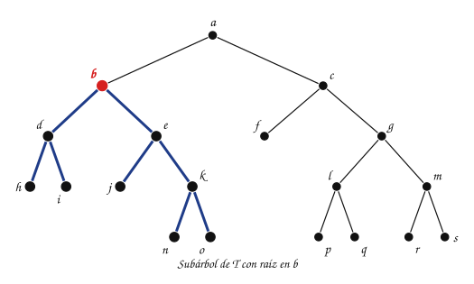

> El subárbol con raíz en $b$ tiene a $b$ y a todos sus descendientes: $b$, $d$, $h$, $i$, $e$, $j$, $k$, $n$, $o$.

:::
::::
:::::

## 7. Aplicaciones de los árboles

- **Árboles de juego**: modelan las jugadas de cada jugador en un juego con adversario. Se estudian en [Recorridos en espacios de estados y juegos](../../Unidad5-Grafos/BusquedaEspacioEstados/index.md).
- **Árboles binarios de búsqueda**: guardan llaves ordenadas para buscarlas rápido. Se estudian en [Árboles binarios ordenados y de búsqueda](../ArbolesBinariosBusqueda/index.md).
- **Árboles de decisión**: se ven a continuación.

### Árboles de decisión

**Árbol de decisión.** Un árbol en cuyos vértices hay **comparaciones** y en cuyas hojas hay **decisiones** sobre un problema particular.

Árbol de decisión para ordenar tres elementos $a$, $b$ y $c$:


Se sigue con $a = 1$, $b = 7$, $c = 5$:

:::::{admonition} a = 1, b = 7, c = 5
:class: dropdown
::::{tab-set}
:::{tab-item} Paso 1
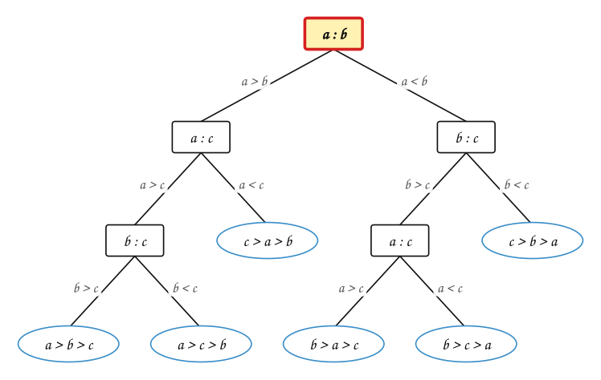

> Se compara $a$ con $b$: $1 < 7$, se baja por la rama $a < b$.

:::
:::{tab-item} Paso 2
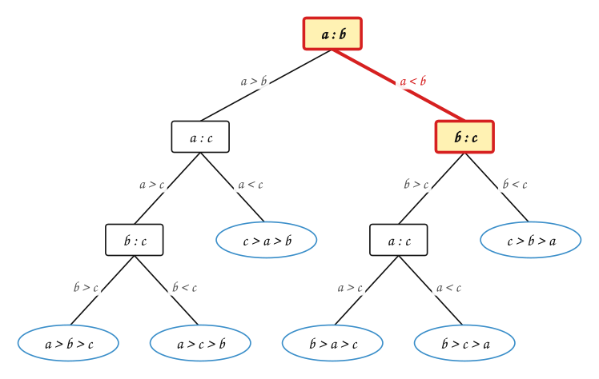

> Se compara $b$ con $c$: $7 > 5$, se baja por la rama $b > c$.

:::
:::{tab-item} Paso 3
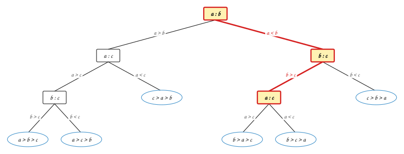

> Se compara $a$ con $c$: $1 < 5$, se baja por la rama $a < c$.

:::
:::{tab-item} Paso 4
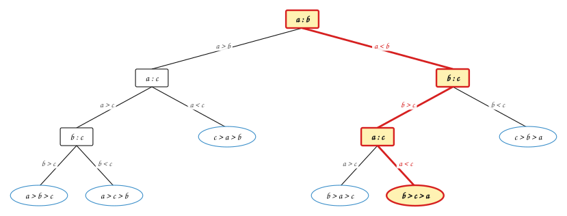

> Se llega a la hoja $b > c > a$: el orden es $a, c, b$ $(1, 5, 7)$. Hicieron falta $3$ comparaciones.

:::
::::
:::::

> **¿Cuántas comparaciones hacen falta, en el peor caso, para ordenar $3$ elementos?**

:::{admonition} Respuesta
:class: dropdown
$3$: es la rama más larga del árbol. Ningún árbol de decisión puede hacerlo con $2$: hay $3! = 6$ órdenes posibles, cada uno tiene que ser una hoja distinta, y con $2$ comparaciones solo se llega a $2^2 = 4$ hojas.
:::

Los árboles de decisión también se construyen a partir de ejemplos. Con esta tabla de días en que se jugó ($P$) o no se jugó ($N$) golf:

| Ambiente | Temp. | Humedad | Viento | Clase |
|---|---|---|---|---|
| soleado | alta | alta | no | N |
| soleado | alta | alta | sí | N |
| nublado | alta | alta | no | P |
| lluvia | media | alta | no | P |
| lluvia | baja | normal | no | P |
| lluvia | baja | normal | sí | N |
| nublado | baja | normal | sí | P |
| soleado | media | alta | no | N |
| soleado | baja | normal | no | P |
| lluvia | media | normal | no | P |
| soleado | media | normal | sí | P |
| nublado | media | alta | sí | P |
| nublado | alta | normal | no | P |
| lluvia | media | alta | sí | N |

se obtiene este árbol:

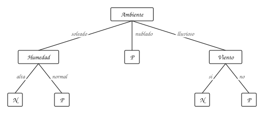

> **¿Se juega un día soleado, con humedad normal y con viento?**

:::{admonition} Respuesta
:class: dropdown
Ambiente soleado → se pregunta por la humedad → normal → $P$: **sí se juega**. Es lo que dice la fila «soleado, media, normal, sí» de la tabla.
:::

Árbol de decisión para aprobar un crédito en un banco:

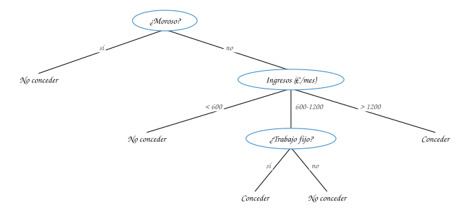

## 8. Algoritmos sobre árboles $n$-arios

Un árbol $n$-ario se guarda con dos estructuras: cada **nodo** tiene su elemento y la lista de sus hijos (sus subárboles), y el **árbol** tiene una referencia a la raíz, que puede ser vacía.

Cada algoritmo se escribe en **dos niveles**:

1. **Primer nivel** (el árbol): trata el caso del árbol vacío y delega la responsabilidad en la raíz.
2. **Segundo nivel** (el nodo): el planteamiento recursivo. Hay $n$ avances posibles en la recursión, uno por subárbol, así que hace falta un **ciclo** sobre los hijos.

Para buscar un elemento:

```text
BUSCAR(T, e)                         // primer nivel
1  if raíz[T] = NIL
2      return NIL
3  return BUSCAR-NODO(raíz[T], e)

BUSCAR-NODO(x, e)                    // segundo nivel
1  if elem[x] = e
2      return x
3  for cada hijo h de x
4      r ← BUSCAR-NODO(h, e)
5      if r ≠ NIL
6          return r
7  return NIL
```

> **¿Qué cambia respecto a insertar y eliminar en un árbol binario ordenado?**

:::{admonition} Respuesta
:class: dropdown
En un árbol $n$-ario no hay un orden que diga dónde va un elemento. Para insertar o eliminar hay que indicar el **padre**: se busca el padre y se le agrega (o se le quita) el hijo. Y solo se puede eliminar una **hoja**: si se elimina un nodo con hijos, sus descendientes quedan sueltos.
:::

### Dos patrones

Casi todos los algoritmos sobre árboles $n$-arios siguen uno de dos patrones:

**Descenso recursivo.** Hay una o varias salidas de la recursión con solución directa. El ciclo avanza sobre los subárboles y puede **terminar antes**, cuando el problema ya está resuelto (en `BUSCAR-NODO`, al encontrar el elemento).

```text
if condición1
    solución directa 1
else if condición2
    solución directa 2
else
    inicializar las variables donde se acumula la respuesta
    for cada subárbol h, mientras el problema no esté resuelto
        avanzar la recursión sobre h
        acumular o componer la respuesta
```

**Recorrido total.** Se visita **cada** elemento del árbol haciendo una operación sobre él: primero se incluye la raíz y luego se recorre cada subárbol.

```text
incluir la raíz en el recorrido
for cada subárbol h
    recorrido total sobre h
```

Peso, número de hojas y altura siguen el mismo esquema: se calcula la respuesta de cada hijo y se acumula.

```text
PESO(x)                      HOJAS(x)                       ALTURA(x)
1  p ← 1                     1  if x no tiene hijos         1  m ← 0
2  for cada hijo h de x      2      return 1                2  for cada hijo h de x
3      p ← p + PESO(h)       3  k ← 0                       3      m ← max(m, ALTURA(h))
4  return p                  4  for cada hijo h de x        4  return m + 1
                             5      k ← k + HOJAS(h)
                             6  return k
```

Con el árbol de la sección 4: `PESO` da $19$, `HOJAS` da 10 y `ALTURA` da $5$, por la rama $\langle a, d, k, o, r \rangle$. Si se elimina la hoja $f$, el nodo $b$ se vuelve hoja: el número de hojas no cambia.

## Ejercicios

Practique con los [ejercicios de árboles](exercises.md).

## Fuentes

- Aristizábal, A. *Árboles $n$-arios* (definición, terminología, algoritmos en dos niveles, patrones). Computación y Estructuras Discretas I, Universidad Icesi, 2026.
- Bedoya, O. *Árboles* (definición, árbol con raíz, terminología, árboles $n$-arios, subárboles, árboles de decisión). Diapositivas del curso, Universidad del Valle.
- Vargas Forero, V. M. *Estructuras de datos: tipos de árboles*. Introducción a la Programación Orientada a Objetos, Universidad del Valle.
- Villalobos, J. A. *Patrones de algoritmo para árboles $n$-arios* (sección 4.5.6), tal como se cita en las diapositivas de A. Aristizábal.
- Rosen, K. H. *Discrete Mathematics and Its Applications*, 7.ª ed. McGraw-Hill, 2011. Secciones 11.1 y 11.2.

---

*Material adaptado del material original de los profesores Andrés Aristizábal y Oscar Bedoya.*
