---
# Copyright (c) 2026 Angela Villota, and collaborators from the CyED block
# Licensed under the PolyForm Noncommercial License 1.0.0.
# Commercial use is prohibited without prior written authorization.
title: "Unidad 4: Árboles"
---

# Unidad 4: Árboles

Las preguntas tienen la respuesta en un desplegable justo debajo. Intente responder antes de abrirlo.

## 1. El problema

Hay $7$ computadores y se quiere tender cable para que **todos se puedan comunicar** (directamente o pasando por otros). **¿Cuál es el menor número de cables necesario? ¿Qué forma tiene la red resultante?**

Pruebe con $3$, $4$ y $5$ computadores antes de seguir.

:::{admonition} Respuesta
:class: dropdown
Hacen falta $n - 1$ cables: $6$ para $7$ computadores. Con menos, algún computador queda aislado del resto. Con exactamente $n - 1$ cables y todos comunicados, la red **no tiene circuitos**: si hubiera uno, se podría quitar un cable del circuito y todo seguiría conectado, así que no sería el mínimo.

Una red conexa y sin circuitos es un **árbol**.
:::

## 2. Definición

**Árbol.** Un árbol es un grafo **conexo** que **no tiene circuitos** simples.

Indique cuáles de los siguientes grafos son árboles:

| | | | |
|---|---|---|---|
| 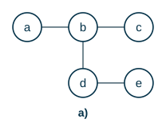 | 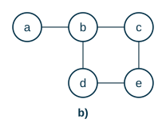 | 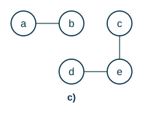 | 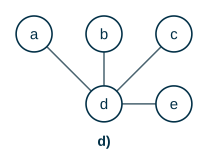 |

:::{admonition} Respuesta
:class: dropdown
- a) Es un árbol.
- b) No es árbol porque tiene el circuito $b \to c \to e \to d \to b$.

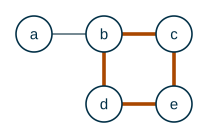

- c) No es árbol porque no es conexo (no hay camino de $a$ a $c$). Un grafo sin circuitos, conexo o no, se llama **bosque**: cada componente es un árbol.
- d) Es un árbol (una «estrella»).
:::

**Teorema.** Un grafo no dirigido es un árbol si y solo si entre cada par de vértices hay **un único** camino simple.

**Teorema.** Un árbol con $n$ vértices tiene exactamente $n - 1$ aristas.

### Árbol con raíz

En muchas aplicaciones se escoge un vértice como **raíz** y todas las aristas se orientan alejándose de ella. Un mismo árbol da árboles con raíz distintos según el vértice que se escoja:

| | | |
|---|---|---|
| 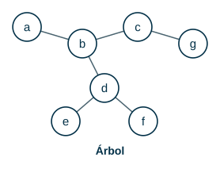 | 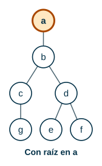 | 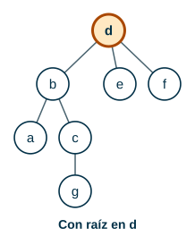 |

Se dibujan con la raíz arriba. En el resto de la unidad, «árbol» quiere decir árbol con raíz.

## 3. Terminología

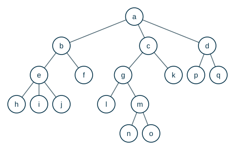

| Término | Significado | En el árbol |
|---|---|---|
| **raíz** | el único vértice sin padre | $a$ |
| **padre** de $v$ | el vértice inmediatamente arriba de $v$ | el padre de $e$ es $b$ |
| **hijos** de $v$ | los vértices inmediatamente abajo de $v$ | los hijos de $a$ son $b, c, d$ |
| **hermanos** | vértices con el mismo padre | $h, i, j$ |
| **ancestros** de $v$ | los vértices del camino de la raíz a $v$, sin $v$ | los de $n$ son $a, c, g, m$ |
| **descendientes** de $v$ | los vértices que tienen a $v$ como ancestro | los de $g$ son $l, m, n, o$ |
| **hoja** | vértice sin hijos | $h, i, j, \dots$ |
| **nodo interno** | vértice con al menos un hijo | $a, b, c, \dots$ |
| **profundidad** (nivel) de $v$ | longitud del camino de la raíz a $v$ | la de $a$ es $0$; la de $e$ es $2$ |
| **aridad** (orden) de $v$ | número de hijos de $v$ | la de $e$ es $3$; la de una hoja, $0$ |
| **altura** del árbol | número de nodos de la rama más larga (profundidad máxima $+ 1$) | 5 |

Algunos textos (por ejemplo Rosen) definen la altura como la profundidad máxima, sin sumar $1$. En este curso se cuenta en **nodos**, como en las diapositivas y en el código de la sección 7.

**Rama.** Un camino desde la raíz hasta una hoja. Por ejemplo $a \to c \to g \to m \to o$:

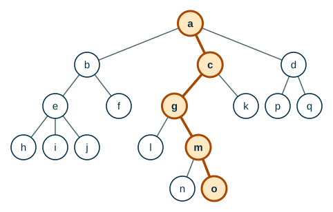

**Subárbol.** Un vértice junto con todos sus descendientes. El subárbol de $T$ con raíz en $c$:

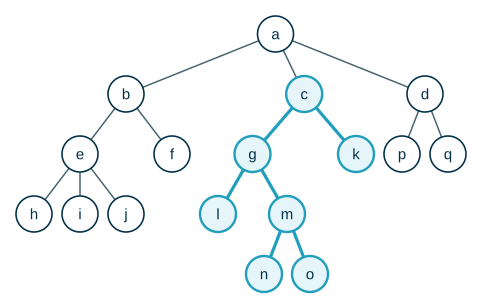

Dado el árbol de arriba, indique:

- La raíz del árbol
- El padre de $e$
- Los hijos de $g$
- Las hojas del árbol
- La profundidad de $m$
- La profundidad de $b$
- La aridad de $c$
- La aridad de $j$

:::{admonition} Respuesta
:class: dropdown
- La raíz del árbol: $a$
- El padre de $e$: b
- Los hijos de $g$: l, m
- Las hojas del árbol: h, i, j, f, l, n, o, k, p, q
- La profundidad de $m$: 3
- La profundidad de $b$: 1
- La aridad de $c$: 2
- La aridad de $j$: 0
:::

Ahora con otro árbol:

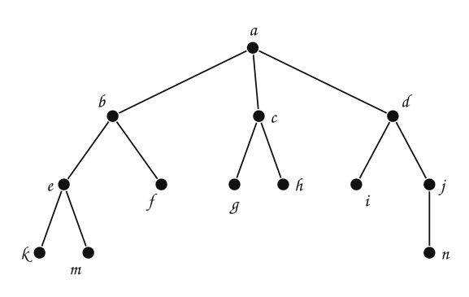

- El padre de $i$
- Los hijos de $b$
- Las hojas del árbol
- La profundidad de $n$
- La profundidad de $a$
- La aridad de $d$
- La altura del árbol

:::{admonition} Respuesta
:class: dropdown
- El padre de $i$: d
- Los hijos de $b$: e, f
- Las hojas del árbol: e, k, m, g, h, n, j
- La profundidad de $n$: 3
- La profundidad de $a$: 0
- La aridad de $d$: 3
- La altura del árbol: 4
:::

## 4. Árboles $n$-arios

- **Árbol $n$-ario:** cada nodo interno tiene **a lo sumo** $n$ hijos. Un árbol $2$-ario se llama **binario**.
- **Árbol $n$-ario completo:** cada nodo interno tiene **exactamente** $n$ hijos.

Indique cuáles de los siguientes árboles son $n$-arios completos y cuáles solo $n$-arios (con el menor $n$ posible):

| | | | |
|---|---|---|---|
| 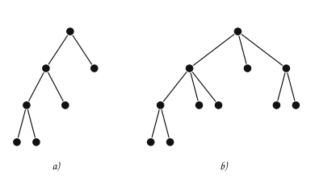 | 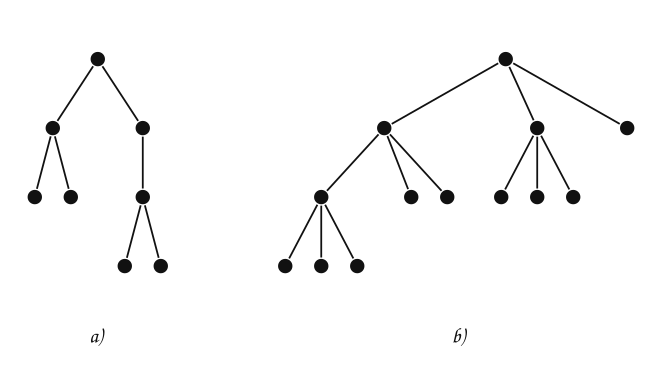 | 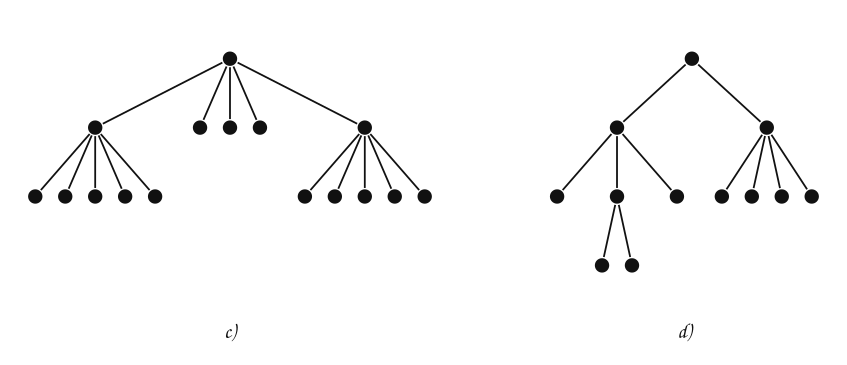 | 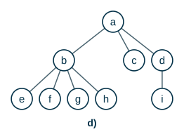 |

:::{admonition} Respuesta
:class: dropdown
- a) Árbol binario ($c$ es hoja y $b$ tiene $2$ hijos; $a$ tiene $2$): es **binario completo**.
- b) Árbol $3$-ario completo: los nodos internos $a$ y $c$ tienen $3$ hijos cada uno.
- c) Árbol binario completo.
- d) Árbol $4$-ario, **no** completo: $a$ tiene $3$ hijos y $d$ tiene $1$.
:::

### Propiedades

Sea $T$ un árbol $m$-ario **completo** con $i$ nodos internos (contando la raíz si tiene hijos). Entonces tiene $n = m \cdot i + 1$ nodos: cada nodo interno aporta $m$ hijos, y el único nodo que no es hijo de nadie es la raíz.

> **¿Cuántos nodos tiene un árbol $3$-ario completo con $4$ nodos internos? ¿Cuántas hojas?**

:::{admonition} Respuesta
:class: dropdown
$n = 3 \cdot 4 + 1 = 13$ nodos, de los cuales $13 - 4 = 9$ son hojas.
:::

Un árbol $m$-ario de altura $h$ (en nodos) tiene a lo sumo $m^{h-1}$ hojas: el nivel $k$ tiene a lo sumo $m^k$ nodos.

## 5. Aplicaciones

- **Árboles de decisión.** En cada nodo interno hay una pregunta, cada rama es una respuesta y cada hoja es una decisión. Árbol de decisión para ordenar tres elementos distintos $a, b, c$ comparando de a dos:

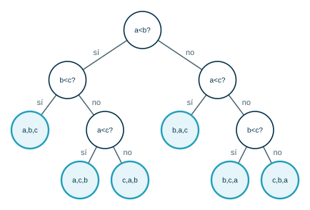

> **¿Cuántas comparaciones hacen falta, como mínimo en el peor caso, para ordenar $3$ elementos?**

:::{admonition} Respuesta
:class: dropdown
Hay $3! = 6$ órdenes posibles, y cada uno debe ser una hoja distinta. Un árbol binario con altura $h$ (en nodos) tiene a lo sumo $2^{h-1}$ hojas; para tener $6$ hojas se necesita $h - 1 \ge 3$. En el peor caso se hacen $3$ comparaciones (la rama más larga del árbol de la figura).
:::

- **Árboles de juego.** Modelan las jugadas posibles de cada jugador; se analizan de las hojas a la raíz. Ver [Recorridos en espacios de estados y juegos](../../Unidad5-Grafos/BusquedaEspacioEstados/index.md).
- **Árboles binarios de búsqueda.** Guardan llaves ordenadas para buscarlas rápido. Ver [Árboles binarios ordenados y de búsqueda](../ArbolesBinariosBusqueda/index.md).
- **Árboles de expresiones.** Representan expresiones aritméticas. Ver [Recorridos de árboles](../RecorridosArboles/index.md).
- **Sistemas de archivos, organigramas, el DOM de una página web**: todas son jerarquías.

## 6. El árbol como estructura recursiva

Un árbol $n$-ario es una **estructura recursiva**: es un elemento (la raíz) con una lista de árboles asociados (sus subárboles). En un árbol $n$-ario el orden de los subárboles no importa. Los algoritmos sobre árboles copian esa forma recursiva, y casi todos siguen uno de dos patrones (Villalobos):

- **Descenso recursivo:** se baja por los subárboles y se puede **detener** apenas se encuentra la respuesta (por ejemplo, buscar un elemento).
- **Recorrido total:** se visitan **todos** los elementos y se acumula una respuesta (por ejemplo, contar nodos).

Los algoritmos se escriben en **dos niveles**:

1. **Primer nivel** (clase del árbol): trata el caso del árbol vacío y delega la responsabilidad en la raíz.
2. **Segundo nivel** (clase del nodo): el planteamiento recursivo. Como hay $n$ subárboles, se usa un ciclo sobre los hijos.

## 7. Implementación en Java

**Análisis.**

| | |
|---|---|
| **Entradas** | Pares (padre, hijo) para construir el árbol. |
| **Salidas** | Peso (número de nodos), número de hojas y altura. |
| **Proceso** | Clase `Nodo<T>` con su elemento y una lista de hijos; métodos recursivos en dos niveles. |

**Diseño.**

- `darPeso()` (recorrido total): $1$ por la raíz más el peso de cada subárbol.
- `darNroHojas()` (recorrido total): $1$ si es hoja; si no, la suma de las hojas de los hijos.
- `darAltura()` (recorrido total): $1$ más la altura del hijo más alto.
- `buscar(e)` (descenso recursivo): si la raíz es `e`, terminar; si no, buscar en cada hijo hasta encontrarlo.
- Para insertar hay que indicar **el padre**: en un árbol $n$-ario no hay un orden que diga dónde va un elemento nuevo.

**Codificación.**

```java
import java.util.ArrayList;
import java.util.List;

public class ArbolNArio<T> {

    static class Nodo<T> {
        private final T elem;
        private final List<Nodo<T>> hijos = new ArrayList<>();

        Nodo(T elem) {
            this.elem = elem;
        }

        boolean esHoja() {
            return hijos.isEmpty();
        }

        // Patrón de recorrido total: la raíz cuenta 1 y se suma el peso de cada hijo.
        int darPeso() {
            int peso = 1;
            for (Nodo<T> h : hijos) {
                peso += h.darPeso();
            }
            return peso;
        }

        int darNroHojas() {
            if (esHoja()) {
                return 1;
            }
            int hojas = 0;
            for (Nodo<T> h : hijos) {
                hojas += h.darNroHojas();
            }
            return hojas;
        }

        // Altura = número de nodos de la rama más larga.
        int darAltura() {
            int maxAltura = 0;
            for (Nodo<T> h : hijos) {
                maxAltura = Math.max(maxAltura, h.darAltura());
            }
            return maxAltura + 1;
        }

        // Patrón de descenso recursivo: se detiene apenas encuentra el elemento.
        Nodo<T> buscar(T e) {
            if (elem.equals(e)) {
                return this;
            }
            for (Nodo<T> h : hijos) {
                Nodo<T> r = h.buscar(e);
                if (r != null) {
                    return r;
                }
            }
            return null;
        }
    }

    private Nodo<T> raiz;

    // Primer nivel: trata el árbol vacío y delega en la raíz.
    public int darPeso() {
        return raiz == null ? 0 : raiz.darPeso();
    }

    public int darNroHojas() {
        return raiz == null ? 0 : raiz.darNroHojas();
    }

    public int darAltura() {
        return raiz == null ? 0 : raiz.darAltura();
    }

    public void insertar(T padre, T elem) {
        if (raiz == null) {
            raiz = new Nodo<>(elem);
            return;
        }
        Nodo<T> p = raiz.buscar(padre);
        if (p == null) {
            throw new IllegalArgumentException("El padre " + padre + " no existe");
        }
        p.hijos.add(new Nodo<>(elem));
    }

    public static void main(String[] args) {
        ArbolNArio<String> t = new ArbolNArio<>();
        t.insertar(null, "a");
        String[][] aristas = {{"a", "b"}, {"a", "c"}, {"a", "d"}, {"b", "e"}, {"b", "f"},
                              {"e", "h"}, {"e", "i"}, {"e", "j"}, {"c", "g"}, {"c", "k"},
                              {"g", "l"}, {"g", "m"}, {"m", "n"}, {"m", "o"}, {"d", "p"},
                              {"d", "q"}};
        for (String[] a : aristas) {
            t.insertar(a[0], a[1]);
        }
        System.out.println("peso = " + t.darPeso());
        System.out.println("hojas = " + t.darNroHojas());
        System.out.println("altura = " + t.darAltura());
    }
}
```

**Prueba.** Con el árbol de la sección 3:

```text
peso = 17
hojas = 10
altura = 5
```

Coincide con lo que se cuenta en la figura: $17$ vértices, las hojas h, i, j, f, l, n, o, k, p, q y la rama más larga $a, c, g, m, n$, con $5$ nodos.

## Ejercicios

Practique con los [ejercicios de árboles](exercises.md).

## Fuentes

- Bedoya, O. *Árboles* (definición, terminología, árboles $n$-arios, aplicaciones). Diapositivas del curso, Universidad del Valle.
- Aristizábal, A. *Árboles $n$-arios*. Computación y Estructuras Discretas I, Universidad Icesi, 2026.
- Villalobos, J. A. *Patrones de algoritmo para árboles $n$-arios* (sección 4.5.6), tal como se cita en las diapositivas de A. Aristizábal.
- Rosen, K. H. *Discrete Mathematics and Its Applications*, 7.ª ed. McGraw-Hill, 2011. Secciones 11.1 y 11.2.

---

*Material adaptado del material original de los profesores Oscar Bedoya y Andrés Aristizábal.*
