---
# Copyright (c) 2026 Angela Villota, and collaborators from the CyED block
# Licensed under the PolyForm Noncommercial License 1.0.0.
# Commercial use is prohibited without prior written authorization.
title: "Árboles AVL: Ejercicios"
---

# Árboles AVL: Ejercicios

Use esta página después de leer el [material de estudio de árboles AVL](index.md). Cada ejercicio trae **pistas** y una **solución general**; intente resolverlo antes de abrirlas.

---

### Ejercicio 1

Calcule la altura y el factor de balanceo de cada nodo del siguiente árbol. ¿Es un árbol AVL?

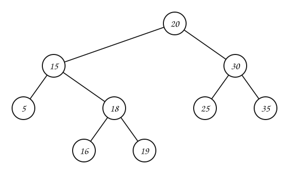

:::{admonition} Pistas
:class: dropdown
- Empiece por las hojas: altura $1$ y $fb = 0$.
- $fb(v)$ = altura del subárbol derecho − altura del subárbol izquierdo.
:::

:::{admonition} Solución general
:class: dropdown
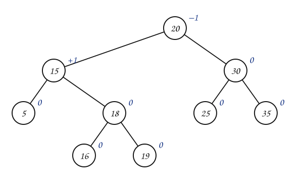

Sí es AVL: todos los factores están entre $-1$ y $1$. Su recorrido en inorden es $5, 15, 16, 18, 19, 20, 25, 30, 35$, su peso es $9$ y su altura $4$. La diferencia entre las alturas de los dos subárboles de la raíz es $1$.
:::

### Ejercicio 2

Dado cada árbol $T$, siga el algoritmo `AVL-DELETE` con la llave indicada. Diga qué caso de desbalanceo aparece.

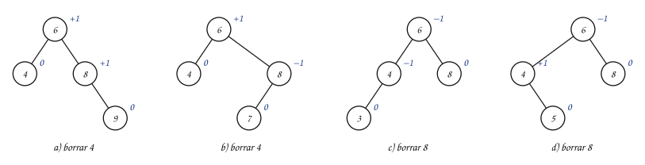

:::{admonition} Pistas
:class: dropdown
- Después de borrar, el primer nodo posiblemente desbalanceado es el padre del que salió: aquí, la raíz $6$.
- Mire el hijo del lado más alto de $6$ y su factor de balanceo.
:::

:::{admonition} Solución general
:class: dropdown
- a) Caso A: preorden final $8, 6, 9$.
- b) Caso C: preorden final $7, 6, 8$.
- c) Caso D: preorden final $4, 3, 6$.
- d) Caso F: preorden final $5, 4, 6$.
:::

### Ejercicio 3

Inserte en un AVL vacío las llaves $10, 20, 30, 40, 50, 25$, en ese orden. Indique en cada rotación qué caso se aplicó.

:::{admonition} Pistas
:class: dropdown
- Las llaves crecientes cargan el árbol a la derecha: las primeras rotaciones son del caso A.
- Al insertar $25$, mire el signo de $fb(q)$.
:::

:::{admonition} Solución general
:class: dropdown
Rotaciones: al insertar $30$, caso A en $10$; al insertar $50$, caso A en $30$; al insertar $25$, caso C en $20$. Árbol final:

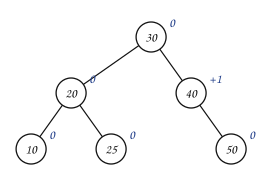
:::

### Ejercicio 4

Inserte en un AVL vacío las llaves $15, 20, 24, 10, 13, 7, 30, 36, 25$. Lleve los factores de balanceo y anote cada caso de rotación.

:::{admonition} Pistas
:class: dropdown
- Hay cinco rotaciones en total.
- Después de cada inserción, suba por el camino del nodo nuevo; el **primer** nodo con $|fb| = 2$ es el que se rebalancea.
:::

:::{admonition} Solución general
:class: dropdown
Rotaciones: al insertar $24$, caso A en $15$; al insertar $13$, caso F en $15$; al insertar $7$, caso D en $20$; al insertar $36$, caso A en $24$; al insertar $25$, caso C en $20$. Árbol final:

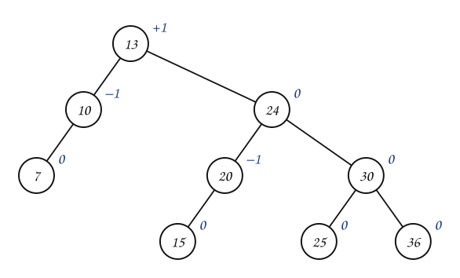
:::

### Ejercicio 5

El administrador de un pequeño negocio de compra y venta de vehículos usados ha decidido almacenar los datos de los automóviles de su establecimiento en un árbol AVL, para poder acceder velozmente a sus registros. Los carros están ordenados por su placa. Si se inicia con un árbol AVL vacío, muestre (dibuje) el estado del árbol después de la inserción (compra) o eliminación (venta), en el orden indicado, de cada uno de los siguientes vehículos:

1. Se compra el Ford Focus con placa JOK458.
2. Se compra el Honda Civic con placa PZY526.
3. Se compra el Mazda 3 con placa NOB512.
4. Se compra el Renault Clio con placa AZX323.
5. Se compra el Toyota Prius con placa BMO419.
6. Se vende el Honda Civic con placa PZY526.
7. Se compra el Mitsubishi Montero con placa ENN422.
8. Se vende el Renault Clio con placa AZX323.
9. Se compra el Audi A4 con placa GIC437.
10. Se vende el Mazda 3 con placa NOB512.

:::{admonition} Pistas
:class: dropdown
- Las placas se comparan en orden alfabético: AZX323 < BMO419 < ENN422 < GIC437 < JOK458 < NOB512 < PZY526.
- Una venta de un nodo con dos hijos se hace con su sucesor, como en un ABB.
- Después de cada operación, revise los factores desde el nodo afectado hasta la raíz.
:::

::::::{admonition} Solución general
:class: dropdown
:::::{admonition} Estado del árbol después de cada operación
::::{tab-set}
:::{tab-item} Paso 1
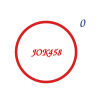

> 1. Se compra el Ford Focus (JOK458): sin rotaciones.

:::
:::{tab-item} Paso 2
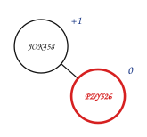

> 2. Se compra el Honda Civic (PZY526): sin rotaciones.

:::
:::{tab-item} Paso 3
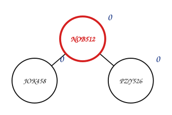

> 3. Se compra el Mazda 3 (NOB512): caso C en JOK458.

:::
:::{tab-item} Paso 4
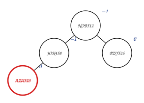

> 4. Se compra el Renault Clio (AZX323): sin rotaciones.

:::
:::{tab-item} Paso 5
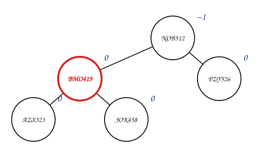

> 5. Se compra el Toyota Prius (BMO419): caso F en JOK458.

:::
:::{tab-item} Paso 6
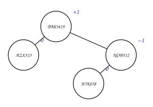

> 6. Se vende el Honda Civic (PZY526): caso E en NOB512.

:::
:::{tab-item} Paso 7
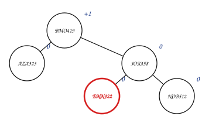

> 7. Se compra el Mitsubishi Montero (ENN422): caso D en NOB512.

:::
:::{tab-item} Paso 8
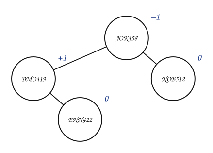

> 8. Se vende el Renault Clio (AZX323): caso B en BMO419.

:::
:::{tab-item} Paso 9
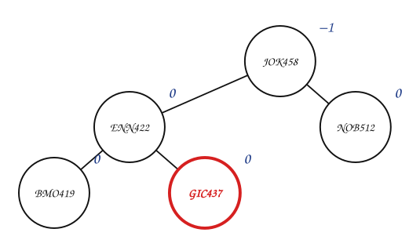

> 9. Se compra el Audi A4 (GIC437): caso A en BMO419.

:::
:::{tab-item} Paso 10
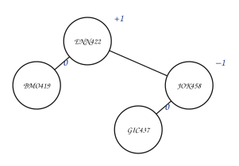

> 10. Se vende el Mazda 3 (NOB512): caso E en JOK458.

:::
::::
:::::
::::::

### Ejercicio 6

En el siguiente AVL, elimine $8$. Indique qué nodo sale físicamente del árbol, y cada caso de desbalanceo que aparece al subir hacia la raíz.

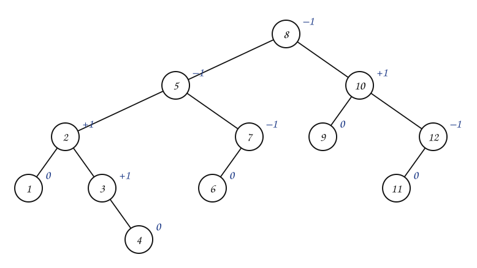

:::{admonition} Pistas
:class: dropdown
- $8$ tiene dos hijos: lo reemplaza su sucesor.
- Después de rebalancear el primer nodo, la altura de ese subárbol puede bajar: siga subiendo.
:::

:::{admonition} Solución general
:class: dropdown
Sale el sucesor $9$ (su llave reemplaza a $8$). Al subir aparecen dos desbalanceos: caso C en $10$, luego caso D en $9$. Árbol final:

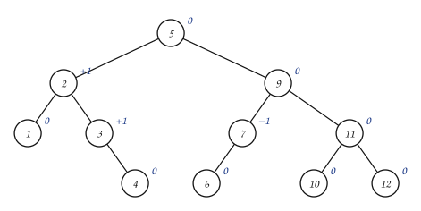
:::

### Ejercicio 7

¿Cuál es el **mínimo** número de nodos de un árbol AVL de altura $1, 2, 3, 4$ y $5$ (altura contada en nodos)? Dibuje uno de altura $4$ con ese mínimo.

:::{admonition} Pistas
:class: dropdown
- Para que tenga pocos nodos, un subárbol debe tener altura $h - 1$ y el otro $h - 2$, ambos también mínimos.
:::

:::{admonition} Solución general
:class: dropdown
$N(1) = 1$, $N(2) = 2$, $N(h) = 1 + N(h-1) + N(h-2)$: $1, 2, 4, 7, 12$. Un AVL mínimo de altura $4$ tiene $7$ nodos: una raíz con un subárbol mínimo de altura $3$ ($4$ nodos) y otro de altura $2$ ($2$ nodos). El árbol del Ejercicio 6 es un AVL mínimo de altura $5$.
:::

### Ejercicio 8

Escriba en pseudocódigo un algoritmo `ES-AVL(x)` que verifique el invariante del subárbol con raíz $x$: que sea un ABB y que $|fb| \le 1$ en todos sus nodos. Aplíquelo a los cuatro árboles de la sección 2 del material de estudio.

:::{admonition} Pistas
:class: dropdown
- Un algoritmo recursivo que devuelva la altura de un subárbol, o $-1$ si encuentra un desbalanceo.
- Para el ABB, pase como parámetros el mínimo y el máximo permitidos para las llaves del subárbol.
:::

:::{admonition} Solución general
:class: dropdown
Un solo recorrido en postorden calcula la altura de cada subárbol y revisa $|fb| \le 1$ en cada nodo; otro (o el mismo, con los límites como parámetros) revisa el orden. Ambos son $O(n)$. En la sección 2, `ES-AVL` es verdadero para a) y c), y falso para b) y d): en los dos falla en la raíz $8$.
:::

### Ejercicio 9

Implemente el árbol AVL genérico: buscar, insertar y eliminar, con las rotaciones y los seis casos de desbalanceo. Pruébelo con el Ejercicio 5.

---

*Material adaptado del material original de los profesores Andrés Aristizábal y Victor Manuel Vargas.*
