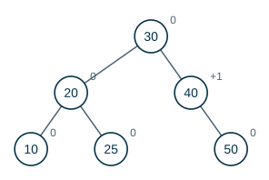
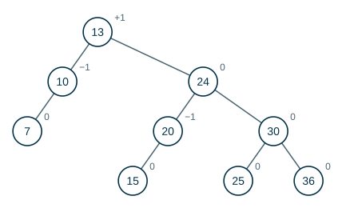

---
# Copyright (c) 2026 Angela Villota, and collaborators from the CyED block
# Licensed under the PolyForm Noncommercial License 1.0.0.
# Commercial use is prohibited without prior written authorization.
title: "Árboles AVL: Ejercicios"
---

# Árboles AVL: Ejercicios

Use esta página después de leer el [material de estudio de árboles AVL](index.md). Cada ejercicio trae **pistas** y una **solución general**; intente resolverlo antes de abrirlas.

---

### Ejercicio 1

Inserte en un AVL vacío las llaves $10, 20, 30, 40, 50, 25$, en ese orden. Indique en cada rotación qué caso se aplicó.

:::{admonition} Pistas
:class: dropdown
- Las primeras rotaciones son del caso A: llaves crecientes cargan el árbol a la derecha.
- Al insertar $25$, mire el signo de $fb(q)$.
:::

:::{admonition} Solución general
:class: dropdown
Rotaciones: caso A en $10$ (al insertar $30$), caso A en $30$ (al insertar $50$) y caso C en $20$ (al insertar $25$). Árbol final:

:::

### Ejercicio 2

Inserte en un AVL vacío las llaves $15, 20, 24, 10, 13, 7, 30, 36, 25$. Lleve los factores de balanceo y anote cada caso de rotación.

:::{admonition} Pistas
:class: dropdown
- Hay cinco rotaciones en total.
- Después de cada inserción, suba por el camino del nodo nuevo; el **primer** nodo con $|fb| = 2$ es el que se rebalancea.
:::

:::{admonition} Solución general
:class: dropdown
Rotaciones: al insertar $24$: caso A en $15$; al insertar $13$: caso F en $15$; al insertar $7$: caso D en $20$; al insertar $36$: caso A en $24$; al insertar $25$: caso C en $20$. Árbol final:

:::

### Ejercicio 3

¿Cuál es el **mínimo** número de nodos de un árbol AVL de altura $1, 2, 3, 4$ y $5$ (altura contada en nodos)? Dibuje uno de altura $4$ con ese mínimo.

:::{admonition} Pistas
:class: dropdown
- Para que tenga pocos nodos, un subárbol debe tener altura $h - 1$ y el otro $h - 2$, ambos también mínimos.
:::

:::{admonition} Solución general
:class: dropdown
$N(1) = 1$, $N(2) = 2$, $N(h) = 1 + N(h-1) + N(h-2)$: $1, 2, 4, 7, 12$. Un AVL mínimo de altura $4$ tiene $7$ nodos: una raíz con un subárbol mínimo de altura $3$ ($4$ nodos) y otro de altura $2$ ($2$ nodos).
:::

### Ejercicio 4

Dé un árbol AVL y una llave tal que, al **eliminarla**, se necesiten **dos** rebalanceos en nodos distintos.

:::{admonition} Pistas
:class: dropdown
- Use un árbol de Fibonacci (AVL mínimo, Ejercicio 3): todos sus nodos internos tienen $fb = \pm 1$.
- Elimine una hoja del lado más **bajo**.
:::

:::{admonition} Solución general
:class: dropdown
En un AVL mínimo de altura $5$ ($12$ nodos), eliminar la hoja más cercana a la raíz del lado bajo desbalancea su padre; la rotación baja la altura de ese subárbol en $1$, y eso desbalancea a su vez a la raíz, que requiere otra rotación.
:::

### Ejercicio 5

Agregue a la clase `AVL<T>` el método `void eliminar(T k)` y un método `boolean esAVL()` que verifique el invariante (ABB y $|fb| \le 1$ en todos los nodos) recalculando las alturas. Pruebe que después de $1000$ inserciones y eliminaciones aleatorias `esAVL()` sigue siendo `true`.

---

*Material adaptado del material original del profesor Andrés Aristizábal.*
