---
# Copyright (c) 2026 Angela Villota, and collaborators from the CyED block
# Licensed under the PolyForm Noncommercial License 1.0.0.
# Commercial use is prohibited without prior written authorization.
title: "Unidad 4: Árboles AVL"
---

# Unidad 4: Árboles AVL

## 1. El problema

Inserte $1, 2, 3, 4, 5, 6, 7$, en ese orden, en un árbol binario de búsqueda:

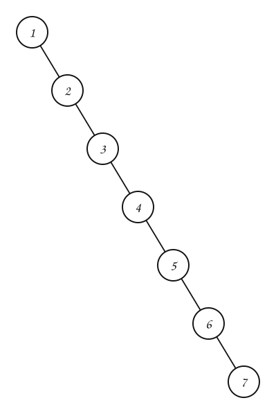

Es una cadena: buscar $7$ cuesta $7$ comparaciones, como en una lista. Con las mismas llaves, este otro ABB tiene altura $3$:

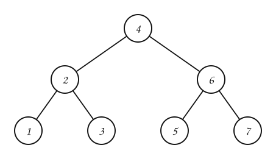

**¿Cómo mantener el árbol «bajo» sin importar el orden en que lleguen las llaves?** Hacen falta dos cosas:

1. una forma de **medir** qué tan desbalanceado está cada nodo, y
2. una operación que **corrija** el desbalance sin romper el orden del ABB.

## 2. ¿Qué es un árbol AVL?

**Árbol AVL.** Es un árbol binario de búsqueda **balanceado en altura**. Su nombre viene de las iniciales de sus dos creadores, Adelson-Velskii y Landis, y fue el primer ABB balanceado publicado. Gracias a su noción de balanceo, permite hacer las operaciones de diccionario (buscar, insertar, eliminar) en tiempo **logarítmico**.

El concepto clave para hablar de balanceo en altura es el **factor de balanceo**.

### Altura de un subárbol

Recuerde: la **altura** de un árbol es el número de nodos de su rama más larga. Una hoja tiene altura $1$ y el árbol vacío tiene altura $0$. La altura de un nodo $v$ es la de su subárbol:

$$
h(v) = 1 + \max\big(h(\text{izquierdo de } v),\ h(\text{derecho de } v)\big)
$$

### Factor de balanceo

**Factor de balanceo.** Para un nodo $v$ de un árbol binario:

$$
fb(v) = h(\text{subárbol derecho de } v) - h(\text{subárbol izquierdo de } v)
$$

- $fb(v) > 0$: el lado **derecho** es más alto.
- $fb(v) < 0$: el lado **izquierdo** es más alto.
- $fb(v) = 0$: los dos lados tienen la misma altura.

Así como cada nodo de un árbol rojinegro tiene un color, cada nodo de un AVL tiene un factor de balanceo. Se calcula de abajo hacia arriba, porque la altura de un nodo depende de la de sus hijos:

:::::{admonition} Altura (h) y factor de balanceo (fb) de cada nodo
:class: dropdown
::::{tab-set}
:::{tab-item} Paso 1
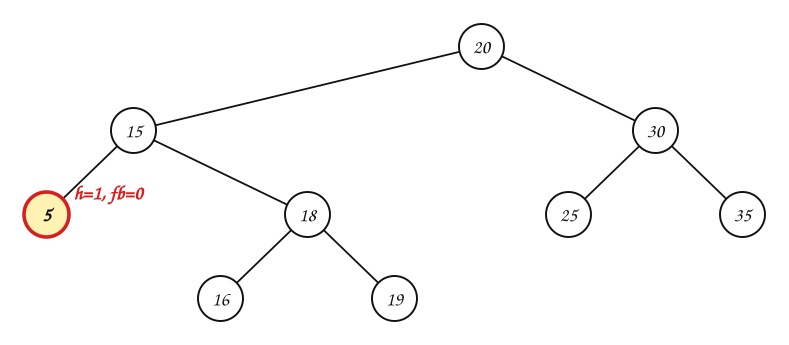

> $5$ es hoja: sus dos subárboles son vacíos (altura $0$). $h = 1$ y $fb = 0 - 0 = 0$.

:::
:::{tab-item} Paso 2
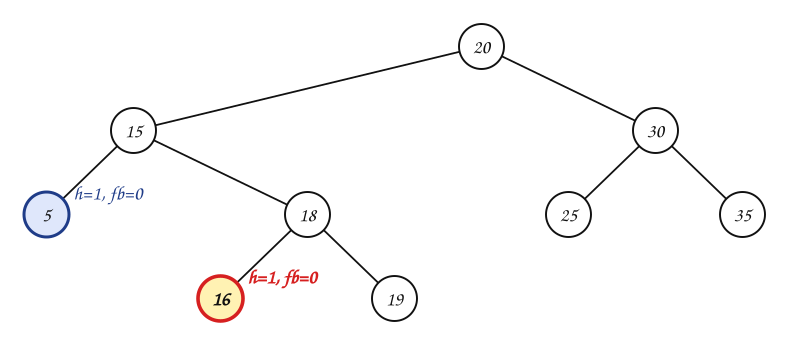

> $16$ es hoja: sus dos subárboles son vacíos (altura $0$). $h = 1$ y $fb = 0 - 0 = 0$.

:::
:::{tab-item} Paso 3
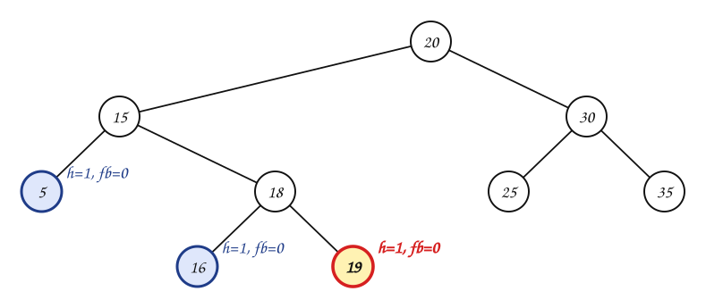

> $19$ es hoja: sus dos subárboles son vacíos (altura $0$). $h = 1$ y $fb = 0 - 0 = 0$.

:::
:::{tab-item} Paso 4
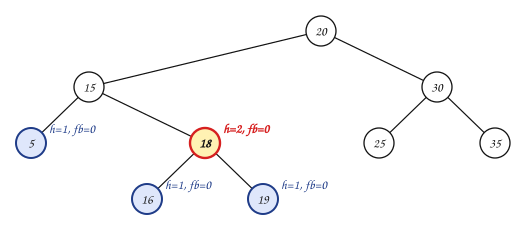

> $18$: el subárbol derecho tiene altura $1$ y el izquierdo $1$. $h = 1 + \max(1, 1) = 2$ y $fb = 1 - 1 = 0$.

:::
:::{tab-item} Paso 5
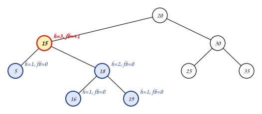

> $15$: el subárbol derecho tiene altura $2$ y el izquierdo $1$. $h = 1 + \max(1, 2) = 3$ y $fb = 2 - 1 = +1$.

:::
:::{tab-item} Paso 6
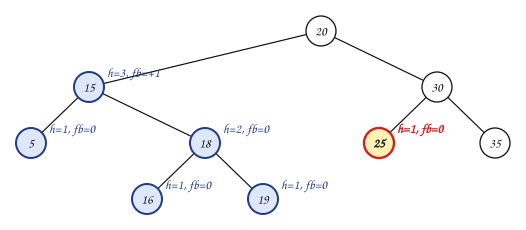

> $25$ es hoja: sus dos subárboles son vacíos (altura $0$). $h = 1$ y $fb = 0 - 0 = 0$.

:::
:::{tab-item} Paso 7
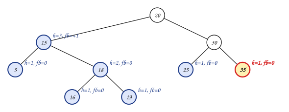

> $35$ es hoja: sus dos subárboles son vacíos (altura $0$). $h = 1$ y $fb = 0 - 0 = 0$.

:::
:::{tab-item} Paso 8
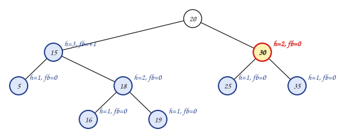

> $30$: el subárbol derecho tiene altura $1$ y el izquierdo $1$. $h = 1 + \max(1, 1) = 2$ y $fb = 1 - 1 = 0$.

:::
:::{tab-item} Paso 9
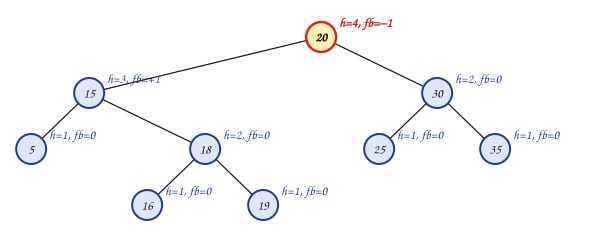

> $20$: el subárbol derecho tiene altura $2$ y el izquierdo $3$. $h = 1 + \max(3, 2) = 4$ y $fb = 2 - 3 = −1$.

:::
::::
:::::

### Balanceado en altura

Un árbol binario está **balanceado en altura** si para **cada** nodo $v$:

$$
|fb(v)| \le 1
$$

En particular, cada nodo de un AVL tiene factor de balanceo $-1$, $0$ o $1$. Dicho de otra forma, un ABB es AVL si:

1. los subárboles de cada nodo difieren en altura en $1$ como máximo, y
2. cada subárbol es también un árbol AVL.

El árbol de las pestañas **es** AVL: todos sus factores están entre $-1$ y $1$. Desde aquí, el número que aparece junto a cada nodo es su factor de balanceo; en rojo si está desbalanceado.

Indique cuáles de estos ABB son AVL:

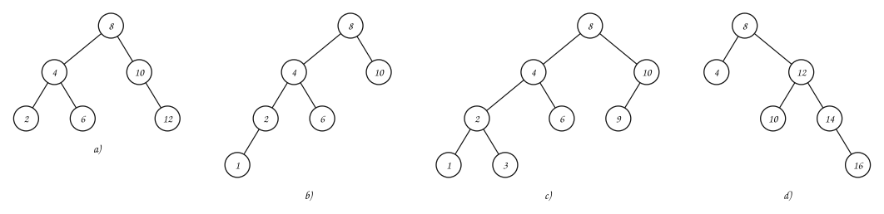

:::{admonition} Respuesta
:class: dropdown
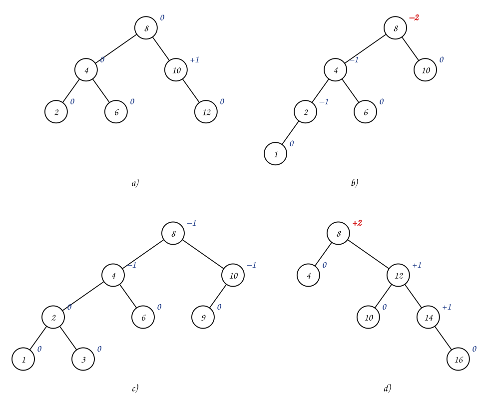

- a) Sí.
- b) **No**: $fb(8) = 1 - 3 = -2$.
- c) Sí.
- d) **No**: $fb(8) = 3 - 1 = +2$.

En b) todos los nodos **menos la raíz** están bien. Hay que revisar **cada** nodo, no solo las hojas o los hijos de la raíz.
:::

### ¿Qué cambia respecto a un ABB?

Buscar, mínimo, máximo, sucesor y predecesor son **iguales** que en un ABB: no modifican el árbol. Las operaciones que difieren son la **inserción** y la **eliminación**, porque pueden dañar el balanceo:

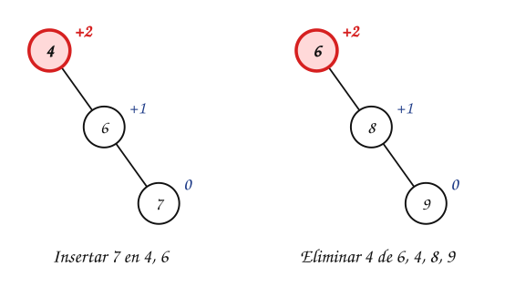

El esquema de las dos es el mismo:

1. Realizar la operación como en un ABB.
2. Rebalancear los nodos que quedaron desbalanceados.

Para rebalancear se usan las **rotaciones**.

## 3. Rotaciones

### El caso más simple

Se insertan $4$, $6$ y $7$ en un ABB. El nodo $4$ queda con $fb(4) = +2$: su lado derecho tiene altura $2$ y el izquierdo, $0$.

:::::{admonition} Rotar a la izquierda en 4
::::{tab-set}
:::{tab-item} Paso 1
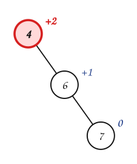

> $fb(4) = 2 - 0 = +2$: el subárbol derecho de $4$ es mucho más alto. Hay que «subir» a $6$.

:::
:::{tab-item} Paso 2
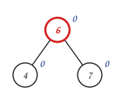

> `LEFT-ROTATE(4)`: $6$ sube a la raíz y $4$ baja a ser su hijo izquierdo. Todos los factores son $0$, y el inorden sigue siendo $4, 6, 7$.

:::
::::
:::::

### Rotación a la izquierda y a la derecha

`LEFT-ROTATE(x)` toma un nodo $x$ que **debe tener un hijo derecho** $y$:

- rota $x$ hacia la izquierda, dejando a $y$ como raíz del subárbol;
- cuelga a la derecha de $x$ el subárbol izquierdo de $y$ (si hubiera uno).

Al rotar $x$ a la izquierda, se **baja** $x$ y se **sube** $y$.

`RIGHT-ROTATE(y)` es la operación inversa: exige que $y$ tenga un **hijo izquierdo** $x$, rota $y$ hacia la derecha (baja $y$, sube $x$) y cuelga a la izquierda de $y$ el subárbol derecho de $x$.

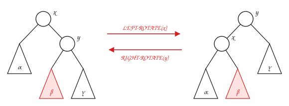

```text
LEFT-ROTATE(x)                  RIGHT-ROTATE(y)
1  y ← right[x]                 1  x ← left[y]
2  right[x] ← left[y]           2  left[y] ← right[x]
3  left[y] ← x                  3  right[x] ← y
4  return y   // nueva raíz     4  return x   // nueva raíz
```

> **¿El resultado de una rotación sigue siendo un ABB?**

:::{admonition} Respuesta
:class: dropdown
Sí. En los dos dibujos el inorden es $\alpha, x, \beta, y, \gamma$: todo lo de $\alpha$ es menor que $x$, todo lo de $\beta$ está entre $x$ y $y$, y todo lo de $\gamma$ es mayor que $y$. Por eso:

- Las rotaciones son **independientes** de cualquier noción de balanceo: se pueden aplicar en cualquier ABB y el resultado es otro ABB.
- Las dos operaciones son **una inversa de la otra**.
:::

Intuitivamente, `LEFT-ROTATE(x)` traslada **peso** del subárbol derecho al izquierdo, y `RIGHT-ROTATE(y)`, del izquierdo al derecho. Aquí «peso» no es una cantidad de nodos sino **altura**, que es lo que se intenta balancear.

## 4. Casos de desbalanceo

Cuando una inserción o una eliminación deja factores de balanceo con valor absoluto mayor que $1$, conviene resolverlos **progresivamente**: primero los nodos más profundos y luego los más cercanos a la raíz. Por eso basta estudiar un escenario:

> un subárbol cuya raíz $p$ tiene $fb(p) = 2$ o $fb(p) = -2$, pero tal que **todos los nodos debajo de $p$ están balanceados**.

En los dibujos de esta sección, el número dentro de cada nodo es su factor de balanceo y cada triángulo es un subárbol, con su altura al lado.

Tome $fb(p) = 2$. Si el subárbol izquierdo de $p$ tiene altura $h$, el derecho tiene altura $h + 2$; ese subárbol derecho tiene al menos dos nodos, y su raíz se llama $q$. Como todo lo que está debajo de $p$ está balanceado, $fb(q) \in \{-1, 0, 1\}$. Hay un caso por cada valor.

### Caso A: $fb(p) = 2$ y $fb(q) = 1$

El subárbol derecho de $p$ es mucho más alto que el izquierdo, así que hay que trasladar peso de la derecha a la izquierda: se ejecuta `LEFT-ROTATE(p)` y se restablece el balance.

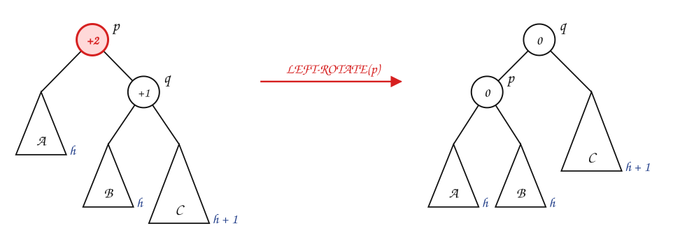

Ejemplo: dado $T$, siga `AVL-INSERT(T, 7)`.

:::::{admonition} AVL-INSERT(T, 7)
:class: dropdown
::::{tab-set}
:::{tab-item} Paso 1


> El árbol $T$, con el factor de balanceo junto a cada nodo.

:::
:::{tab-item} Paso 2


> Se inserta $7$ como en un ABB (camino: 4, 6). Se revisan los factores de balanceo de abajo hacia arriba, por el camino del nodo nuevo.

:::
:::{tab-item} Paso 3
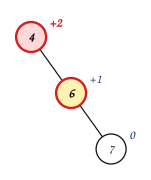

> El primer nodo desbalanceado (subiendo) es $p = 4$, con $fb(p) = +2$. Su hijo del lado más alto es $q = 6$, con $fb(q) = +1$.

:::
:::{tab-item} Paso 4


> **Caso A:** se ejecuta `LEFT-ROTATE(4)`: se rota $p = 4$ hacia la **izquierda**. La nueva raíz del subárbol es $6$ y todos los factores del subárbol quedan entre $-1$ y $1$.

:::
::::
:::::

### Caso B: $fb(p) = 2$ y $fb(q) = 0$

Otra vez el lado derecho de $p$ es mucho más alto: se ejecuta `LEFT-ROTATE(p)` y se restablece el balance. Esta vez $q$ queda con $fb = -1$ y $p$ con $fb = 1$.

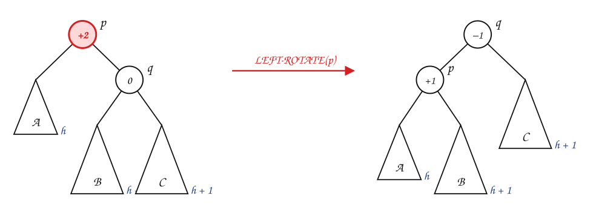

Este caso **no puede aparecer al insertar** (una inserción no deja a $q$ con sus dos subárboles altos a la vez); aparece al eliminar. Ejemplo: dado $T$, siga `AVL-DELETE(T, 4)`.

:::::{admonition} AVL-DELETE(T, 4)
:class: dropdown
::::{tab-set}
:::{tab-item} Paso 1
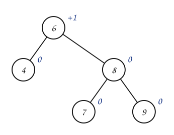

> El árbol $T$, con el factor de balanceo junto a cada nodo.

:::
:::{tab-item} Paso 2
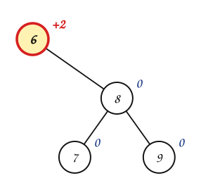

> Se borra $4$ como en un ABB. El primer nodo posiblemente desbalanceado es $6$, el padre del nodo que salió; desde ahí se sube revisando hasta la raíz.

:::
:::{tab-item} Paso 3
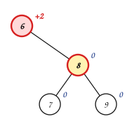

> El primer nodo desbalanceado (subiendo) es $p = 6$, con $fb(p) = +2$. Su hijo del lado más alto es $q = 8$, con $fb(q) = 0$.

:::
:::{tab-item} Paso 4
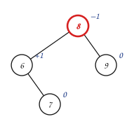

> **Caso B:** se ejecuta `LEFT-ROTATE(6)`: se rota $p = 6$ hacia la **izquierda**. La nueva raíz del subárbol es $8$ y todos los factores del subárbol quedan entre $-1$ y $1$.

:::
::::
:::::

### Caso C: $fb(p) = 2$ y $fb(q) = -1$

Ahora el peso de $q$ está en su subárbol **izquierdo**, el del medio. Se podría intentar otra vez rotar $p$ a la izquierda:

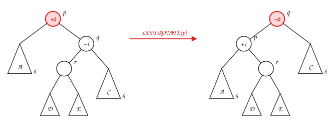

Lamentablemente no funciona: el subárbol del medio pasa a ser hijo derecho de $p$ y el desbalance aparece del otro lado. La solución es en dos pasos: primero `RIGHT-ROTATE(q)`, que deja el peso «en línea» (como en el caso A), y luego `LEFT-ROTATE(p)`. Sea $r$ la raíz del subárbol izquierdo de $q$:

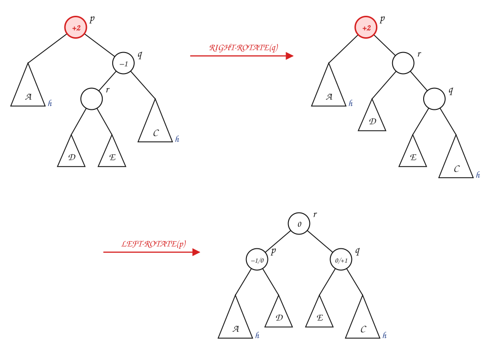

Ejemplo: dado $T$, siga `AVL-INSERT(T, 5)`.

:::::{admonition} AVL-INSERT(T, 5)
:class: dropdown
::::{tab-set}
:::{tab-item} Paso 1
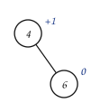

> El árbol $T$, con el factor de balanceo junto a cada nodo.

:::
:::{tab-item} Paso 2
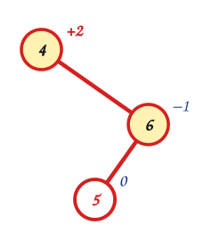

> Se inserta $5$ como en un ABB (camino: 4, 6). Se revisan los factores de balanceo de abajo hacia arriba, por el camino del nodo nuevo.

:::
:::{tab-item} Paso 3
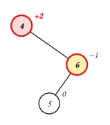

> El primer nodo desbalanceado (subiendo) es $p = 4$, con $fb(p) = +2$. Su hijo del lado más alto es $q = 6$, con $fb(q) = −1$.

:::
:::{tab-item} Paso 4
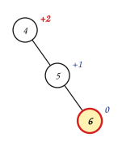

> **Caso C:** $fb(q)$ tiene signo contrario a $fb(p)$. Primero `RIGHT-ROTATE(6)`: se rota $q = 6$ hacia la **derecha** y el peso queda «en línea».

:::
:::{tab-item} Paso 5


> Luego `LEFT-ROTATE(4)`: se rota $p = 4$ hacia la **izquierda**. La nueva raíz del subárbol es $5$ y todos los factores quedan entre $-1$ y $1$.

:::
::::
:::::

### Casos D, E y F: $fb(p) = -2$

Cuando $fb(p) = -2$ se divide otra vez según $fb(q) \in \{-1, 0, 1\}$, ahora con $q$ la raíz del subárbol **izquierdo** de $p$. Los tres casos son completamente simétricos a los anteriores: se cambia izquierda por derecha.

**Caso D: $fb(p) = -2$ y $fb(q) = -1$.** Se ejecuta `RIGHT-ROTATE(p)`.

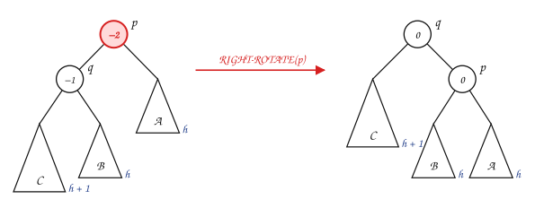

Ejemplo: dado $T$, siga `AVL-INSERT(T, 1)`.

:::::{admonition} AVL-INSERT(T, 1)
:class: dropdown
::::{tab-set}
:::{tab-item} Paso 1


> El árbol $T$, con el factor de balanceo junto a cada nodo.

:::
:::{tab-item} Paso 2
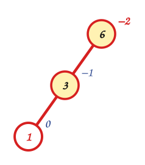

> Se inserta $1$ como en un ABB (camino: 6, 3). Se revisan los factores de balanceo de abajo hacia arriba, por el camino del nodo nuevo.

:::
:::{tab-item} Paso 3
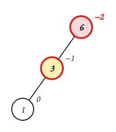

> El primer nodo desbalanceado (subiendo) es $p = 6$, con $fb(p) = −2$. Su hijo del lado más alto es $q = 3$, con $fb(q) = −1$.

:::
:::{tab-item} Paso 4
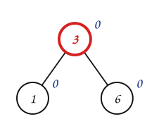

> **Caso D:** se ejecuta `RIGHT-ROTATE(6)`: se rota $p = 6$ hacia la **derecha**. La nueva raíz del subárbol es $3$ y todos los factores del subárbol quedan entre $-1$ y $1$.

:::
::::
:::::

**Caso E: $fb(p) = -2$ y $fb(q) = 0$.** Se ejecuta `RIGHT-ROTATE(p)`. Como el caso B, solo aparece al eliminar.

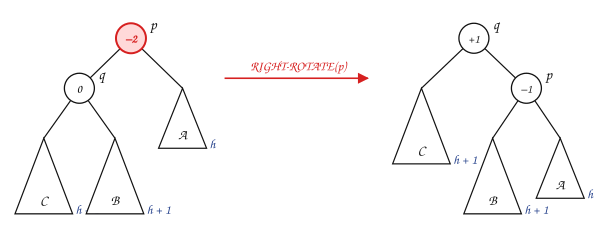

Ejemplo: dado $T$, siga `AVL-DELETE(T, 8)`.

:::::{admonition} AVL-DELETE(T, 8)
:class: dropdown
::::{tab-set}
:::{tab-item} Paso 1
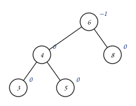

> El árbol $T$, con el factor de balanceo junto a cada nodo.

:::
:::{tab-item} Paso 2
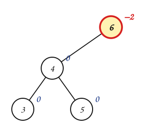

> Se borra $8$ como en un ABB. El primer nodo posiblemente desbalanceado es $6$, el padre del nodo que salió; desde ahí se sube revisando hasta la raíz.

:::
:::{tab-item} Paso 3
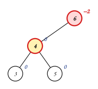

> El primer nodo desbalanceado (subiendo) es $p = 6$, con $fb(p) = −2$. Su hijo del lado más alto es $q = 4$, con $fb(q) = 0$.

:::
:::{tab-item} Paso 4
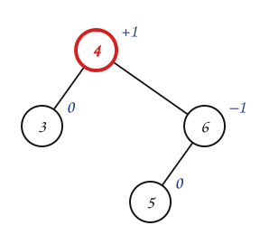

> **Caso E:** se ejecuta `RIGHT-ROTATE(6)`: se rota $p = 6$ hacia la **derecha**. La nueva raíz del subárbol es $4$ y todos los factores del subárbol quedan entre $-1$ y $1$.

:::
::::
:::::

**Caso F: $fb(p) = -2$ y $fb(q) = 1$.** Primero `LEFT-ROTATE(q)` y luego `RIGHT-ROTATE(p)`.

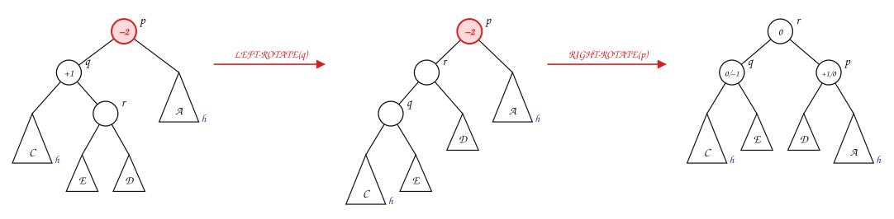

Ejemplo: dado $T$, siga `AVL-INSERT(T, 4)`.

:::::{admonition} AVL-INSERT(T, 4)
:class: dropdown
::::{tab-set}
:::{tab-item} Paso 1
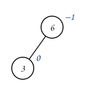

> El árbol $T$, con el factor de balanceo junto a cada nodo.

:::
:::{tab-item} Paso 2
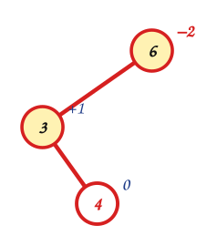

> Se inserta $4$ como en un ABB (camino: 6, 3). Se revisan los factores de balanceo de abajo hacia arriba, por el camino del nodo nuevo.

:::
:::{tab-item} Paso 3
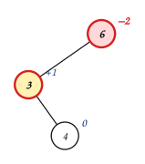

> El primer nodo desbalanceado (subiendo) es $p = 6$, con $fb(p) = −2$. Su hijo del lado más alto es $q = 3$, con $fb(q) = +1$.

:::
:::{tab-item} Paso 4
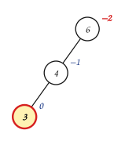

> **Caso F:** $fb(q)$ tiene signo contrario a $fb(p)$. Primero `LEFT-ROTATE(3)`: se rota $q = 3$ hacia la **izquierda** y el peso queda «en línea».

:::
:::{tab-item} Paso 5
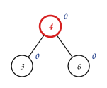

> Luego `RIGHT-ROTATE(6)`: se rota $p = 6$ hacia la **derecha**. La nueva raíz del subárbol es $4$ y todos los factores quedan entre $-1$ y $1$.

:::
::::
:::::

### Resumen

| Caso | $fb(p)$ | $fb(q)$ | Rotaciones | ¿Cuándo aparece? |
|---|---|---|---|---|
| A | $2$ | $1$ | `LEFT-ROTATE(p)` | insertar o eliminar |
| B | $2$ | $0$ | `LEFT-ROTATE(p)` | solo eliminar |
| C | $2$ | $-1$ | `RIGHT-ROTATE(q)`, luego `LEFT-ROTATE(p)` | insertar o eliminar |
| D | $-2$ | $-1$ | `RIGHT-ROTATE(p)` | insertar o eliminar |
| E | $-2$ | $0$ | `RIGHT-ROTATE(p)` | solo eliminar |
| F | $-2$ | $1$ | `LEFT-ROTATE(q)`, luego `RIGHT-ROTATE(p)` | insertar o eliminar |

Para recordarla: si $fb(q)$ tiene el **mismo signo** que $fb(p)$, o es $0$, basta **una** rotación de $p$ hacia el lado contrario al del desbalance. Si tiene **signo contrario**, primero se rota $q$ para dejar el peso en línea y después se rota $p$: es una **rotación doble**.

## 5. Inserción

La inserción en un AVL agrega el nodo nuevo como una **hoja** del árbol. Eso implica que solo pueden cambiar los factores de balanceo de los nodos que están en el camino entre la raíz y el nodo agregado. Si se rebalancea cada factor desbalanceado a lo largo de ese camino, se restablece el balance en todo el árbol.

```text
AVL-INSERT(T, k)
1  insertar k en T como en un ABB
2  sea x el nodo agregado
3  AVL-REBALANCE(T, x)

AVL-REBALANCE(T, x)
1  for cada nodo p en el camino entre x y la raíz de T   // de abajo hacia arriba
2      if |fb(p)| > 1
3          rebalancear el subárbol con raíz en p según el caso A, ..., F
```

- El primer nodo desbalanceado que se encuentra subiendo tiene $fb = \pm 2$, nunca más: como solo se insertó un nodo, ningún factor cambió en más de una unidad. Por eso siempre cae en alguno de los casos.
- En la inserción, después de rebalancear ese primer nodo, el subárbol vuelve a tener la altura que tenía **antes** de insertar. Los nodos de más arriba no cambian: basta **un** rebalanceo.
- El costo es proporcional a la altura del árbol: $O(\log n)$.

### Ejemplo 1

Las llaves de la sección 1, ahora en un AVL:

:::::{admonition} Insertar 1, 2, 3, 4, 5, 6, 7
:class: dropdown
::::{tab-set}
:::{tab-item} Paso 1
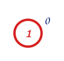

> Se inserta $1$ como en un ABB: es la raíz. Se revisan los factores de balanceo de abajo hacia arriba, por el camino del nodo nuevo: todos están entre $-1$ y $1$. Sigue siendo AVL.

:::
:::{tab-item} Paso 2
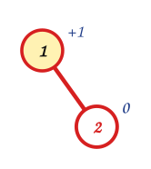

> Se inserta $2$ como en un ABB (camino: 1). Se revisan los factores de balanceo de abajo hacia arriba, por el camino del nodo nuevo: todos están entre $-1$ y $1$. Sigue siendo AVL.

:::
:::{tab-item} Paso 3
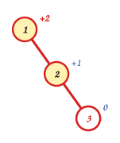

> Se inserta $3$ como en un ABB (camino: 1, 2). Se revisan los factores de balanceo de abajo hacia arriba, por el camino del nodo nuevo.

:::
:::{tab-item} Paso 4
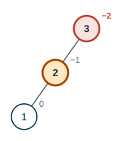

> El primer nodo desbalanceado (subiendo) es $p = 1$, con $fb(p) = +2$. Su hijo del lado más alto es $q = 2$, con $fb(q) = +1$.

:::
:::{tab-item} Paso 5


> **Caso A:** se ejecuta `LEFT-ROTATE(1)`: se rota $p = 1$ hacia la **izquierda**. La nueva raíz del subárbol es $2$ y todos los factores del subárbol quedan entre $-1$ y $1$.

:::
:::{tab-item} Paso 6
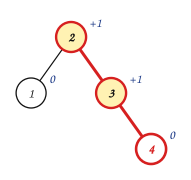

> Se inserta $4$ como en un ABB (camino: 2, 3). Se revisan los factores de balanceo de abajo hacia arriba, por el camino del nodo nuevo: todos están entre $-1$ y $1$. Sigue siendo AVL.

:::
:::{tab-item} Paso 7


> Se inserta $5$ como en un ABB (camino: 2, 3, 4). Se revisan los factores de balanceo de abajo hacia arriba, por el camino del nodo nuevo.

:::
:::{tab-item} Paso 8


> El primer nodo desbalanceado (subiendo) es $p = 3$, con $fb(p) = +2$. Su hijo del lado más alto es $q = 4$, con $fb(q) = +1$.

:::
:::{tab-item} Paso 9


> **Caso A:** se ejecuta `LEFT-ROTATE(3)`: se rota $p = 3$ hacia la **izquierda**. La nueva raíz del subárbol es $4$ y todos los factores del subárbol quedan entre $-1$ y $1$.

:::
:::{tab-item} Paso 10


> Se inserta $6$ como en un ABB (camino: 2, 4, 5). Se revisan los factores de balanceo de abajo hacia arriba, por el camino del nodo nuevo.

:::
:::{tab-item} Paso 11


> El primer nodo desbalanceado (subiendo) es $p = 2$, con $fb(p) = +2$. Su hijo del lado más alto es $q = 4$, con $fb(q) = +1$.

:::
:::{tab-item} Paso 12


> **Caso A:** se ejecuta `LEFT-ROTATE(2)`: se rota $p = 2$ hacia la **izquierda**. La nueva raíz del subárbol es $4$ y todos los factores del subárbol quedan entre $-1$ y $1$.

:::
:::{tab-item} Paso 13


> Se inserta $7$ como en un ABB (camino: 4, 5, 6). Se revisan los factores de balanceo de abajo hacia arriba, por el camino del nodo nuevo.

:::
:::{tab-item} Paso 14


> El primer nodo desbalanceado (subiendo) es $p = 5$, con $fb(p) = +2$. Su hijo del lado más alto es $q = 6$, con $fb(q) = +1$.

:::
:::{tab-item} Paso 15


> **Caso A:** se ejecuta `LEFT-ROTATE(5)`: se rota $p = 5$ hacia la **izquierda**. La nueva raíz del subárbol es $6$ y todos los factores del subárbol quedan entre $-1$ y $1$.

:::
::::
:::::

El resultado es un árbol **lleno** de altura $3$, contra la cadena de altura $7$ del ABB.

### Ejemplo 2

Dado el árbol $T$:


:::::{admonition} AVL-INSERT(T, 25)
:class: dropdown
::::{tab-set}
:::{tab-item} Paso 1


> Se inserta $25$ como en un ABB (camino: 50, 20, 30). Se revisan los factores de balanceo de abajo hacia arriba, por el camino del nodo nuevo.

:::
:::{tab-item} Paso 2


> El primer nodo desbalanceado (subiendo) es $p = 50$, con $fb(p) = −2$. Su hijo del lado más alto es $q = 20$, con $fb(q) = +1$.

:::
:::{tab-item} Paso 3


> **Caso F:** $fb(q)$ tiene signo contrario a $fb(p)$. Primero `LEFT-ROTATE(20)`: se rota $q = 20$ hacia la **izquierda** y el peso queda «en línea».

:::
:::{tab-item} Paso 4


> Luego `RIGHT-ROTATE(50)`: se rota $p = 50$ hacia la **derecha**. La nueva raíz del subárbol es $30$ y todos los factores quedan entre $-1$ y $1$.

:::
::::
:::::

## 6. Eliminación

Al igual que en la inserción, el borrado de un nodo solo modifica, a lo sumo en una unidad, los factores de balanceo de los nodos entre cierto nodo particular y la raíz. Ese nodo es el padre del nodo que **sale físicamente** del árbol: el propio nodo si tenía cero o un hijo, o su **sucesor** si tenía dos (caso 3 del ABB).

```text
AVL-DELETE(T, k)
1  borrar k de T como en un ABB
2  sea y el primer nodo posiblemente desbalanceado   // el padre del nodo que salió
3  AVL-REBALANCE(T, y)
```

Dos diferencias con la inserción:

- Al eliminar pueden aparecer **los seis casos**, incluidos B y E.
- Un rebalanceo puede **bajar** la altura del subárbol, y entonces un ancestro que estaba bien puede quedar desbalanceado: puede hacer falta **más de un** rebalanceo en el camino hacia la raíz.

El costo también es proporcional a la altura del árbol: $O(\log n)$.

### Ejemplo 3


:::::{admonition} AVL-DELETE(T, 1)
:class: dropdown
::::{tab-set}
:::{tab-item} Paso 1


> Se borra $1$ como en un ABB. El primer nodo posiblemente desbalanceado es $2$, el padre del nodo que salió; desde ahí se sube revisando hasta la raíz.

:::
:::{tab-item} Paso 2


> El primer nodo desbalanceado (subiendo) es $p = 2$, con $fb(p) = +2$. Su hijo del lado más alto es $q = 3$, con $fb(q) = +1$.

:::
:::{tab-item} Paso 3


> **Caso A:** se ejecuta `LEFT-ROTATE(2)`: se rota $p = 2$ hacia la **izquierda**. La nueva raíz del subárbol es $3$ y todos los factores del subárbol quedan entre $-1$ y $1$.

:::
:::{tab-item} Paso 4


> El primer nodo desbalanceado (subiendo) es $p = 5$, con $fb(p) = +2$. Su hijo del lado más alto es $q = 8$, con $fb(q) = +1$.

:::
:::{tab-item} Paso 5


> **Caso A:** se ejecuta `LEFT-ROTATE(5)`: se rota $p = 5$ hacia la **izquierda**. La nueva raíz del subárbol es $8$ y todos los factores del subárbol quedan entre $-1$ y $1$.

> El primer rebalanceo bajó la altura del subárbol de $2$ de $3$ a $2$, y eso desbalanceó a la raíz: por eso hizo falta un **segundo** rebalanceo.

:::
::::
:::::

## 7. Formalización

- Un árbol AVL con $n$ nodos tiene altura $O(\log n)$. Si $N(h)$ es el **mínimo** número de nodos de un AVL de altura $h$, entonces $N(h) = 1 + N(h-1) + N(h-2)$, que crece como los números de Fibonacci; de ahí, $h < 1{,}45 \log_2(n + 2)$.
- Por lo tanto, buscar, insertar y eliminar en un AVL cuestan $O(\log n)$.
- Las rotaciones cuestan $O(1)$ y preservan el invariante del ABB.
- En la inserción se hace a lo sumo un rebalanceo (una rotación simple o una doble); en la eliminación pueden hacer falta $O(\log n)$.

## Ejercicios

Practique con los [ejercicios de árboles AVL](exercises.md).

## Fuentes

- Aristizábal, A. *Árboles AVL* (factor de balanceo, rotaciones, casos de desbalanceo A–F, inserción, eliminación y ejemplos). Computación y Estructuras Discretas I, Universidad Icesi, 2026.
- Vargas Forero, V. M. *Estructuras de datos: árboles AVL*. Universidad del Valle.
- Cormen, T. H., Leiserson, C. E., Rivest, R. L., Stein, C. *Introduction to Algorithms*, 3.ª ed. The MIT Press, 2009. Problema 13-3 (árboles AVL) y sección 13.2 (rotaciones).

---

*Material adaptado del material original de los profesores Andrés Aristizábal y Victor Manuel Vargas.*
