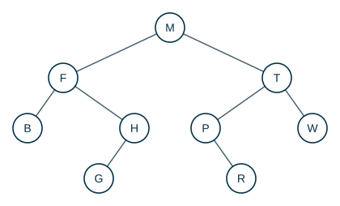

---
# Copyright (c) 2026 Angela Villota, and collaborators from the CyED block
# Licensed under the PolyForm Noncommercial License 1.0.0.
# Commercial use is prohibited without prior written authorization.
title: "Árboles binarios: Ejercicios"
---

# Árboles binarios: Ejercicios

Use esta página después de leer el [material de estudio de árboles binarios](index.md). Cada ejercicio trae **pistas** y una **solución general**; intente resolverlo antes de abrirlas.

---

### Ejercicio 1

Para el siguiente árbol binario indique: peso, altura, hojas, elementos no terminales, el nivel de $R$, el camino de $M$ a $G$ y su longitud. ¿Es completo? ¿Está lleno?

:::{admonition} Pistas
:class: dropdown
- La altura cuenta **nodos** de la rama más larga.
- Revise cada elemento no terminal: ¿tiene los dos subárboles no vacíos?
:::

:::{admonition} Solución general
:class: dropdown
Peso 9, altura 4, hojas B, G, R, W. $R$ está en el nivel $3$. El camino de $M$ a $G$ es $M, F, H, G$, de longitud $3$. No es completo ($H$ y $P$ tienen un solo hijo) y por lo tanto no está lleno.
:::

### Ejercicio 2

Dibuje **todos** los árboles binarios distintos con $3$ nodos (sin importar los valores). ¿Cuántos son? ¿Cuántos tienen altura $3$?

:::{admonition} Pistas
:class: dropdown
- La raíz puede tener: $2$ nodos a la izquierda y $0$ a la derecha, $1$ y $1$, o $0$ y $2$.
- Con $2$ nodos hay $2$ árboles distintos.
:::

:::{admonition} Solución general
:class: dropdown
Son $5$: $2 \cdot 1 + 1 \cdot 1 + 1 \cdot 2$. Cuatro tienen altura $3$ (son «cadenas»); solo el que tiene un hijo a cada lado tiene altura $2$. En general, el número de árboles binarios con $n$ nodos es el número de Catalan $\frac{1}{n+1}\binom{2n}{n}$.
:::

### Ejercicio 3

Demuestre que en un árbol binario **completo** (todo no terminal tiene exactamente dos hijos) con $\ell$ hojas hay exactamente $\ell - 1$ elementos no terminales.

:::{admonition} Pistas
:class: dropdown
- Es el resultado $n = m \cdot i + 1$ de árboles $m$-arios completos con $m = 2$.
- O por inducción estructural: un árbol completo es una hoja, o una raíz con dos subárboles completos.
:::

:::{admonition} Solución general
:class: dropdown
Con $i$ no terminales, $n = 2i + 1$ y también $n = i + \ell$. Igualando: $\ell = i + 1$.
:::

### Ejercicio 4

Agregue a `ArbolBinario<T>` los métodos `boolean estaLleno()`, `int contarEnNivel(int k)` (cuántos elementos hay en el nivel $k$) y `boolean esIgual(ArbolBinario<T> otro)` (misma forma y mismos elementos). Pruébelos con el árbol del Ejercicio 1.

:::{admonition} Pistas
:class: dropdown
- `estaLleno`: completo y con todas las hojas a la misma profundidad. Otra forma: el peso es $2^{\text{altura}} - 1$.
- `contarEnNivel(k)`: si $k = 0$ es $1$; si no, sume `contarEnNivel(k - 1)` en cada hijo.
:::

:::{admonition} Solución general
:class: dropdown
Para el árbol del Ejercicio 1: `estaLleno()` es `false`; `contarEnNivel(0..3)` da $1, 2, 4, 2$; `esIgual` con una copia del mismo árbol es `true`, y con el árbol del ejemplo de la sección 2 es `false`.
:::

### Ejercicio 5

Escriba un método que reciba un árbol binario y devuelva su **espejo** (el mismo árbol con los subárboles izquierdo y derecho intercambiados en todos los niveles). Demuestre por inducción estructural que el espejo del espejo es el árbol original.

---

*Material adaptado del material original de los profesores Andrés Aristizábal y Oscar Bedoya.*
