---
# Copyright (c) 2026 Angela Villota, and collaborators from the CyED block
# Licensed under the PolyForm Noncommercial License 1.0.0.
# Commercial use is prohibited without prior written authorization.
title: "Unidad 4: Árboles binarios"
---

# Unidad 4: Árboles binarios

## 1. El problema

¿Cómo se guarda en un programa una estructura en la que cada elemento se divide en **a lo sumo dos** partes, y **importa cuál es la izquierda y cuál la derecha**? Por ejemplo, la expresión $(x + 5) / (x - 3)$: el operador $/$ tiene un operando izquierdo, $(x + 5)$, y uno derecho, $(x - 3)$, y si se intercambian el resultado cambia. Cada operando, a su vez, se divide igual.

La respuesta es una estructura **recursiva**: un elemento y dos estructuras del mismo tipo.

## 2. Definición

**Árbol binario.** Un árbol binario es una estructura de datos recursiva que es:

- el **árbol vacío** (sin elementos ni subárboles), o
- un elemento, llamado **raíz**, con dos subárboles asociados, también binarios, llamados **hijo izquierdo** e **hijo derecho**.

A diferencia de un árbol $2$-ario cualquiera, en un árbol binario la posición **sí** importa. Estos dos árboles binarios son distintos:

| | |
|---|---|
| 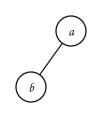 | 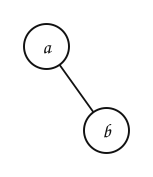 |
| $b$ es hijo **izquierdo** de $a$ | $b$ es hijo **derecho** de $a$ |

### Características

- **Hijo y padre.** $B$ es hijo de $A$ si $B$ es la raíz de alguno de los subárboles de $A$; $A$ es el padre de $B$.
- **Hermanos.** Dos elementos con el mismo padre.
- **Hoja.** Un elemento cuyos hijos izquierdo y derecho son vacíos.
- **Elemento no terminal.** Todo elemento que no es hoja.
- **Camino** entre $A$ y $B$. Una secuencia que empieza en $A$, termina en $B$ y en la que cada elemento es padre del siguiente. Su **longitud** es el número de elementos menos $1$.
- **Rama.** Un camino de la raíz a una hoja.
- **Peso.** El número de elementos del árbol.
- **Altura.** La longitud del camino más largo desde la raíz, más $1$ (el número de nodos de la rama más larga).
- **Nivel** de un elemento. La longitud del camino desde la raíz hasta el elemento.
- **Árbol binario completo.** Todo elemento no terminal tiene **exactamente dos** subárboles no vacíos.
- **Árbol binario lleno.** Es completo y además **todas sus hojas están en el mismo nivel**.

| | | |
|---|---|---|
| 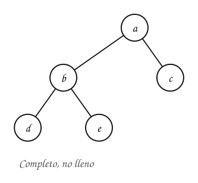 | 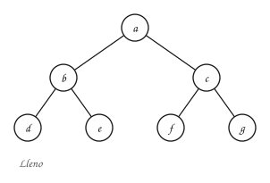 | 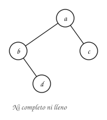 |

Otros textos usan «completo» y «lleno» con otros significados (por ejemplo, para los montículos de la Unidad 3, «completo» quiere decir lleno en todos los niveles menos el último, que se llena de izquierda a derecha). Aquí se usan las definiciones de esta sección.

### Ejemplo

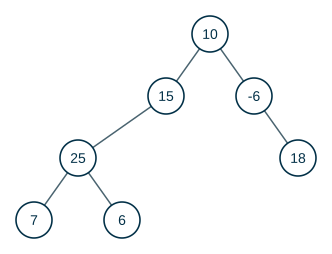

Responda sí o no:

1. ¿La raíz del árbol es $10$?
2. ¿La altura del árbol es $4$?
3. ¿El peso del árbol es $7$?
4. ¿Son hojas $7$, $6$ y $18$?
5. ¿Es un elemento no terminal $-6$?
6. ¿$15$ es hijo de $10$?
7. ¿$25$ es padre de $7$?
8. ¿Son hermanos $7$ y $6$?
9. ¿El camino entre $10$ y $7$ es $10, 15, 25, 7$?
10. ¿La longitud del camino entre $10$ y $7$ es $3$?
11. ¿$25$ está en el nivel $2$?
12. ¿El árbol es completo?
13. ¿El árbol está lleno?

:::{admonition} Respuesta
:class: dropdown
Del 1 al 11: **sí**. La rama más larga es $10, 15, 25, 7$ (o $10, 15, 25, 6$), con $4$ nodos.

12: **no**. $15$ es no terminal y tiene un solo subárbol no vacío (el izquierdo); lo mismo pasa con $-6$.

13: **no**. Para estar lleno tendría que ser completo.
:::

## 3. Altura y peso, recursivamente

La definición recursiva lleva directamente a fórmulas recursivas. Para un árbol con raíz $r$, subárbol izquierdo $I$ y subárbol derecho $D$:

$$
\text{peso}(\varnothing) = 0 \qquad \text{peso}(T) = 1 + \text{peso}(I) + \text{peso}(D)
$$

$$
\text{altura}(\varnothing) = 0 \qquad \text{altura}(T) = 1 + \max\big(\text{altura}(I), \text{altura}(D)\big)
$$

Así se ve el cálculo en el árbol del ejemplo. Cada nodo recibe su altura $h$ y su peso $p$ solo cuando ya se conocen los de sus dos subárboles:

:::::{admonition} Altura (h) y peso (p) de cada subárbol
:class: dropdown
::::{tab-set}
:::{tab-item} Paso 1
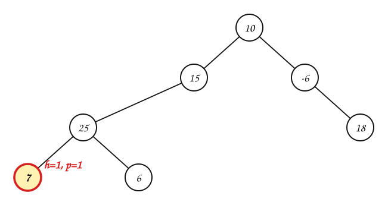

> $7$ es hoja: sus dos subárboles son vacíos (altura $0$, peso $0$). $h = 1 + \max(0, 0) = 1$, $p = 1 + 0 + 0 = 1$.

:::
:::{tab-item} Paso 2
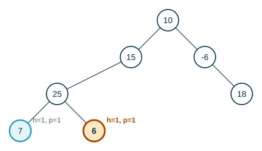

> $6$ es hoja: sus dos subárboles son vacíos (altura $0$, peso $0$). $h = 1 + \max(0, 0) = 1$, $p = 1 + 0 + 0 = 1$.

> **¿Por qué se calcula primero $7$ y $6$, y no $10$?**

:::
:::{tab-item} Paso 3
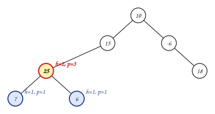

> $25$: ya se conocen sus subárboles. $h = 1 + \max(1, 1) = 2$, $p = 1 + 1 + 1 = 3$.

> Porque la altura y el peso de un nodo **dependen** de los de sus hijos. Hay que resolver primero los subárboles: es la recursión regresando desde las hojas.

:::
:::{tab-item} Paso 4
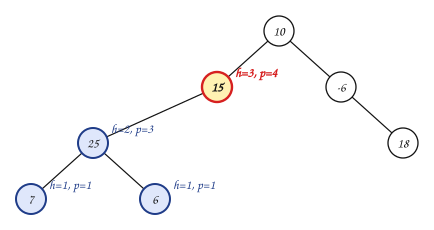

> $15$: ya se conocen sus subárboles. $h = 1 + \max(2, 0) = 3$, $p = 1 + 3 + 0 = 4$.

:::
:::{tab-item} Paso 5
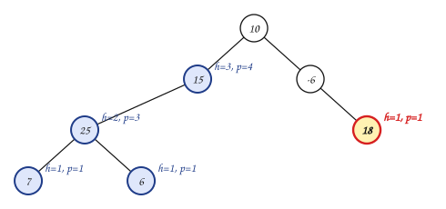

> $18$ es hoja: sus dos subárboles son vacíos (altura $0$, peso $0$). $h = 1 + \max(0, 0) = 1$, $p = 1 + 0 + 0 = 1$.

:::
:::{tab-item} Paso 6
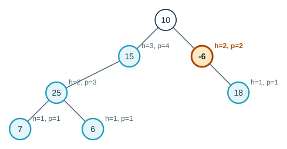

> $-6$: ya se conocen sus subárboles. $h = 1 + \max(0, 1) = 2$, $p = 1 + 0 + 1 = 2$.

:::
:::{tab-item} Paso 7
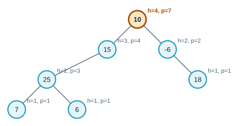

> $10$: ya se conocen sus subárboles. $h = 1 + \max(3, 2) = 4$, $p = 1 + 4 + 2 = 7$.

:::
::::
:::::

## 4. ¿Cuántos nodos caben?

> **¿Cuántos nodos puede tener, como máximo, el nivel $i$ de un árbol binario? ¿Y un árbol binario de altura $h$?**

:::{admonition} Respuesta
:class: dropdown
El nivel $0$ tiene $1$ nodo (la raíz) y cada nodo tiene a lo sumo $2$ hijos, así que el nivel $i$ tiene a lo sumo $2^i$ nodos. Un árbol de altura $h$ tiene niveles $0, \dots, h - 1$:

$$
1 + 2 + 4 + \cdots + 2^{h-1} = 2^h - 1
$$

El máximo se alcanza en un árbol **lleno**. Por ejemplo, con altura $4$: $2^4 - 1 = 15$ nodos.

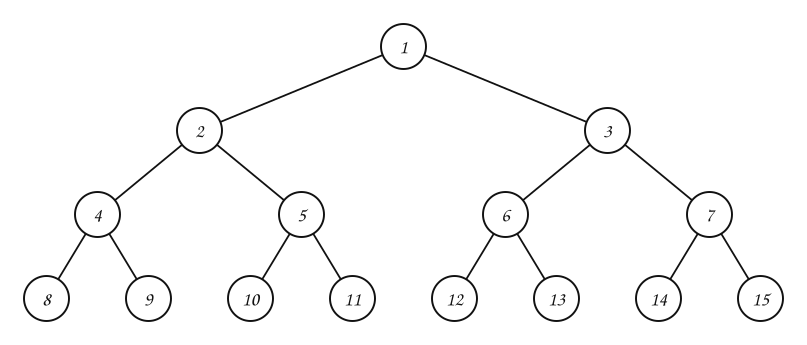
:::

Al revés: un árbol binario con $n$ nodos tiene altura **al menos** $\lceil \log_2(n + 1) \rceil$. Esto importa para los árboles de búsqueda: si el árbol se mantiene «bajo», recorrer una rama cuesta $O(\log n)$.

## 5. Ejemplos

**Ejemplo 1.** Para este árbol, ¿cuáles son las hojas? ¿Cuál es su altura y su peso? ¿Es completo? ¿Es lleno?

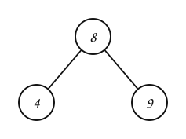

:::::{admonition} Paso a paso
:class: dropdown
::::{tab-set}
:::{tab-item} Paso 1
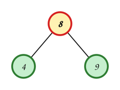

> **Hojas** (en verde, sin hijos): $4$, $9$. **No terminales** (en amarillo): $8$.

:::
:::{tab-item} Paso 2
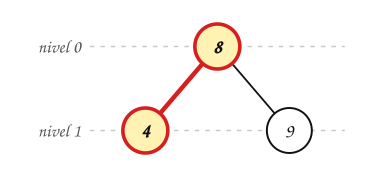

> Los niveles van de $0$ (la raíz) a $1$. La rama más larga, $8$ → $4$, tiene $2$ nodos: la **altura** es $2$.

:::
:::{tab-item} Paso 3
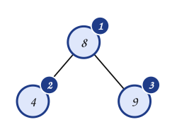

> Se cuentan los nodos: el **peso** es $3$.

:::
:::{tab-item} Paso 4
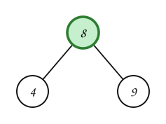

> **¿Completo?** Sí: cada no terminal ($8$) tiene exactamente dos hijos.

:::
:::{tab-item} Paso 5
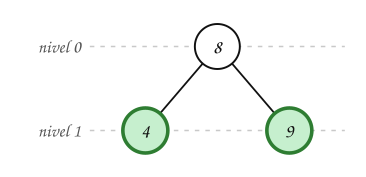

> **¿Lleno?** Sí: es completo y todas sus hojas están en el nivel $1$. Con altura $2$ caben a lo sumo $2^2 - 1 = 3$ nodos y tiene $3$.

:::
::::
:::::

**Ejemplo 2.** Para este árbol, ¿cuáles son las hojas? ¿Cuál es su altura y su peso? ¿Es completo? ¿Es lleno?

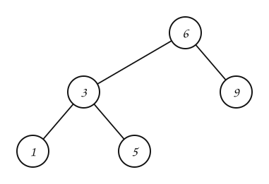

:::::{admonition} Paso a paso
:class: dropdown
::::{tab-set}
:::{tab-item} Paso 1
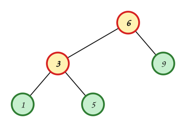

> **Hojas** (en verde, sin hijos): $1$, $5$, $9$. **No terminales** (en amarillo): $6$, $3$.

:::
:::{tab-item} Paso 2
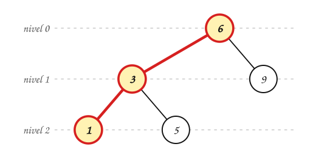

> Los niveles van de $0$ (la raíz) a $2$. La rama más larga, $6$ → $3$ → $1$, tiene $3$ nodos: la **altura** es $3$.

:::
:::{tab-item} Paso 3
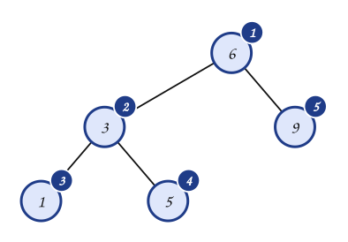

> Se cuentan los nodos: el **peso** es $5$.

:::
:::{tab-item} Paso 4
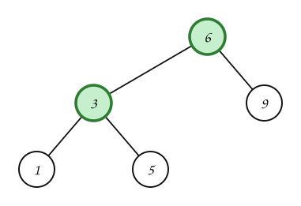

> **¿Completo?** Sí: cada no terminal ($6$, $3$) tiene exactamente dos hijos.

:::
:::{tab-item} Paso 5
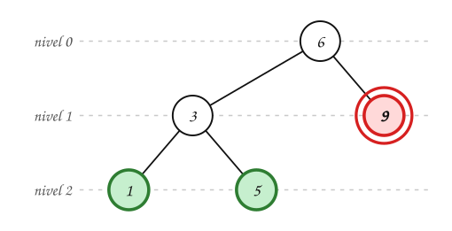

> **¿Lleno?** No: es completo, pero sus hojas están en los niveles $1$, $2$: no todas están en el mismo nivel (en rojo, las que no están en el último). Con altura $3$ caben a lo sumo $2^3 - 1 = 7$ nodos y tiene $5$: le faltan $2$ para estar lleno.

:::
::::
:::::

**Ejemplo 3.** Para este árbol, ¿cuáles son las hojas? ¿Cuál es su altura y su peso? ¿Es completo? ¿Es lleno?

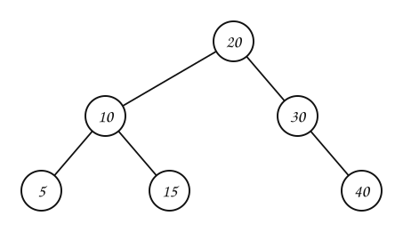

:::::{admonition} Paso a paso
:class: dropdown
::::{tab-set}
:::{tab-item} Paso 1
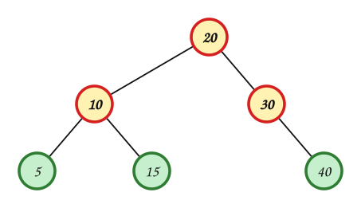

> **Hojas** (en verde, sin hijos): $5$, $15$, $40$. **No terminales** (en amarillo): $20$, $10$, $30$.

:::
:::{tab-item} Paso 2
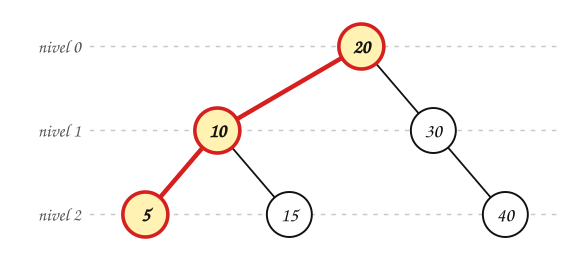

> Los niveles van de $0$ (la raíz) a $2$. La rama más larga, $20$ → $10$ → $5$, tiene $3$ nodos: la **altura** es $3$.

:::
:::{tab-item} Paso 3
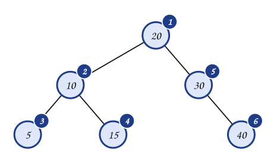

> Se cuentan los nodos: el **peso** es $6$.

:::
:::{tab-item} Paso 4
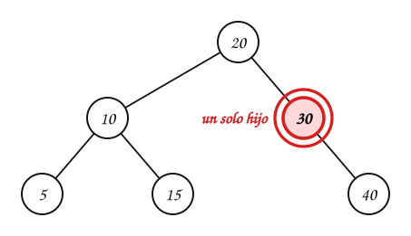

> **¿Completo?** No: $30$ es no terminal con un solo subárbol no vacío. En un árbol completo cada no terminal tiene **exactamente dos** hijos.

:::
:::{tab-item} Paso 5
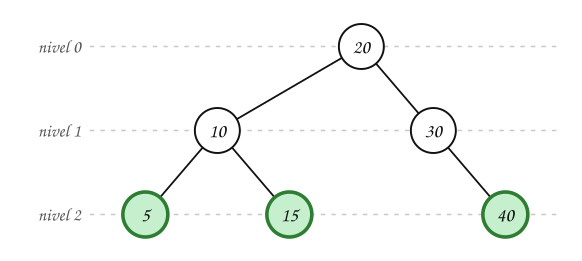

> **¿Lleno?** No: no es completo, así que tampoco puede ser lleno. Con altura $3$ caben a lo sumo $2^3 - 1 = 7$ nodos y tiene $6$: le faltan $1$ para estar lleno.

:::
::::
:::::

**Ejemplo 4.** Para este árbol, ¿cuáles son las hojas? ¿Cuál es su altura y su peso? ¿Es completo? ¿Es lleno?

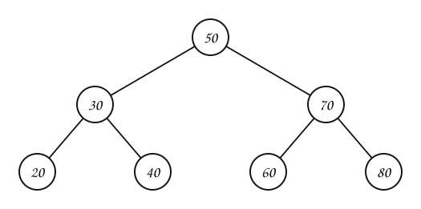

:::::{admonition} Paso a paso
:class: dropdown
::::{tab-set}
:::{tab-item} Paso 1
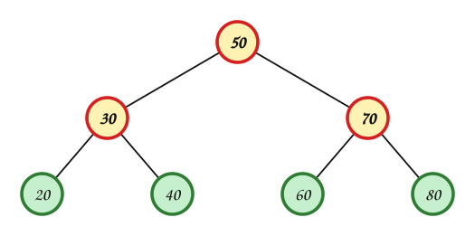

> **Hojas** (en verde, sin hijos): $20$, $40$, $60$, $80$. **No terminales** (en amarillo): $50$, $30$, $70$.

:::
:::{tab-item} Paso 2
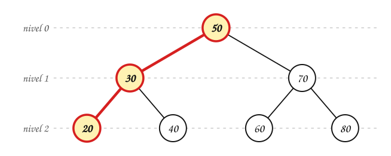

> Los niveles van de $0$ (la raíz) a $2$. La rama más larga, $50$ → $30$ → $20$, tiene $3$ nodos: la **altura** es $3$.

:::
:::{tab-item} Paso 3
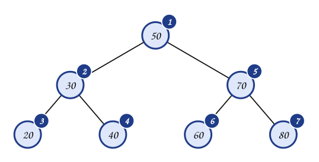

> Se cuentan los nodos: el **peso** es $7$.

:::
:::{tab-item} Paso 4
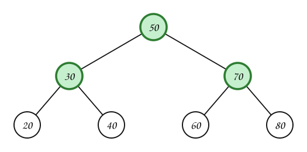

> **¿Completo?** Sí: cada no terminal ($50$, $30$, $70$) tiene exactamente dos hijos.

:::
:::{tab-item} Paso 5
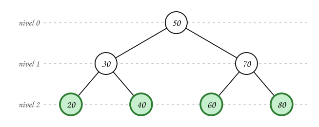

> **¿Lleno?** Sí: es completo y todas sus hojas están en el nivel $2$. Con altura $3$ caben a lo sumo $2^3 - 1 = 7$ nodos y tiene $7$.

:::
::::
:::::

**Ejemplo 5.** Para este árbol, ¿cuáles son las hojas? ¿Cuál es su altura y su peso? ¿Es completo? ¿Es lleno?

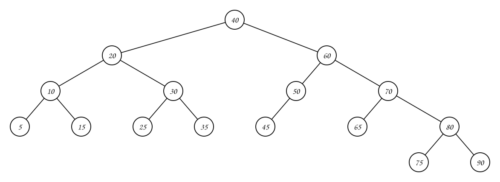

:::::{admonition} Paso a paso
:class: dropdown
::::{tab-set}
:::{tab-item} Paso 1
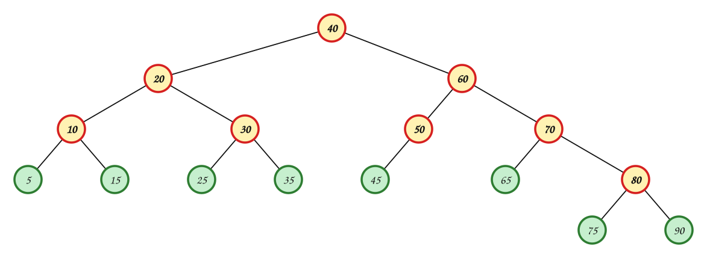

> **Hojas** (en verde, sin hijos): $5$, $15$, $25$, $35$, $45$, $65$, $75$, $90$. **No terminales** (en amarillo): $40$, $20$, $10$, $30$, $60$, $50$, $70$, $80$.

:::
:::{tab-item} Paso 2
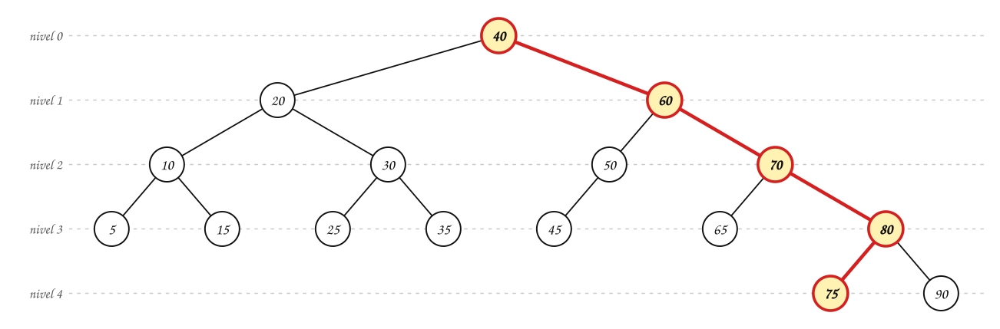

> Los niveles van de $0$ (la raíz) a $4$. La rama más larga, $40$ → $60$ → $70$ → $80$ → $75$, tiene $5$ nodos: la **altura** es $5$.

:::
:::{tab-item} Paso 3
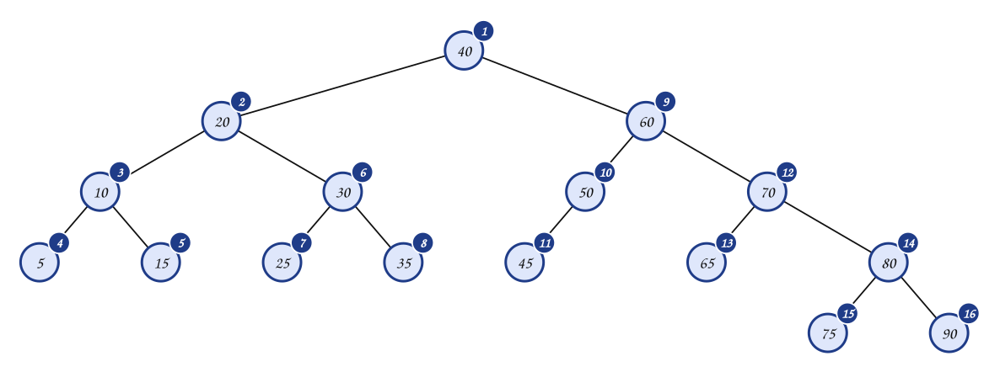

> Se cuentan los nodos: el **peso** es $16$.

:::
:::{tab-item} Paso 4
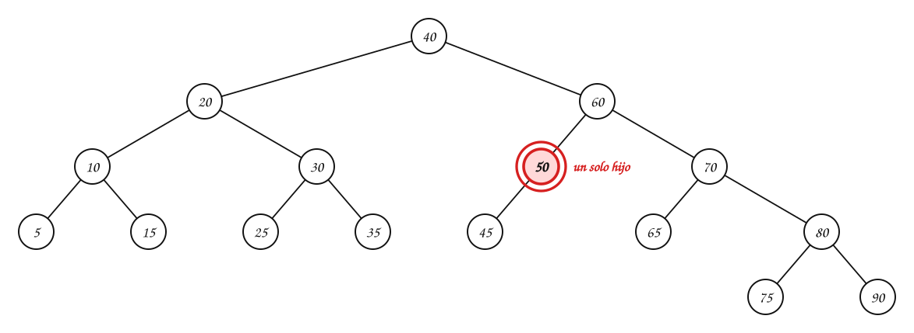

> **¿Completo?** No: $50$ es no terminal con un solo subárbol no vacío. En un árbol completo cada no terminal tiene **exactamente dos** hijos.

:::
:::{tab-item} Paso 5
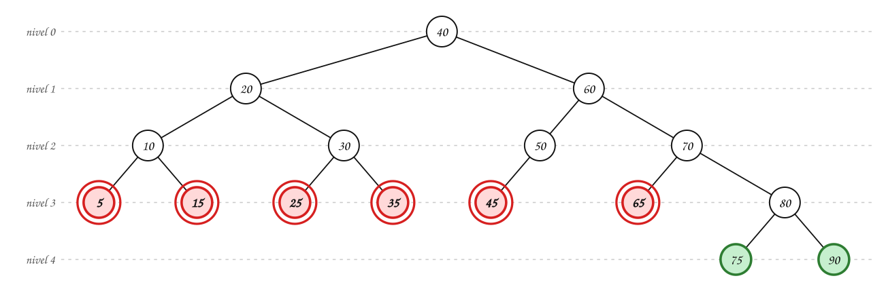

> **¿Lleno?** No: no es completo, así que tampoco puede ser lleno (además, sus hojas están en distintos niveles: en rojo, las que no están en el último). Con altura $5$ caben a lo sumo $2^5 - 1 = 31$ nodos y tiene $16$: le faltan $15$ para estar lleno.

:::
::::
:::::

## Ejercicios

Practique con los [ejercicios de árboles binarios](exercises.md).

## Fuentes

- Vargas Forero, V. M. *Estructuras de datos: árboles binarios* (definición, características, ejemplo). Introducción a la Programación Orientada a Objetos, Universidad del Valle.
- Aristizábal, A. *Árboles $n$-arios y árboles de búsqueda binaria*. Computación y Estructuras Discretas I, Universidad Icesi, 2026.
- Bedoya, O. *Árboles* (árbol $2$-ario o binario, árbol binario completo). Diapositivas del curso, Universidad del Valle.

---

*Material adaptado del material original de los profesores Victor Manuel Vargas, Andrés Aristizábal y Oscar Bedoya.*
