---
# Copyright (c) 2026 Angela Villota, and collaborators from the CyED block
# Licensed under the PolyForm Noncommercial License 1.0.0.
# Commercial use is prohibited without prior written authorization.
title: "Unidad 4: Árboles binarios ordenados y de búsqueda"
---

# Unidad 4: Árboles binarios ordenados y de búsqueda

Los ejemplos se desarrollan en desplegables con pestañas **Paso 1, Paso 2, …**: cada paso conserva lo anterior y muestra lo nuevo **en color**.

## 1. El problema

Se tiene una colección de llaves en la que hay que **buscar**, **insertar** y **eliminar** con frecuencia. ¿Qué estructura usar?

- **Lista sin orden:** insertar es $O(1)$, pero buscar es $O(n)$ (hay que revisar todo).
- **Arreglo ordenado:** buscar es rápido con **búsqueda binaria**, que divide sucesivamente la lista por la mitad. Pero insertar o eliminar cuesta $O(n)$, porque hay que correr elementos.

Búsqueda binaria del $6$ en la lista ordenada $1, 2, 5, 6, 10, 22, 26, 32, 40, 50$:

:::::{admonition} Búsqueda binaria de 6
:class: dropdown
::::{tab-set}
:::{tab-item} Paso 1


> La mitad es $10$. Como $6 < 10$, se descarta la mitad derecha.

:::
:::{tab-item} Paso 2


> La mitad es $2$. Como $6 > 2$, se descarta la mitad izquierda.

:::
:::{tab-item} Paso 3


> La mitad es $5$. Como $6 > 5$, se descarta la mitad izquierda.

:::
:::{tab-item} Paso 4


> La mitad es $6$: **es el buscado**. Se hicieron 4 comparaciones.

:::
::::
:::::

En cada paso se descarta la mitad: con $n$ elementos se hacen a lo sumo $\lfloor \log_2 n \rfloor + 1$ comparaciones. **¿Se puede tener una estructura que busque así de rápido y que además permita insertar sin correr elementos?** La idea: guardar «la mitad» de la búsqueda binaria en un nodo, la parte menor a su izquierda y la mayor a su derecha.

## 2. Definiciones

**Árbol binario ordenado.** Un árbol binario en el que todos los elementos del subárbol izquierdo son **menores** que la raíz y todos los del subárbol derecho son **mayores**. A su vez, los subárboles izquierdo y derecho son árboles binarios ordenados.

**Árbol binario de búsqueda (ABB).** Un árbol binario en el que cada nodo $x$ tiene una llave y se cumple la **propiedad del ABB**: si $y$ está en el subárbol izquierdo de $x$, entonces $y.key \le x.key$; si $y$ está en el subárbol derecho de $x$, entonces $y.key \ge x.key$.

Son la misma idea. La versión del ABB (Cormen et al.) permite llaves repetidas; la del árbol binario ordenado, no.

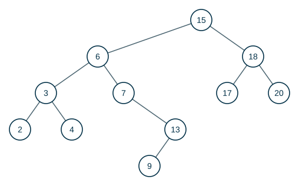

> **Recorra el árbol en inorden. ¿Qué observa?**

:::{admonition} Respuesta
:class: dropdown
$2, 3, 4, 6, 7, 9, 13, 15, 17, 18, 20$: las llaves salen **ordenadas de forma ascendente**. En inorden se visita primero todo lo menor (el subárbol izquierdo), luego la raíz y luego todo lo mayor. Recorrer el árbol en inorden toma $\Theta(n)$.
:::

## 3. Consultas

Todas las consultas siguen un solo camino desde la raíz hacia abajo (o hacia arriba): cuestan $O(h)$, donde $h$ es la altura del árbol.

### Buscar

Para buscar la llave $k$ desde un nodo $x$: si $x$ es `nil` o tiene la llave $k$, terminar. Si $k$ es menor, buscar en el subárbol izquierdo; si es mayor, en el derecho.

```text
TREE-SEARCH(x, k)                       ITERATIVE-TREE-SEARCH(x, k)
1  if x == NIL or k == x.key            1  while x ≠ NIL and k ≠ x.key
2      return x                         2      if k < x.key
3  if k < x.key                         3          x = x.left
4      return TREE-SEARCH(x.left, k)    4      else x = x.right
5  else return TREE-SEARCH(x.right, k)  5  return x
```

:::::{admonition} TREE-SEARCH(raíz, 13)
:class: dropdown
::::{tab-set}
:::{tab-item} Paso 1


> $13 < 15$: se sigue por el subárbol **izquierdo**.

:::
:::{tab-item} Paso 2
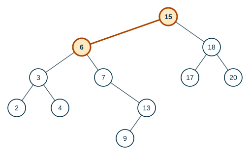

> $13 > 6$: se sigue por el subárbol **derecho**.

:::
:::{tab-item} Paso 3
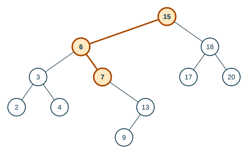

> $13 > 7$: se sigue por el subárbol **derecho**.

:::
:::{tab-item} Paso 4
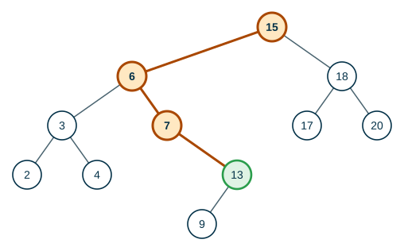

> $13 = 13$: **encontrado**.

:::
::::
:::::

:::::{admonition} TREE-SEARCH(raíz, 14)
:class: dropdown
::::{tab-set}
:::{tab-item} Paso 1
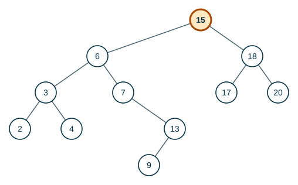

> $14 < 15$: se sigue por el subárbol **izquierdo**.

:::
:::{tab-item} Paso 2


> $14 > 6$: se sigue por el subárbol **derecho**.

:::
:::{tab-item} Paso 3


> $14 > 7$: se sigue por el subárbol **derecho**.

:::
:::{tab-item} Paso 4
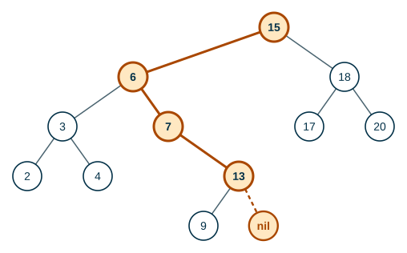

> $14 > 13$: se sigue por el subárbol **derecho**. Pero ese subárbol es vacío: **14 no está** en el árbol.

:::
::::
:::::

### Mínimo y máximo

> **¿En un ABB dónde se ubica el elemento mínimo? ¿Y el máximo?**

:::{admonition} Respuesta
:class: dropdown
El mínimo: siguiendo los apuntadores al hijo **izquierdo** desde la raíz hasta encontrar `nil`. El máximo: siguiendo los apuntadores al hijo **derecho**.

| Mínimo | Máximo |
|---|---|
|  |  |

```text
TREE-MINIMUM(x)                 TREE-MAXIMUM(x)
1  while x.left ≠ NIL           1  while x.right ≠ NIL
2      x = x.left               2      x = x.right
3  return x                     3  return x
```
:::

### Sucesor y predecesor

Dado un nodo $x$ con $x.key = k$:

- El **sucesor** de $x$ es el nodo $y$ cuya llave es la **menor** llave mayor que $k$ (el que sigue a $x$ en inorden).
- El **predecesor** de $x$ es el nodo $y$ cuya llave es la **mayor** llave menor que $k$.

Hay dos casos para el sucesor:

:::::{admonition} TREE-SUCCESSOR(6)
:class: dropdown
::::{tab-set}
:::{tab-item} Paso 1
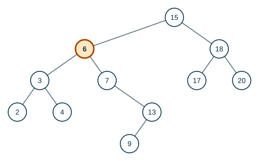

> $6$ tiene subárbol derecho: el sucesor es el **mínimo** de ese subárbol.

:::
:::{tab-item} Paso 2
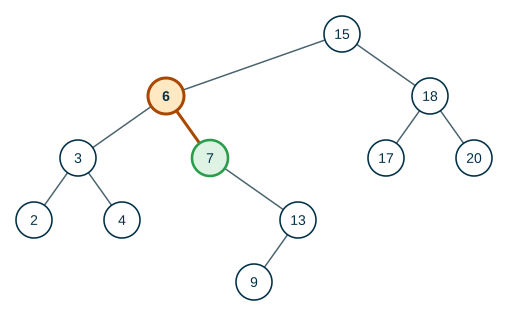

> Se baja a la derecha una vez y luego a la izquierda hasta el final: el sucesor de $6$ es $7$.

:::
::::
:::::

:::::{admonition} TREE-SUCCESSOR(13)
:class: dropdown
::::{tab-set}
:::{tab-item} Paso 1
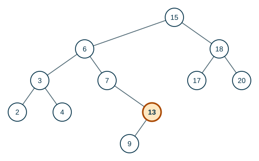

> $13$ **no** tiene subárbol derecho. Hay que subir hasta encontrar un ancestro del que $x$ esté en el subárbol **izquierdo**.

:::
:::{tab-item} Paso 2
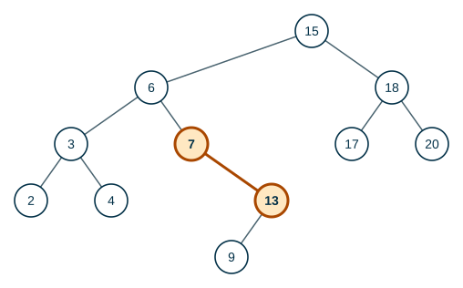

> $13$ es hijo **derecho** de $7$: se sigue subiendo.

:::
:::{tab-item} Paso 3
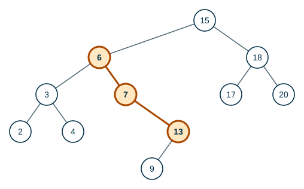

> $7$ es hijo **derecho** de $6$: se sigue subiendo.

:::
:::{tab-item} Paso 4
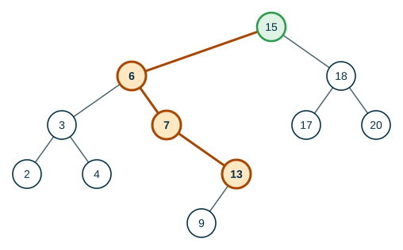

> $6$ es hijo **izquierdo** de $15$: el sucesor de $13$ es $15$.

:::
::::
:::::

```text
TREE-SUCCESSOR(x)
1  if x.right ≠ NIL
2      return TREE-MINIMUM(x.right)
3  y = x.p
4  while y ≠ NIL and x == y.right
5      x = y
6      y = y.p
7  return y
```

> **¿Cuál es el sucesor de $20$?**

:::{admonition} Respuesta
:class: dropdown
No tiene: $20$ es el máximo. $20$ no tiene subárbol derecho, y al subir siempre se llega desde un hijo derecho ($20$ es hijo derecho de $18$, $18$ de $15$) hasta la raíz, cuyo padre es `nil`. `TREE-SUCCESSOR` devuelve `nil`.
:::

## 4. Inserción

Para insertar la llave $k$ se busca como si estuviera en el árbol. La búsqueda termina en `nil`, y **ahí** se cuelga el nodo nuevo, como hoja.

Crear un ABB insertando las llaves $12, 5, 18, 2, 9, 15, 19, 13, 17$, en ese orden:

:::::{admonition} Insertar 12, 5, 18, 2, 9, 15, 19, 13, 17
:class: dropdown
::::{tab-set}
:::{tab-item} Paso 1


> El árbol está vacío: $12$ es la raíz.

:::
:::{tab-item} Paso 2


> Insertar $5$: $5 < 12$. Se cuelga como hijo **izquierdo** de $12$.

:::
:::{tab-item} Paso 3


> Insertar $18$: $18 > 12$. Se cuelga como hijo **derecho** de $12$.

:::
:::{tab-item} Paso 4


> Insertar $2$: $2 < 12$, $2 < 5$. Se cuelga como hijo **izquierdo** de $5$.

:::
:::{tab-item} Paso 5


> Insertar $9$: $9 < 12$, $9 > 5$. Se cuelga como hijo **derecho** de $5$.

:::
:::{tab-item} Paso 6
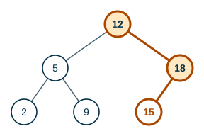

> Insertar $15$: $15 > 12$, $15 < 18$. Se cuelga como hijo **izquierdo** de $18$.

:::
:::{tab-item} Paso 7
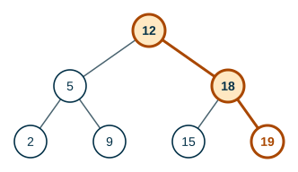

> Insertar $19$: $19 > 12$, $19 > 18$. Se cuelga como hijo **derecho** de $18$.

> **¿Dónde quedará $13$?**

:::
:::{tab-item} Paso 8
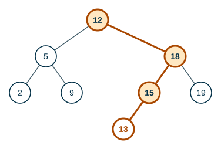

> Insertar $13$: $13 > 12$, $13 < 18$, $13 < 15$. Se cuelga como hijo **izquierdo** de $15$.

:::
:::{tab-item} Paso 9
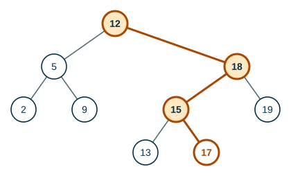

> Insertar $17$: $17 > 12$, $17 < 18$, $17 > 15$. Se cuelga como hijo **derecho** de $15$.

:::
::::
:::::

Inorden del árbol final: 2, 5, 9, 12, 13, 15, 17, 18, 19.

```text
TREE-INSERT(T, z)
1  y = NIL
2  x = T.root
3  while x ≠ NIL           // bajar como en una búsqueda; y es el padre de x
4      y = x
5      if z.key < x.key
6          x = x.left
7      else x = x.right
8  z.p = y
9  if y == NIL
10     T.root = z          // el árbol estaba vacío
11 elseif z.key < y.key
12     y.left = z
13 else y.right = z
```

### El orden de inserción importa

> **¿Qué árbol resulta al insertar $1, 2, 3, 4, 5$, en ese orden?**

:::{admonition} Respuesta
:class: dropdown


Cada llave es mayor que todas las anteriores y siempre va a la derecha: el árbol degenera en una **cadena** de altura $n$. Buscar $5$ toma $5$ comparaciones, igual que en una lista.
:::

Por eso: si el árbol se construye bien, la altura es cercana a $\log_2 n$ y las operaciones toman $\Theta(\log n)$; si degenera en una cadena, toman $\Theta(n)$. Los **árboles AVL** de la siguiente página evitan el caso malo.

## 5. Eliminación

Eliminar el nodo $z$ tiene tres casos:

1. $z$ **no tiene hijos**: su padre pasa a apuntar a `nil`.
2. $z$ **tiene un solo hijo**: se separa $z$ y su hijo ocupa su lugar.
3. $z$ **tiene dos hijos**: se separa su **sucesor** $y$ (que no tiene hijo izquierdo, así que se quita como en el caso 1 o 2) y la llave de $y$ reemplaza la de $z$.

Sobre el árbol de la sección 4: eliminar $9$, luego $5$ y luego $12$.

:::::{admonition} TREE-DELETE: los tres casos
:class: dropdown
::::{tab-set}
:::{tab-item} Paso 1
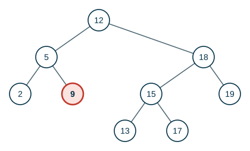

> **Caso 1.** $9$ no tiene hijos: basta con que su padre ($5$) apunte a `nil` en su lugar.

:::
:::{tab-item} Paso 2
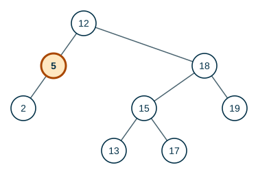

> Se quitó $9$.

:::
:::{tab-item} Paso 3
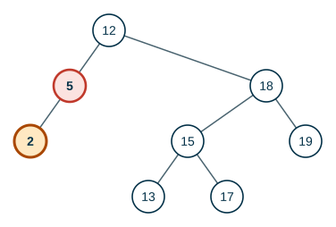

> **Caso 2.** $5$ tiene un solo hijo ($2$): se separa $5$ y su padre ($12$) pasa a apuntar directamente a $2$.

:::
:::{tab-item} Paso 4
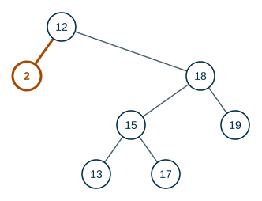

> $2$ ocupa el lugar de $5$. El árbol sigue siendo de búsqueda: $2 < 12$.

:::
:::{tab-item} Paso 5
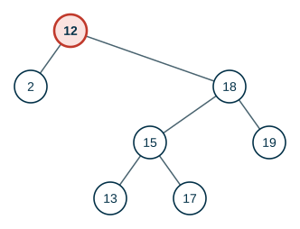

> **Caso 3.** $12$ tiene dos hijos. **¿Cuál de los nodos restantes debería ocupar su lugar?**

:::
:::{tab-item} Paso 6
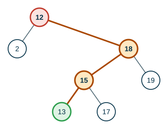

> Su **sucesor**: el mínimo del subárbol derecho, $13$. Es mayor que todo lo de la izquierda y menor que todo lo demás de la derecha. Además, el sucesor no tiene hijo izquierdo, así que quitarlo es el caso 1 o el 2.

:::
:::{tab-item} Paso 7
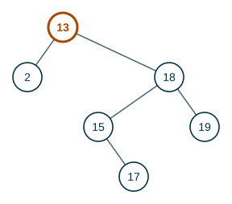

> Se separa el sucesor $13$ y su llave reemplaza la de $12$.

:::
::::
:::::

Inorden después de las tres eliminaciones: 2, 13, 15, 17, 18, 19. Sigue ordenado.

## 6. Implementación en Java

**Análisis.**

| | |
|---|---|
| **Entradas** | Llaves de un tipo comparable (`T extends Comparable<T>`). |
| **Salidas** | El árbol tras insertar y eliminar; respuestas a buscar y mínimo; el inorden. |
| **Proceso** | Nodo con `llave`, `izq` y `der`; buscar y mínimo iterativos; insertar y eliminar recursivos. |

**Diseño.** Insertar y eliminar se escriben como funciones recursivas que **devuelven la nueva raíz del subárbol**. Así, `x.izq = insertar(x.izq, k)` reconecta el árbol sin necesitar apuntadores al padre. Para el caso 3 de eliminar se copia la llave del sucesor y luego se elimina el sucesor del subárbol derecho.

**Codificación.**

```java
import java.util.ArrayList;
import java.util.List;

public class ABB<T extends Comparable<T>> {

    private static class Nodo<T> {
        T llave;
        Nodo<T> izq;
        Nodo<T> der;

        Nodo(T llave) {
            this.llave = llave;
        }
    }

    private Nodo<T> raiz;

    public boolean buscar(T k) {
        Nodo<T> x = raiz;
        while (x != null && k.compareTo(x.llave) != 0) {
            x = k.compareTo(x.llave) < 0 ? x.izq : x.der;
        }
        return x != null;
    }

    public T minimo() {
        Nodo<T> x = raiz;
        while (x.izq != null) {
            x = x.izq;
        }
        return x.llave;
    }

    public void insertar(T k) {
        raiz = insertar(raiz, k);
    }

    // Devuelve la raíz del subárbol después de insertar k en él.
    private Nodo<T> insertar(Nodo<T> x, T k) {
        if (x == null) {
            return new Nodo<>(k);
        }
        if (k.compareTo(x.llave) < 0) {
            x.izq = insertar(x.izq, k);
        } else {
            x.der = insertar(x.der, k);
        }
        return x;
    }

    public void eliminar(T k) {
        raiz = eliminar(raiz, k);
    }

    private Nodo<T> eliminar(Nodo<T> x, T k) {
        if (x == null) {
            return null;                      // k no está
        }
        int c = k.compareTo(x.llave);
        if (c < 0) {
            x.izq = eliminar(x.izq, k);
        } else if (c > 0) {
            x.der = eliminar(x.der, k);
        } else if (x.izq == null) {
            return x.der;                     // casos 1 y 2: cero o un hijo
        } else if (x.der == null) {
            return x.izq;
        } else {
            Nodo<T> s = x.der;                // caso 3: dos hijos
            while (s.izq != null) {
                s = s.izq;                    // sucesor = mínimo del subárbol derecho
            }
            x.llave = s.llave;
            x.der = eliminar(x.der, s.llave);
        }
        return x;
    }

    public List<T> inorden() {
        List<T> res = new ArrayList<>();
        inorden(raiz, res);
        return res;
    }

    private void inorden(Nodo<T> x, List<T> res) {
        if (x != null) {
            inorden(x.izq, res);
            res.add(x.llave);
            inorden(x.der, res);
        }
    }

    public static void main(String[] args) {
        ABB<Integer> t = new ABB<>();
        for (int k : new int[] {12, 5, 18, 2, 9, 15, 19, 13, 17}) {
            t.insertar(k);
        }
        System.out.println("inorden: " + t.inorden());
        System.out.println("buscar 13: " + t.buscar(13) + ", buscar 14: " + t.buscar(14));
        System.out.println("minimo: " + t.minimo());
        t.eliminar(9);
        t.eliminar(5);
        t.eliminar(12);
        System.out.println("después de eliminar 9, 5 y 12: " + t.inorden());
    }
}
```

**Prueba.**

```text
inorden: [2, 5, 9, 12, 13, 15, 17, 18, 19]
buscar 13: true, buscar 14: false
minimo: 2
después de eliminar 9, 5 y 12: [2, 13, 15, 17, 18, 19]
```

Son los resultados de las secciones 4 y 5.

## 7. Formalización

- Si $x$ es la raíz de un subárbol con $n$ nodos, `INORDER-TREE-WALK(x)` toma $\Theta(n)$ y lista las llaves en orden.
- `SEARCH`, `MINIMUM`, `MAXIMUM`, `SUCCESSOR`, `PREDECESSOR`, `INSERT` y `DELETE` toman $O(h)$ en un ABB de altura $h$.
- Para un árbol binario lleno con $n$ nodos, $h = \Theta(\log n)$; si el árbol es una cadena, $h = \Theta(n)$.

## Ejercicios

Practique con los [ejercicios de árboles binarios de búsqueda](exercises.md).

## Fuentes

- Aristizábal, A. *Árboles de búsqueda binaria* (propiedad, consultas, inserción, eliminación). Computación y Estructuras Discretas I, Universidad Icesi, 2026.
- Bedoya, O. *Árboles: árboles binarios de búsqueda*. Diapositivas del curso, Universidad del Valle.
- Cormen, T. H., Leiserson, C. E., Rivest, R. L., Stein, C. *Introduction to Algorithms*, 3.ª ed. The MIT Press, 2009. Capítulo 12.

---

*Material adaptado del material original de los profesores Andrés Aristizábal y Oscar Bedoya.*
