---
# Copyright (c) 2026 Angela Villota, and collaborators from the CyED block
# Licensed under the PolyForm Noncommercial License 1.0.0.
# Commercial use is prohibited without prior written authorization.
title: "Unidad 4: Árboles binarios ordenados y de búsqueda"
---

# Unidad 4: Árboles binarios ordenados y de búsqueda

## 1. El problema

En una bolsa hay $27$ fichas, cada una con una llave. **Buscar la llave $45$.**

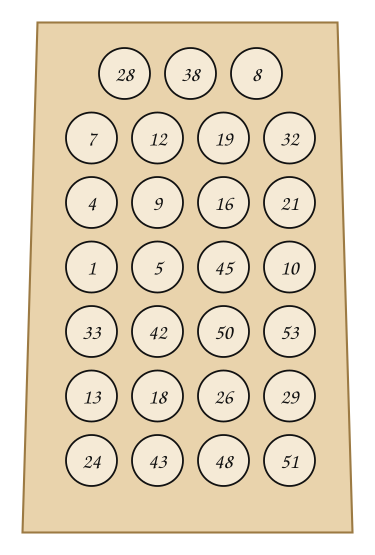

:::{admonition} Respuesta
:class: dropdown
Sin ningún orden, no queda más que sacar fichas una por una: $28, 38, 8, 7, 12, 19, 32, 4, 9, 16, 21, 1, 5, 45$. Se necesitan **$14$ comparaciones**, y en el peor caso, $27$.
:::

Si las llaves estuvieran en una **lista ordenada**, se podría usar la **búsqueda binaria**: dividir sucesivamente la lista por la mitad hasta encontrar el elemento. Buscar $6$ en la lista $1, 2, 5, 6, 10, 22, 26, 32, 40, 50$:

:::::{admonition} Búsqueda binaria de 6
:class: dropdown
::::{tab-set}
:::{tab-item} Paso 1
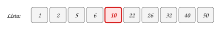

> La mitad es $10$. Como $6 < 10$, se descarta la mitad derecha.

:::
:::{tab-item} Paso 2


> La mitad es $2$. Como $6 > 2$, se descarta la mitad izquierda.

:::
:::{tab-item} Paso 3
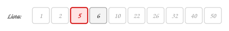

> La mitad es $5$. Como $6 > 5$, se descarta la mitad izquierda.

:::
:::{tab-item} Paso 4
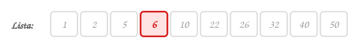

> La mitad es $6$: **es el buscado**. Se hicieron 4 comparaciones.

:::
::::
:::::

Pero en una lista, insertar o quitar una llave obliga a correr las demás. Las mismas $27$ llaves de la bolsa, organizadas en un árbol:

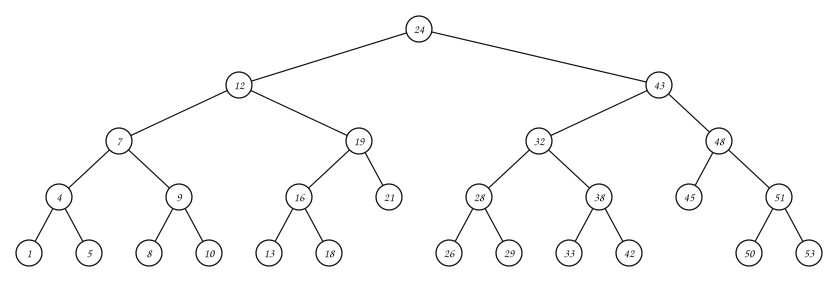

:::::{admonition} TREE-SEARCH(raíz, 45)
:class: dropdown
::::{tab-set}
:::{tab-item} Paso 1
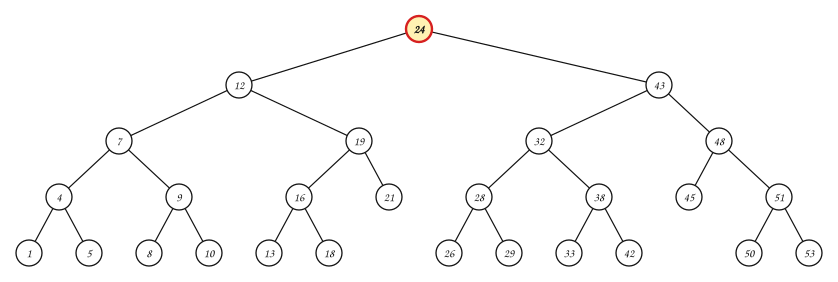

> $45 > 24$: se sigue por el subárbol **derecho**.

:::
:::{tab-item} Paso 2
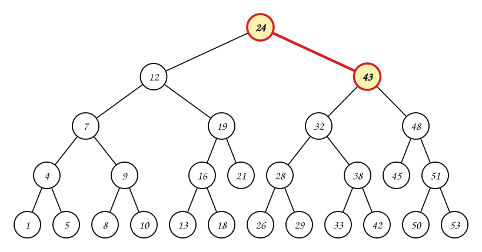

> $45 > 43$: se sigue por el subárbol **derecho**.

:::
:::{tab-item} Paso 3
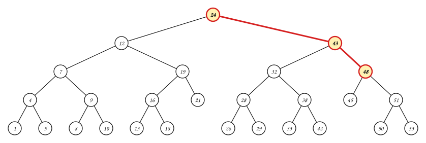

> $45 < 48$: se sigue por el subárbol **izquierdo**.

:::
:::{tab-item} Paso 4
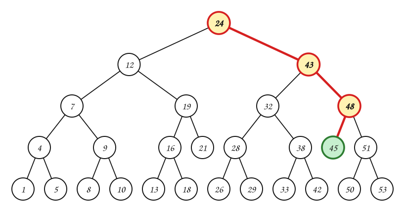

> $45 = 45$: **encontrado**, con 4 comparaciones.

:::
::::
:::::

**¿Qué propiedad del árbol permite descartar la mitad de las llaves en cada comparación?**

## 2. Árbol binario de búsqueda

**Árbol binario de búsqueda (ABB).** Es un árbol binario en el que cada vértice tiene una **llave**. La llave de un vértice es **mayor** que las llaves de los vértices de su subárbol izquierdo y **menor** que las llaves de los vértices de su subárbol derecho.

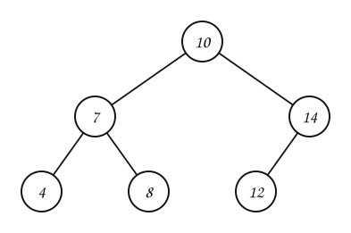

Con llaves repetidas, la propiedad se escribe con $\le$ y $\ge$. Sea $x$ un nodo del árbol:

- si $y$ es un nodo del subárbol **izquierdo** de $x$, entonces $key[y] \le key[x]$;
- si $y$ es un nodo del subárbol **derecho** de $x$, entonces $key[y] \ge key[x]$.

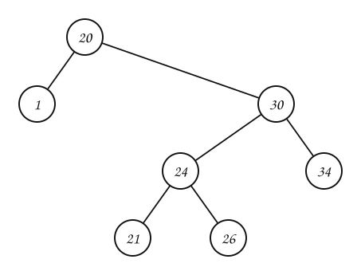

A un árbol binario en el que todos los elementos del subárbol izquierdo son menores que la raíz, todos los del derecho son mayores y ambos subárboles son a su vez ordenados, también se le llama **árbol binario ordenado**.

> **Recorra el árbol de la derecha en inorden. ¿Qué observa?**

:::{admonition} Respuesta
:class: dropdown
$1, 20, 21, 24, 26, 30, 34$: si se recorre en inorden, un ABB produce la lista de sus llaves **ordenada ascendentemente**. En inorden se visita primero todo lo menor (el subárbol izquierdo), luego la raíz y luego todo lo mayor.

```text
INORDER-TREE-WALK(x)
1  if x ≠ NIL
2      INORDER-TREE-WALK(left[x])
3      print key[x]
4      INORDER-TREE-WALK(right[x])
```

Visita cada nodo una vez: toma $\Theta(n)$ en un árbol de $n$ nodos.
:::

Las operaciones básicas (insertar, borrar, buscar) toman un tiempo **proporcional a la altura** del árbol. Para un árbol binario completo con $n$ nodos toman $\Theta(\log n)$; si el árbol se construye como una cadena lineal de $n$ nodos, toman $\Theta(n)$.

## 3. Consultas

Las consultas sobre un ABB son: **buscar** una llave, el **mínimo**, el **máximo**, el **sucesor** y el **predecesor** de un nodo. Cada una recorre un solo camino del árbol: todas toman $O(h)$, con $h$ la altura del árbol.

### Buscar

Para buscar un nodo con llave $k$ empezando en el nodo $x$ (la raíz): si $x$ es `nil` o tiene la llave $k$, terminar. Si $k$ es menor, buscar en el subárbol izquierdo; si es mayor, en el derecho.

```text
TREE-SEARCH(x, k)                       ITERATIVE-TREE-SEARCH(x, k)
1  if x = NIL or k = key[x]             1  while x ≠ NIL and k ≠ key[x]
2      return x                         2      if k < key[x]
3  if k < key[x]                        3          x ← left[x]
4      return TREE-SEARCH(left[x], k)   4      else x ← right[x]
5  else return TREE-SEARCH(right[x], k) 5  return x
```

Si la llave no está, la búsqueda baja hasta un subárbol vacío:

:::::{admonition} TREE-SEARCH(raíz, 11)
:class: dropdown
::::{tab-set}
:::{tab-item} Paso 1


> $11 < 24$: se sigue por el subárbol **izquierdo**.

:::
:::{tab-item} Paso 2
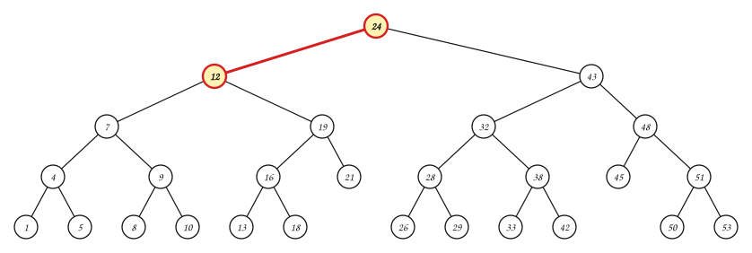

> $11 < 12$: se sigue por el subárbol **izquierdo**.

:::
:::{tab-item} Paso 3
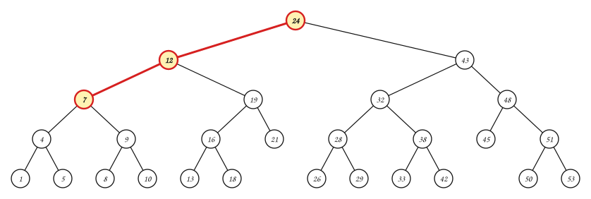

> $11 > 7$: se sigue por el subárbol **derecho**.

:::
:::{tab-item} Paso 4
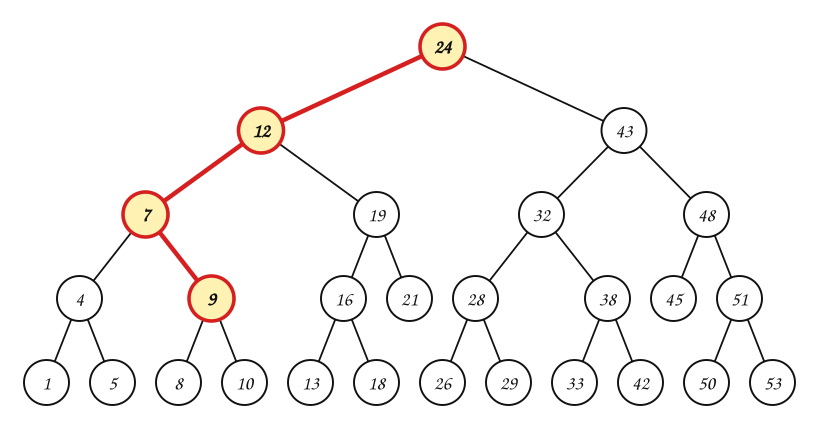

> $11 > 9$: se sigue por el subárbol **derecho**.

:::
:::{tab-item} Paso 5
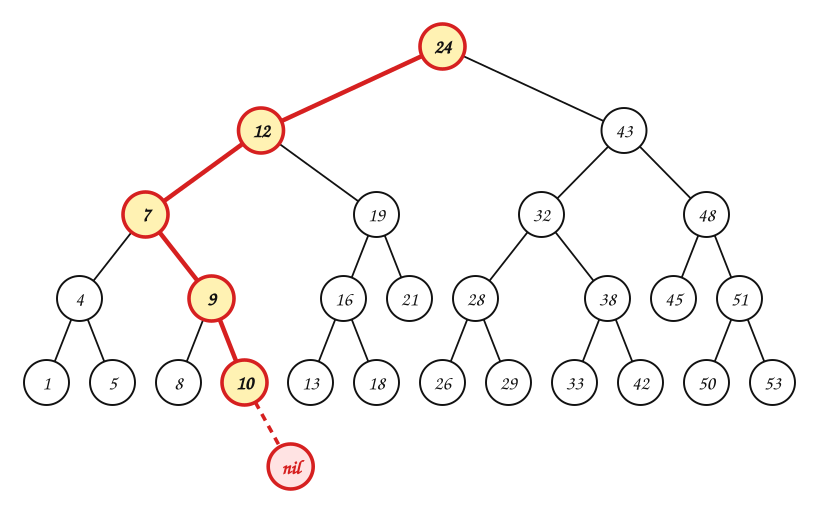

> $11 > 10$: se sigue por el subárbol **derecho**. Pero ese subárbol es vacío: **$11$ no está** en el árbol.

:::
::::
:::::

### Mínimo y máximo

> **¿En un ABB dónde se ubica el elemento mínimo? ¿Y el máximo?**

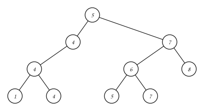

:::{admonition} Respuesta
:class: dropdown
El mínimo: se siguen los apuntadores al hijo **izquierdo** desde la raíz hasta que se encuentre `nil`. El máximo: se siguen los apuntadores al hijo **derecho**.

| Mínimo | Máximo |
|---|---|
| 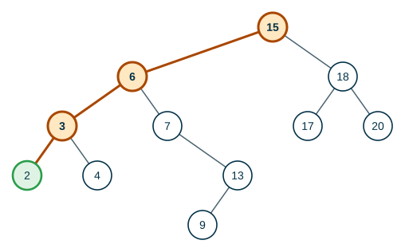 | 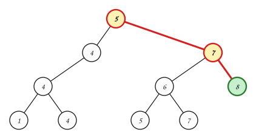 |

```text
TREE-MINIMUM(x)                 TREE-MAXIMUM(x)
1  while left[x] ≠ NIL          1  while right[x] ≠ NIL
2      x ← left[x]              2      x ← right[x]
3  return x                     3  return x
```

Este árbol tiene llaves repetidas: hay tres $4$ y dos $7$. La propiedad con $\le$ y $\ge$ se cumple, y el mínimo y el máximo se encuentran igual.
:::

### Sucesor y predecesor

Dado un nodo $x$ con $key[x] = k$:

- El **sucesor** de $x$ es el nodo $y$ tal que $key[y]$ es la **menor** llave mayor que $key[x]$: el que sigue a $x$ en inorden.
- El **predecesor** de $x$ es el nodo $y$ tal que $key[y]$ es la **mayor** llave menor que $key[x]$.

En el árbol de la sección 1, el sucesor de $19$ es $21$ y el de $21$ es $24$. Para encontrarlos hay dos casos:

:::::{admonition} TREE-SUCCESSOR(19)
:class: dropdown
::::{tab-set}
:::{tab-item} Paso 1
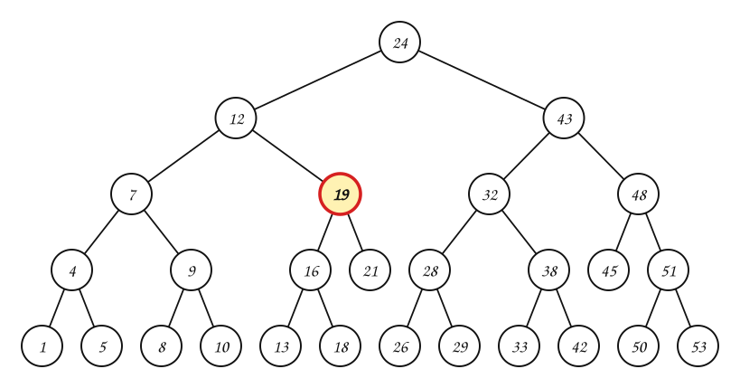

> $19$ tiene subárbol derecho: el sucesor es el **mínimo** de ese subárbol (`TREE-MINIMUM(right[x])`).

:::
:::{tab-item} Paso 2
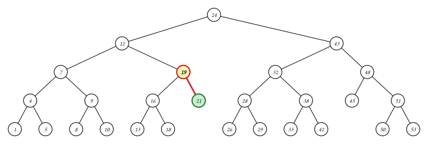

> Se baja a la derecha una vez y luego a la izquierda hasta el final: el sucesor de $19$ es $21$.

:::
::::
:::::

:::::{admonition} TREE-SUCCESSOR(21)
:class: dropdown
::::{tab-set}
:::{tab-item} Paso 1
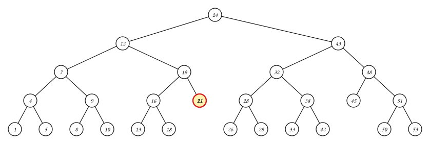

> $21$ **no** tiene subárbol derecho. Hay que subir mientras se llegue desde un hijo **derecho**.

:::
:::{tab-item} Paso 2
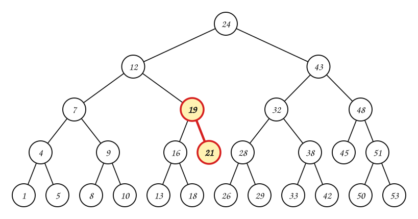

> $21$ es hijo **derecho** de $19$: se sigue subiendo.

:::
:::{tab-item} Paso 3
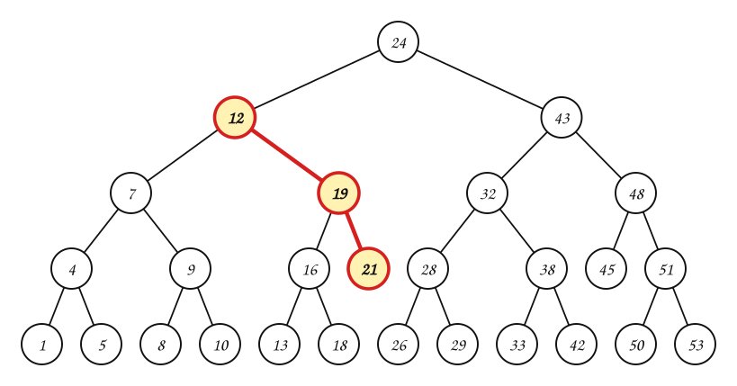

> $19$ es hijo **derecho** de $12$: se sigue subiendo.

:::
:::{tab-item} Paso 4
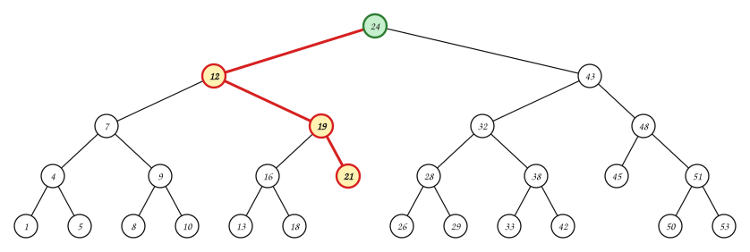

> $12$ es hijo **izquierdo** de $24$: el sucesor de $21$ es $24$.

:::
::::
:::::

```text
TREE-SUCCESSOR(x)
1  if right[x] ≠ NIL
2      return TREE-MINIMUM(right[x])
3  y ← p[x]
4  while y ≠ NIL and x = right[y]
5      x ← y
6      y ← p[y]
7  return y
```

> **¿Cuál es el sucesor de $53$?**

:::{admonition} Respuesta
:class: dropdown
No tiene: $53$ es el máximo. No tiene subárbol derecho, y al subir siempre se llega desde un hijo derecho ($53$ es hijo derecho de $51$, $51$ de $48$, $48$ de $43$ y $43$ de $24$) hasta la raíz, cuyo padre es `nil`. `TREE-SUCCESSOR` devuelve `nil`.
:::

## 4. Inserción

Para insertar el nodo $z$, se baja como en una búsqueda: $x$ es el nodo actual y $y$ va un paso atrás (el padre de $x$). Cuando $x$ llega a `nil`, $z$ se cuelga de $y$, como hoja.

```text
TREE-INSERT(T, z)
1  y ← NIL
2  x ← root[T]
3  while x ≠ NIL
4      y ← x
5      if key[z] < key[x]
6          x ← left[x]
7      else x ← right[x]
8  p[z] ← y
9  if y = NIL
10     root[T] ← z            // el árbol estaba vacío
11 else if key[z] < key[y]
12     left[y] ← z
13 else right[y] ← z
```

Explique el código anterior para el caso de `TREE-INSERT(z)` con $key[z] = 5$:

:::::{admonition} TREE-INSERT(T, z) con key[z] = 5
:class: dropdown
::::{tab-set}
:::{tab-item} Paso 1


> Líneas 1 y 2: $y = $ NIL, $x = $ la raíz $8$.

| Iteración | y | x | Comparación |
|---|---|---|---|
| inicio | NIL | 8 |  |

:::
:::{tab-item} Paso 2
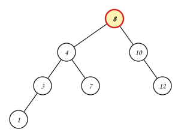

> $y = 8$. Como $5 < 8$, $x$ baja al hijo **izquierdo**: $x = $ 4.

| Iteración | y | x | Comparación |
|---|---|---|---|
| inicio | NIL | 8 |  |
| $\textcolor{#a94700}{\textbf{1}}$ | $\textcolor{#a94700}{\textbf{8}}$ | $\textcolor{#a94700}{\textbf{4}}$ | $5 < 8$ |

:::
:::{tab-item} Paso 3
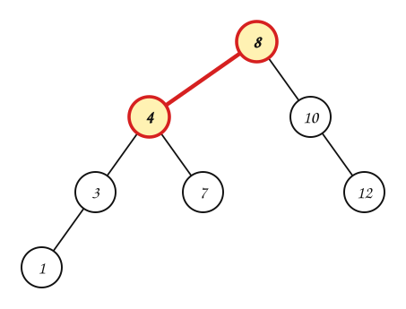

> $y = 4$. Como $5 > 4$, $x$ baja al hijo **derecho**: $x = $ 7.

| Iteración | y | x | Comparación |
|---|---|---|---|
| inicio | NIL | 8 |  |
| 1 | 8 | 4 | $5 < 8$ |
| $\textcolor{#a94700}{\textbf{2}}$ | $\textcolor{#a94700}{\textbf{4}}$ | $\textcolor{#a94700}{\textbf{7}}$ | $5 > 4$ |

:::
:::{tab-item} Paso 4
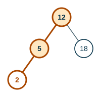

> $y = 7$. Como $5 < 7$, $x$ baja al hijo **izquierdo**: $x = $ NIL.

| Iteración | y | x | Comparación |
|---|---|---|---|
| inicio | NIL | 8 |  |
| 1 | 8 | 4 | $5 < 8$ |
| 2 | 4 | 7 | $5 > 4$ |
| $\textcolor{#a94700}{\textbf{3}}$ | $\textcolor{#a94700}{\textbf{7}}$ | $\textcolor{#a94700}{\textbf{NIL}}$ | $5 < 7$ |

:::
:::{tab-item} Paso 5
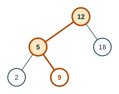

> $x$ es NIL: termina el ciclo. Línea 8: $p[z] = y = 7$. Como $5 < 7$, $z$ queda como hijo **izquierdo** de $7$ (línea 12).

:::
::::
:::::

### El orden de inserción importa

> **¿Qué árbol resulta al insertar $1, 2, 3, 4, 5$, en ese orden?**

:::{admonition} Respuesta
:class: dropdown
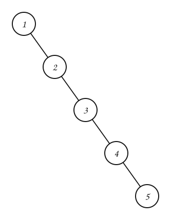

Cada llave es mayor que todas las anteriores y siempre va a la derecha: el árbol es una **cadena** de altura $n$. Buscar $5$ toma $5$ comparaciones, igual que en la bolsa.
:::

Si el árbol se construye bien, la altura es cercana a $\log_2 n$; si es una cadena, es $n$. Los **árboles AVL** de la siguiente página evitan el caso malo.

## 5. Eliminación

Para borrar un nodo $z$ hay tres casos.

**Caso 1: $z$ no tiene hijos.** `TREE-DELETE(T, z)` con $key[z] = 5$. ¿Qué se debe hacer?

:::::{admonition} Caso 1: borrar 5
:class: dropdown
::::{tab-set}
:::{tab-item} Paso 1
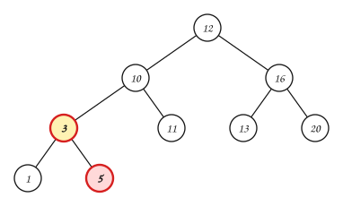

> $z = 5$ es hoja.

:::
:::{tab-item} Paso 2
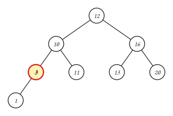

> El padre de $z$ debe ahora apuntar a `nil`: $3$ se queda sin hijo derecho.

:::
::::
:::::

**Caso 2: $z$ tiene un solo hijo.** `TREE-DELETE(T, z)` con $key[z] = 10$. ¿Qué se debe hacer?

:::::{admonition} Caso 2: borrar 10
:class: dropdown
::::{tab-set}
:::{tab-item} Paso 1
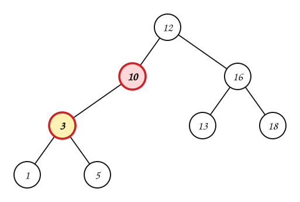

> $z = 10$ tiene un solo hijo, $3$.

:::
:::{tab-item} Paso 2
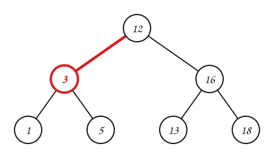

> Se separa $z$ del árbol: su padre, $12$, pasa a apuntar a su único hijo, $3$, que sube con todo su subárbol. Sigue siendo un ABB: todo lo que estaba debajo de $10$ era menor que $12$.

:::
::::
:::::

**Caso 3: $z$ tiene dos hijos.** `TREE-DELETE(T, z)` con $key[z] = 12$. ¿Qué se debe hacer?

:::::{admonition} Caso 3: borrar 12
:class: dropdown
::::{tab-set}
:::{tab-item} Paso 1
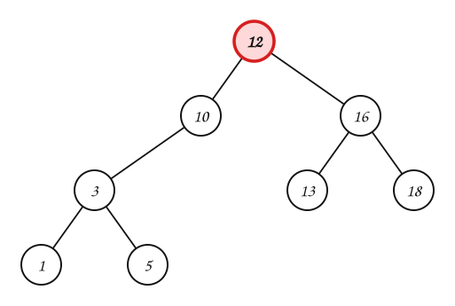

> $z = 12$ tiene dos hijos. **¿Cuál de los nodos restantes debería ocupar el lugar del nodo a borrar?**

:::
:::{tab-item} Paso 2
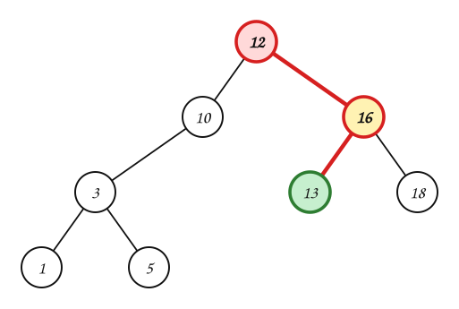

> Su **sucesor** $y = 13$, el mínimo del subárbol derecho: es mayor que todo lo de la izquierda de $12$ y menor que todo lo demás de la derecha. El sucesor no tiene hijo izquierdo, así que separarlo es el caso 1 o el caso 2.

:::
:::{tab-item} Paso 3
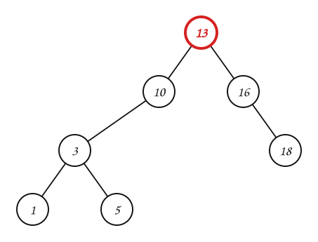

> Se separa (elimina) su sucesor $y$ del árbol y se reemplaza el contenido de $z$ con el de $y$: la raíz ahora tiene la llave $13$.

:::
::::
:::::

```text
TREE-DELETE(T, z)
1  if left[z] = NIL or right[z] = NIL
2      y ← z                       // casos 1 y 2: se separa z
3  else y ← TREE-SUCCESSOR(z)      // caso 3: se separa el sucesor
4  if left[y] ≠ NIL
5      x ← left[y]
6  else x ← right[y]
7  if x ≠ NIL
8      p[x] ← p[y]
9  if p[y] = NIL
10     root[T] ← x
11 else if y = left[p[y]]
12     left[p[y]] ← x
13 else right[p[y]] ← x
14 if y ≠ z
15     key[z] ← key[y]             // la llave del sucesor reemplaza la de z
16 return y
```

## 6. Ejemplos

**Ejemplo 1.** Inserte, en este orden, $5$, $3$, $8$ en un ABB vacío; luego busque $8$.

:::::{admonition} Paso a paso
:class: dropdown
::::{tab-set}
:::{tab-item} Paso 1


> Insertar $5$: el árbol está vacío, $5$ es la **raíz**.

:::
:::{tab-item} Paso 2
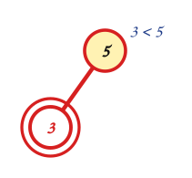

> Insertar $3$: $3 < 5$ → izquierda. Ese lugar está vacío: $3$ queda como hijo **izquierdo** de $5$.

:::
:::{tab-item} Paso 3
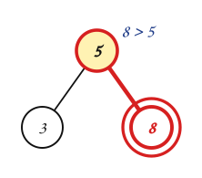

> Insertar $8$: $8 > 5$ → derecha. Ese lugar está vacío: $8$ queda como hijo **derecho** de $5$.

:::
:::{tab-item} Paso 4
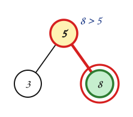

> Buscar $8$: $8 > 5$ → derecha; $8 = 8$: **encontrado** con $2$ comparaciones, sin mirar el resto del árbol.

:::
:::{tab-item} Paso 5
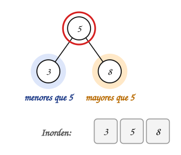

> **¿Es ABB?** Todo lo que está a la izquierda de la raíz $5$ es menor y todo lo de la derecha es mayor, y lo mismo pasa en cada subárbol. Comprobación rápida: el inorden sale ordenado, $3$, $5$, $8$.

:::
::::
:::::

**Ejemplo 2.** Inserte, en este orden, $50$, $30$, $70$, $20$, $40$, $60$ en un ABB vacío; luego busque $40$ y busque $65$.

:::::{admonition} Paso a paso
:class: dropdown
::::{tab-set}
:::{tab-item} Paso 1


> Insertar $50$: el árbol está vacío, $50$ es la **raíz**.

:::
:::{tab-item} Paso 2
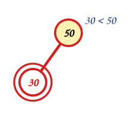

> Insertar $30$: $30 < 50$ → izquierda. Ese lugar está vacío: $30$ queda como hijo **izquierdo** de $50$.

:::
:::{tab-item} Paso 3


> Insertar $70$: $70 > 50$ → derecha. Ese lugar está vacío: $70$ queda como hijo **derecho** de $50$.

:::
:::{tab-item} Paso 4


> Insertar $20$: $20 < 50$ → izquierda; $20 < 30$ → izquierda. Ese lugar está vacío: $20$ queda como hijo **izquierdo** de $30$.

:::
:::{tab-item} Paso 5
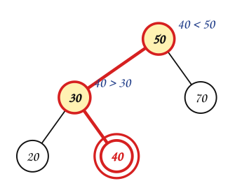

> Insertar $40$: $40 < 50$ → izquierda; $40 > 30$ → derecha. Ese lugar está vacío: $40$ queda como hijo **derecho** de $30$.

:::
:::{tab-item} Paso 6
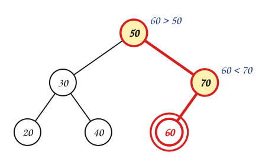

> Insertar $60$: $60 > 50$ → derecha; $60 < 70$ → izquierda. Ese lugar está vacío: $60$ queda como hijo **izquierdo** de $70$.

:::
:::{tab-item} Paso 7
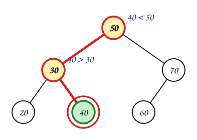

> Buscar $40$: $40 < 50$ → izquierda; $40 > 30$ → derecha; $40 = 40$: **encontrado** con $3$ comparaciones, sin mirar el resto del árbol.

:::
:::{tab-item} Paso 8
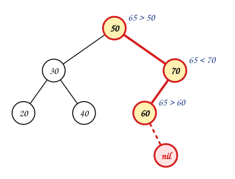

> Buscar $65$: $65 > 50$ → derecha; $65 < 70$ → izquierda; $65 > 60$ → derecha. Ese subárbol es vacío (`nil`): **$65$ no está** en el árbol. Bastaron $3$ comparaciones para saberlo.

:::
:::{tab-item} Paso 9
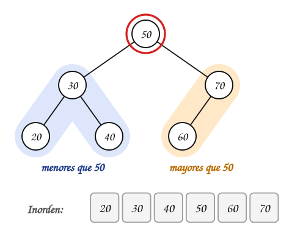

> **¿Es ABB?** Todo lo que está a la izquierda de la raíz $50$ es menor y todo lo de la derecha es mayor, y lo mismo pasa en cada subárbol. Comprobación rápida: el inorden sale ordenado, $20$, $30$, $40$, $50$, $60$, $70$.

:::
::::
:::::

**Ejemplo 3.** Inserte, en este orden, $45$, $25$, $65$, $15$, $35$, $55$, $75$, $30$ en un ABB vacío; luego borre $15$ y borre $35$.

:::::{admonition} Paso a paso
:class: dropdown
::::{tab-set}
:::{tab-item} Paso 1


> Insertar $45$: el árbol está vacío, $45$ es la **raíz**.

:::
:::{tab-item} Paso 2


> Insertar $25$: $25 < 45$ → izquierda. Ese lugar está vacío: $25$ queda como hijo **izquierdo** de $45$.

:::
:::{tab-item} Paso 3
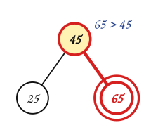

> Insertar $65$: $65 > 45$ → derecha. Ese lugar está vacío: $65$ queda como hijo **derecho** de $45$.

:::
:::{tab-item} Paso 4
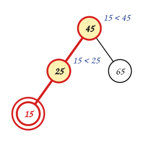

> Insertar $15$: $15 < 45$ → izquierda; $15 < 25$ → izquierda. Ese lugar está vacío: $15$ queda como hijo **izquierdo** de $25$.

:::
:::{tab-item} Paso 5


> Insertar $35$: $35 < 45$ → izquierda; $35 > 25$ → derecha. Ese lugar está vacío: $35$ queda como hijo **derecho** de $25$.

:::
:::{tab-item} Paso 6
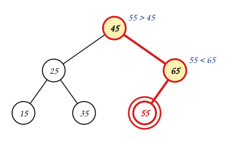

> Insertar $55$: $55 > 45$ → derecha; $55 < 65$ → izquierda. Ese lugar está vacío: $55$ queda como hijo **izquierdo** de $65$.

:::
:::{tab-item} Paso 7
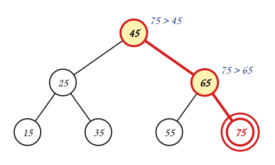

> Insertar $75$: $75 > 45$ → derecha; $75 > 65$ → derecha. Ese lugar está vacío: $75$ queda como hijo **derecho** de $65$.

:::
:::{tab-item} Paso 8


> Insertar $30$: $30 < 45$ → izquierda; $30 > 25$ → derecha; $30 < 35$ → izquierda. Ese lugar está vacío: $30$ queda como hijo **izquierdo** de $35$.

:::
:::{tab-item} Paso 9


> Borrar $15$: es **hoja** (caso 1). Basta con quitarla: su padre, $25$, pasa a apuntar a `nil`.

:::
:::{tab-item} Paso 10


> $25$ se quedó sin hijo izquierdo. Nada más cambió.

:::
:::{tab-item} Paso 11


> Borrar $35$: tiene **un solo hijo**, $30$ (caso 2). Se separa $35$ y su padre, $25$, pasa a apuntar a $30$, que sube con todo su subárbol.

:::
:::{tab-item} Paso 12


> Sigue siendo ABB: todo lo que colgaba de $35$ estaba del mismo lado de $25$ que $35$.

:::
:::{tab-item} Paso 13


> **¿Es ABB?** Todo lo que está a la izquierda de la raíz $45$ es menor y todo lo de la derecha es mayor, y lo mismo pasa en cada subárbol. Comprobación rápida: el inorden sale ordenado, $25$, $30$, $45$, $55$, $65$, $75$.

:::
::::
:::::

**Ejemplo 4.** Inserte, en este orden, $40$, $20$, $60$, $10$, $30$, $50$, $70$, $25$, $35$, $65$ en un ABB vacío; luego borre $20$.

:::::{admonition} Paso a paso
:class: dropdown
::::{tab-set}
:::{tab-item} Paso 1


> Se insertan, en este orden, $40$, $20$, $60$, $10$, $30$, $50$, $70$, $25$, $35$, $65$, con el mismo método de los ejemplos anteriores: se compara con cada nodo desde la raíz y se baja a la izquierda si es menor o a la derecha si es mayor. El número junto a cada nodo es su orden de llegada: un nodo siempre llega **después** que su padre.

:::
:::{tab-item} Paso 2


> Borrar $20$: tiene **dos hijos** (caso 3). Su lugar lo toma su **sucesor**, el mínimo del subárbol derecho: se baja a la derecha una vez y luego a la izquierda hasta el final, $20$ → $30$ → $25$. El sucesor es $25$: mayor que todo lo de la izquierda de $20$ y menor que todo lo demás de la derecha.

:::
:::{tab-item} Paso 3


> La llave $25$ reemplaza a $20$. El árbol tiene un nodo menos y sigue siendo ABB.

:::
:::{tab-item} Paso 4


> **¿Es ABB?** Todo lo que está a la izquierda de la raíz $40$ es menor y todo lo de la derecha es mayor, y lo mismo pasa en cada subárbol. Comprobación rápida: el inorden sale ordenado, $10$, $25$, $30$, $35$, $40$, $50$, $60$, $65$, $70$.

:::
::::
:::::

**Ejemplo 5.** Inserte, en este orden, $50$, $30$, $80$, $20$, $40$, $70$, $90$, $35$, $45$, $60$, $75$, $65$, $85$ en un ABB vacío; luego borre $50$.

:::::{admonition} Paso a paso
:class: dropdown
::::{tab-set}
:::{tab-item} Paso 1


> Se insertan, en este orden, $50$, $30$, $80$, $20$, $40$, $70$, $90$, $35$, $45$, $60$, $75$, $65$, $85$, con el mismo método de los ejemplos anteriores: se compara con cada nodo desde la raíz y se baja a la izquierda si es menor o a la derecha si es mayor. El número junto a cada nodo es su orden de llegada: un nodo siempre llega **después** que su padre.

:::
:::{tab-item} Paso 2


> Borrar $50$: tiene **dos hijos** (caso 3). Su lugar lo toma su **sucesor**, el mínimo del subárbol derecho: se baja a la derecha una vez y luego a la izquierda hasta el final, $50$ → $80$ → $70$ → $60$. El sucesor es $60$: mayor que todo lo de la izquierda de $50$ y menor que todo lo demás de la derecha.

:::
:::{tab-item} Paso 3


> Primero se separa $60$ de donde está. No tiene hijo izquierdo (es un mínimo), pero sí derecho, $65$: es el caso 2, $65$ sube y queda colgando de $70$.

:::
:::{tab-item} Paso 4


> La llave $60$ reemplaza a $50$. El árbol tiene un nodo menos y sigue siendo ABB.

:::
:::{tab-item} Paso 5


> **¿Es ABB?** Todo lo que está a la izquierda de la raíz $60$ es menor y todo lo de la derecha es mayor, y lo mismo pasa en cada subárbol. Comprobación rápida: el inorden sale ordenado, $20$, $30$, $35$, $40$, $45$, $60$, $65$, $70$, $75$, $80$, $85$, $90$.

:::
::::
:::::

## 7. Formalización

- Si $x$ es la raíz de un subárbol con $n$ nodos, `INORDER-TREE-WALK(x)` toma $\Theta(n)$ y lista las llaves en orden.
- `SEARCH`, `MINIMUM`, `MAXIMUM`, `SUCCESSOR`, `PREDECESSOR`, `INSERT` y `DELETE` toman $O(h)$ en un ABB de altura $h$.
- Para un árbol binario lleno con $n$ nodos, $h = \Theta(\log n)$; si el árbol es una cadena, $h = \Theta(n)$.

## Ejercicios

Practique con los [ejercicios de árboles binarios de búsqueda](exercises.md).

## Fuentes

- Aristizábal, A. *Árboles de búsqueda binaria* (propiedad, consultas, inserción, eliminación). Computación y Estructuras Discretas I, Universidad Icesi, 2026.
- Bedoya, O. *Árboles: árboles binarios de búsqueda* (buscar la llave 45, construir un ABB con una estructura dada). Diapositivas del curso, Universidad del Valle.
- Vargas Forero, V. M. *Estructuras de datos: árboles binarios ordenados, búsqueda binaria*. Universidad del Valle.
- Cormen, T. H., Leiserson, C. E., Rivest, R. L., Stein, C. *Introduction to Algorithms*, 3.ª ed. The MIT Press, 2009. Capítulo 12.

---

*Material adaptado del material original de los profesores Andrés Aristizábal y Oscar Bedoya.*
