---
# Copyright (c) 2026 Angela Villota, and collaborators from the CyED block
# Licensed under the PolyForm Noncommercial License 1.0.0.
# Commercial use is prohibited without prior written authorization.
title: "Montículos: Ejercicios"
---

# Montículos: Ejercicios

Use esta página después de leer el [material de estudio de montículos](index.md). Cada ejercicio trae **pistas** y una **solución general**; intente resolverlo antes de abrirlas.

---

### Ejercicio 1

Indique si cada arreglo es un max-heap. Si $heap\text{-}size[A]$ no se indica, es el largo del arreglo.

- a) $A = \langle 23, 17, 14, 6, 13, 10, 1, 5, 7, 12 \rangle$
- b) $A = \langle 10, 9, 8, 7, 6, 5, 4 \rangle$
- c) $A = \langle 8, 5, 7, 4, 3, 1, 2, 1, 2, 1 \rangle$
- d) $A = \langle 8, 4, 2, 1, 7, 9 \rangle$, con $heap\text{-}size[A] = 6$

:::{admonition} Pistas
:class: dropdown
- Dado como arreglo, la forma siempre se cumple: solo hay que revisar el orden.
- Compare cada $A[i]$, para $i \ge 2$, con $A[\lfloor i/2 \rfloor]$.
- En d), compárelo con el ejemplo 6 del material de estudio: allí $heap\text{-}size[A] = 4$.
:::

:::{admonition} Solución general
:class: dropdown
- a) $A = \langle 23, 17, 14, 6, 13, 10, 1, 5, 7, 12 \rangle$: no: $A[4] = 6 < A[9] = 7$.
- b) $A = \langle 10, 9, 8, 7, 6, 5, 4 \rangle$: sí es un max-heap.
- c) $A = \langle 8, 5, 7, 4, 3, 1, 2, 1, 2, 1 \rangle$: sí es un max-heap.
- d) $A = \langle 8, 4, 2, 1, 7, 9 \rangle$: no: $A[2] = 4 < A[5] = 7$, $A[3] = 2 < A[6] = 9$.

[▶ Abrir la animación con controles (reproducir, pausar, cuadro a cuadro)](images/ex1-anim.svg)
:::

### Ejercicio 2

Un montículo tiene $heap\text{-}size[A] = 12$.

1. ¿Cuál es la posición del padre de $A[11]$? ¿Y la del padre de $A[12]$?
2. ¿En qué posiciones están los hijos de $A[5]$? ¿Y los de $A[6]$?
3. ¿Qué posiciones son hojas?
4. ¿Cuál es la altura del montículo?

:::{admonition} Pistas
:class: dropdown
- $\text{PARENT}(i) = \lfloor i/2 \rfloor$, $\text{LEFT}(i) = 2i$, $\text{RIGHT}(i) = 2i + 1$.
- Un hijo existe solo si su posición no pasa de $heap\text{-}size[A]$.
:::

:::{admonition} Solución general
:class: dropdown
1. $\lfloor 11/2 \rfloor = 5$ y $\lfloor 12/2 \rfloor = 6$.
2. Los hijos de $A[5]$ están en $10$ y $11$. $A[6]$ tiene solo hijo izquierdo, en $12$: el derecho sería $13 > 12$.
3. Las posiciones $7$ a $12$: en general, de $\lfloor n/2 \rfloor + 1$ a $n$.
4. $\lfloor \lg 12 \rfloor + 1 = 4$.
:::

### Ejercicio 3

Aplique `MAX-HEAP-INSERT(A, 12)` con $A = \langle 8, 5, 7, 4, 3, 1, 2 \rangle$. Dé el arreglo final y el número de intercambios.

:::{admonition} Pistas
:class: dropdown
- $12$ entra en $A[8]$, como hijo izquierdo de $A[4]$.
- $12$ es mayor que todo el montículo: ¿hasta dónde sube?
:::

:::{admonition} Solución general
:class: dropdown
$A = \langle 12, 8, 7, 5, 3, 1, 2, 4 \rangle$; $3$ intercambios.

[▶ Abrir la animación con controles (reproducir, pausar, cuadro a cuadro)](images/ex3-anim.svg)
:::

### Ejercicio 4

Aplique `HEAP-INCREASE-KEY(A, 8, 11)` con $A = \langle 10, 8, 9, 4, 7, 1, 6, 2, 3 \rangle$.

:::{admonition} Pistas
:class: dropdown
- Primero verifique que $11 \ge A[8]$.
- Después, $11$ sube mientras su padre sea menor.
:::

:::{admonition} Solución general
:class: dropdown
$A = \langle 11, 10, 9, 8, 7, 1, 6, 4, 3 \rangle$

[▶ Abrir la animación con controles (reproducir, pausar, cuadro a cuadro)](images/ex4-anim.svg)
:::

### Ejercicio 5

Aplique `HEAP-EXTRACT-MAX(A)` **dos veces** sobre $A = \langle 10, 8, 9, 4, 7, 1, 6, 2, 3 \rangle$. ¿Qué devuelve cada llamado y cómo queda el arreglo?

:::{admonition} Pistas
:class: dropdown
- Después de la primera extracción, $heap\text{-}size[A] = 8$ y $A[1]$ es el antiguo $A[9]$.
- Al hundir, se intercambia siempre con el **mayor** de los hijos.
:::

:::{admonition} Solución general
:class: dropdown
La primera extracción devuelve $10$ y deja $A[1..8] = \langle 9, 8, 6, 4, 7, 1, 3, 2 \rangle$; la segunda devuelve $9$ y deja $A[1..7] = \langle 8, 7, 6, 4, 2, 1, 3 \rangle$.
:::

### Ejercicio 6

Inserte $5, 12, 8, 20, 3, 15, 10, 25$, en ese orden, en un montículo vacío. Dé el arreglo final.

:::{admonition} Pistas
:class: dropdown
- Las seis primeras llaves son las del ejemplo 4 del material de estudio: parta de ese resultado.
- $25$ es mayor que todos: termina en la raíz.
:::

:::{admonition} Solución general
:class: dropdown
$A = \langle 25, 20, 15, 12, 3, 8, 10, 5 \rangle$, con $7$ intercambios en total.
:::

### Ejercicio 7

Responda y justifique con un ejemplo o un argumento:

1. ¿Un arreglo ordenado de mayor a menor es siempre un max-heap?
2. ¿Todo max-heap está ordenado de mayor a menor?
3. En un max-heap con llaves distintas, ¿en qué posiciones puede estar el **mínimo**?

:::{admonition} Pistas
:class: dropdown
- En un arreglo ordenado de mayor a menor, ¿cómo se compara $A[\lfloor i/2 \rfloor]$ con $A[i]$?
- Busque un max-heap pequeño donde dos hermanos estén «al revés».
- El mínimo no puede tener hijos: ¿por qué?
:::

:::{admonition} Solución general
:class: dropdown
1. Sí: $\lfloor i/2 \rfloor < i$, así que $A[\lfloor i/2 \rfloor] \ge A[i]$.
2. No: $A = \langle 9, 8, 6, 2, 5 \rangle$ es un max-heap y no está ordenado ($2 < 5$). El orden de un montículo solo es entre padre e hijo, no entre hermanos ni entre ramas.
3. En una hoja: si tuviera un hijo, ese hijo sería menor. Las hojas son las posiciones $\lfloor n/2 \rfloor + 1$ a $n$, y el mínimo puede estar en cualquiera de ellas.
:::

### Ejercicio 8

Escriba `MIN-HEAP-INSERT(A, key)` para un **min-heap** y úselo para insertar $7, 3, 9, 1, 4$, en ese orden, en un min-heap vacío. Dibuje el árbol después de cada inserción.

---

*Ejercicios adaptados del material del profesor Oscar Bedoya y de Cormen et al., capítulo 6 (el 1 a) es el ejercicio 6.1-6; el 2.3, el 6.1-7; el 7, los 6.1-4 y 6.1-5; el 8, una parte del 6.5-3).*
