---
# Copyright (c) 2026 Angela Villota, and collaborators from the CyED block
# Licensed under the PolyForm Noncommercial License 1.0.0.
# Commercial use is prohibited without prior written authorization.
title: "Unidad 4: Montículos"
---

# Unidad 4: Montículos

## 1. El problema

En una sala de urgencias llegan pacientes con una prioridad: $5, 12, 8, 20, 3, 15$, en ese orden. Siempre se atiende primero al de **mayor** prioridad. Hacen falta dos operaciones: **insertar** un paciente y **sacar al de mayor prioridad**.

Primer intento, con un arreglo:

- **Desordenado**: insertar es poner al final, $O(1)$; pero para sacar el mayor hay que recorrer todo el arreglo, $O(n)$.
- **Ordenado** (como la cola de prioridad de la Unidad 3): sacar el mayor es tomar el último, $O(1)$; pero insertar obliga a correr elementos para abrir espacio, $O(n)$.

En los dos casos, una de las operaciones cuesta $O(n)$. **¿Se puede lograr que las dos cuesten $O(\log n)$?** Sí: con un arreglo que **se lee como un árbol binario** y que solo está «medio ordenado». Eso es un montículo.

## 2. ¿Qué es un montículo?

**Montículo** (*heap*). Es un arreglo que puede ser visto como un árbol binario que cumple dos propiedades:

- **Propiedad de orden:** la raíz de cada subárbol es mayor o igual que cualquiera de sus nodos restantes.
- **Propiedad de forma:** la longitud de toda rama es $h$ o $h - 1$, donde $h$ es la altura del árbol. Además, no puede existir una rama de longitud $h$ a la derecha de una rama de longitud $h - 1$.

Analice las dos propiedades en este montículo:

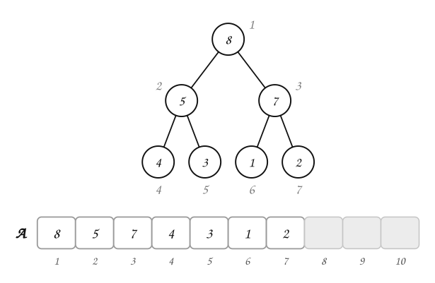

- **Orden.** $8$ es mayor que todo el árbol; $5$ es mayor que $4$ y $3$; $7$ es mayor que $1$ y $2$.
- **Forma.** Todas las ramas tienen longitud $3$. No hay huecos.

El número gris junto a cada nodo es su **posición**: se numeran por niveles, de izquierda a derecha. Esas posiciones son los índices del arreglo $A$.

### La propiedad de orden

> **¿Hace falta comparar cada nodo con *todos* los de su subárbol?**

:::{admonition} Respuesta
:class: dropdown
No. Basta comparar cada nodo con **sus hijos**. Si cada padre es mayor o igual que sus hijos, por transitividad es mayor o igual que sus nietos, bisnietos, etc. Por eso la propiedad de orden se escribe así: para todo nodo $i$ distinto de la raíz,

$$
A[\text{PARENT}(i)] \ge A[i]
$$
:::

Esta propiedad **no** dice nada sobre los hermanos: en el montículo de arriba, el hijo izquierdo de la raíz ($5$) es menor que el derecho ($7$), y eso está bien. Un montículo **no** es un árbol binario de búsqueda.

El montículo de esta página es un **max-heap**: la raíz es el mayor. Un **min-heap** es lo simétrico: $A[\text{PARENT}(i)] \le A[i]$ y la raíz es el menor. Todo lo que sigue vale para el min-heap cambiando «mayor» por «menor».

### La propiedad de forma

La forma de Bedoya («las ramas miden $h$ o $h - 1$, y las largas van a la izquierda») dice que el árbol se llena **por niveles y, en cada nivel, de izquierda a derecha**:


[▶ Abrir la animación con controles (reproducir, pausar, cuadro a cuadro)](images/llenado-anim.svg)

Una forma práctica de revisarla: numere las posiciones por niveles, de izquierda a derecha, como en la animación. El árbol cumple la forma si sus $n$ nodos ocupan **exactamente las posiciones $1$ a $n$, sin huecos**.

Cuidado con los nombres: en la sección de [árboles binarios](../ArbolesBinarios/index.md) un árbol «completo» es otra cosa (todo nodo interno tiene dos hijos). Aquí se habla siempre de la **propiedad de forma**.

### Representación en arreglo

Los datos se almacenan en el arreglo recorriendo el árbol **por niveles, de izquierda a derecha**. $A[1..heap\text{-}size[A]]$ es el montículo: el arreglo puede ser más largo ($length[A]$), pero lo que está después de $heap\text{-}size[A]$ no es parte del montículo.


[▶ Abrir la animación con controles (reproducir, pausar, cuadro a cuadro)](images/arreglo-anim.svg)

> **Evalúe $\lfloor i/2 \rfloor$ para $i = 2$ y $3$; para $i = 4$ y $5$; para $i = 6$ y $7$. ¿Qué obtiene?**

:::{admonition} Respuesta
:class: dropdown
$\lfloor 2/2 \rfloor = \lfloor 3/2 \rfloor = 1$, $\lfloor 4/2 \rfloor = \lfloor 5/2 \rfloor = 2$ y $\lfloor 6/2 \rfloor = \lfloor 7/2 \rfloor = 3$: siempre la posición del **padre**. Así, no hace falta guardar apuntadores; el árbol se recorre con aritmética sobre los índices:

| Operación | Fórmula |
|---|---|
| Raíz del árbol | $A[1]$ |
| `PARENT(i)` | $\lfloor i/2 \rfloor$ |
| `LEFT(i)` | $2i$ |
| `RIGHT(i)` | $2i + 1$ |
:::

### Altura

Por la propiedad de forma, un montículo de $n$ elementos tiene todos sus niveles llenos menos, quizás, el último. Con la altura medida en nodos (como en el resto de la unidad), un montículo de $n$ elementos tiene altura $\lfloor \lg n \rfloor + 1$, es decir, $\Theta(\lg n)$:

| $n$ | $1$ | $2$ y $3$ | $4$ a $7$ | $8$ a $15$ | $16$ a $31$ |
|---|---|---|---|---|---|
| altura | $1$ | $2$ | $3$ | $4$ | $5$ |

Cormen et al. miden la altura en **aristas** y por eso escriben $\lfloor \lg n \rfloor$: es el mismo árbol, contado con un nodo menos.

Esa altura es la que hace rápidas las operaciones de la sección 4: cada una recorre a lo sumo **una rama**.

## 3. ¿Es un montículo? Siete ejemplos

Para cada árbol o arreglo se aplica el mismo método:

1. **Forma.** Numerar las posiciones por niveles, de izquierda a derecha. ¿Ocupan los $n$ nodos las posiciones $1$ a $n$, sin huecos?
2. **Orden.** Para cada nodo con hijos: ¿es mayor o igual que cada uno de ellos?

Si se da un arreglo, primero se arma el árbol: $A[1]$ es la raíz, los hijos de $A[i]$ son $A[2i]$ y $A[2i + 1]$, y solo cuentan $A[1..heap\text{-}size[A]]$. La animación de cada respuesta hace las dos revisiones; los ✓ en verde y los ✗ en rojo.

### Ejemplo 1

Dado el árbol:

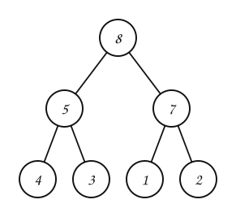

¿Cumple la propiedad de forma? ¿Y la de orden? ¿Es un max-heap?

:::{admonition} Respuesta
:class: dropdown

[▶ Abrir la animación con controles (reproducir, pausar, cuadro a cuadro)](images/es1-anim.svg)

**Sí es un max-heap.**
- Forma ✓.
- Orden ✓.

El ejemplo de las diapositivas de Bedoya: un árbol lleno donde cada padre es mayor que sus hijos.
:::

### Ejemplo 2

Dado el árbol:

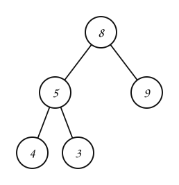

¿Cumple la propiedad de forma? ¿Y la de orden? ¿Es un max-heap?

:::{admonition} Respuesta
:class: dropdown

[▶ Abrir la animación con controles (reproducir, pausar, cuadro a cuadro)](images/es2-anim.svg)

**No es un montículo.**
- Forma ✓.
- Orden ✗: $A[1] = 8 < A[3] = 9$.

Basta **un** padre menor que un hijo para que falle el orden: aquí $8 < 9$ en la raíz.
:::

### Ejemplo 3

Dado el árbol:

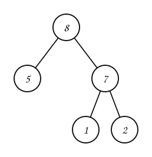

¿Cumple la propiedad de forma? ¿Y la de orden? ¿Es un max-heap?

:::{admonition} Respuesta
:class: dropdown

[▶ Abrir la animación con controles (reproducir, pausar, cuadro a cuadro)](images/es3-anim.svg)

**No es un montículo.**
- Forma ✗: la posición $4$ está vacía y hay nodos más a la derecha o más abajo.
- Orden ✓.

El orden se cumple, pero los dos hijos de $5$ faltan mientras $7$ tiene los suyos: hay ramas de longitud $2$ a la izquierda de ramas de longitud $3$.
:::

### Ejemplo 4

$A = \langle 20, 10, 5, 4, 3, 1 \rangle$, con $heap\text{-}size[A] = 6$ y $length[A] = 10$.

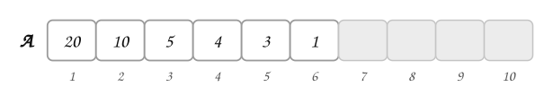

¿Cumple la propiedad de forma? ¿Y la de orden? ¿Es un max-heap?

:::{admonition} Respuesta
:class: dropdown

[▶ Abrir la animación con controles (reproducir, pausar, cuadro a cuadro)](images/es4-anim.svg)

**Sí es un max-heap.**
- Forma ✓.
- Orden ✓.

Del arreglo se arma el árbol por niveles: $A[1]$ es la raíz, $A[2]$ y $A[3]$ sus hijos, y así. Las casillas $7$ a $10$ están en el arreglo pero no en el montículo.
:::

### Ejemplo 5

Dado el árbol:

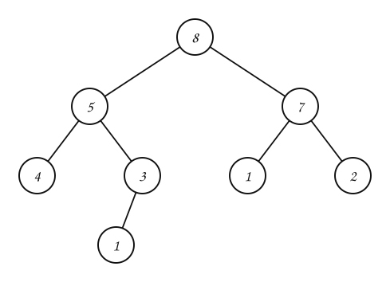

¿Cumple la propiedad de forma? ¿Y la de orden? ¿Es un max-heap?

:::{admonition} Respuesta
:class: dropdown

[▶ Abrir la animación con controles (reproducir, pausar, cuadro a cuadro)](images/es5-anim.svg)

**No es un montículo.**
- Forma ✗: la posición $8$ está vacía y hay nodos más a la derecha o más abajo.
- Orden ✓.

Parece casi un árbol lleno, pero $1$ cuelga de $3$ (posición $10$) mientras $4$ no tiene hijos (posiciones $8$ y $9$ vacías): el último nivel no se llenó de izquierda a derecha.
:::

### Ejemplo 6

$A = \langle 8, 4, 2, 1, 7, 9 \rangle$, con $heap\text{-}size[A] = 4$ y $length[A] = 10$.

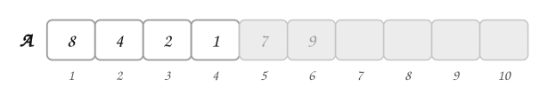

¿Cumple la propiedad de forma? ¿Y la de orden? ¿Es un max-heap?

:::{admonition} Respuesta
:class: dropdown

[▶ Abrir la animación con controles (reproducir, pausar, cuadro a cuadro)](images/es6-anim.svg)

**Sí es un max-heap.**
- Forma ✓.
- Orden ✓.

Aunque $7$ y $9$ son mayores que $4$ y $2$, **no** están en el montículo: $heap\text{-}size[A] = 4$ deja solo $8, 4, 2, 1$. Con $heap\text{-}size[A] = 6$ no sería montículo.
:::

### Ejemplo 7

Dado el árbol:

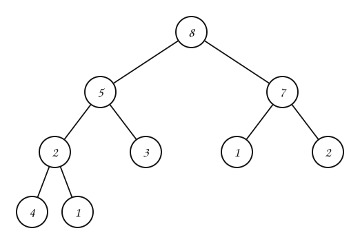

¿Cumple la propiedad de forma? ¿Y la de orden? ¿Es un max-heap?

:::{admonition} Respuesta
:class: dropdown

[▶ Abrir la animación con controles (reproducir, pausar, cuadro a cuadro)](images/es7-anim.svg)

**No es un montículo.**
- Forma ✓.
- Orden ✗: $A[4] = 2 < A[8] = 4$.

La raíz es mayor que todos y el segundo nivel también está bien: la falla está abajo, en el subárbol $2$–$4$–$1$, donde la raíz $2$ no es mayor que $4$. Hay que revisar **todos** los padres.
:::

## 4. Operaciones de cola de prioridad

Un montículo implementa una **cola de prioridad**: una estructura con servicios de inserción y retiro de elementos según una prioridad (el valor numérico guardado en el árbol). Se retira (atiende) primero al de mayor prioridad. Las operaciones son:

| Operación | Qué hace | Tiempo |
|---|---|---|
| `HEAP-MAXIMUM(A)` | devuelve el elemento de máxima prioridad | $\Theta(1)$ |
| `MAX-HEAP-INSERT(A, key)` | inserta el elemento con clave `key` | $O(\lg n)$ |
| `HEAP-INCREASE-KEY(A, i, key)` | sube la prioridad de $A[i]$ a `key` | $O(\lg n)$ |
| `HEAP-EXTRACT-MAX(A)` | elimina y devuelve el elemento de máxima prioridad | $O(\lg n)$ |

Todas siguen la misma idea: hacer el cambio en el lugar que **conserva la forma**, y luego reparar el orden moviendo **un** elemento por **una** rama, hacia arriba o hacia abajo.

### HEAP-MAXIMUM

Por la propiedad de orden, el mayor está en la raíz:

```text
HEAP-MAXIMUM(A)
1  return A[1]
```

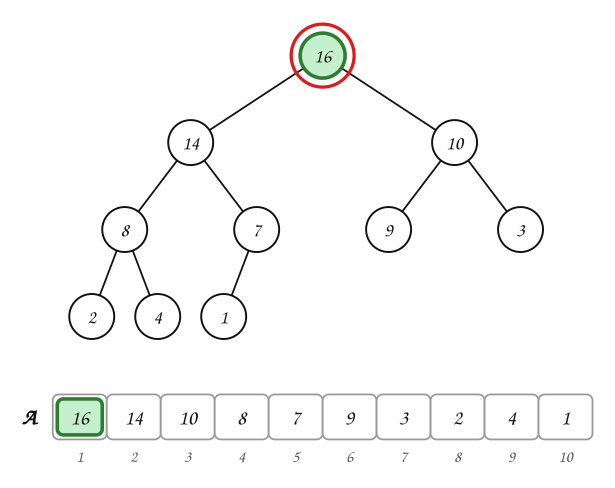

Tiempo de ejecución: $\Theta(1)$.

### MAX-HEAP-INSERT

```text
MAX-HEAP-INSERT(A, key)
1  heap-size[A] ← heap-size[A] + 1
2  i ← heap-size[A]
3  A[i] ← key
4  while i > 1 and A[PARENT(i)] < A[i]
5      do exchange A[i] ↔ A[PARENT(i)]
6         i ← PARENT(i)
```

Cormen et al. escriben lo mismo de otra forma: ponen $-\infty$ en la nueva posición y llaman a `HEAP-INCREASE-KEY(A, heap-size[A], key)`, cuyo ciclo es idéntico a las líneas 4 a 6.

- Las líneas 1 a 3 ponen `key` en la **siguiente posición libre**: la forma se conserva.
- El orden puede fallar solo entre `key` y su padre. Si el padre es menor, se intercambian y se sigue revisando más arriba: `key` **sube** por su rama hasta encontrar un padre mayor o igual, o hasta llegar a la raíz.

**Ejemplo 1.** El más simple: insertar $7$ en $A = \langle 9, 8, 6, 2, 5 \rangle$.


[▶ Abrir la animación con controles (reproducir, pausar, cuadro a cuadro)](images/ins1-anim.svg)

:::::{admonition} MAX-HEAP-INSERT(A, 7)
:class: dropdown
::::{tab-set}
:::{tab-item} Paso 1
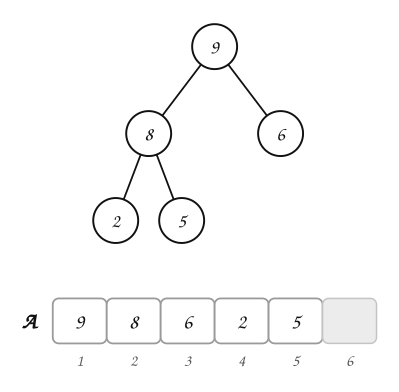

> A = ⟨9, 8, 6, 2, 5⟩, heap-size[A] = 5. Es un max-heap.

:::
:::{tab-item} Paso 2


> MAX-HEAP-INSERT(A, 7): heap-size[A] pasa de 5 a 6 y 7 entra en A[6], la siguiente posición libre: queda como hijo izquierdo de A[3] = 6.

:::
:::{tab-item} Paso 3
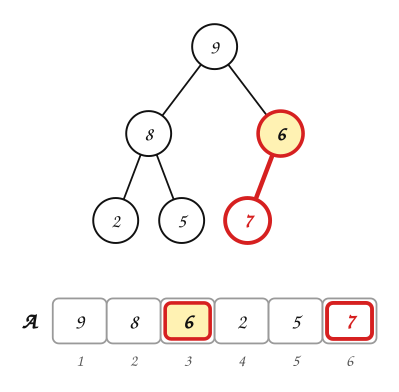

> i = 6: A[PARENT(6)] = A[3] = 6 < 7: se intercambian A[6] y A[3].

:::
:::{tab-item} Paso 4


> 7 subió a A[3]. i = 3: A[PARENT(3)] = A[1] = 9 ≥ 7: el orden se cumple. Termina.

:::
:::{tab-item} Paso 5
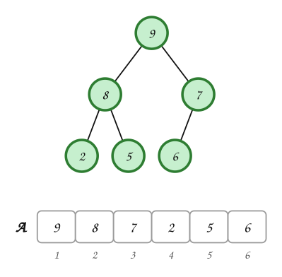

> Resultado: A = ⟨9, 8, 7, 2, 5, 6⟩. Sigue siendo un max-heap.

:::
::::
:::::

Resultado: $A = \langle 9, 8, 7, 2, 5, 6 \rangle$.

**Ejemplo 2.** Mismo montículo, ahora insertar $4$. ¿Cuántas veces entra al ciclo?


[▶ Abrir la animación con controles (reproducir, pausar, cuadro a cuadro)](images/ins2-anim.svg)

:::::{admonition} MAX-HEAP-INSERT(A, 4)
:class: dropdown
::::{tab-set}
:::{tab-item} Paso 1


> A = ⟨9, 8, 6, 2, 5⟩, heap-size[A] = 5. Es un max-heap.

:::
:::{tab-item} Paso 2


> MAX-HEAP-INSERT(A, 4): heap-size[A] pasa de 5 a 6 y 4 entra en A[6], la siguiente posición libre: queda como hijo izquierdo de A[3] = 6.

:::
:::{tab-item} Paso 3
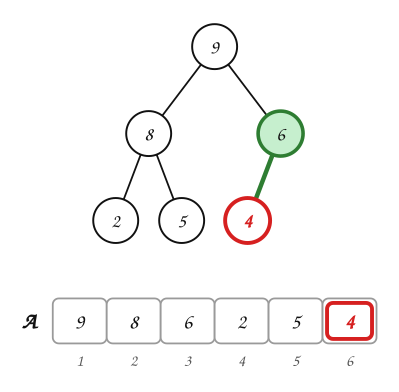

> i = 6: A[PARENT(6)] = A[3] = 6 ≥ 4: el orden se cumple. Termina.

:::
:::{tab-item} Paso 4
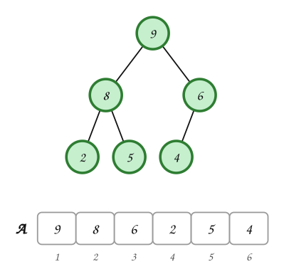

> Resultado: A = ⟨9, 8, 6, 2, 5, 4⟩. Sigue siendo un max-heap.

:::
::::
:::::

Ninguna: el padre de la posición $6$ es $6 \ge 4$, así que la condición del `while` es falsa de entrada y $4$ se queda donde llegó. Resultado: $A = \langle 9, 8, 6, 2, 5, 4 \rangle$.

**Ejemplo 3.** Insertar $15$ en $A = \langle 16, 14, 10, 8, 7, 9, 3, 2, 4, 1 \rangle$.


[▶ Abrir la animación con controles (reproducir, pausar, cuadro a cuadro)](images/ins3-anim.svg)

:::::{admonition} MAX-HEAP-INSERT(A, 15)
:class: dropdown
::::{tab-set}
:::{tab-item} Paso 1
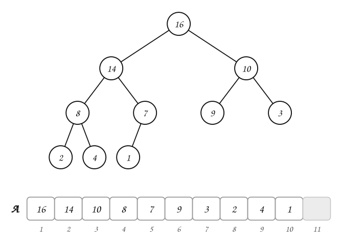

> A = ⟨16, 14, 10, 8, 7, 9, 3, 2, 4, 1⟩, heap-size[A] = 10. Es un max-heap.

:::
:::{tab-item} Paso 2
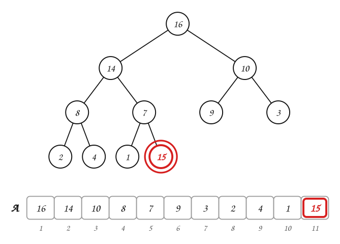

> MAX-HEAP-INSERT(A, 15): heap-size[A] pasa de 10 a 11 y 15 entra en A[11], la siguiente posición libre: queda como hijo derecho de A[5] = 7.

:::
:::{tab-item} Paso 3
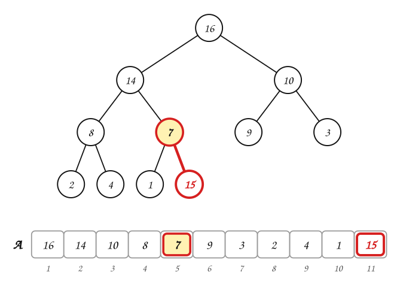

> i = 11: A[PARENT(11)] = A[5] = 7 < 15: se intercambian A[11] y A[5].

:::
:::{tab-item} Paso 4
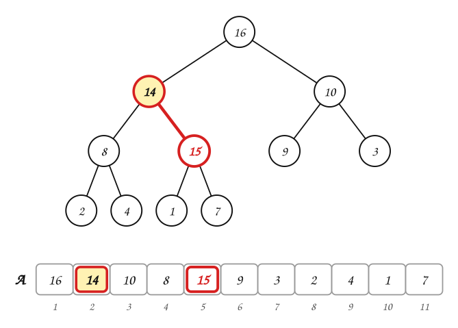

> 15 subió a A[5]. i = 5: A[PARENT(5)] = A[2] = 14 < 15: se intercambian A[5] y A[2].

:::
:::{tab-item} Paso 5
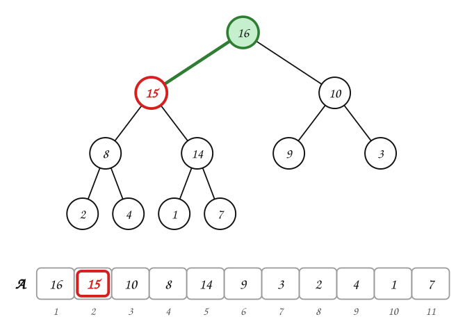

> 15 subió a A[2]. i = 2: A[PARENT(2)] = A[1] = 16 ≥ 15: el orden se cumple. Termina.

:::
:::{tab-item} Paso 6
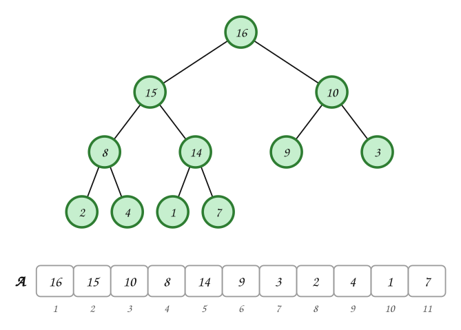

> Resultado: A = ⟨16, 15, 10, 8, 14, 9, 3, 2, 4, 1, 7⟩. Sigue siendo un max-heap.

:::
::::
:::::

Resultado: $A = \langle 16, 15, 10, 8, 14, 9, 3, 2, 4, 1, 7 \rangle$. $15$ subió dos niveles y se detuvo bajo $16$.

**Ejemplo 4.** Insertar $5, 12, 8, 20, 3, 15$, en ese orden, en un montículo vacío (los pacientes de la sección 1).


[▶ Abrir la animación con controles (reproducir, pausar, cuadro a cuadro)](images/insseq-anim.svg)

:::::{admonition} Insertar 5, 12, 8, 20, 3, 15
:class: dropdown
::::{tab-set}
:::{tab-item} Paso 1
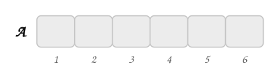

> Montículo vacío: heap-size[A] = 0. Se insertan 5, 12, 8, 20, 3, 15, en ese orden.

:::
:::{tab-item} Paso 2
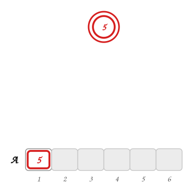

> MAX-HEAP-INSERT(A, 5): heap-size[A] pasa de 0 a 1 y 5 entra en A[1], la siguiente posición libre: es la raíz.

:::
:::{tab-item} Paso 3
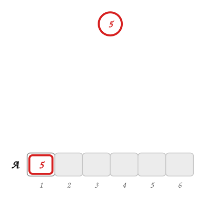

> i = 1: 5 llegó a la raíz. Termina.

:::
:::{tab-item} Paso 4
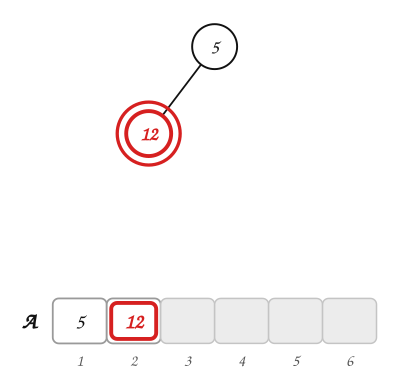

> MAX-HEAP-INSERT(A, 12): heap-size[A] pasa de 1 a 2 y 12 entra en A[2], la siguiente posición libre: queda como hijo izquierdo de A[1] = 5.

:::
:::{tab-item} Paso 5
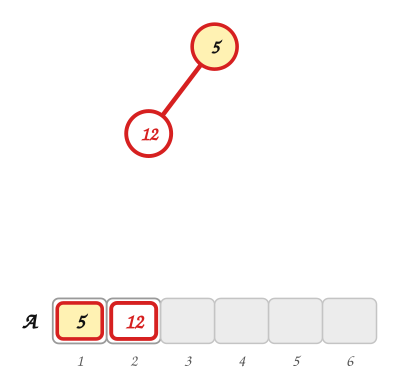

> i = 2: A[PARENT(2)] = A[1] = 5 < 12: se intercambian A[2] y A[1].

:::
:::{tab-item} Paso 6
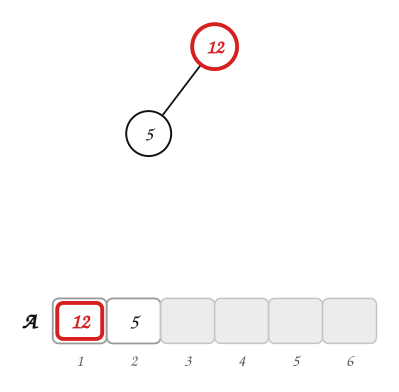

> 12 subió a A[1]. i = 1: 12 llegó a la raíz. Termina.

:::
:::{tab-item} Paso 7
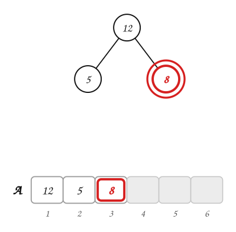

> MAX-HEAP-INSERT(A, 8): heap-size[A] pasa de 2 a 3 y 8 entra en A[3], la siguiente posición libre: queda como hijo derecho de A[1] = 12.

:::
:::{tab-item} Paso 8
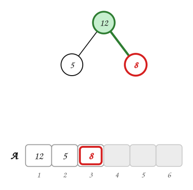

> i = 3: A[PARENT(3)] = A[1] = 12 ≥ 8: el orden se cumple. Termina.

:::
:::{tab-item} Paso 9
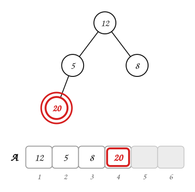

> MAX-HEAP-INSERT(A, 20): heap-size[A] pasa de 3 a 4 y 20 entra en A[4], la siguiente posición libre: queda como hijo izquierdo de A[2] = 5.

:::
:::{tab-item} Paso 10
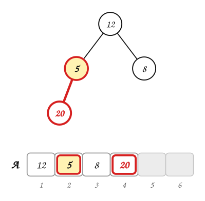

> i = 4: A[PARENT(4)] = A[2] = 5 < 20: se intercambian A[4] y A[2].

:::
:::{tab-item} Paso 11
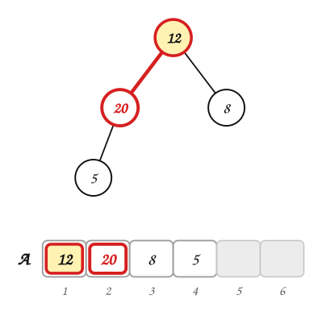

> 20 subió a A[2]. i = 2: A[PARENT(2)] = A[1] = 12 < 20: se intercambian A[2] y A[1].

:::
:::{tab-item} Paso 12
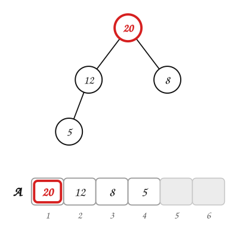

> 20 subió a A[1]. i = 1: 20 llegó a la raíz. Termina.

:::
:::{tab-item} Paso 13
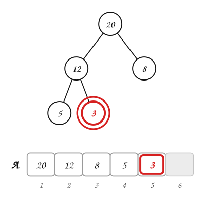

> MAX-HEAP-INSERT(A, 3): heap-size[A] pasa de 4 a 5 y 3 entra en A[5], la siguiente posición libre: queda como hijo derecho de A[2] = 12.

:::
:::{tab-item} Paso 14
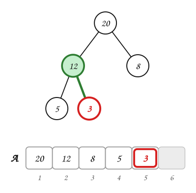

> i = 5: A[PARENT(5)] = A[2] = 12 ≥ 3: el orden se cumple. Termina.

:::
:::{tab-item} Paso 15
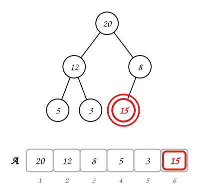

> MAX-HEAP-INSERT(A, 15): heap-size[A] pasa de 5 a 6 y 15 entra en A[6], la siguiente posición libre: queda como hijo izquierdo de A[3] = 8.

:::
:::{tab-item} Paso 16


> i = 6: A[PARENT(6)] = A[3] = 8 < 15: se intercambian A[6] y A[3].

:::
:::{tab-item} Paso 17
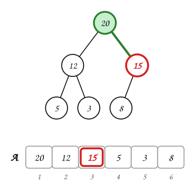

> 15 subió a A[3]. i = 3: A[PARENT(3)] = A[1] = 20 ≥ 15: el orden se cumple. Termina.

:::
:::{tab-item} Paso 18
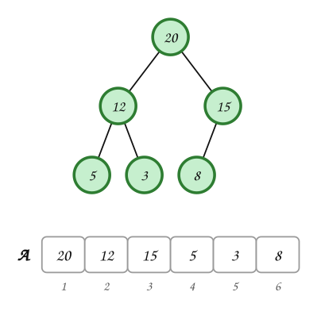

> Resultado: A = ⟨20, 12, 15, 5, 3, 8⟩.

:::
::::
:::::

Resultado: $A = \langle 20, 12, 15, 5, 3, 8 \rangle$. El paciente $20$ quedó en la raíz: es el próximo en ser atendido.

Tiempo de ejecución: $O(\lg n)$, porque `key` sube a lo sumo por una rama, de altura $\Theta(\lg n)$.

### HEAP-INCREASE-KEY

```text
HEAP-INCREASE-KEY(A, i, key)
1  if key < A[i]
2      then error "la nueva clave es menor que la actual"
3  A[i] ← key
4  while i > 1 and A[PARENT(i)] < A[i]
5      do exchange A[i] ↔ A[PARENT(i)]
6         i ← PARENT(i)
```

Las líneas 4 a 6 son las mismas de `MAX-HEAP-INSERT`: después de **aumentar** $A[i]$, solo puede fallar el orden con su padre, y se repara subiendo.

**Ejemplo 5.** En $A = \langle 16, 14, 10, 8, 7, 9, 3, 2, 4, 1 \rangle$, aumentar $A[9] = 4$ a $15$.


[▶ Abrir la animación con controles (reproducir, pausar, cuadro a cuadro)](images/inc1-anim.svg)

:::::{admonition} HEAP-INCREASE-KEY(A, 9, 15)
:class: dropdown
::::{tab-set}
:::{tab-item} Paso 1


> A = ⟨16, 14, 10, 8, 7, 9, 3, 2, 4, 1⟩, heap-size[A] = 10. Es un max-heap.

:::
:::{tab-item} Paso 2


> HEAP-INCREASE-KEY(A, 9, 15): A[9] = 4.

:::
:::{tab-item} Paso 3


> 15 ≥ 4, no hay error: A[9] ← 15. Ahora A[9] puede ser mayor que su padre: se sube mientras lo sea.

:::
:::{tab-item} Paso 4


> i = 9: A[PARENT(9)] = A[4] = 8 < 15: se intercambian A[9] y A[4].

:::
:::{tab-item} Paso 5


> 15 subió a A[4]. i = 4: A[PARENT(4)] = A[2] = 14 < 15: se intercambian A[4] y A[2].

:::
:::{tab-item} Paso 6


> 15 subió a A[2]. i = 2: A[PARENT(2)] = A[1] = 16 ≥ 15: el orden se cumple. Termina.

:::
:::{tab-item} Paso 7


> Resultado: A = ⟨16, 15, 10, 14, 7, 9, 3, 2, 8, 1⟩. Sigue siendo un max-heap.

:::
::::
:::::

Resultado: $A = \langle 16, 15, 10, 14, 7, 9, 3, 2, 8, 1 \rangle$.

> **¿Qué pasa con `HEAP-INCREASE-KEY(A, 9, 1)` en el mismo arreglo?**

:::{admonition} Respuesta
:class: dropdown
$1 < A[9] = 4$: la línea 1 da error y el arreglo no cambia. La operación solo **aumenta** claves. Si se permitiera bajar $A[9]$, el orden podría fallar con sus **hijos**, no con su padre, y subir no lo arreglaría.
:::

Tiempo de ejecución: $O(\lg n)$.

### HEAP-EXTRACT-MAX

```text
HEAP-EXTRACT-MAX(A)
 1  if heap-size[A] < 1
 2      then error "heap underflow"
 3  max ← A[1]
 4  A[1] ← A[heap-size[A]]
 5  heap-size[A] ← heap-size[A] − 1
 6  i ← 1
 7  while A[i] tenga un hijo mayor que él                // hundir A[1]
 8      do m ← la posición del mayor de los hijos de i
 9         exchange A[i] ↔ A[m]
10         i ← m
11  return max
```

- El máximo está en $A[1]$ (línea 3).
- Para no dejar un hueco en la raíz, la ocupa el **último** elemento (línea 4) y el montículo pierde su última posición (línea 5): la forma se conserva.
- El orden puede fallar ahora en la raíz. Se repara **hundiendo** ese elemento: mientras tenga un hijo mayor, se intercambia con el **mayor** de sus hijos (así, el que sube es mayor que su nuevo hermano).

> **¿Por qué se intercambia con el mayor de los hijos y no con cualquiera que sea mayor?**

:::{admonition} Respuesta
:class: dropdown
El hijo que sube queda como padre del otro. Si sube el menor de los dos, queda por encima de un hermano mayor que él y el orden falla de nuevo. En el ejemplo 7, en la raíz compiten $14$ y $10$: si subiera $10$, quedaría como padre de $14$.


[▶ Abrir la animación con controles (reproducir, pausar, cuadro a cuadro)](images/hijo-anim.svg)
:::

**Ejemplo 6.** El más simple: $A = \langle 9, 8, 6, 2, 5 \rangle$.


[▶ Abrir la animación con controles (reproducir, pausar, cuadro a cuadro)](images/ext1-anim.svg)

:::::{admonition} HEAP-EXTRACT-MAX(A)
:class: dropdown
::::{tab-set}
:::{tab-item} Paso 1


> A = ⟨9, 8, 6, 2, 5⟩, heap-size[A] = 5. Es un max-heap.

:::
:::{tab-item} Paso 2


> HEAP-EXTRACT-MAX(A): max ← A[1] = 9, el mayor de todo el montículo.

:::
:::{tab-item} Paso 3


> El máximo 9 sale del montículo; la raíz queda vacía.

:::
:::{tab-item} Paso 4


> A[1] ← A[5] = 5: el último elemento sube a la raíz y heap-size[A] pasa a 4. La forma se conserva, pero en la raíz el orden puede fallar.

:::
:::{tab-item} Paso 5


> i = 1: el mayor entre A[1] = 5, A[2] = 8, A[3] = 6 es A[2] = 8: se intercambian A[1] y A[2].

:::
:::{tab-item} Paso 6


> 5 bajó a A[2]. i = 2: el mayor entre A[2] = 5, A[4] = 2 es A[2] mismo: 5 ≥ sus hijos. Termina.

:::
:::{tab-item} Paso 7


> return 9. Quedan A[1..4] = ⟨8, 5, 6, 2⟩: otra vez un max-heap, con un elemento menos.

:::
::::
:::::

Resultado: $A[1..4] = \langle 8, 5, 6, 2 \rangle$.

**Ejemplo 7.** $A = \langle 16, 14, 10, 8, 7, 9, 3, 2, 4, 1 \rangle$.


[▶ Abrir la animación con controles (reproducir, pausar, cuadro a cuadro)](images/ext2-anim.svg)

:::::{admonition} HEAP-EXTRACT-MAX(A)
:class: dropdown
::::{tab-set}
:::{tab-item} Paso 1


> A = ⟨16, 14, 10, 8, 7, 9, 3, 2, 4, 1⟩, heap-size[A] = 10. Es un max-heap.

:::
:::{tab-item} Paso 2


> HEAP-EXTRACT-MAX(A): max ← A[1] = 16, el mayor de todo el montículo.

:::
:::{tab-item} Paso 3


> El máximo 16 sale del montículo; la raíz queda vacía.

:::
:::{tab-item} Paso 4


> A[1] ← A[10] = 1: el último elemento sube a la raíz y heap-size[A] pasa a 9. La forma se conserva, pero en la raíz el orden puede fallar.

:::
:::{tab-item} Paso 5


> i = 1: el mayor entre A[1] = 1, A[2] = 14, A[3] = 10 es A[2] = 14: se intercambian A[1] y A[2].

:::
:::{tab-item} Paso 6


> 1 bajó a A[2]. i = 2: el mayor entre A[2] = 1, A[4] = 8, A[5] = 7 es A[4] = 8: se intercambian A[2] y A[4].

:::
:::{tab-item} Paso 7


> 1 bajó a A[4]. i = 4: el mayor entre A[4] = 1, A[8] = 2, A[9] = 4 es A[9] = 4: se intercambian A[4] y A[9].

:::
:::{tab-item} Paso 8


> 1 bajó a A[9]. A[9] = 1 no tiene hijos dentro del montículo. Termina.

:::
:::{tab-item} Paso 9


> return 16. Quedan A[1..9] = ⟨14, 8, 10, 4, 7, 9, 3, 2, 1⟩: otra vez un max-heap, con un elemento menos.

:::
::::
:::::

Resultado: $A[1..9] = \langle 14, 8, 10, 4, 7, 9, 3, 2, 1 \rangle$. El $1$ que subió a la raíz bajó otra vez hasta una hoja, siempre por el lado del hijo mayor.

Tiempo de ejecución: $O(\lg n)$: el elemento baja a lo sumo por una rama.

### Una cola de urgencias

**Ejemplo 8.** Vuelva a la sala de urgencias de la sección 1, ahora con las operaciones mezcladas, en este orden: llegan $5$, $12$ y $8$; se atiende a un paciente; llegan $20$ y $3$; se atiende a otro; llega $15$. ¿A quién se atiende cada vez y quién queda en espera?


[▶ Abrir la animación con controles (reproducir, pausar, cuadro a cuadro)](images/urgencias-anim.svg)

Respuesta: se atiende a $12$ y luego a $20$, y quedan en espera $A = \langle 15, 8, 3, 5 \rangle$. Cada llegada es un `MAX-HEAP-INSERT` y cada atención un `HEAP-EXTRACT-MAX`; ninguna recorre más de una rama.

## 5. Formalización

- Un **max-heap** es un arreglo $A[1..heap\text{-}size[A]]$ tal que $A[\lfloor i/2 \rfloor] \ge A[i]$ para $2 \le i \le heap\text{-}size[A]$. Vista como árbol, la posición $i$ tiene hijos en $2i$ y $2i + 1$ (si no pasan de $heap\text{-}size[A]$).
- La forma es consecuencia de la representación: un arreglo $A[1..n]$ sin huecos, leído por niveles, siempre da un árbol que cumple la propiedad de forma. Por eso la forma solo hay que revisarla cuando el montículo se da **como árbol**.
- Un montículo de $n$ elementos tiene altura $\lfloor \lg n \rfloor + 1 = \Theta(\lg n)$.
- `HEAP-MAXIMUM` cuesta $\Theta(1)$; `MAX-HEAP-INSERT`, `HEAP-INCREASE-KEY` y `HEAP-EXTRACT-MAX` cuestan $O(\lg n)$, porque mueven un elemento por una sola rama.
- En un min-heap todo es simétrico: $A[\lfloor i/2 \rfloor] \le A[i]$, la raíz es el mínimo, y las operaciones son `HEAP-MINIMUM`, `MIN-HEAP-INSERT`, `HEAP-DECREASE-KEY` y `HEAP-EXTRACT-MIN`.

## Ejercicios

Practique con los [ejercicios de montículos](exercises.md).

## Fuentes

- Bedoya, O. *Montículos y Heapsort* (propiedades de orden y de forma, representación en arreglo, colas de prioridad y sus operaciones). Fundamentos de Análisis y Diseño de Algoritmos, Universidad del Valle.
- Cormen, T. H., Leiserson, C. E., Rivest, R. L., Stein, C. *Introduction to Algorithms*, 3.ª ed. The MIT Press, 2009. Secciones 6.1 (montículos) y 6.5 (colas de prioridad).

---

*Material adaptado del material original del profesor Oscar Bedoya.*
