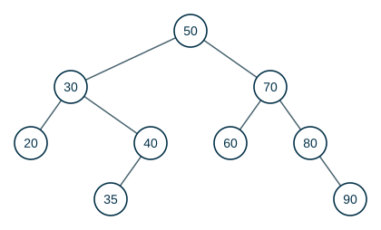
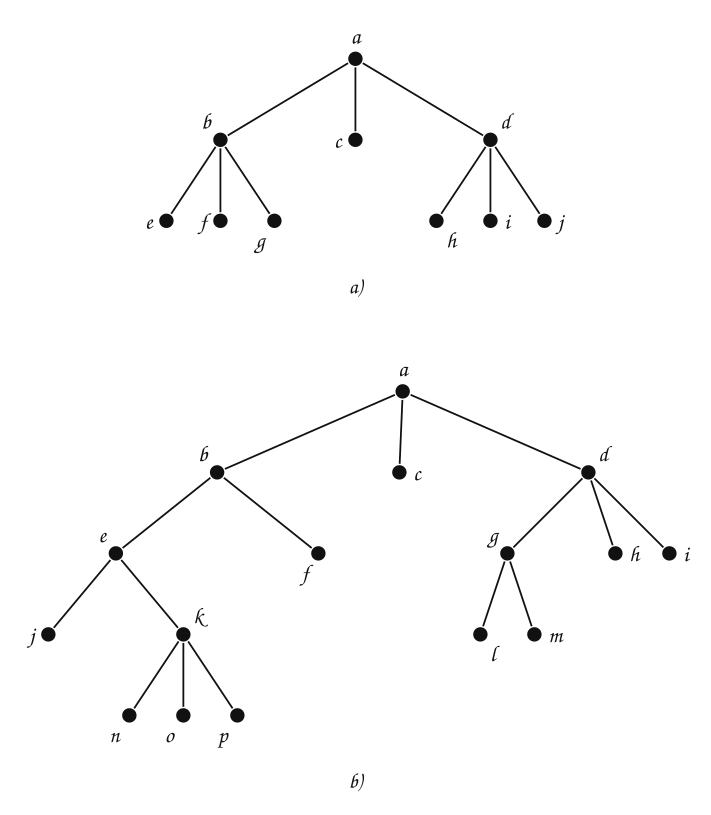
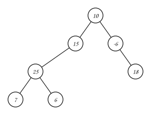
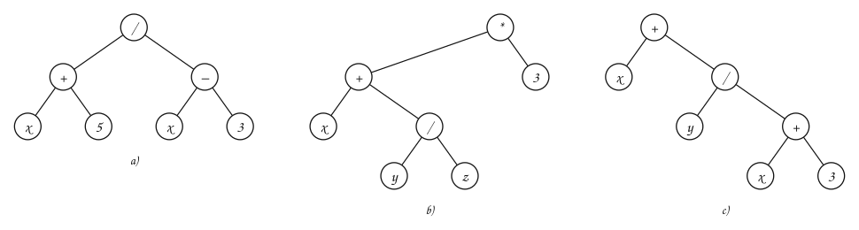
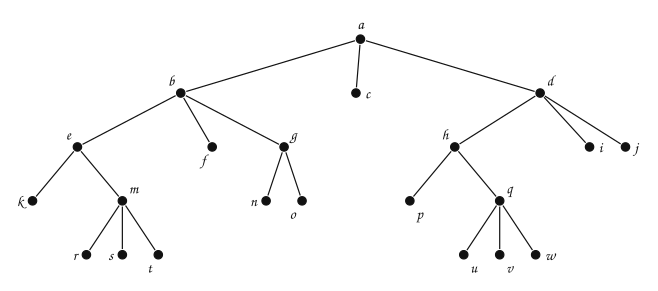

---
# Copyright (c) 2026 Angela Villota, and collaborators from the CyED block
# Licensed under the PolyForm Noncommercial License 1.0.0.
# Commercial use is prohibited without prior written authorization.
title: "Recorridos de árboles: Ejercicios"
---

# Recorridos de árboles: Ejercicios

Use esta página después de leer el [material de estudio de recorridos](index.md). Cada ejercicio trae **pistas** y una **solución general**; intente resolverlo antes de abrirlas.

---

### Ejercicio 1

Muestre el recorrido en preorden, inorden y postorden de cada árbol.

:::{admonition} Pistas
:class: dropdown
- En preorden la primera es la raíz; en postorden, la última.
- Fíjese de qué lado cuelga cada hijo único: $j$ cuelga a la derecha de $h$; $n$ y $j$ cuelgan a la izquierda de $i$ y de $g$.
:::

:::{admonition} Solución general
:class: dropdown
a)
- Preorden: c – b – e – i – a – h – j – g – f – d – k – m
- Inorden: i – e – a – b – h – j – c – f – g – k – d – m
- Postorden: i – a – e – j – h – b – f – k – m – d – g – c

b)
- Preorden: e – c – h – k – m – p – q – i – n – r – o – d – f – g – j – a – b
- Inorden: k – h – p – m – q – c – r – n – o – i – e – f – d – a – j – b – g
- Postorden: k – p – q – m – h – r – o – n – i – c – f – a – b – j – g – d – e

c)
- Preorden: a – b – d – h – i – e – j – k – n – o – c – f – g – l – p – q – m – r – s
- Inorden: h – d – i – b – j – e – n – k – o – a – f – c – p – l – q – g – r – m – s
- Postorden: h – i – d – j – n – o – k – e – b – f – p – q – l – r – s – m – g – c – a
:::

### Ejercicio 2

Muestre el recorrido en preorden, inorden y postorden de cada árbol.

:::{admonition} Pistas
:class: dropdown
- Con tres hijos, el inorden es: el primer subárbol, la raíz y luego los otros dos subárboles.
:::

:::{admonition} Solución general
:class: dropdown
a)
- Preorden: a – b – e – f – g – c – d – h – i – j
- Inorden: e – b – f – g – a – c – h – d – i – j
- Postorden: e – f – g – b – c – h – i – j – d – a

b)
- Preorden: a – b – e – j – k – n – o – p – f – c – d – g – l – m – h – i
- Inorden: j – e – n – k – o – p – b – f – a – c – l – g – m – d – h – i
- Postorden: j – n – o – p – k – e – f – b – c – l – m – g – h – i – d – a
:::

### Ejercicio 3

Muestre el recorrido en preorden, inorden, postorden y por niveles del siguiente árbol.

:::{admonition} Pistas
:class: dropdown
- La raíz es $10$. ¿Qué subárbol se recorre completo antes que el otro?
- Por niveles: la raíz, luego los del nivel $1$ de izquierda a derecha, y así.
:::

:::{admonition} Solución general
:class: dropdown
- Preorden: 10 – 15 – 25 – 7 – 6 – -6 – 18
- Inorden: 7 – 25 – 6 – 15 – 10 – -6 – 18
- Postorden: 7 – 6 – 25 – 15 – 18 – -6 – 10
- Por niveles: 10 – 15 – -6 – 25 – 18 – 7 – 6
:::

### Ejercicio 4

Muestre un árbol binario que represente cada expresión matemática:

- a) $(x+5)/(x-3)$
- b) $(x+(y/z))*3$
- c) $x+(y/(x+3))$

:::{admonition} Pistas
:class: dropdown
- La raíz es el operador que se evalúa **último**, el que queda por fuera de todos los paréntesis.
- Luego se repite con cada operando.
:::

:::{admonition} Solución general
:class: dropdown

En c) se lee en inorden $x+(y/(x+3))$: el árbol tiene a $+$ en dos lugares distintos.
:::

### Ejercicio 5

Escriba en notación prefija y postfija las tres expresiones del Ejercicio 4.

:::{admonition} Pistas
:class: dropdown
- Prefija = preorden del árbol; postfija = postorden.
:::

:::{admonition} Solución general
:class: dropdown
| Expresión | Prefija | Postfija |
|---|---|---|
| $(x+5)/(x-3)$ | `/ + x 5 − x 3` | `x 5 + x 3 − /` |
| $(x+(y/z))*3$ | `* + x / y z 3` | `x y z / + 3 *` |
| $x+(y/(x+3))$ | `+ x / y + x 3` | `x y x 3 + / +` |
:::

### Ejercicio 6

Indique el valor de las siguientes expresiones, que están en notación prefija:

- a) `+ − * 2 3 5 / ↑ 2 3 4`
- b) `/ − + + 4 3 13 5 − ↑ − 6 4 3 3`

:::{admonition} Pistas
:class: dropdown
- Busque el operador más a la derecha que esté seguido de dos números.
- En a), el primer paso reduce `↑ 2 3`.
:::

:::{admonition} Solución general
:class: dropdown
a) Valor **3**:

- `+ − * 2 3 5 / ↑ 2 3 4`
- `+ − * 2 3 5 / 8 4`
- `+ − * 2 3 5 2`
- `+ − 6 5 2`
- `+ 1 2`
- `3`

b) Valor **3**:

- `/ − + + 4 3 13 5 − ↑ − 6 4 3 3`
- `/ − + + 4 3 13 5 − ↑ 2 3 3`
- `/ − + + 4 3 13 5 − 8 3`
- `/ − + + 4 3 13 5 5`
- `/ − + 7 13 5 5`
- `/ − 20 5 5`
- `/ 15 5`
- `3`
:::

### Ejercicio 7

Indique el valor de las siguientes expresiones, que están en notación postfija:

- a) `7 2 3 * − 4 ↑ 9 3 / +`
- b) `2 3 ↑ 3 1 + / 4 ↑ 1 4 + 2 ↑ 5 / +`

:::{admonition} Pistas
:class: dropdown
- Busque el operador más a la izquierda que esté precedido de dos números.
- En a), el primer operador que aparece es `*`: opera sobre $2$ y $3$.
:::

:::{admonition} Solución general
:class: dropdown
a) Valor **4**:

- `7 2 3 * − 4 ↑ 9 3 / +`
- `7 6 − 4 ↑ 9 3 / +`
- `1 4 ↑ 9 3 / +`
- `1 9 3 / +`
- `1 3 +`
- `4`

b) Valor **21**:

- `2 3 ↑ 3 1 + / 4 ↑ 1 4 + 2 ↑ 5 / +`
- `8 3 1 + / 4 ↑ 1 4 + 2 ↑ 5 / +`
- `8 4 / 4 ↑ 1 4 + 2 ↑ 5 / +`
- `2 4 ↑ 1 4 + 2 ↑ 5 / +`
- `16 1 4 + 2 ↑ 5 / +`
- `16 5 2 ↑ 5 / +`
- `16 25 5 / +`
- `16 5 +`
- `21`
:::

### Ejercicio 8

El preorden de un árbol binario es $A, B, D, E, C, F, G$ y su inorden es $D, B, E, A, F, C, G$. Reconstruya el árbol y dé su postorden.

:::{admonition} Pistas
:class: dropdown
- El primero del preorden es la raíz.
- En el inorden, lo que está a la izquierda de la raíz forma el subárbol izquierdo.
- Repita con cada subárbol.
:::

:::{admonition} Solución general
:class: dropdown
Raíz $A$; subárbol izquierdo con inorden $D, B, E$ y raíz $B$ (hijos $D$ y $E$); subárbol derecho con inorden $F, C, G$ y raíz $C$ (hijos $F$ y $G$). Postorden: $D, E, B, F, G, C, A$.
:::

### Ejercicio 9

Mostrar el recorrido en preorden, inorden y postorden para el siguiente árbol:

---

*Material adaptado del material original de los profesores Oscar Bedoya, Andrés Aristizábal y Victor Manuel Vargas.*
