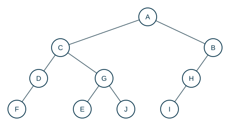
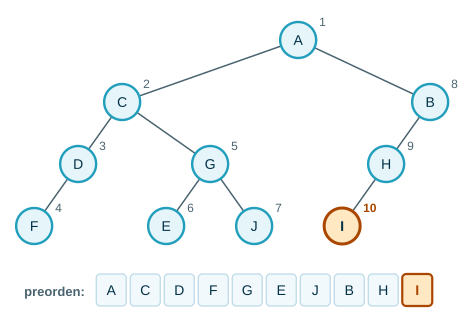
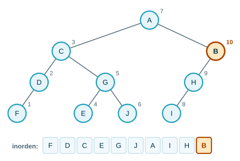
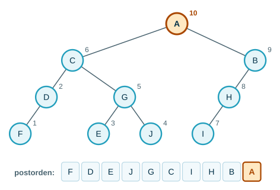

---
# Copyright (c) 2026 Angela Villota, and collaborators from the CyED block
# Licensed under the PolyForm Noncommercial License 1.0.0.
# Commercial use is prohibited without prior written authorization.
title: "Unidad 4: Recorridos en preorden, inorden y postorden"
---

# Unidad 4: Recorridos en preorden, inorden y postorden

Los ejemplos se desarrollan en desplegables con pestañas **Paso 1, Paso 2, …**: cada paso conserva lo anterior y muestra lo nuevo **en color**. Junto a cada nodo visitado aparece el número de orden en que se visitó.

## 1. El problema

Hay que imprimir **todos** los elementos de un árbol, cada uno **exactamente una vez**. En una lista basta con ir de izquierda a derecha, pero un árbol no tiene un «siguiente» natural. **¿En qué orden se visitan los nodos?**


> **¿De cuántas formas razonables se pueden listar $a$, $b$ y $c$ si los hijos siempre van de izquierda a derecha?**

:::{admonition} Respuesta
:class: dropdown
Lo único que cambia es **cuándo** se visita la raíz respecto a sus subárboles:

- antes de los dos: $a, b, c$ (**preorden**);
- entre los dos: $b, a, c$ (**inorden**);
- después de los dos: $b, c, a$ (**postorden**).
:::

Como el árbol es una estructura recursiva, cada subárbol se recorre **con la misma regla**.

## 2. Definiciones para árboles binarios

- **Preorden:** primero se visita la raíz, luego se recorre en preorden el subárbol izquierdo y finalmente en preorden el subárbol derecho.
- **Inorden:** primero se recorre en inorden el subárbol izquierdo, luego se visita la raíz y finalmente se recorre en inorden el subárbol derecho.
- **Postorden:** primero se recorre en postorden el subárbol izquierdo, luego en postorden el derecho y finalmente se visita la raíz.

```text
PREORDEN(x)              INORDEN(x)               POSTORDEN(x)
  if x ≠ NIL               if x ≠ NIL               if x ≠ NIL
      visitar(x)               INORDEN(x.izq)           POSTORDEN(x.izq)
      PREORDEN(x.izq)          visitar(x)               POSTORDEN(x.der)
      PREORDEN(x.der)          INORDEN(x.der)           visitar(x)
```

Los tres recorridos se diferencian en una sola cosa: la línea donde está `visitar(x)`.

### Ejemplo



:::::{admonition} Recorrido en preorden (raíz → izquierdo → derecho)
:class: dropdown
::::{tab-set}
:::{tab-item} Paso 1


:::
:::{tab-item} Paso 2


> Después de $A$ se recorre **todo** el subárbol izquierdo (el de $C$) en preorden, antes de tocar el derecho.

:::
:::{tab-item} Paso 3


:::
:::{tab-item} Paso 4


:::
:::{tab-item} Paso 5


> Terminó el subárbol de $D$; se sigue con el subárbol derecho de $C$, que empieza en $G$.

:::
:::{tab-item} Paso 6


:::
:::{tab-item} Paso 7


:::
:::{tab-item} Paso 8


:::
:::{tab-item} Paso 9


:::
:::{tab-item} Paso 10


:::
::::
:::::

:::::{admonition} Recorrido en inorden (izquierdo → raíz → derecho)
:class: dropdown
::::{tab-set}
:::{tab-item} Paso 1


> $F$ es el primero: hay que bajar por la izquierda hasta donde se pueda antes de visitar cualquier raíz.

:::
:::{tab-item} Paso 2


:::
:::{tab-item} Paso 3


:::
:::{tab-item} Paso 4


:::
:::{tab-item} Paso 5


:::
:::{tab-item} Paso 6


:::
:::{tab-item} Paso 7


> Se visita $A$ solo cuando ya se recorrió todo su subárbol izquierdo.

:::
:::{tab-item} Paso 8


:::
:::{tab-item} Paso 9


:::
:::{tab-item} Paso 10


:::
::::
:::::

:::::{admonition} Recorrido en postorden (izquierdo → derecho → raíz)
:class: dropdown
::::{tab-set}
:::{tab-item} Paso 1


:::
:::{tab-item} Paso 2


:::
:::{tab-item} Paso 3


:::
:::{tab-item} Paso 4


:::
:::{tab-item} Paso 5


:::
:::{tab-item} Paso 6


:::
:::{tab-item} Paso 7


:::
:::{tab-item} Paso 8


:::
:::{tab-item} Paso 9


:::
:::{tab-item} Paso 10


> La raíz $A$ es siempre la **última** en postorden.

:::
::::
:::::

| Recorrido | Resultado |
|---|---|
| Preorden | A – C – D – F – G – E – J – B – H – I |
| Inorden | F – D – C – E – G – J – A – I – H – B |
| Postorden | F – D – E – J – G – C – I – H – B – A |

> **Observe** que en preorden la raíz $A$ es la **primera**, en postorden es la **última**, y en inorden separa los elementos del subárbol izquierdo ($F, D, C, E, G, J$) de los del derecho ($I, H, B$).

### Recorrido por niveles

También se puede recorrer **nivel por nivel**, de izquierda a derecha: primero la raíz, luego los elementos del nivel $1$, y así sucesivamente. Para el ejemplo: $A, C, B, D, G, H, F, E, J, I$. Es el recorrido BFS de la Unidad 5, con una **cola**; los otros tres son recorridos en profundidad (DFS), con la **pila** de la recursión.

## 3. Árboles $n$-arios

Sea $T$ un árbol con raíz $r$ y subárboles $T_1, T_2, \dots, T_n$ (de izquierda a derecha):

- **Preorden:** $r$; luego $T_1$ en preorden, $T_2$ en preorden, …, $T_n$ en preorden.
- **Inorden:** $T_1$ en inorden; luego $r$; luego $T_2$ en inorden, …, $T_n$ en inorden.
- **Postorden:** $T_1$ en postorden, $T_2$ en postorden, …, $T_n$ en postorden; luego $r$.


> **Muestre el recorrido en preorden, inorden y postorden para el árbol.**

:::{admonition} Respuesta
:class: dropdown
- Preorden: a – b – e – f – g – c – d – h – i – j
- Inorden: e – b – f – g – a – c – h – d – i – j
- Postorden: e – f – g – b – c – h – i – j – d – a

En inorden, la raíz va después del **primer** subárbol: $e$ (el subárbol de $b$ empieza con su primer hijo), luego $b$, luego $f$ y $g$.
:::

## 4. Árboles de expresiones

Una expresión aritmética con operadores binarios ($+$, $-$, $\times$, $/$, $↑$ para potencia) se representa con un árbol binario: los nodos internos son **operadores** y las hojas son **operandos**.

:::::{admonition} Construir el árbol de ((x+y)↑2)+((x−4)/3)
:class: dropdown
::::{tab-set}
:::{tab-item} Paso 1


> El operador que se evalúa **último** es el $+$ central: $\big((x+y)↑2\big) \mathbin{\mathbf{+}} \big((x-4)/3\big)$. Es la raíz.

:::
:::{tab-item} Paso 2


> Su operando izquierdo es $(x+y)↑2$ (raíz $↑$) y el derecho es $(x-4)/3$ (raíz $/$).

:::
:::{tab-item} Paso 3


> Se repite en cada operando: $x+y$, el exponente $2$, $x-4$ y el divisor $3$.

:::
:::{tab-item} Paso 4


> Las hojas son siempre **operandos** (variables o números); los nodos internos, **operadores**.

:::
::::
:::::

Los tres recorridos dan tres **notaciones**:

| Recorrido | Notación | Resultado |
|---|---|---|
| Inorden | infija (con paréntesis) | $((x + y) ↑ 2) + ((x - 4) / 3)$ |
| Preorden | prefija (polaca) | `+ ↑ + x y 2 / − x 4 3` |
| Postorden | posfija (polaca inversa) | `x y + 2 ↑ x 4 − 3 / +` |

> **¿Por qué la notación infija necesita paréntesis y las otras dos no?**

:::{admonition} Respuesta
:class: dropdown
En inorden, $x + y ↑ 2$ puede venir de dos árboles distintos: $(x + y) ↑ 2$ o $x + (y ↑ 2)$. Los paréntesis deshacen la ambigüedad. En preorden y en postorden el árbol se reconstruye sin ambigüedad (cada operador tiene exactamente dos operandos), así que no hacen falta.
:::

### Evaluar en notación posfija

Se lee de izquierda a derecha con una **pila**: un número se apila; un operador saca los dos de arriba, opera y apila el resultado. Es la expresión $((8 - 6) ↑ 3) + (10 / (7 - 2))$:

:::::{admonition} Evaluar 8 6 − 3 ↑ 10 7 2 − / + con una pila
:class: dropdown
::::{tab-set}
:::{tab-item} Paso 1
| Símbolo | Acción | Pila (tope a la derecha) |
|---|---|---|
| $\textcolor{#a94700}{\textbf{8}}$ | $\textcolor{#a94700}{\textbf{es número: se apila}}$ | $\textcolor{#a94700}{\textbf{8}}$ |

:::
:::{tab-item} Paso 2
| Símbolo | Acción | Pila (tope a la derecha) |
|---|---|---|
| `8` | es número: se apila | 8 |
| $\textcolor{#a94700}{\textbf{6}}$ | $\textcolor{#a94700}{\textbf{es número: se apila}}$ | $\textcolor{#a94700}{\textbf{8 6}}$ |

:::
:::{tab-item} Paso 3
| Símbolo | Acción | Pila (tope a la derecha) |
|---|---|---|
| `8` | es número: se apila | 8 |
| `6` | es número: se apila | 8 6 |
| **−** | **saca 6 y 8; 8 − 6 = 2** | $\textcolor{#a94700}{\textbf{2}}$ |

:::
:::{tab-item} Paso 4
| Símbolo | Acción | Pila (tope a la derecha) |
|---|---|---|
| `8` | es número: se apila | 8 |
| `6` | es número: se apila | 8 6 |
| `−` | saca 6 y 8; 8 − 6 = 2 | 2 |
| $\textcolor{#a94700}{\textbf{3}}$ | $\textcolor{#a94700}{\textbf{es número: se apila}}$ | $\textcolor{#a94700}{\textbf{2 3}}$ |

:::
:::{tab-item} Paso 5
| Símbolo | Acción | Pila (tope a la derecha) |
|---|---|---|
| `8` | es número: se apila | 8 |
| `6` | es número: se apila | 8 6 |
| `−` | saca 6 y 8; 8 − 6 = 2 | 2 |
| `3` | es número: se apila | 2 3 |
| **↑** | **saca 3 y 2; 2 ↑ 3 = 8** | $\textcolor{#a94700}{\textbf{8}}$ |

:::
:::{tab-item} Paso 6
| Símbolo | Acción | Pila (tope a la derecha) |
|---|---|---|
| `8` | es número: se apila | 8 |
| `6` | es número: se apila | 8 6 |
| `−` | saca 6 y 8; 8 − 6 = 2 | 2 |
| `3` | es número: se apila | 2 3 |
| `↑` | saca 3 y 2; 2 ↑ 3 = 8 | 8 |
| $\textcolor{#a94700}{\textbf{10}}$ | $\textcolor{#a94700}{\textbf{es número: se apila}}$ | $\textcolor{#a94700}{\textbf{8 10}}$ |

:::
:::{tab-item} Paso 7
| Símbolo | Acción | Pila (tope a la derecha) |
|---|---|---|
| `8` | es número: se apila | 8 |
| `6` | es número: se apila | 8 6 |
| `−` | saca 6 y 8; 8 − 6 = 2 | 2 |
| `3` | es número: se apila | 2 3 |
| `↑` | saca 3 y 2; 2 ↑ 3 = 8 | 8 |
| `10` | es número: se apila | 8 10 |
| $\textcolor{#a94700}{\textbf{7}}$ | $\textcolor{#a94700}{\textbf{es número: se apila}}$ | $\textcolor{#a94700}{\textbf{8 10 7}}$ |

:::
:::{tab-item} Paso 8
| Símbolo | Acción | Pila (tope a la derecha) |
|---|---|---|
| `8` | es número: se apila | 8 |
| `6` | es número: se apila | 8 6 |
| `−` | saca 6 y 8; 8 − 6 = 2 | 2 |
| `3` | es número: se apila | 2 3 |
| `↑` | saca 3 y 2; 2 ↑ 3 = 8 | 8 |
| `10` | es número: se apila | 8 10 |
| `7` | es número: se apila | 8 10 7 |
| $\textcolor{#a94700}{\textbf{2}}$ | $\textcolor{#a94700}{\textbf{es número: se apila}}$ | $\textcolor{#a94700}{\textbf{8 10 7 2}}$ |

:::
:::{tab-item} Paso 9
| Símbolo | Acción | Pila (tope a la derecha) |
|---|---|---|
| `8` | es número: se apila | 8 |
| `6` | es número: se apila | 8 6 |
| `−` | saca 6 y 8; 8 − 6 = 2 | 2 |
| `3` | es número: se apila | 2 3 |
| `↑` | saca 3 y 2; 2 ↑ 3 = 8 | 8 |
| `10` | es número: se apila | 8 10 |
| `7` | es número: se apila | 8 10 7 |
| `2` | es número: se apila | 8 10 7 2 |
| **−** | **saca 2 y 7; 7 − 2 = 5** | $\textcolor{#a94700}{\textbf{8 10 5}}$ |

:::
:::{tab-item} Paso 10
| Símbolo | Acción | Pila (tope a la derecha) |
|---|---|---|
| `8` | es número: se apila | 8 |
| `6` | es número: se apila | 8 6 |
| `−` | saca 6 y 8; 8 − 6 = 2 | 2 |
| `3` | es número: se apila | 2 3 |
| `↑` | saca 3 y 2; 2 ↑ 3 = 8 | 8 |
| `10` | es número: se apila | 8 10 |
| `7` | es número: se apila | 8 10 7 |
| `2` | es número: se apila | 8 10 7 2 |
| `−` | saca 2 y 7; 7 − 2 = 5 | 8 10 5 |
| $\textcolor{#a94700}{\textbf{/}}$ | $\textcolor{#a94700}{\textbf{saca 5 y 10; 10 / 5 = 2}}$ | $\textcolor{#a94700}{\textbf{8 2}}$ |

:::
:::{tab-item} Paso 11
| Símbolo | Acción | Pila (tope a la derecha) |
|---|---|---|
| `8` | es número: se apila | 8 |
| `6` | es número: se apila | 8 6 |
| `−` | saca 6 y 8; 8 − 6 = 2 | 2 |
| `3` | es número: se apila | 2 3 |
| `↑` | saca 3 y 2; 2 ↑ 3 = 8 | 8 |
| `10` | es número: se apila | 8 10 |
| `7` | es número: se apila | 8 10 7 |
| `2` | es número: se apila | 8 10 7 2 |
| `−` | saca 2 y 7; 7 − 2 = 5 | 8 10 5 |
| `/` | saca 5 y 10; 10 / 5 = 2 | 8 2 |
| $\textcolor{#a94700}{\textbf{+}}$ | $\textcolor{#a94700}{\textbf{saca 2 y 8; 8 + 2 = 10}}$ | $\textcolor{#a94700}{\textbf{10}}$ |

> Al final la pila tiene un solo valor: **10**.

:::
::::
:::::

### Evaluar en notación prefija

Se busca el operador **más a la derecha** que tenga dos números a continuación, se reemplaza por su resultado y se repite:

:::::{admonition} Evaluar + − * 2 3 5 / ↑ 2 3 4
:class: dropdown
::::{tab-set}
:::{tab-item} Paso 1
- **`+ − * 2 3 5 / ↑ 2 3 4`** ←

> Se busca el operador **más a la derecha** que esté seguido de dos números.

:::
:::{tab-item} Paso 2
- `+ − * 2 3 5 / ↑ 2 3 4`
- **`+ − * 2 3 5 / 8 4`** ←

:::
:::{tab-item} Paso 3
- `+ − * 2 3 5 / ↑ 2 3 4`
- `+ − * 2 3 5 / 8 4`
- **`+ − * 2 3 5 2`** ←

:::
:::{tab-item} Paso 4
- `+ − * 2 3 5 / ↑ 2 3 4`
- `+ − * 2 3 5 / 8 4`
- `+ − * 2 3 5 2`
- **`+ − 6 5 2`** ←

:::
:::{tab-item} Paso 5
- `+ − * 2 3 5 / ↑ 2 3 4`
- `+ − * 2 3 5 / 8 4`
- `+ − * 2 3 5 2`
- `+ − 6 5 2`
- **`+ 1 2`** ←

:::
:::{tab-item} Paso 6
- `+ − * 2 3 5 / ↑ 2 3 4`
- `+ − * 2 3 5 / 8 4`
- `+ − * 2 3 5 2`
- `+ − 6 5 2`
- `+ 1 2`
- **`3`** ←

:::
::::
:::::

El valor es $3$: $(2 \cdot 3 - 5) + (2^3 / 4) = 1 + 2$.

## 5. Implementación en Java

**Análisis.**

| | |
|---|---|
| **Entradas** | Un árbol binario. |
| **Salidas** | Las listas de elementos en preorden, inorden, postorden y por niveles. |
| **Proceso** | Tres métodos recursivos que llenan una lista; uno iterativo con una cola para el recorrido por niveles. |

**Diseño.** El pseudocódigo de la sección 2. Cada método recibe la lista donde acumula el resultado; el caso base es el subárbol vacío (`null`).

**Codificación.**

```java
import java.util.ArrayDeque;
import java.util.ArrayList;
import java.util.List;
import java.util.Queue;

public class Recorridos {

    static class Nodo<T> {
        T elem;
        Nodo<T> izq;
        Nodo<T> der;

        Nodo(T elem, Nodo<T> izq, Nodo<T> der) {
            this.elem = elem;
            this.izq = izq;
            this.der = der;
        }
    }

    static <T> void preorden(Nodo<T> n, List<T> res) {
        if (n == null) {
            return;
        }
        res.add(n.elem);           // raíz
        preorden(n.izq, res);      // subárbol izquierdo
        preorden(n.der, res);      // subárbol derecho
    }

    static <T> void inorden(Nodo<T> n, List<T> res) {
        if (n == null) {
            return;
        }
        inorden(n.izq, res);
        res.add(n.elem);
        inorden(n.der, res);
    }

    static <T> void postorden(Nodo<T> n, List<T> res) {
        if (n == null) {
            return;
        }
        postorden(n.izq, res);
        postorden(n.der, res);
        res.add(n.elem);
    }

    // Por niveles: es BFS sobre el árbol, con una cola.
    static <T> List<T> porNiveles(Nodo<T> raiz) {
        List<T> res = new ArrayList<>();
        Queue<Nodo<T>> cola = new ArrayDeque<>();
        if (raiz != null) {
            cola.add(raiz);
        }
        while (!cola.isEmpty()) {
            Nodo<T> n = cola.remove();
            res.add(n.elem);
            if (n.izq != null) {
                cola.add(n.izq);
            }
            if (n.der != null) {
                cola.add(n.der);
            }
        }
        return res;
    }

    static <T> Nodo<T> n(T e, Nodo<T> izq, Nodo<T> der) {
        return new Nodo<>(e, izq, der);
    }

    public static void main(String[] args) {
        Nodo<Character> raiz =
                n('A', n('C', n('D', n('F', null, null), null),
                              n('G', n('E', null, null), n('J', null, null))),
                       n('B', n('H', n('I', null, null), null), null));
        List<Character> pre = new ArrayList<>();
        List<Character> in = new ArrayList<>();
        List<Character> post = new ArrayList<>();
        preorden(raiz, pre);
        inorden(raiz, in);
        postorden(raiz, post);
        System.out.println("preorden:    " + pre);
        System.out.println("inorden:     " + in);
        System.out.println("postorden:   " + post);
        System.out.println("por niveles: " + porNiveles(raiz));
    }
}
```

**Prueba.** Con el árbol del ejemplo de la sección 2:

```text
preorden:    [A, C, D, F, G, E, J, B, H, I]
inorden:     [F, D, C, E, G, J, A, I, H, B]
postorden:   [F, D, E, J, G, C, I, H, B, A]
por niveles: [A, C, B, D, G, H, F, E, J, I]
```

Son las secuencias de las pestañas de la sección 2.

**Complejidad.** Cada recorrido visita cada nodo una vez y hace una cantidad constante de trabajo por nodo: $\Theta(n)$ para un árbol de $n$ nodos.

## Ejercicios

Practique con los [ejercicios de recorridos](exercises.md).

## Fuentes

- Bedoya, O. *Árboles: recorridos de los árboles, notación infija, prefija y postfija*. Diapositivas del curso, Universidad del Valle.
- Aristizábal, A. *Árboles $n$-arios*. Computación y Estructuras Discretas I, Universidad Icesi, 2026.
- Rosen, K. H. *Discrete Mathematics and Its Applications*, 7.ª ed. McGraw-Hill, 2011. Sección 11.3.

---

*Material adaptado del material original de los profesores Oscar Bedoya y Andrés Aristizábal.*
