---
# Copyright (c) 2026 Angela Villota, and collaborators from the CyED block
# Licensed under the PolyForm Noncommercial License 1.0.0.
# Commercial use is prohibited without prior written authorization.
title: "Unidad 4: Recorridos en preorden, inorden y postorden"
---

# Unidad 4: Recorridos en preorden, inorden y postorden

## 1. El problema

Hay que imprimir **todos** los elementos de un árbol, cada uno **exactamente una vez**. En una lista basta con ir de izquierda a derecha, pero un árbol no tiene un «siguiente» natural. **¿En qué orden se visitan los nodos?**

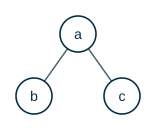

> **¿De cuántas formas razonables se pueden listar $a$, $b$ y $c$ si los hijos siempre van de izquierda a derecha?**

:::{admonition} Respuesta
:class: dropdown
Lo único que cambia es **cuándo** se visita la raíz respecto a sus subárboles:

- antes de los dos: $a, b, c$ (**preorden**);
- entre los dos: $b, a, c$ (**inorden**);
- después de los dos: $b, c, a$ (**postorden**).
:::

Como el árbol es una estructura recursiva, cada subárbol se recorre **con la misma regla**.

## 2. Definiciones

Sea $T$ un árbol con raíz $r$ y subárboles $T_1, T_2, \dots, T_n$, de izquierda a derecha.

- **Preorden:** se visita $r$, luego se recorre $T_1$ en preorden, luego $T_2$ en preorden, así hasta $T_n$ en preorden.
- **Inorden:** se recorre $T_1$ en inorden, luego se visita $r$, luego se recorre $T_2$ en inorden, así hasta $T_n$ en inorden.
- **Postorden:** se recorre $T_1$ en postorden, $T_2$ en postorden, hasta $T_n$ en postorden, y luego se visita $r$.

En un árbol **binario** los subárboles son el izquierdo y el derecho:

```text
PREORDEN(x)              INORDEN(x)               POSTORDEN(x)
  if x ≠ NIL               if x ≠ NIL               if x ≠ NIL
      visitar(x)               INORDEN(x.izq)           POSTORDEN(x.izq)
      PREORDEN(x.izq)          visitar(x)               POSTORDEN(x.der)
      PREORDEN(x.der)          INORDEN(x.der)           visitar(x)
```

Los tres recorridos se diferencian en una sola cosa: la línea donde está `visitar(x)`.

### Recorrido en preorden

:::::{admonition} Recorrido en preorden
:class: dropdown
::::{tab-set}
:::{tab-item} Paso 1
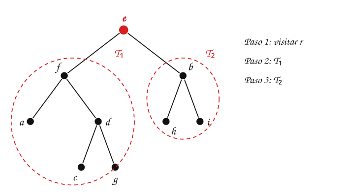

> La raíz es $e$, con subárboles $T_1$ (raíz $f$) y $T_2$ (raíz $b$). En preorden se recorre la raíz, luego $T_1$ completo en preorden y luego $T_2$ en preorden. Dentro de cada subárbol se aplica la **misma** regla.

:::
:::{tab-item} Paso 2
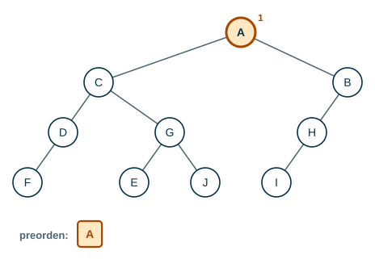

:::
:::{tab-item} Paso 3
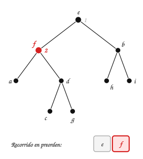

> Después de $e$ se recorre **todo** $T_1$ en preorden: su raíz $f$ primero.

:::
:::{tab-item} Paso 4
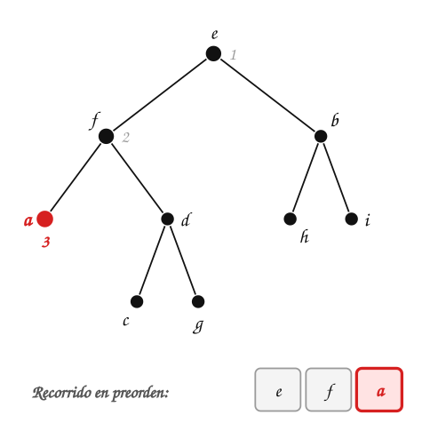

:::
:::{tab-item} Paso 5
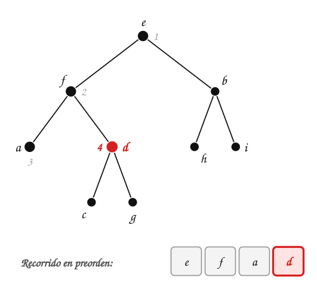

:::
:::{tab-item} Paso 6
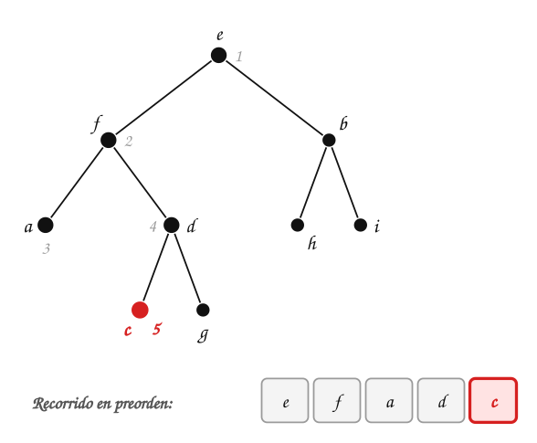

:::
:::{tab-item} Paso 7


> Terminó $T_1$. Ahora se recorre $T_2$, que empieza en su raíz $b$.

:::
:::{tab-item} Paso 8
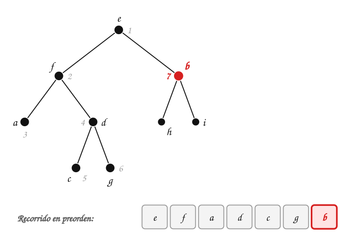

:::
:::{tab-item} Paso 9
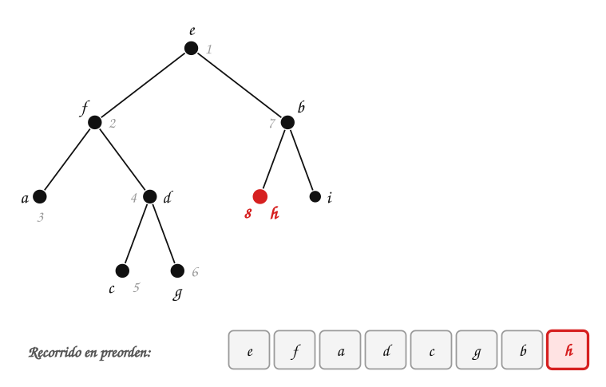

:::
:::{tab-item} Paso 10
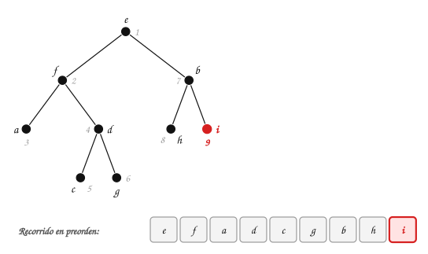

:::
::::
:::::

### Recorrido en inorden

:::::{admonition} Recorrido en inorden
:class: dropdown
::::{tab-set}
:::{tab-item} Paso 1
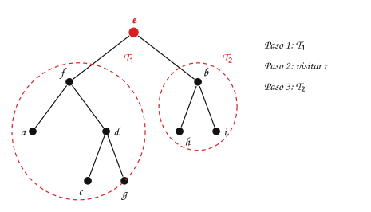

> La raíz es $e$, con subárboles $T_1$ (raíz $f$) y $T_2$ (raíz $b$). En inorden se recorre $T_1$ completo en inorden, luego la raíz y luego $T_2$ en inorden. Dentro de cada subárbol se aplica la **misma** regla.

:::
:::{tab-item} Paso 2
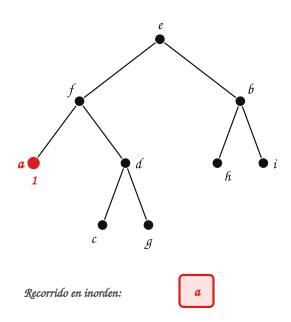

> $a$ es el primero: se baja por el primer subárbol hasta donde se pueda antes de visitar cualquier raíz.

:::
:::{tab-item} Paso 3
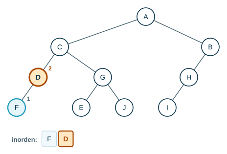

:::
:::{tab-item} Paso 4
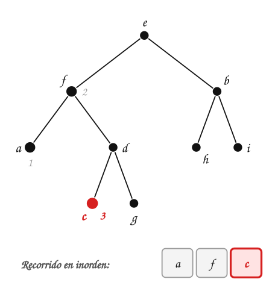

:::
:::{tab-item} Paso 5
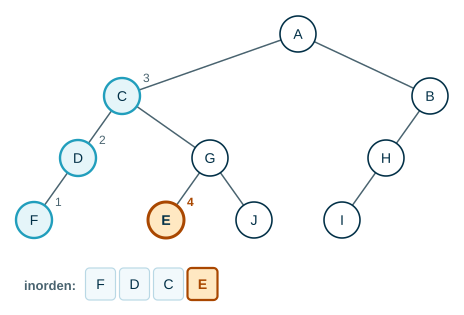

:::
:::{tab-item} Paso 6
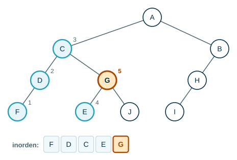

:::
:::{tab-item} Paso 7
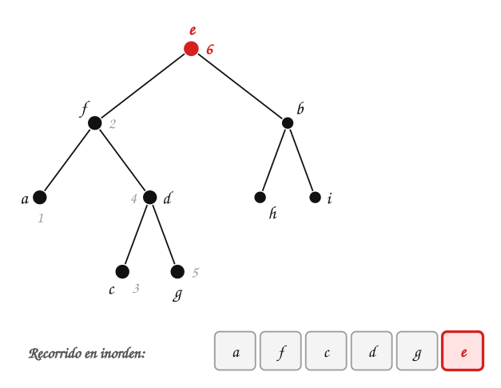

> Se visita $e$ solo cuando ya se recorrió todo $T_1$.

:::
:::{tab-item} Paso 8
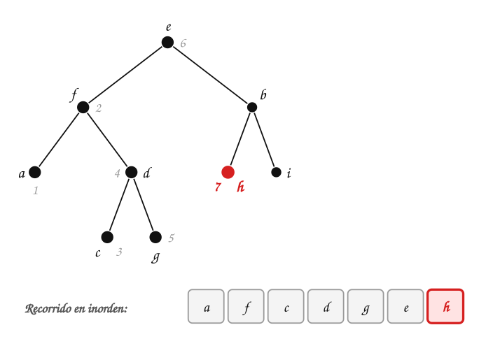

:::
:::{tab-item} Paso 9
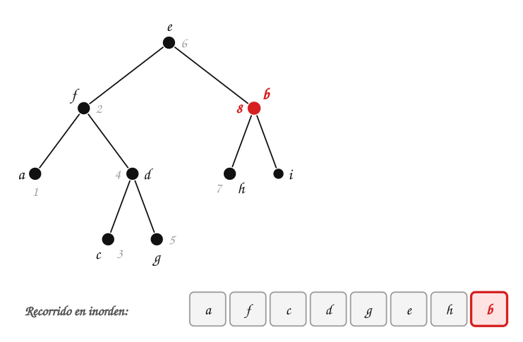

:::
:::{tab-item} Paso 10
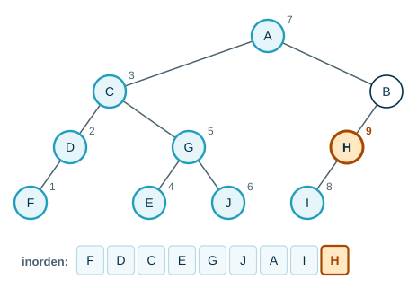

:::
::::
:::::

### Recorrido en postorden

:::::{admonition} Recorrido en postorden
:class: dropdown
::::{tab-set}
:::{tab-item} Paso 1
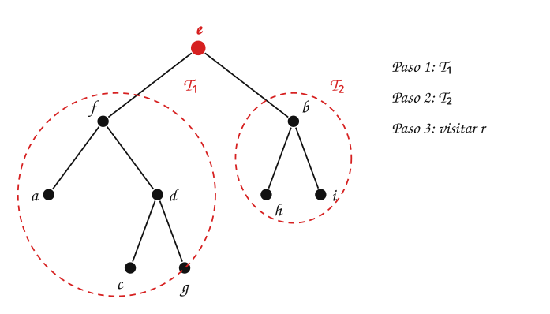

> La raíz es $e$, con subárboles $T_1$ (raíz $f$) y $T_2$ (raíz $b$). En postorden se recorre $T_1$ completo en postorden, luego $T_2$ en postorden y al final la raíz. Dentro de cada subárbol se aplica la **misma** regla.

:::
:::{tab-item} Paso 2
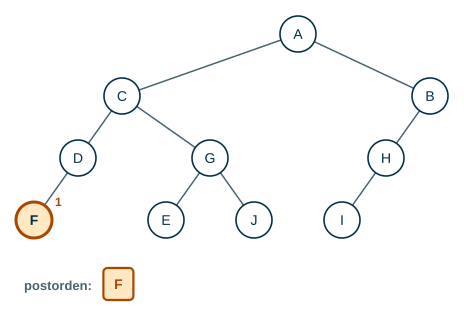

:::
:::{tab-item} Paso 3
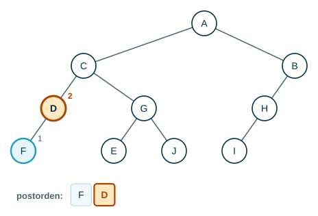

:::
:::{tab-item} Paso 4
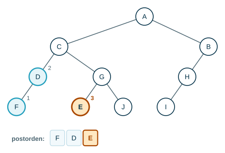

:::
:::{tab-item} Paso 5
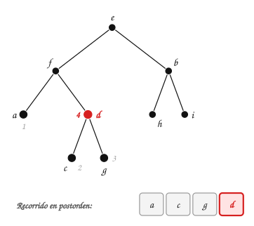

:::
:::{tab-item} Paso 6
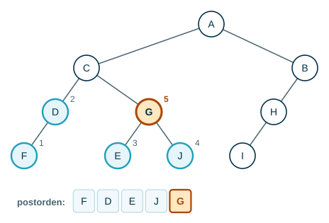

> $f$ va después de todo su subárbol: $a$, y luego $c, g, d$.

:::
:::{tab-item} Paso 7
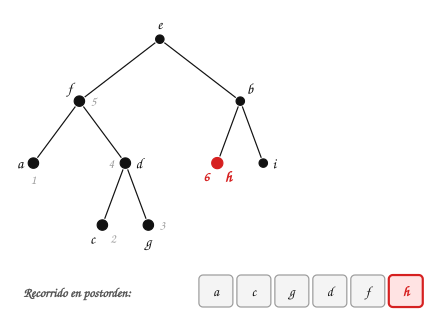

:::
:::{tab-item} Paso 8
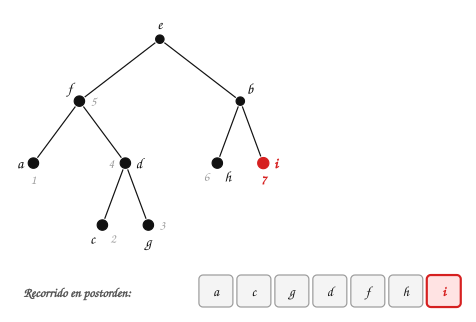

:::
:::{tab-item} Paso 9
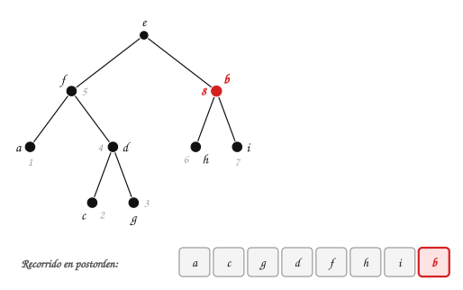

:::
:::{tab-item} Paso 10
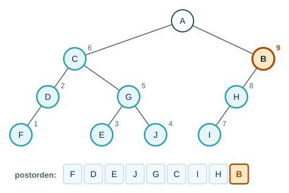

> La raíz $e$ es siempre la **última** en postorden.

:::
::::
:::::

| Recorrido | Resultado |
|---|---|
| Preorden | e – f – a – d – c – g – b – h – i |
| Inorden | a – f – c – d – g – e – h – b – i |
| Postorden | a – c – g – d – f – h – i – b – e |

> **¿Qué tienen en común los tres resultados?**

:::{admonition} Respuesta
:class: dropdown
La raíz $e$ es la **primera** en preorden y la **última** en postorden. En inorden separa los nodos del subárbol $T_1$ ($a, f, c, d, g$) de los del subárbol $T_2$ ($h, b, i$). Y en los tres, cada subárbol aparece **seguido**, sin mezclarse con otros nodos.
:::

### Un hijo solo: ¿izquierdo o derecho?

En un árbol binario importa de qué lado cuelga un hijo único. En este árbol, $h$ tiene un solo hijo, $j$, **a la derecha**:

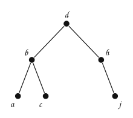

> **¿Va $j$ antes o después de $h$ en inorden?**

:::{admonition} Respuesta
:class: dropdown
Después: el subárbol izquierdo de $h$ está vacío, así que se visita $h$ y luego su subárbol derecho, $j$. El inorden es a – b – c – d – h – j. Si $j$ colgara a la izquierda, iría antes: $\dots, j, h, \dots$.
:::

### Árboles $n$-arios

En un árbol $n$-ario, el preorden incluye primero la raíz y luego recorre en preorden todos sus subárboles. El orden que resulta no cumple ninguna propiedad particular, pero se garantiza que cada elemento del árbol aparece **exactamente una vez**.

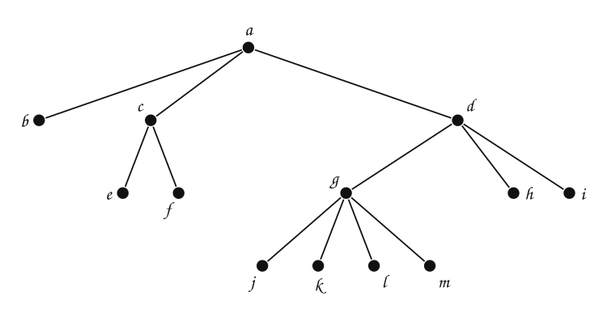

> **Muestre el recorrido en preorden, inorden y postorden para el árbol.**

:::{admonition} Respuesta
:class: dropdown
- Preorden: a – b – c – e – f – d – g – j – k – l – m – h – i
- Inorden: b – a – e – c – f – j – g – k – l – m – d – h – i
- Postorden: b – e – f – c – j – k – l – m – g – h – i – d – a

En inorden, la raíz va después del **primer** subárbol: $b$, luego $a$, luego los subárboles de $c$ y de $d$. Dentro de $g$, que tiene cuatro hijos, va $j$, luego $g$, luego $k, l, m$.
:::

### Recorrido por niveles

También se puede recorrer **nivel por nivel**, de izquierda a derecha: primero la raíz, luego los elementos del nivel $1$, y así sucesivamente. Para el árbol de las pestañas: e – f – b – a – d – h – i – c – g. Es el recorrido BFS de la Unidad 5, que usa una **cola**; los otros tres bajan por un subárbol hasta el fondo antes de pasar al siguiente, como el DFS.

## 3. Notación infija, prefija y postfija

Los recorridos permiten escribir expresiones complejas: proposiciones compuestas, combinaciones de conjuntos y expresiones aritméticas. En una expresión aritmética con suma ($+$), resta ($-$), multiplicación ($*$), división ($/$) y potencia ($↑$), cada operador tiene dos operandos, así que la expresión se representa con un **árbol binario**: los nodos internos son operadores y las hojas son operandos.

Muestre un árbol binario que represente la expresión $((x+y)↑2)+((x-4)/3)$:

:::::{admonition} Árbol de ((x+y)↑2)+((x−4)/3)
:class: dropdown
::::{tab-set}
:::{tab-item} Paso 1
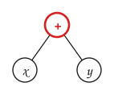

> Se empieza por los paréntesis de adentro: $x+y$.

:::
:::{tab-item} Paso 2
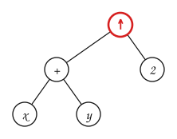

> $(x+y)↑2$: el árbol de $x+y$ es el operando izquierdo de $↑$.

:::
:::{tab-item} Paso 3
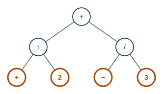

> Por el otro lado, $x-4$.

:::
:::{tab-item} Paso 4
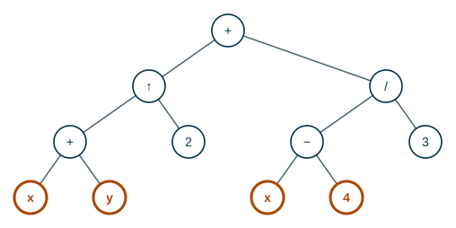

> $(x-4)/3$: el árbol de $x-4$ es el operando izquierdo de $/$.

:::
:::{tab-item} Paso 5
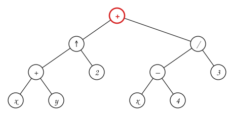

> El $+$ del centro se evalúa **último**: es la raíz, con los dos árboles como subárboles.

:::
::::
:::::

Los tres recorridos dan tres **notaciones**:

| Recorrido | Notación | Resultado |
|---|---|---|
| Inorden | infija | $((x + y) ↑ 2) + ((x - 4) / 3)$ |
| Preorden | prefija | `+ ↑ + x y 2 / − x 4 3` |
| Postorden | postfija | `x y + 2 ↑ x 4 − 3 / +` |

> **¿Por qué la notación infija necesita paréntesis y las otras dos no?**

:::{admonition} Respuesta
:class: dropdown
En inorden, $x + y ↑ 2$ puede venir de dos árboles distintos: $(x + y) ↑ 2$ o $x + (y ↑ 2)$. Los paréntesis deshacen la ambigüedad. En prefija y en postfija cada operador tiene exactamente dos operandos en un lugar fijo, así que el árbol se reconstruye sin ambigüedad.
:::

Represente en notación infija, prefija y postfija la expresión dada por el siguiente árbol:

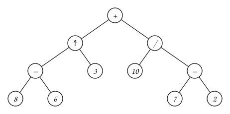

:::{admonition} Respuesta
:class: dropdown
- Notación infija: $((8-6)↑3)+(10/(7-2))$
- Notación prefija: `+ ↑ − 8 6 3 / 10 − 7 2`
- Notación postfija: `8 6 − 3 ↑ 10 7 2 − / +`
:::

### Evaluar en notación prefija

Se busca el operador **más a la derecha** que esté seguido de dos números, se reemplaza por su resultado y se repite:

:::::{admonition} Evaluar + ↑ − 8 6 3 / 10 − 7 2
:class: dropdown
::::{tab-set}
:::{tab-item} Paso 1
- **`+ ↑ − 8 6 3 / 10 − 7 2`** ←

> El operador más a la derecha seguido de dos números es `− 7 2`: se reemplaza por $5$.

:::
:::{tab-item} Paso 2
- `+ ↑ − 8 6 3 / 10 − 7 2`
- **`+ ↑ − 8 6 3 / 10 5`** ←

:::
:::{tab-item} Paso 3
- `+ ↑ − 8 6 3 / 10 − 7 2`
- `+ ↑ − 8 6 3 / 10 5`
- **`+ ↑ − 8 6 3 2`** ←

:::
:::{tab-item} Paso 4
- `+ ↑ − 8 6 3 / 10 − 7 2`
- `+ ↑ − 8 6 3 / 10 5`
- `+ ↑ − 8 6 3 2`
- **`+ ↑ 2 3 2`** ←

:::
:::{tab-item} Paso 5
- `+ ↑ − 8 6 3 / 10 − 7 2`
- `+ ↑ − 8 6 3 / 10 5`
- `+ ↑ − 8 6 3 2`
- `+ ↑ 2 3 2`
- **`+ 8 2`** ←

:::
:::{tab-item} Paso 6
- `+ ↑ − 8 6 3 / 10 − 7 2`
- `+ ↑ − 8 6 3 / 10 5`
- `+ ↑ − 8 6 3 2`
- `+ ↑ 2 3 2`
- `+ 8 2`
- **`10`** ←

> Queda un solo número: el valor es **10**.

:::
::::
:::::

### Evaluar en notación postfija

Al revés: se busca el operador **más a la izquierda** que esté precedido de dos números:

:::::{admonition} Evaluar 8 6 − 3 ↑ 10 7 2 − / +
:class: dropdown
::::{tab-set}
:::{tab-item} Paso 1
- **`8 6 − 3 ↑ 10 7 2 − / +`** ←

> El operador más a la izquierda precedido de dos números es `8 6 −`: se reemplaza por $2$.

:::
:::{tab-item} Paso 2
- `8 6 − 3 ↑ 10 7 2 − / +`
- **`2 3 ↑ 10 7 2 − / +`** ←

:::
:::{tab-item} Paso 3
- `8 6 − 3 ↑ 10 7 2 − / +`
- `2 3 ↑ 10 7 2 − / +`
- **`8 10 7 2 − / +`** ←

:::
:::{tab-item} Paso 4
- `8 6 − 3 ↑ 10 7 2 − / +`
- `2 3 ↑ 10 7 2 − / +`
- `8 10 7 2 − / +`
- **`8 10 5 / +`** ←

:::
:::{tab-item} Paso 5
- `8 6 − 3 ↑ 10 7 2 − / +`
- `2 3 ↑ 10 7 2 − / +`
- `8 10 7 2 − / +`
- `8 10 5 / +`
- **`8 2 +`** ←

:::
:::{tab-item} Paso 6
- `8 6 − 3 ↑ 10 7 2 − / +`
- `2 3 ↑ 10 7 2 − / +`
- `8 10 7 2 − / +`
- `8 10 5 / +`
- `8 2 +`
- **`10`** ←

> Queda un solo número: el valor es **10**.

:::
::::
:::::

Las dos dan $10$, el valor de $((8-6)↑3)+(10/(7-2)) = 2^3 + 2$.

## Ejercicios

Practique con los [ejercicios de recorridos](exercises.md).

## Fuentes

- Bedoya, O. *Árboles: recorridos de los árboles, notación infija, prefija y postfija*. Diapositivas del curso, Universidad del Valle.
- Aristizábal, A. *Árboles $n$-arios* (preorden en un árbol $n$-ario). Computación y Estructuras Discretas I, Universidad Icesi, 2026.
- Vargas Forero, V. M. *Estructuras de datos: recorrido de árboles binarios* (preorden, inorden, postorden y por niveles). Universidad del Valle.
- Rosen, K. H. *Discrete Mathematics and Its Applications*, 7.ª ed. McGraw-Hill, 2011. Sección 11.3.

---

*Material adaptado del material original de los profesores Oscar Bedoya y Andrés Aristizábal.*
