---
# Copyright (c) 2026 Angela Villota, and collaborators from the CyED block
# Licensed under the PolyForm Noncommercial License 1.0.0.
# Commercial use is prohibited without prior written authorization.
title: "Unidad 5: Recorrido en anchura (BFS)"
---

# Unidad 5: Recorrido en anchura (BFS)

Los ejemplos se desarrollan en desplegables. Dentro, las pestañas **Paso 1, Paso 2, …** construyen la solución poco a poco, como diapositivas: cada paso conserva lo anterior y muestra lo nuevo **en color**.

## 1. El problema

Cada vértice es una estación y cada arista es un tramo entre dos estaciones.

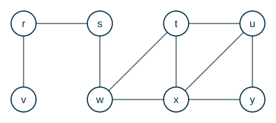

**Saliendo de la estación $s$, ¿cuál es el menor número de tramos que hay que recorrer para llegar a cada estación?**

Pruebe con algunas estaciones antes de seguir.

:::{admonition} ¿Cuántos tramos hasta $w$? ¿Hasta $u$? ¿Hasta $y$?
:class: dropdown
- $w$: **1** tramo ($s \to w$).
- $u$: **3** tramos. Por ejemplo $s \to w \to t \to u$ o $s \to w \to x \to u$.
- $y$: **3** tramos ($s \to w \to x \to y$).

Para $u$ también existe $s \to r \to v \to \dots$, pero ese camino no llega a $u$: $v$ solo conecta con $r$.
:::

**¿Cómo estar seguros de que $3$ es el mínimo para $u$?** Una primera idea es listar **todos** los caminos simples desde $s$ hasta $u$ y quedarse con el más corto. Esa idea funciona con $8$ estaciones, pero el número de caminos simples puede crecer exponencialmente con el número de vértices: en un grafo completo $K_n$ hay más de $(n-2)!$ caminos simples entre dos vértices. Hace falta otra estrategia.

### ¿Entendimos el problema?

| | |
|---|---|
| **Entradas** | Un grafo $G = (V, E)$ (dirigido o no) y un vértice origen $s \in V$. |
| **Salidas** | Para cada $v \in V$: $v.d$, el menor número de aristas de un camino de $s$ a $v$ ($\infty$ si no hay camino), y $v.\pi$, el vértice anterior a $v$ en uno de esos caminos. |

Traza a mano con la figura: $s.d = 0$, $w.d = 1$ con $w.\pi = s$, $x.d = 2$ con $x.\pi = w$, $y.d = 3$ con $y.\pi = x$.

> **¿Por qué $y.\pi = x$ y no $u$?** Las dos opciones dan caminos de longitud $3$. El algoritmo devuelve **uno** de los caminos mínimos; cuál, depende del orden en que se revisan los vecinos.

## 2. Idea: explorar por niveles

En lugar de seguir caminos completos, se avanza **por capas**: primero el origen, luego todo lo que está a distancia $1$, luego todo lo que está a distancia $2$, etc. Así, la primera vez que se alcanza un vértice se hace por un camino de la menor longitud posible.

**Recorrido en anchura (BFS, *breadth-first search*).** Se descubren todos los vértices a distancia $k$ del origen antes de descubrir cualquier vértice a distancia $k+1$. Para lograrlo se usa una **cola** (FIFO).

### Ejemplo 1

El primer ejemplo es un árbol, donde los niveles se ven a simple vista. Se recorre desde la raíz $A$; los vecinos se revisan de izquierda a derecha. Junto a cada vértice aparece su distancia $d$ a $A$.

:::::{admonition} Recorrido BFS desde A
:class: dropdown
::::{tab-set}
:::{tab-item} Paso 1
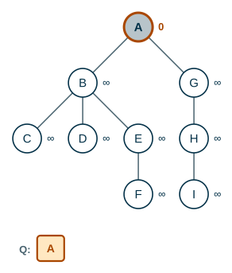

> Todos los vértices empiezan blancos con $d = \infty$. Se descubre el origen $A$: se pinta de gris, $A.d = 0$ y se encola.

:::
:::{tab-item} Paso 2
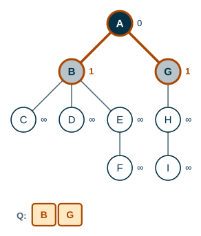

> Se extrae $A$ de la cola. Sus vecinos blancos $B$ y $G$ se descubren: quedan grises, con $d = A.d + 1 = 1$ y $\pi = A$, y se encolan. $A$ queda negro.

:::
:::{tab-item} Paso 3
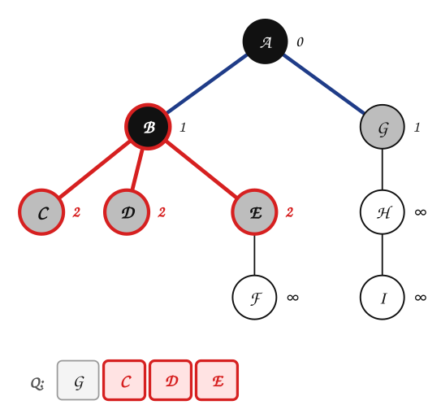

> Se extrae $B$ de la cola. Sus vecinos blancos $C$, $D$ y $E$ se descubren: quedan grises, con $d = B.d + 1 = 2$ y $\pi = B$, y se encolan. $B$ queda negro.

:::
:::{tab-item} Paso 4
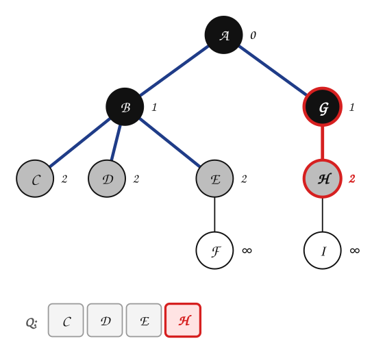

> Se extrae $G$ de la cola. Sus vecinos blancos $H$ se descubren: quedan grises, con $d = G.d + 1 = 2$ y $\pi = G$, y se encolan. $G$ queda negro.

> **¿Quién sale de la cola ahora: C o H? ¿Por qué?**

:::
:::{tab-item} Paso 5
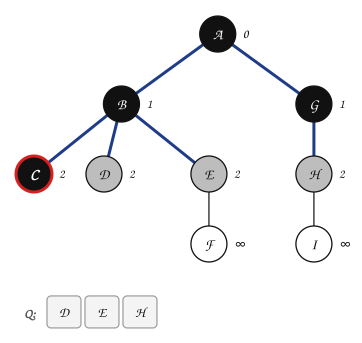

> Se extrae $C$ de la cola. No tiene vecinos blancos: no se descubre nada y $C$ queda negro.

> Sale $C$ (no $H$): $C$ entró a la cola antes. La cola respeta el orden de llegada, y eso hace que se terminen los vértices a distancia $2$ antes de pasar a los de distancia $3$.

:::
:::{tab-item} Paso 6
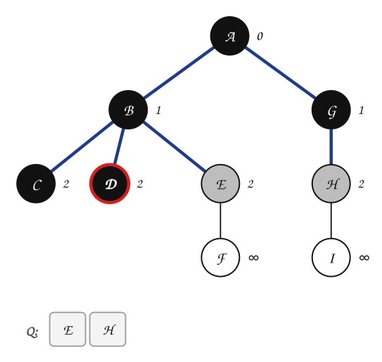

> Se extrae $D$ de la cola. No tiene vecinos blancos: no se descubre nada y $D$ queda negro.

:::
:::{tab-item} Paso 7
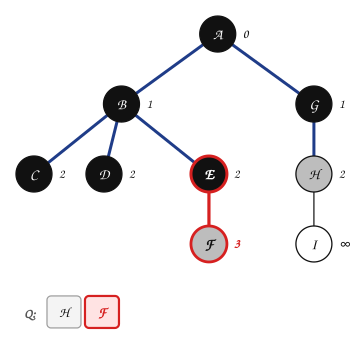

> Se extrae $E$ de la cola. Sus vecinos blancos $F$ se descubren: quedan grises, con $d = E.d + 1 = 3$ y $\pi = E$, y se encolan. $E$ queda negro.

:::
:::{tab-item} Paso 8
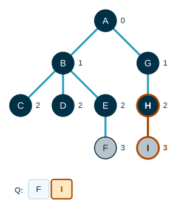

> Se extrae $H$ de la cola. Sus vecinos blancos $I$ se descubren: quedan grises, con $d = H.d + 1 = 3$ y $\pi = H$, y se encolan. $H$ queda negro.

:::
:::{tab-item} Paso 9
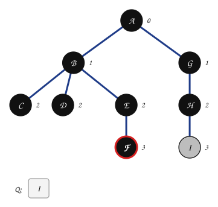

> Se extrae $F$ de la cola. No tiene vecinos blancos: no se descubre nada y $F$ queda negro.

:::
:::{tab-item} Paso 10
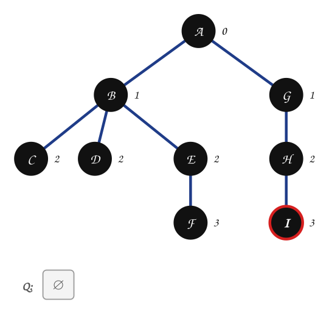

> Se extrae $I$ de la cola. No tiene vecinos blancos: no se descubre nada y $I$ queda negro.

:::
::::
:::::

El orden de visita fue $A, B, G, C, D, E, H, F, I$: **nivel por nivel**, de izquierda a derecha.

## 3. El algoritmo

Para que funcione en cualquier grafo (con circuitos, donde un vértice se puede alcanzar por varios caminos), BFS lleva el estado de cada vértice con un **color**:

| Color | Significado |
|---|---|
| **blanco** | todavía no se ha descubierto |
| **gris** | ya se descubrió y está en la cola: es la **frontera** entre lo descubierto y lo no descubierto |
| **negro** | ya se descubrió y ya se revisaron todos sus vecinos |

Cada vértice $u$ guarda tres atributos: $u.color$, $u.d$ (distancia desde $s$) y $u.\pi$ (predecesor). El grafo se representa con **listas de adyacencia**: $G.Adj[u]$ son los vecinos de $u$.

```text
BFS(G, s)
 1  for cada vértice u ∈ G.V − {s}
 2      u.color = BLANCO
 3      u.d = ∞
 4      u.π = NIL
 5  s.color = GRIS
 6  s.d = 0
 7  s.π = NIL
 8  Q = ∅
 9  ENQUEUE(Q, s)
10  while Q ≠ ∅
11      u = DEQUEUE(Q)
12      for cada v ∈ G.Adj[u]
13          if v.color == BLANCO
14              v.color = GRIS
15              v.d = u.d + 1
16              v.π = u
17              ENQUEUE(Q, v)
18      u.color = NEGRO
```

Las líneas 1–9 inicializan. Cada vuelta del `while` (líneas 10–18) saca un vértice gris de la cola, descubre sus vecinos blancos y lo pinta de negro.

### Ejemplo 2

Volvemos al problema de las estaciones, desde $s$. Las listas de adyacencia están en orden alfabético. En la figura se marca la distancia $d$ de cada vértice; las aristas en azul forman el **árbol BF**, que se explica en la sección 4.

:::::{admonition} Recorrido BFS desde s
:class: dropdown
::::{tab-set}
:::{tab-item} Paso 1
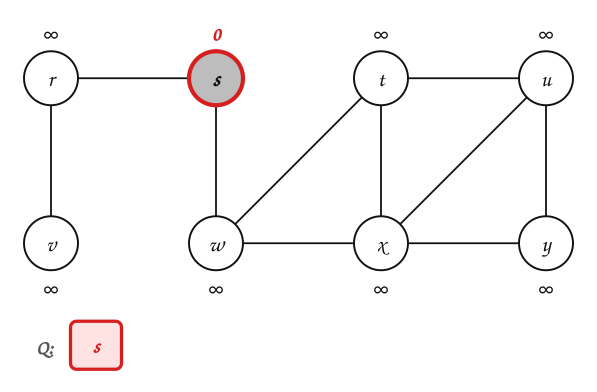

> Todos los vértices empiezan blancos con $d = \infty$. Se descubre el origen $s$: se pinta de gris, $s.d = 0$ y se encola.

|  | $r$ | $s$ | $t$ | $u$ | $v$ | $w$ | $x$ | $y$ |
|---|---|---|---|---|---|---|---|---|
| $d$ | ∞ | $\textcolor{#a94700}{\textbf{0}}$ | ∞ | ∞ | ∞ | ∞ | ∞ | ∞ |
| $\pi$ | NIL | $\textcolor{#a94700}{\textbf{NIL}}$ | NIL | NIL | NIL | NIL | NIL | NIL |

:::
:::{tab-item} Paso 2
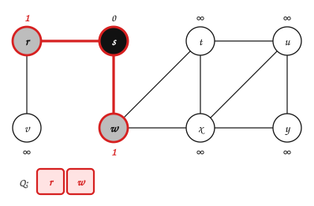

> Se extrae $s$ de la cola. Sus vecinos blancos $r$ y $w$ se descubren: quedan grises, con $d = s.d + 1 = 1$ y $\pi = s$, y se encolan. $s$ queda negro.

|  | $r$ | $s$ | $t$ | $u$ | $v$ | $w$ | $x$ | $y$ |
|---|---|---|---|---|---|---|---|---|
| $d$ | $\textcolor{#a94700}{\textbf{1}}$ | 0 | ∞ | ∞ | ∞ | $\textcolor{#a94700}{\textbf{1}}$ | ∞ | ∞ |
| $\pi$ | $\textcolor{#a94700}{\textbf{s}}$ | NIL | NIL | NIL | NIL | $\textcolor{#a94700}{\textbf{s}}$ | NIL | NIL |

:::
:::{tab-item} Paso 3
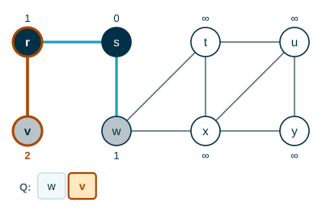

> Se extrae $r$ de la cola. Sus vecinos blancos $v$ se descubren: quedan grises, con $d = r.d + 1 = 2$ y $\pi = r$, y se encolan. $r$ queda negro.

|  | $r$ | $s$ | $t$ | $u$ | $v$ | $w$ | $x$ | $y$ |
|---|---|---|---|---|---|---|---|---|
| $d$ | 1 | 0 | ∞ | ∞ | $\textcolor{#a94700}{\textbf{2}}$ | 1 | ∞ | ∞ |
| $\pi$ | s | NIL | NIL | NIL | $\textcolor{#a94700}{\textbf{r}}$ | s | NIL | NIL |

:::
:::{tab-item} Paso 4
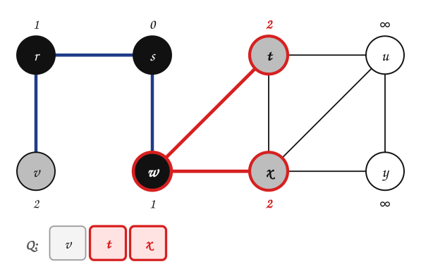

> Se extrae $w$ de la cola. Sus vecinos blancos $t$ y $x$ se descubren: quedan grises, con $d = w.d + 1 = 2$ y $\pi = w$, y se encolan. $w$ queda negro.

|  | $r$ | $s$ | $t$ | $u$ | $v$ | $w$ | $x$ | $y$ |
|---|---|---|---|---|---|---|---|---|
| $d$ | 1 | 0 | $\textcolor{#a94700}{\textbf{2}}$ | ∞ | 2 | 1 | $\textcolor{#a94700}{\textbf{2}}$ | ∞ |
| $\pi$ | s | NIL | $\textcolor{#a94700}{\textbf{w}}$ | NIL | r | s | $\textcolor{#a94700}{\textbf{w}}$ | NIL |

:::
:::{tab-item} Paso 5
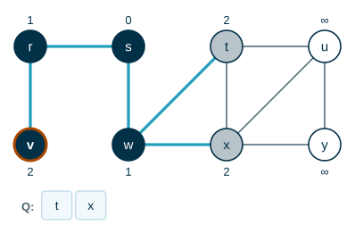

> Se extrae $v$ de la cola. No tiene vecinos blancos: no se descubre nada y $v$ queda negro.

|  | $r$ | $s$ | $t$ | $u$ | $v$ | $w$ | $x$ | $y$ |
|---|---|---|---|---|---|---|---|---|
| $d$ | 1 | 0 | 2 | ∞ | 2 | 1 | 2 | ∞ |
| $\pi$ | s | NIL | w | NIL | r | s | w | NIL |

> **Al extraer t, su vecino x ya es gris. ¿Se cambia x.d?**

:::
:::{tab-item} Paso 6
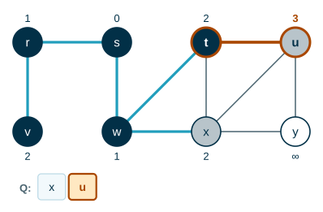

> Se extrae $t$ de la cola. Sus vecinos blancos $u$ se descubren: quedan grises, con $d = t.d + 1 = 3$ y $\pi = t$, y se encolan. $t$ queda negro.

|  | $r$ | $s$ | $t$ | $u$ | $v$ | $w$ | $x$ | $y$ |
|---|---|---|---|---|---|---|---|---|
| $d$ | 1 | 0 | 2 | $\textcolor{#a94700}{\textbf{3}}$ | 2 | 1 | 2 | ∞ |
| $\pi$ | s | NIL | w | $\textcolor{#a94700}{\textbf{t}}$ | r | s | w | NIL |

> No. $x$ ya fue descubierto (desde $w$) con $d = 2$. Un vértice se descubre **una sola vez**: el primer camino que lo alcanza es el más corto, porque la cola procesa por niveles.

:::
:::{tab-item} Paso 7
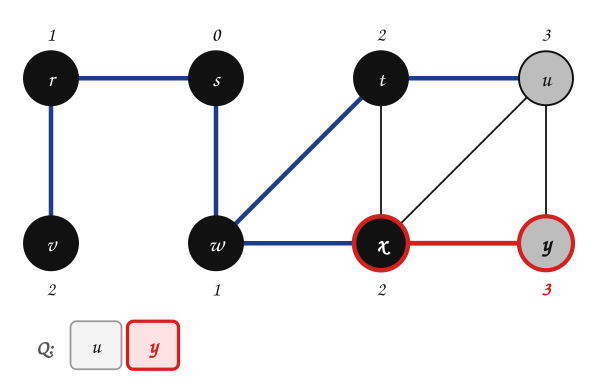

> Se extrae $x$ de la cola. Sus vecinos blancos $y$ se descubren: quedan grises, con $d = x.d + 1 = 3$ y $\pi = x$, y se encolan. $x$ queda negro.

|  | $r$ | $s$ | $t$ | $u$ | $v$ | $w$ | $x$ | $y$ |
|---|---|---|---|---|---|---|---|---|
| $d$ | 1 | 0 | 2 | 3 | 2 | 1 | 2 | $\textcolor{#a94700}{\textbf{3}}$ |
| $\pi$ | s | NIL | w | t | r | s | w | $\textcolor{#a94700}{\textbf{x}}$ |

:::
:::{tab-item} Paso 8
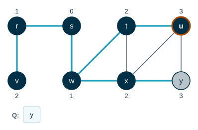

> Se extrae $u$ de la cola. No tiene vecinos blancos: no se descubre nada y $u$ queda negro.

|  | $r$ | $s$ | $t$ | $u$ | $v$ | $w$ | $x$ | $y$ |
|---|---|---|---|---|---|---|---|---|
| $d$ | 1 | 0 | 2 | 3 | 2 | 1 | 2 | 3 |
| $\pi$ | s | NIL | w | t | r | s | w | x |

:::
:::{tab-item} Paso 9
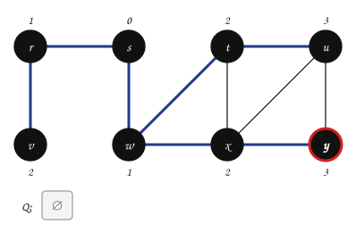

> Se extrae $y$ de la cola. No tiene vecinos blancos: no se descubre nada y $y$ queda negro.

|  | $r$ | $s$ | $t$ | $u$ | $v$ | $w$ | $x$ | $y$ |
|---|---|---|---|---|---|---|---|---|
| $d$ | 1 | 0 | 2 | 3 | 2 | 1 | 2 | 3 |
| $\pi$ | s | NIL | w | t | r | s | w | x |

:::
::::
:::::

Resultado final:

|  | $r$ | $s$ | $t$ | $u$ | $v$ | $w$ | $x$ | $y$ |
|---|---|---|---|---|---|---|---|---|
| $d$ | 1 | 0 | 2 | 3 | 2 | 1 | 2 | 3 |
| $\pi$ | s | NIL | w | t | r | s | w | x |

Es lo que se encontró a mano en la sección 1: $u.d = 3$ y $y.d = 3$.

### Ejemplo 3

Mismo procedimiento sobre otro grafo no dirigido, con origen en el vértice $3$ y listas en orden numérico.


:::::{admonition} Recorrido BFS desde 3
:class: dropdown
::::{tab-set}
:::{tab-item} Paso 1
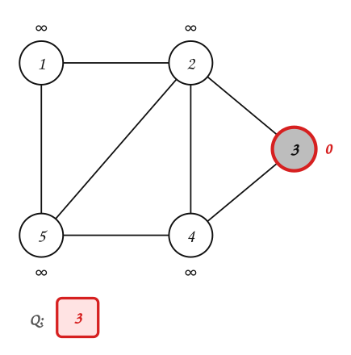

> Todos los vértices empiezan blancos con $d = \infty$. Se descubre el origen $3$: se pinta de gris, $3.d = 0$ y se encola.

|  | $1$ | $2$ | $3$ | $4$ | $5$ |
|---|---|---|---|---|---|
| $d$ | ∞ | ∞ | $\textcolor{#a94700}{\textbf{0}}$ | ∞ | ∞ |
| $\pi$ | NIL | NIL | $\textcolor{#a94700}{\textbf{NIL}}$ | NIL | NIL |

:::
:::{tab-item} Paso 2
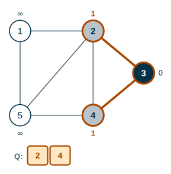

> Se extrae $3$ de la cola. Sus vecinos blancos $2$ y $4$ se descubren: quedan grises, con $d = 3.d + 1 = 1$ y $\pi = 3$, y se encolan. $3$ queda negro.

|  | $1$ | $2$ | $3$ | $4$ | $5$ |
|---|---|---|---|---|---|
| $d$ | ∞ | $\textcolor{#a94700}{\textbf{1}}$ | 0 | $\textcolor{#a94700}{\textbf{1}}$ | ∞ |
| $\pi$ | NIL | $\textcolor{#a94700}{\textbf{3}}$ | NIL | $\textcolor{#a94700}{\textbf{3}}$ | NIL |

:::
:::{tab-item} Paso 3
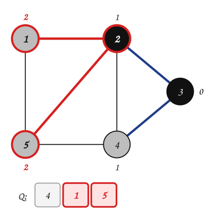

> Se extrae $2$ de la cola. Sus vecinos blancos $1$ y $5$ se descubren: quedan grises, con $d = 2.d + 1 = 2$ y $\pi = 2$, y se encolan. $2$ queda negro.

|  | $1$ | $2$ | $3$ | $4$ | $5$ |
|---|---|---|---|---|---|
| $d$ | $\textcolor{#a94700}{\textbf{2}}$ | 1 | 0 | 1 | $\textcolor{#a94700}{\textbf{2}}$ |
| $\pi$ | $\textcolor{#a94700}{\textbf{2}}$ | 3 | NIL | 3 | $\textcolor{#a94700}{\textbf{2}}$ |

:::
:::{tab-item} Paso 4
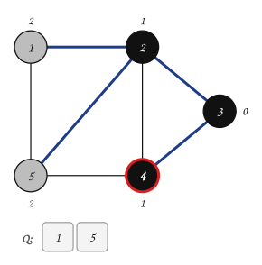

> Se extrae $4$ de la cola. No tiene vecinos blancos: no se descubre nada y $4$ queda negro.

|  | $1$ | $2$ | $3$ | $4$ | $5$ |
|---|---|---|---|---|---|
| $d$ | 2 | 1 | 0 | 1 | 2 |
| $\pi$ | 2 | 3 | NIL | 3 | 2 |

:::
:::{tab-item} Paso 5
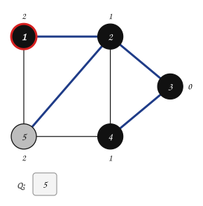

> Se extrae $1$ de la cola. No tiene vecinos blancos: no se descubre nada y $1$ queda negro.

|  | $1$ | $2$ | $3$ | $4$ | $5$ |
|---|---|---|---|---|---|
| $d$ | 2 | 1 | 0 | 1 | 2 |
| $\pi$ | 2 | 3 | NIL | 3 | 2 |

:::
:::{tab-item} Paso 6
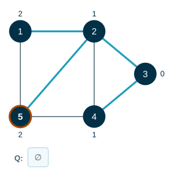

> Se extrae $5$ de la cola. No tiene vecinos blancos: no se descubre nada y $5$ queda negro.

|  | $1$ | $2$ | $3$ | $4$ | $5$ |
|---|---|---|---|---|---|
| $d$ | 2 | 1 | 0 | 1 | 2 |
| $\pi$ | 2 | 3 | NIL | 3 | 2 |

:::
::::
:::::

### Ejemplo 4

BFS también funciona sobre grafos **dirigidos**: los vecinos de $u$ son los vértices a los que **sale** una arista desde $u$. Origen: el vértice $3$.

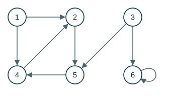

:::::{admonition} Recorrido BFS desde 3 (grafo dirigido)
:class: dropdown
::::{tab-set}
:::{tab-item} Paso 1
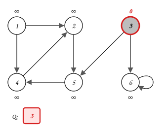

> Todos los vértices empiezan blancos con $d = \infty$. Se descubre el origen $3$: se pinta de gris, $3.d = 0$ y se encola.

|  | $1$ | $2$ | $3$ | $4$ | $5$ | $6$ |
|---|---|---|---|---|---|---|
| $d$ | ∞ | ∞ | $\textcolor{#a94700}{\textbf{0}}$ | ∞ | ∞ | ∞ |
| $\pi$ | NIL | NIL | $\textcolor{#a94700}{\textbf{NIL}}$ | NIL | NIL | NIL |

> **¿Llegará el recorrido a todos los vértices?**

:::
:::{tab-item} Paso 2
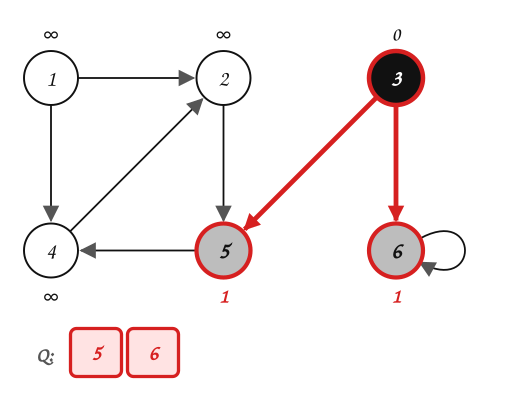

> Se extrae $3$ de la cola. Sus vecinos blancos $5$ y $6$ se descubren: quedan grises, con $d = 3.d + 1 = 1$ y $\pi = 3$, y se encolan. $3$ queda negro.

|  | $1$ | $2$ | $3$ | $4$ | $5$ | $6$ |
|---|---|---|---|---|---|---|
| $d$ | ∞ | ∞ | 0 | ∞ | $\textcolor{#a94700}{\textbf{1}}$ | $\textcolor{#a94700}{\textbf{1}}$ |
| $\pi$ | NIL | NIL | NIL | NIL | $\textcolor{#a94700}{\textbf{3}}$ | $\textcolor{#a94700}{\textbf{3}}$ |

:::
:::{tab-item} Paso 3
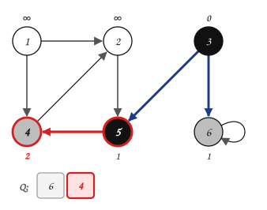

> Se extrae $5$ de la cola. Sus vecinos blancos $4$ se descubren: quedan grises, con $d = 5.d + 1 = 2$ y $\pi = 5$, y se encolan. $5$ queda negro.

|  | $1$ | $2$ | $3$ | $4$ | $5$ | $6$ |
|---|---|---|---|---|---|---|
| $d$ | ∞ | ∞ | 0 | $\textcolor{#a94700}{\textbf{2}}$ | 1 | 1 |
| $\pi$ | NIL | NIL | NIL | $\textcolor{#a94700}{\textbf{5}}$ | 3 | 3 |

:::
:::{tab-item} Paso 4
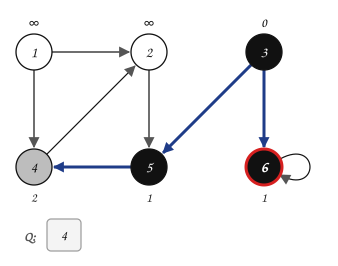

> Se extrae $6$ de la cola. No tiene vecinos blancos: no se descubre nada y $6$ queda negro.

|  | $1$ | $2$ | $3$ | $4$ | $5$ | $6$ |
|---|---|---|---|---|---|---|
| $d$ | ∞ | ∞ | 0 | 2 | 1 | 1 |
| $\pi$ | NIL | NIL | NIL | 5 | 3 | 3 |

:::
:::{tab-item} Paso 5
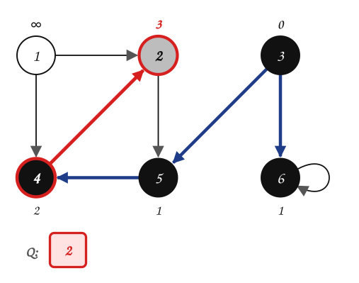

> Se extrae $4$ de la cola. Sus vecinos blancos $2$ se descubren: quedan grises, con $d = 4.d + 1 = 3$ y $\pi = 4$, y se encolan. $4$ queda negro.

|  | $1$ | $2$ | $3$ | $4$ | $5$ | $6$ |
|---|---|---|---|---|---|---|
| $d$ | ∞ | $\textcolor{#a94700}{\textbf{3}}$ | 0 | 2 | 1 | 1 |
| $\pi$ | NIL | $\textcolor{#a94700}{\textbf{4}}$ | NIL | 5 | 3 | 3 |

:::
:::{tab-item} Paso 6
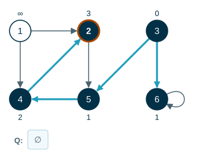

> Se extrae $2$ de la cola. No tiene vecinos blancos: no se descubre nada y $2$ queda negro.

|  | $1$ | $2$ | $3$ | $4$ | $5$ | $6$ |
|---|---|---|---|---|---|---|
| $d$ | ∞ | 3 | 0 | 2 | 1 | 1 |
| $\pi$ | NIL | 4 | NIL | 5 | 3 | 3 |

> La cola quedó vacía y el vértice $1$ sigue blanco con $d = \infty$: **no es alcanzable** desde $3$. Ninguna arista entra a $1$.

:::
::::
:::::

El bucle $6 \to 6$ no cambia nada: cuando se revisa, $6$ ya es gris.

## 4. El árbol BF y el camino más corto

Las aristas $(v.\pi, v)$ forman un árbol con raíz en $s$: el **árbol BF** (*breadth-first tree*). Para el Ejemplo 2:

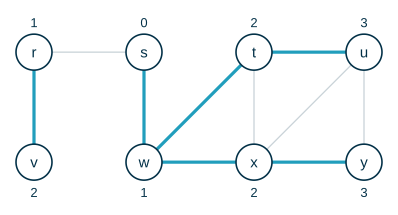

En el árbol BF, el único camino de $s$ a $v$ es un camino más corto de $s$ a $v$ en el grafo. Para imprimirlo basta con seguir los predecesores hacia atrás, de forma recursiva:

```text
PRINT-PATH(G, s, v)
1  if v == s
2      print s
3  elseif v.π == NIL
4      print "no hay camino de" s "a" v
5  else PRINT-PATH(G, s, v.π)
6      print v
```

:::::{admonition} Camino más corto de s a y
:class: dropdown
::::{tab-set}
:::{tab-item} Paso 1
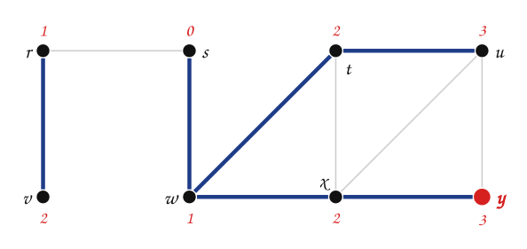

> `PRINT-PATH(G, s, y)`: como $y \neq s$, primero se imprime el camino hasta $y.\pi = x$.

:::
:::{tab-item} Paso 2
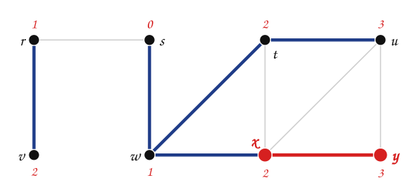

> `PRINT-PATH(G, s, x)`: como $x \neq s$, primero se imprime el camino hasta $x.\pi = w$.

:::
:::{tab-item} Paso 3
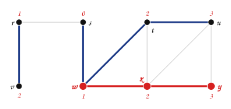

> `PRINT-PATH(G, s, w)`: como $w \neq s$, primero se imprime el camino hasta $w.\pi = s$.

:::
:::{tab-item} Paso 4
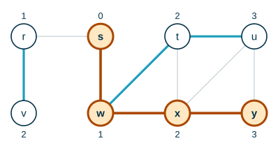

> `PRINT-PATH(G, s, s)`: caso base, se imprime $s$. Al regresar de las llamadas se imprime el resto: $s \to w \to x \to y$.

:::
::::
:::::

## 5. Complejidad

> **¿Cuántas veces entra cada vértice a la cola?**

:::{admonition} Respuesta
:class: dropdown
**Una sola vez.** Un vértice entra a la cola cuando deja de ser blanco, y nunca vuelve a ser blanco.
:::

- Inicializar cuesta $O(V)$.
- Cada vértice se encola y se desencola una vez: $O(V)$ en total.
- La lista de adyacencia de cada vértice se recorre una sola vez, cuando el vértice sale de la cola. La suma de las longitudes de todas las listas es $\Theta(E)$ (en un grafo no dirigido es $2|E|$, por el teorema de *handshaking*).

$$
T_{BFS}(V, E) = O(V + E)
$$

Es tiempo **lineal** en el tamaño de la representación con listas de adyacencia.

## 6. Implementación en Java

**Análisis.**

| | |
|---|---|
| **Entradas** | Número de vértices $n$, lista de aristas, origen $s$. |
| **Salidas** | Arreglos `d[]` y `pi[]`; el camino de $s$ a cualquier $v$. |
| **Proceso** | BFS con una cola (`ArrayDeque`) y colores; el camino se arma recursivamente con `pi[]`, como `PRINT-PATH`. |

**Diseño.** El pseudocódigo `BFS(G, s)` y `PRINT-PATH(G, s, v)` de las secciones 3 y 4. Los vértices son enteros y `-1` hace las veces de `NIL`.

**Codificación.**

```java
import java.util.ArrayDeque;
import java.util.ArrayList;
import java.util.Arrays;
import java.util.List;
import java.util.Queue;

public class BFS {

    enum Color { BLANCO, GRIS, NEGRO }

    static final int INF = Integer.MAX_VALUE;

    private final List<List<Integer>> adj;
    private final int[] d;
    private final int[] pi;

    public BFS(int n) {
        adj = new ArrayList<>();
        for (int i = 0; i < n; i++) {
            adj.add(new ArrayList<>());
        }
        d = new int[n];
        pi = new int[n];
    }

    public void agregarArista(int u, int v) {
        adj.get(u).add(v);
        adj.get(v).add(u);
    }

    public void bfs(int s) {
        int n = adj.size();
        Color[] color = new Color[n];
        Arrays.fill(color, Color.BLANCO);
        Arrays.fill(d, INF);
        Arrays.fill(pi, -1);
        color[s] = Color.GRIS;
        d[s] = 0;
        Queue<Integer> q = new ArrayDeque<>();
        q.add(s);
        while (!q.isEmpty()) {
            int u = q.remove();
            for (int v : adj.get(u)) {
                if (color[v] == Color.BLANCO) {
                    color[v] = Color.GRIS;
                    d[v] = d[u] + 1;
                    pi[v] = u;
                    q.add(v);
                }
            }
            color[u] = Color.NEGRO;
        }
    }

    public String camino(int s, int v) {
        if (v == s) {
            return String.valueOf(s);
        }
        if (pi[v] == -1) {
            return "no hay camino de " + s + " a " + v;
        }
        return camino(s, pi[v]) + " -> " + v;
    }

    public static void main(String[] args) {
        BFS g = new BFS(6);           // vértices 1..5 (el 0 no se usa)
        int[][] aristas = {{1, 2}, {1, 5}, {2, 3}, {2, 4}, {2, 5}, {3, 4}, {4, 5}};
        for (int[] a : aristas) {
            g.agregarArista(a[0], a[1]);
        }
        g.bfs(3);
        for (int v = 1; v <= 5; v++) {
            System.out.println(v + ": d = " + g.d[v] + ", pi = " + (g.pi[v] == -1 ? "NIL" : g.pi[v])
                    + ", camino = " + g.camino(3, v));
        }
    }
}
```

**Prueba.** Con el grafo del Ejemplo 3 y origen $3$ (las aristas se agregan en un orden que deja cada lista de adyacencia en orden numérico):

```text
1: d = 2, pi = 2, camino = 3 -> 2 -> 1
2: d = 1, pi = 3, camino = 3 -> 2
3: d = 0, pi = NIL, camino = 3
4: d = 1, pi = 3, camino = 3 -> 4
5: d = 2, pi = 2, camino = 3 -> 2 -> 5
```

Coincide con la última pestaña del Ejemplo 3.

## 7. Formalización

Después de los ejemplos, las propiedades que se usaron quedan así (Cormen et al., sección 22.2):

- **Subgrafo de predecesores.** Para $G = (V, E)$ y origen $s$, $G_\pi = (V_\pi, E_\pi)$ con

$$
V_\pi = \{v \in V \mid v.\pi \neq \text{NIL}\} \cup \{s\}
\qquad
E_\pi = \{(v.\pi, v) \mid v \in V_\pi - \{s\}\}
$$

- $G_\pi$ es un **árbol BF**: $V_\pi$ son exactamente los vértices alcanzables desde $s$ y, para todo $v \in V_\pi$, el único camino simple de $s$ a $v$ en $G_\pi$ es un camino más corto de $s$ a $v$ en $G$.
- **Corrección.** Al terminar, $v.d = \delta(s, v)$ para todo $v \in V$, donde $\delta(s, v)$ es el menor número de aristas de un camino de $s$ a $v$ ($\infty$ si no existe).
- **Por niveles.** Si $v.d = k$, todos los vértices con $d < k$ se descubrieron antes que $v$.
- BFS funciona igual en grafos dirigidos y no dirigidos, y su tiempo es $O(V + E)$.

## Ejercicios

Practique con los [ejercicios de BFS](exercises.md).

## Fuentes

- Caicedo Mejía, J. M. *Unidad 5: Grafos - Recorridos*. Computación y Estructuras Discretas I, Universidad Icesi, 2026 (adaptado de material de A. Aristizábal y M. Gómez).
- Bedoya, O. *Búsqueda no informada: búsqueda preferente por amplitud*. Diapositivas del curso, Universidad del Valle.
- Cormen, T. H., Leiserson, C. E., Rivest, R. L., Stein, C. *Introduction to Algorithms*, 3.ª ed. The MIT Press, 2009. Sección 22.2.

---

*Material adaptado del material original de los profesores Andrés Aristizábal, Marlon Gómez y Oscar Bedoya.*
