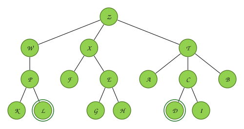

---
# Copyright (c) 2026 Angela Villota, and collaborators from the CyED block
# Licensed under the PolyForm Noncommercial License 1.0.0.
# Commercial use is prohibited without prior written authorization.
title: "Espacios de estados y juegos: Ejercicios"
---

# Espacios de estados y juegos: Ejercicios

Use esta página después de leer el [material de estudio](index.md). Cada ejercicio trae **pistas** y una **solución general**; intente resolverlo antes de abrirlas.

---

### Ejercicio 1

En el siguiente árbol, $I$ y $F$ son nodos meta. Aplique búsqueda preferente por amplitud y búsqueda preferente por profundidad. En cada caso: ¿cuál meta encuentra? Liste los nodos creados y los nodos expandidos.

:::{admonition} Pistas
:class: dropdown
- Expandir = verificar si es meta y, si no lo es, crear los hijos.
- Al expandir un nodo meta no se crean sus hijos.
- Lleve la tabla «Estado de la cola / Iteración» (o de la pila) como en el Ejemplo 1.
:::

:::{admonition} Solución general
:class: dropdown
- **Amplitud.** Encuentra **F**. Creados: A, B, C, D, E, F, G, H, I. Expandidos: A, B, C, D, E, F.
- **Profundidad.** Encuentra **I**. Creados: A, B, C, D, E, H, I. Expandidos: A, B, D, H, I.

La búsqueda por amplitud encuentra la meta menos profunda ($F$, nivel $2$); la de profundidad encuentra primero la que está en la rama de más a la izquierda ($I$, nivel $3$).
:::

### Ejercicio 2

Aplique búsqueda preferente por amplitud para ir de Sibiu (Sib) a Bucarest (Buc) en el siguiente mapa de Rumania, **evitando devolverse** (no se crea un hijo cuyo estado ya está en la rama). Los hijos se crean en este orden: Ara, Zer, Ora, Sib, Tim, Lug, Meh, Dro, Cra, Rim, Fag, Pit, Buc. Liste los nodos expandidos y la ruta encontrada.

:::{admonition} Pistas
:class: dropdown
- Los hijos de Sib son Ara, Ora, Rim y Fag.
- Bucarest está a dos tramos de Sibiu por Fagaras y a tres por Rimnicu y Pitesti.
- Ignore las distancias: esta búsqueda cuenta tramos.
:::

:::{admonition} Solución general
:class: dropdown
Nodos expandidos, en orden: Sib, Ara, Ora, Rim, Fag, Zer, Tim, Zer, Cra, Pit, Buc. Ruta: **Sib → Fag → Buc** (18 nodos creados).

Si **no** se evita devolverse se encuentra la misma ruta, porque los ciclos no afectan la búsqueda en amplitud, pero se crean 43 nodos y se expanden 15.
:::

### Ejercicio 3

**El mundo de la aspiradora.** Hay dos cuartos, izquierdo y derecho. Cada uno puede estar sucio o limpio, y la aspiradora está en uno de los dos. Formule el problema: estados, estado inicial (aspiradora a la izquierda, los dos cuartos sucios), operadores, prueba de meta y costo de ruta, si aspirar cuesta $3$ y desplazarse cuesta $1$. Dibuje el árbol de búsqueda por amplitud hasta encontrar la meta.

:::{admonition} Pistas
:class: dropdown
- Un estado necesita tres datos: dónde está la aspiradora y si cada cuarto está sucio.
- ¿Cuántos estados posibles hay?
- Operadores: mover a la izquierda (I), mover a la derecha (D), aspirar (A).
:::

:::{admonition} Solución general
:class: dropdown
Hay $2 \cdot 2 \cdot 2 = 8$ estados. Meta: los dos cuartos limpios (la aspiradora puede estar en cualquiera). La solución menos profunda es A, D, A (profundidad $3$), con costo $3 + 1 + 3 = 7$. La búsqueda por amplitud la encuentra porque es la de menor profundidad; aquí también es la de menor costo, pero eso no siempre pasa cuando los operadores cuestan distinto.
:::

### Ejercicio 4

Construya el árbol del juego NIM con **5** fichas (cada jugador toma $1$, $2$ o $3$; pierde quien toma la última; empieza J1). Evalúelo con *minimax*. ¿J1 puede asegurar la victoria? ¿Con qué jugada?

:::{admonition} Pistas
:class: dropdown
- No hace falta dibujar todo de nuevo: el subárbol que empieza con $4$ fichas ya se evaluó en el Ejemplo de la sección 7, pero ahora en ese nodo juega **J2**.
- Con $1$ ficha, el que juega pierde.
:::

:::{admonition} Solución general
:class: dropdown
J1 **no** puede asegurar la victoria: con $5$ fichas, tome lo que tome, deja $4$, $3$ o $2$ fichas, y desde cualquiera de esas posiciones el jugador que mueve (J2) puede dejarle $1$ ficha a J1. Las posiciones perdedoras para quien mueve son $1, 5, 9, \dots$ fichas, es decir, $n \equiv 1 \pmod 4$.
:::

### Ejercicio 5

**Misioneros y caníbales.** Tres misioneros y tres caníbales deben cruzar un río en un bote donde caben máximo dos personas. Si en alguna orilla hay más caníbales que misioneros (y hay al menos un misionero), los misioneros son devorados. Formule el problema, implemente en Java la búsqueda preferente por amplitud (puede partir de la clase `Jarras`) y reporte la solución y el número de nodos creados.

---

*Material adaptado del material original del profesor Oscar Bedoya.*
