---
# Copyright (c) 2026 Angela Villota, and collaborators from the CyED block
# Licensed under the PolyForm Noncommercial License 1.0.0.
# Commercial use is prohibited without prior written authorization.
title: "Unidad 5: Recorridos en espacios de estados y juegos"
---

# Unidad 5: Recorridos en espacios de estados y juegos

Los ejemplos se desarrollan en desplegables con pestañas **Paso 1, Paso 2, …**: cada paso conserva lo anterior y muestra lo nuevo **en color**.

## 1. El problema

Hay una jarra de **4 litros** y una de **3 litros**, sin marcas de medida, y una llave de agua. Se puede llenar una jarra, vaciarla, o pasar agua de una a otra hasta que la que recibe se llene o la que entrega quede vacía.

**¿Cómo conseguir exactamente 2 litros en la jarra de 4?**

Intente encontrar una secuencia antes de seguir.

:::{admonition} Un intento
:class: dropdown
Llenar la de 3 y pasarla a la de 4: $(0,0) \to (0,3) \to (3,0)$. Llenar otra vez la de 3 y pasar hasta llenar la de 4: $(3,3) \to (4,2)$. Hay 2 litros… pero en la jarra **de 3**. Hay que seguir: vaciar la de 4 y pasar: $(0,2) \to (2,0)$. Lo logramos en $6$ movimientos.

¿Se puede con menos? ¿Cómo estar seguros sin probar todas las secuencias a mano?
:::

Aquí no hay un grafo dibujado. El grafo está **implícito**: los vértices son las situaciones posibles $(a, b)$ ($a$ litros en la jarra de 4 y $b$ en la de 3) y hay una arista de un estado a otro si un movimiento lleva del primero al segundo. Encontrar la secuencia más corta es buscar un camino en ese grafo, y para eso sirven los recorridos de las páginas de [BFS](../BFS/index.md) y [DFS](../DFS/index.md).

## 2. Formular un problema

Un problema está **bien definido** cuando se conocen:

| Elemento | Qué es | Jarras |
|---|---|---|
| **Estados** | cómo se representa una situación | pares $(a, b)$ con $0 \le a \le 4$, $0 \le b \le 3$ |
| **Estado inicial** | dónde se empieza | $(0, 0)$ |
| **Operadores** | acciones que, aplicadas a un estado, generan otros estados | llenar 4, llenar 3, vaciar 4, vaciar 3, pasar 4→3, pasar 3→4 |
| **Prueba de meta** | permite saber si el estado actual es una meta | $a = 2$ |
| **Costo de ruta** ($g$) | suma de los costos de las acciones de la ruta | cada movimiento cuesta $1$ |

**Para resolver un problema:** (1) formularlo, (2) **buscar** una secuencia de acciones que lleve del estado inicial a una meta, (3) ejecutar esa secuencia.

### ¿Entendimos el problema?

| | |
|---|---|
| **Entradas** | Capacidades $4$ y $3$, estado inicial $(0,0)$. |
| **Salidas** | Una secuencia de operadores que lleve a un estado con $a = 2$, con el menor número de movimientos. |

Traza a mano de un operador: desde $(4, 1)$, «pasar 4→3» mueve $\min(4,\ 3 - 1) = 2$ litros y deja $(2, 3)$.

## 3. El árbol de búsqueda

La búsqueda se organiza como un **árbol**: la raíz es el estado inicial y los hijos de un nodo son los estados que se obtienen al aplicarle los operadores. Cada nodo del árbol guarda:

- el estado del problema,
- una referencia al nodo **padre**,
- el **operador** que se aplicó para generarlo,
- su **profundidad**,
- el **costo** de la ruta desde la raíz.

**Expandir** un nodo es verificar si es meta y, si no lo es, crear sus hijos. Al expandir un nodo meta **no se crean sus hijos**: la búsqueda termina.

Las estrategias de **búsqueda no informada** (o ciega) no usan información adicional sobre el problema. Lo único que las distingue es **el orden en que expanden los nodos**.

## 4. Búsqueda preferente por amplitud

**Búsqueda preferente por amplitud.** Se expande la raíz; después, de izquierda a derecha, cada nodo de profundidad $1$; luego cada nodo de profundidad $2$, y así sucesivamente. Es BFS sobre el árbol de búsqueda: los nodos creados esperan en una **cola**.

```text
function BUSQUEDA-PREFERENTE-POR-AMPLITUD(problema) returns solución o falla
    cola = nodo_raiz(problema)
    loop
        if estaVacia(cola) then return falla
        n = sacar(cola)
        if n es un nodo meta then return solución
        expandir n y meter todos sus hijos al final de la cola
```

### Ejemplo 1

El primer ejemplo es un árbol ya dibujado, con letras. Las metas son $G$ y $L$. **¿Cuál meta encuentra? Liste los nodos creados y los nodos expandidos.**

Colores: azul = expandido, gris = creado y en espera, naranja = lo nuevo del paso.

:::::{admonition} Búsqueda preferente por amplitud
:class: dropdown
::::{tab-set}
:::{tab-item} Paso 1
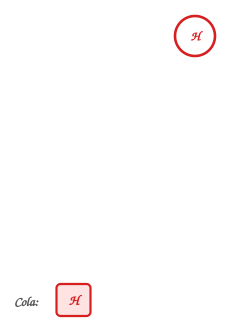

> Se crea el nodo raíz A y se mete en la cola. Las metas (G y L) tienen doble borde verde.

| Estado de la cola | Iteración |
|---|---|
| $\textcolor{#a94700}{\textbf{A}}$ | $\textcolor{#a94700}{\textbf{—}}$ |

:::
:::{tab-item} Paso 2
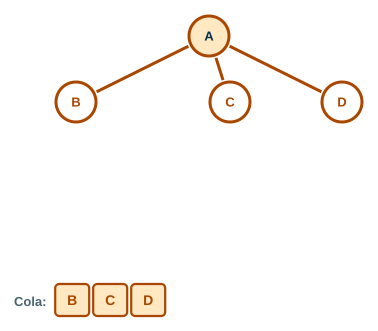

> Se extrae **A** y se expande: no es meta, así que se crean sus hijos B, C, D y se meten al final de la cola.

| Estado de la cola | Iteración |
|---|---|
| A | — |
| $\textcolor{#a94700}{\textbf{B C D}}$ | $\textcolor{#a94700}{\textbf{Extraer A, meter hijos de A}}$ |

:::
:::{tab-item} Paso 3
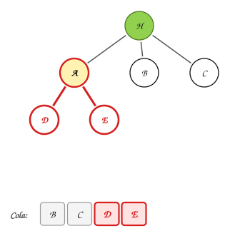

> Se extrae **B** y se expande: no es meta, así que se crean sus hijos E, F y se meten al final de la cola.

| Estado de la cola | Iteración |
|---|---|
| A | — |
| B C D | Extraer A, meter hijos de A |
| $\textcolor{#a94700}{\textbf{C D E F}}$ | $\textcolor{#a94700}{\textbf{Extraer B, meter hijos de B}}$ |

:::
:::{tab-item} Paso 4
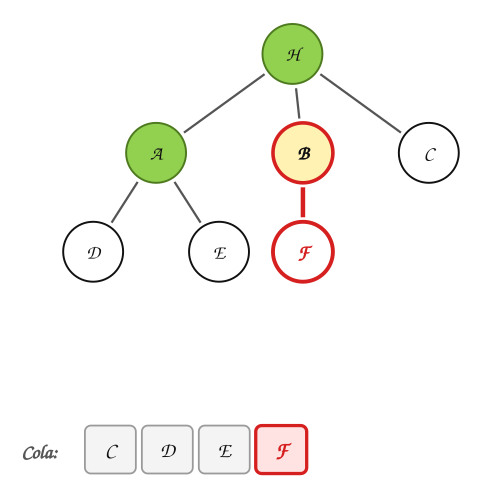

> Se extrae **C** y se expande: no es meta, así que se crean sus hijos G, H y se meten al final de la cola.

| Estado de la cola | Iteración |
|---|---|
| A | — |
| B C D | Extraer A, meter hijos de A |
| C D E F | Extraer B, meter hijos de B |
| $\textcolor{#a94700}{\textbf{D E F G H}}$ | $\textcolor{#a94700}{\textbf{Extraer C, meter hijos de C}}$ |

:::
:::{tab-item} Paso 5
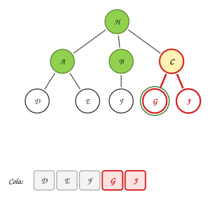

> Se extrae **D** y se expande: no es meta, así que se crean sus hijos I, J y se meten al final de la cola.

| Estado de la cola | Iteración |
|---|---|
| A | — |
| B C D | Extraer A, meter hijos de A |
| C D E F | Extraer B, meter hijos de B |
| D E F G H | Extraer C, meter hijos de C |
| $\textcolor{#a94700}{\textbf{E F G H I J}}$ | $\textcolor{#a94700}{\textbf{Extraer D, meter hijos de D}}$ |

:::
:::{tab-item} Paso 6
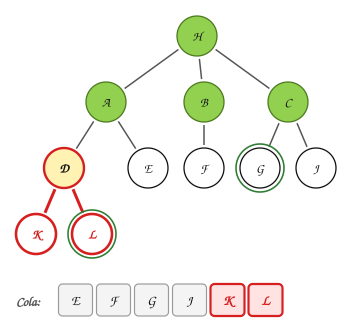

> Se extrae **E** y se expande: no es meta y no tiene hijos.

| Estado de la cola | Iteración |
|---|---|
| A | — |
| B C D | Extraer A, meter hijos de A |
| C D E F | Extraer B, meter hijos de B |
| D E F G H | Extraer C, meter hijos de C |
| E F G H I J | Extraer D, meter hijos de D |
| $\textcolor{#a94700}{\textbf{F G H I J}}$ | $\textcolor{#a94700}{\textbf{Extraer E}}$ |

:::
:::{tab-item} Paso 7
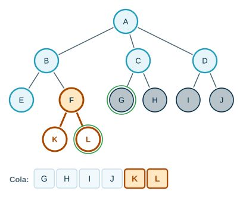

> Se extrae **F** y se expande: no es meta, así que se crean sus hijos K, L y se meten al final de la cola.

| Estado de la cola | Iteración |
|---|---|
| A | — |
| B C D | Extraer A, meter hijos de A |
| C D E F | Extraer B, meter hijos de B |
| D E F G H | Extraer C, meter hijos de C |
| E F G H I J | Extraer D, meter hijos de D |
| F G H I J | Extraer E |
| $\textcolor{#a94700}{\textbf{G H I J K L}}$ | $\textcolor{#a94700}{\textbf{Extraer F, meter hijos de F}}$ |

:::
:::{tab-item} Paso 8
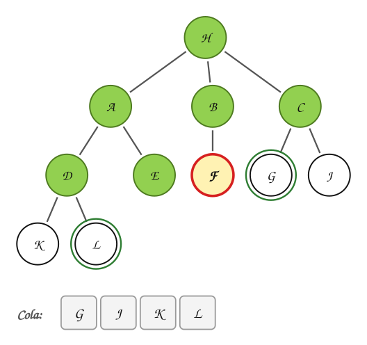

> Se extrae **G** y se expande: **es meta**. La búsqueda termina y no se crean sus hijos.

| Estado de la cola | Iteración |
|---|---|
| A | — |
| B C D | Extraer A, meter hijos de A |
| C D E F | Extraer B, meter hijos de B |
| D E F G H | Extraer C, meter hijos de C |
| E F G H I J | Extraer D, meter hijos de D |
| F G H I J | Extraer E |
| G H I J K L | Extraer F, meter hijos de F |
| $\textcolor{#a94700}{\textbf{H I J K L}}$ | $\textcolor{#a94700}{\textbf{Extraer G: es meta}}$ |

:::
::::
:::::

Encuentra la meta **G**. Nodos creados: A, B, C, D, E, F, G, H, I, J, K, L. Nodos expandidos: A, B, C, D, E, F, G.

> $L$ también es meta, pero está a profundidad $3$; la búsqueda por amplitud termina todo el nivel $2$ antes, y allí está $G$.

### Ejemplo 2: las jarras

Ahora el árbol no está dibujado: se va **generando** al aplicar los operadores. Para no dar vueltas, no se crea un estado que ya se haya creado antes. Los operadores se aplican en el orden de la tabla de la sección 2.

:::::{admonition} Búsqueda por amplitud en el problema de las jarras
:class: dropdown
::::{tab-set}
:::{tab-item} Paso 1
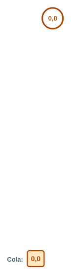

> El estado inicial es $(0,0)$: las dos jarras vacías.

:::
:::{tab-item} Paso 2
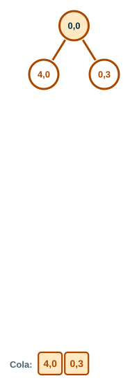

> Se expande $(0,0)$ y se crean los estados nuevos: $(4,0)$ (Llenar 4), $(0,3)$ (Llenar 3).

:::
:::{tab-item} Paso 3
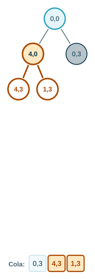

> Se expande $(4,0)$ y se crean los estados nuevos: $(4,3)$ (Llenar 3), $(1,3)$ (4→3).

:::
:::{tab-item} Paso 4
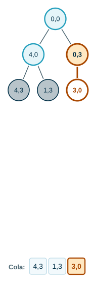

> Se expande $(0,3)$ y se crean los estados nuevos: $(3,0)$ (3→4).

:::
:::{tab-item} Paso 5
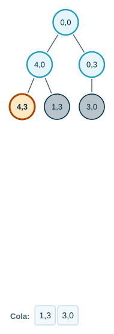

> Se expande $(4,3)$: todos sus sucesores ya fueron creados antes. No se crea nada.

:::
:::{tab-item} Paso 6
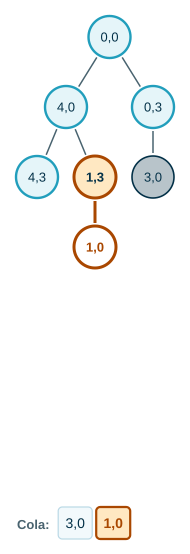

> Se expande $(1,3)$ y se crean los estados nuevos: $(1,0)$ (Vaciar 3).

:::
:::{tab-item} Paso 7
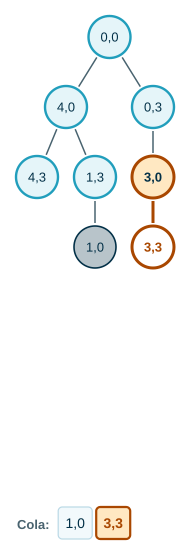

> Se expande $(3,0)$ y se crean los estados nuevos: $(3,3)$ (Llenar 3).

:::
:::{tab-item} Paso 8
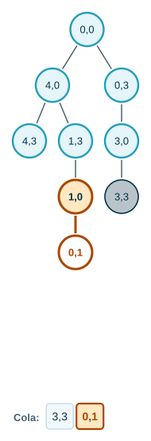

> Se expande $(1,0)$ y se crean los estados nuevos: $(0,1)$ (4→3).

:::
:::{tab-item} Paso 9
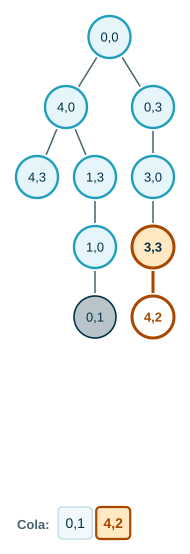

> Se expande $(3,3)$ y se crean los estados nuevos: $(4,2)$ (3→4).

:::
:::{tab-item} Paso 10
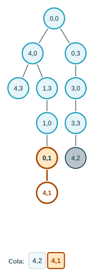

> Se expande $(0,1)$ y se crean los estados nuevos: $(4,1)$ (Llenar 4).

:::
:::{tab-item} Paso 11
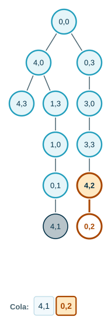

> Se expande $(4,2)$ y se crean los estados nuevos: $(0,2)$ (Vaciar 4).

:::
:::{tab-item} Paso 12
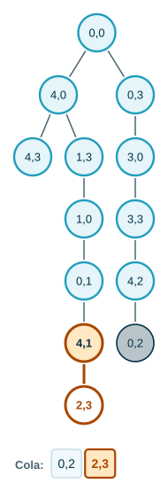

> Se expande $(4,1)$ y se crean los estados nuevos: $(2,3)$ (4→3).

:::
:::{tab-item} Paso 13
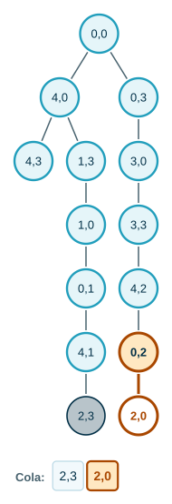

> Se expande $(0,2)$ y se crean los estados nuevos: $(2,0)$ (3→4).

:::
:::{tab-item} Paso 14
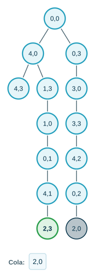

> Se expande $(2,3)$: la jarra de 4 tiene **2 litros**. Es meta.

:::
::::
:::::

Solución (siguiendo los padres desde la meta): $(0,0)$ → **Llenar 4** $(4,0)$ → **4→3** $(1,3)$ → **Vaciar 3** $(1,0)$ → **4→3** $(0,1)$ → **Llenar 4** $(4,1)$ → **4→3** $(2,3)$.

Son $6$ movimientos, igual que en el intento a mano. Como la búsqueda por amplitud recorre los niveles en orden, **no existe** una solución con menos movimientos. En total se crearon 14 nodos.

### Ejemplo 3: el 8-puzzle

Un tablero de $3 \times 3$ con $8$ fichas numeradas y un espacio. Una ficha vecina al espacio se puede deslizar hacia él.

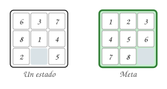

| | |
|---|---|
| **Estados** | configuraciones de las $8$ fichas en el tablero (en Java, `int[3][3]` con `0` para el espacio) |
| **Operadores** | mover el espacio arriba (↑), abajo (↓), a la izquierda (←), a la derecha (→) |
| **Prueba de meta** | el tablero ordenado de la figura |
| **Costo de ruta** | cada movimiento cuesta $1$ |

Para no regresar inmediatamente, no se crea el hijo que repite el estado del padre (**evite devolverse**).

:::::{admonition} Búsqueda por amplitud en el 8-puzzle
:class: dropdown
::::{tab-set}
:::{tab-item} Paso 1
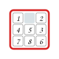

> Estado inicial. Los operadores mueven el **espacio** en el orden ↑, ↓, ←, →.

:::
:::{tab-item} Paso 2
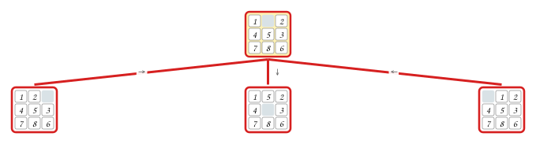

> Se expande el nodo: no es meta; se crean sus hijos con ↑, ↓, ←, →. No se crea el hijo que devolvería al estado del padre.

:::
:::{tab-item} Paso 3
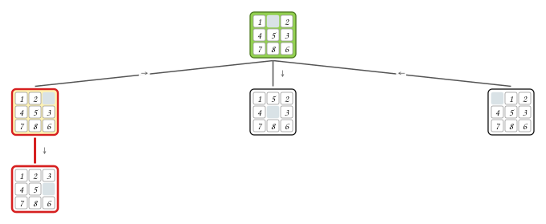

> Se expande el nodo (se llegó con ↑): no es meta; se crean sus hijos con ←, →. No se crea el hijo que devolvería al estado del padre.

:::
:::{tab-item} Paso 4
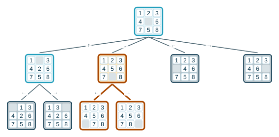

> Se expande el nodo (se llegó con ↓): no es meta; se crean sus hijos con ←, →. No se crea el hijo que devolvería al estado del padre.

:::
:::{tab-item} Paso 5
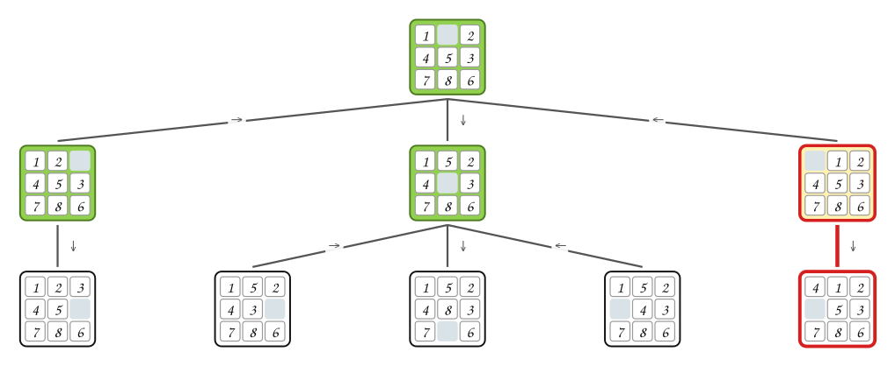

> Se expande el nodo (se llegó con ←): no es meta; se crean sus hijos con ↑, ↓. No se crea el hijo que devolvería al estado del padre.

:::
:::{tab-item} Paso 6
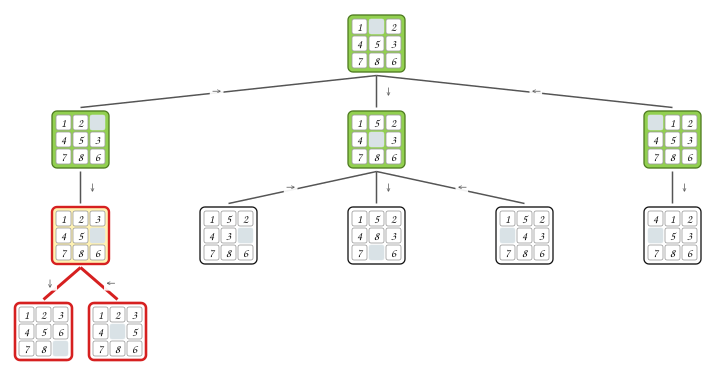

> Se expande el nodo (se llegó con →): no es meta; se crean sus hijos con ↑, ↓. No se crea el hijo que devolvería al estado del padre.

:::
:::{tab-item} Paso 7
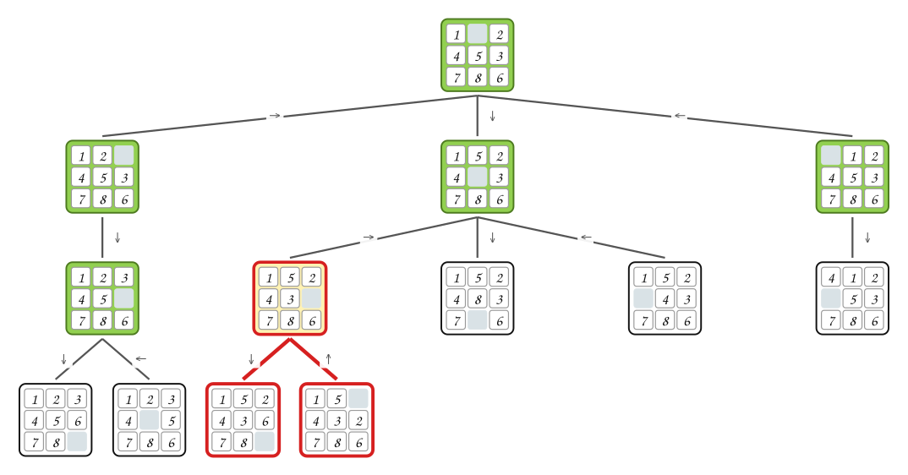

> Se expande el nodo (se llegó con ←): no es meta; se crean sus hijos con ↓. No se crea el hijo que devolvería al estado del padre.

:::
:::{tab-item} Paso 8
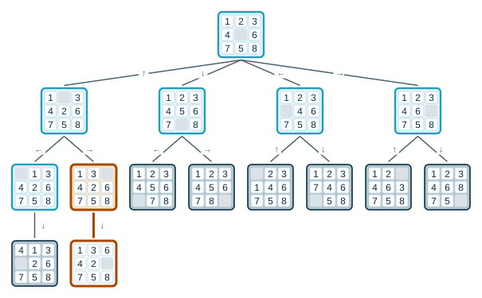

> Se expande el nodo (se llegó con →): no es meta; se crean sus hijos con ↓. No se crea el hijo que devolvería al estado del padre.

:::
:::{tab-item} Paso 9
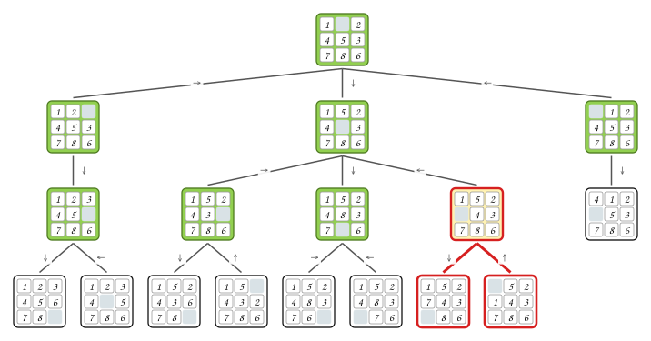

> Se expande el nodo (se llegó con ←): no es meta; se crean sus hijos con ↑. No se crea el hijo que devolvería al estado del padre.

:::
:::{tab-item} Paso 10
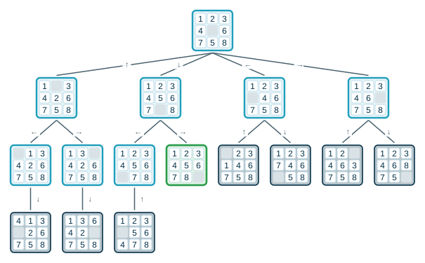

> Se expande el nodo (se llegó con →): es la configuración meta. Termina.

:::
::::
:::::

Resultado: 16 nodos creados y 9 expandidos. La solución es ↓, →.

> **¿Por qué se crearon nodos de profundidad 3 si la meta está a profundidad 2?** Los nodos de profundidad 2 que se expanden **antes** que la meta no son meta, así que se crean sus hijos. Es el costo de no saber dónde está la meta.

## 5. Búsqueda preferente por profundidad

**Búsqueda preferente por profundidad.** Se expande siempre el nodo **más profundo** que haya sido creado. Es DFS sobre el árbol de búsqueda: los nodos creados se guardan en una **pila**, y los hijos se apilan de forma que el de más a la izquierda quede en el tope.

### Ejemplo 4

El mismo árbol del Ejemplo 1, metas $G$ y $L$.

:::::{admonition} Búsqueda preferente por profundidad
:class: dropdown
::::{tab-set}
:::{tab-item} Paso 1


> Se crea el nodo raíz A y se mete en la pila. Las metas (G y L) tienen doble borde verde.

| Estado de la pila | Iteración |
|---|---|
| $\textcolor{#a94700}{\textbf{A}}$ | $\textcolor{#a94700}{\textbf{—}}$ |

:::
:::{tab-item} Paso 2
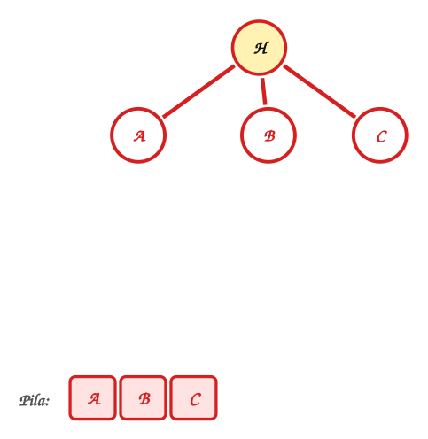

> Se extrae **A** y se expande: no es meta, así que se crean sus hijos B, C, D y se meten al tope de la pila.

| Estado de la pila | Iteración |
|---|---|
| A | — |
| $\textcolor{#a94700}{\textbf{B C D}}$ | $\textcolor{#a94700}{\textbf{Extraer A, meter hijos de A}}$ |

:::
:::{tab-item} Paso 3
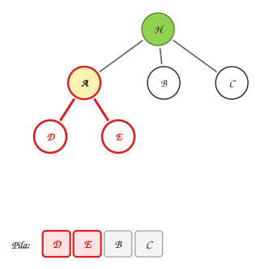

> Se extrae **B** y se expande: no es meta, así que se crean sus hijos E, F y se meten al tope de la pila.

| Estado de la pila | Iteración |
|---|---|
| A | — |
| B C D | Extraer A, meter hijos de A |
| $\textcolor{#a94700}{\textbf{E F C D}}$ | $\textcolor{#a94700}{\textbf{Extraer B, meter hijos de B}}$ |

:::
:::{tab-item} Paso 4
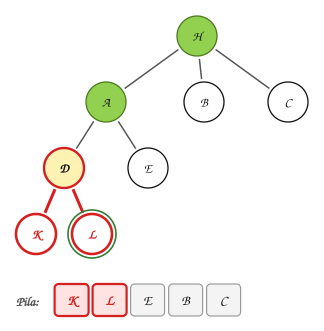

> Se extrae **E** y se expande: no es meta y no tiene hijos.

| Estado de la pila | Iteración |
|---|---|
| A | — |
| B C D | Extraer A, meter hijos de A |
| E F C D | Extraer B, meter hijos de B |
| $\textcolor{#a94700}{\textbf{F C D}}$ | $\textcolor{#a94700}{\textbf{Extraer E}}$ |

:::
:::{tab-item} Paso 5
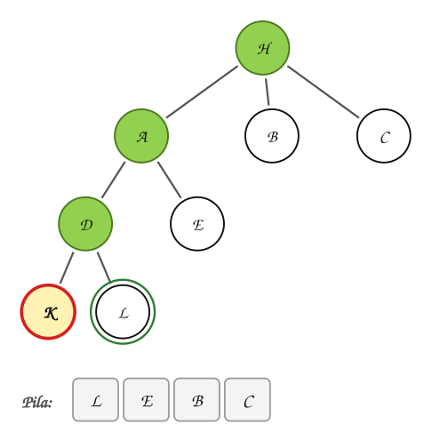

> Se extrae **F** y se expande: no es meta, así que se crean sus hijos K, L y se meten al tope de la pila.

| Estado de la pila | Iteración |
|---|---|
| A | — |
| B C D | Extraer A, meter hijos de A |
| E F C D | Extraer B, meter hijos de B |
| F C D | Extraer E |
| $\textcolor{#a94700}{\textbf{K L C D}}$ | $\textcolor{#a94700}{\textbf{Extraer F, meter hijos de F}}$ |

:::
:::{tab-item} Paso 6
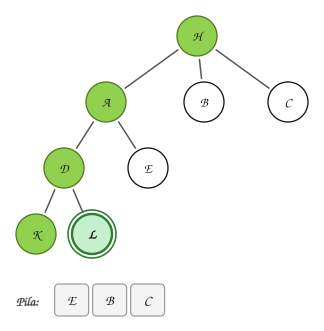

> Se extrae **K** y se expande: no es meta y no tiene hijos.

| Estado de la pila | Iteración |
|---|---|
| A | — |
| B C D | Extraer A, meter hijos de A |
| E F C D | Extraer B, meter hijos de B |
| F C D | Extraer E |
| K L C D | Extraer F, meter hijos de F |
| $\textcolor{#a94700}{\textbf{L C D}}$ | $\textcolor{#a94700}{\textbf{Extraer K}}$ |

:::
:::{tab-item} Paso 7
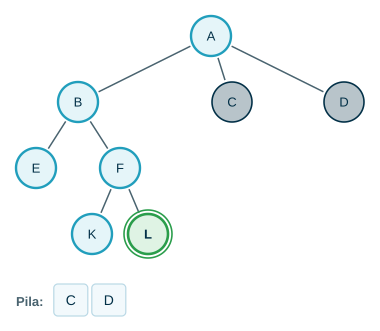

> Se extrae **L** y se expande: **es meta**. La búsqueda termina y no se crean sus hijos.

| Estado de la pila | Iteración |
|---|---|
| A | — |
| B C D | Extraer A, meter hijos de A |
| E F C D | Extraer B, meter hijos de B |
| F C D | Extraer E |
| K L C D | Extraer F, meter hijos de F |
| L C D | Extraer K |
| $\textcolor{#a94700}{\textbf{C D}}$ | $\textcolor{#a94700}{\textbf{Extraer L: es meta}}$ |

:::
::::
:::::

Encuentra la meta **L**. Nodos creados: A, B, C, D, E, F, K, L. Nodos expandidos: A, B, E, F, K, L.

> **¿Cuál búsqueda encontró la meta más cercana a la raíz?** La de amplitud ($G$, profundidad $2$). La de profundidad bajó por la rama de $B$ y encontró $L$ (profundidad $3$), con menos nodos creados.

En un árbol de búsqueda **infinito**, o con ciclos si no se evita devolverse, la búsqueda por profundidad puede bajar para siempre por una rama sin meta. Variantes: la búsqueda **limitada por profundidad** (no expandir más allá de una profundidad $\ell$) y la búsqueda por **profundización iterativa** ($\ell = 0, 1, 2, \dots$).

## 6. ¿Cuál estrategia es mejor?

Se comparan con cuatro criterios:

- **Completitud**: si existe una solución, ¿la estrategia garantiza encontrarla?
- **Complejidad temporal**: ¿cuántos nodos se crean?
- **Complejidad espacial**: ¿cuántos nodos hay que guardar en memoria?
- **Optimalidad**: si hay varias soluciones, ¿encuentra la mejor?

Sea $b$ el **factor de ramificación** (hijos por nodo) y $d$ la profundidad de la meta más superficial. La búsqueda por amplitud expande, en el peor caso,

$$
1 + b + b^2 + \cdots + b^d = O(b^d)
$$

nodos, y todos quedan en memoria. Con $b = 10$ y $1000$ nodos por segundo:

| Profundidad | Nodos | Tiempo |
|---|---|---|
| 2 | 111 | 0,1 segundos |
| 4 | 11 111 | 11 segundos |
| 6 | $10^6$ | 18 minutos |
| 8 | $10^8$ | 31 horas |
| 10 | $10^{10}$ | 128 días |
| 12 | $10^{12}$ | 35 años |
| 14 | $10^{14}$ | 3500 años |

| | Amplitud | Profundidad |
|---|---|---|
| Completa | sí (si $b$ es finito) | no (puede bajar para siempre) |
| Tiempo | $O(b^d)$ | $O(b^m)$, $m$ = profundidad máxima |
| Espacio | $O(b^d)$ | $O(b \cdot m)$: solo la rama actual y sus hermanos |
| Óptima | sí, si todos los operadores cuestan lo mismo | no |

## 7. Juegos: el árbol de juego

En un juego de dos jugadores, los estados son las posiciones del juego y los operadores son las jugadas. El **árbol de juego** modela los posibles movimientos de cada jugador, por turnos, y sirve para analizar el efecto de cada jugada.

**El juego del NIM.** Hay una pila de $4$ fichas. Por turnos, cada jugador toma $1$, $2$ o $3$ fichas. Pierde el que toma la **última** ficha. Empieza J1.

> **¿Tiene J1 una jugada que le asegure ganar?**

Para responder: (1) construir el árbol de juego, (2) analizarlo. El análisis va **de las hojas hacia la raíz**, en **postorden** (los hijos antes que el padre), con el método *minimax*:

- En las hojas se sabe quién ganó: $+1$ si gana J1, $-1$ si pierde.
- En un nivel donde juega J1, el nodo vale el **máximo** de sus hijos: J1 escoge la jugada que más le conviene.
- En un nivel donde juega J2, el nodo vale el **mínimo**: J2 escoge la que menos le conviene a J1.

:::::{admonition} Árbol del juego NIM con 4 fichas
:class: dropdown
::::{tab-set}
:::{tab-item} Paso 1


> La raíz: hay 4 fichas y juega J1.

:::
:::{tab-item} Paso 2
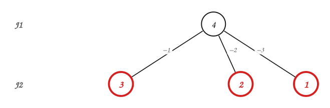

> Nivel 1: juega J2. Se agregan los 3 estados posibles; cada arista dice cuántas fichas se tomaron.

:::
:::{tab-item} Paso 3
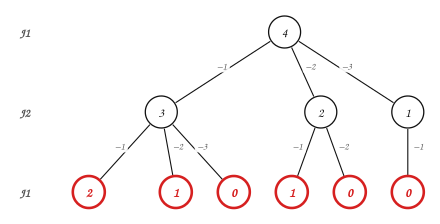

> Nivel 2: juega J1. Se agregan los 6 estados posibles; cada arista dice cuántas fichas se tomaron.

:::
:::{tab-item} Paso 4
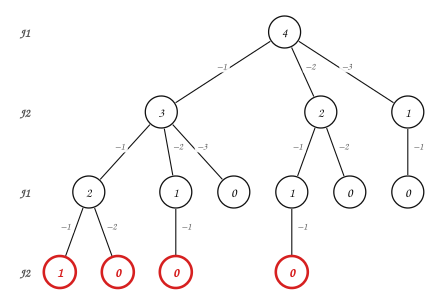

> Nivel 3: juega J2. Se agregan los 4 estados posibles; cada arista dice cuántas fichas se tomaron.

:::
:::{tab-item} Paso 5
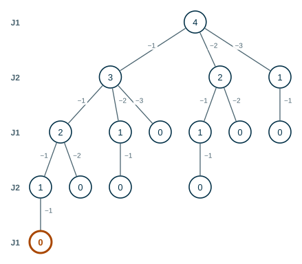

> Nivel 4: juega J1. Se agregan los 1 estados posibles; cada arista dice cuántas fichas se tomaron.

:::
:::{tab-item} Paso 6
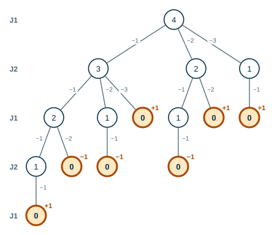

> Las hojas tienen $0$ fichas: el jugador anterior tomó la última y **perdió**. Si en la hoja le toca a J1, J1 gana ($+1$); si le toca a J2, J1 pierde ($-1$).

:::
:::{tab-item} Paso 7
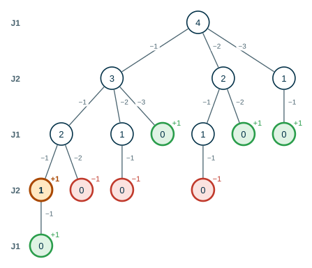

> Nodo con 1 fichas, juega J2. Sus hijos valen +1; J2 escoge el **mínimo**: $+1$.

:::
:::{tab-item} Paso 8
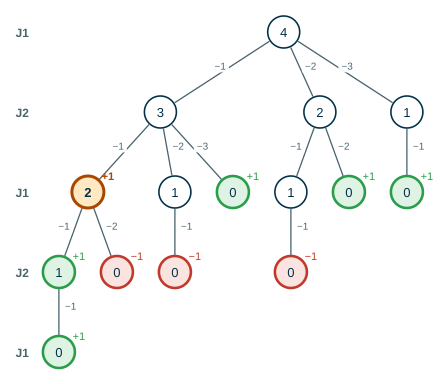

> Nodo con 2 fichas, juega J1. Sus hijos valen +1, −1; J1 escoge el **máximo**: $+1$.

:::
:::{tab-item} Paso 9
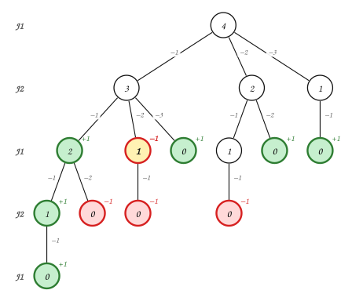

> Nodo con 1 fichas, juega J1. Sus hijos valen −1; J1 escoge el **máximo**: $-1$.

:::
:::{tab-item} Paso 10
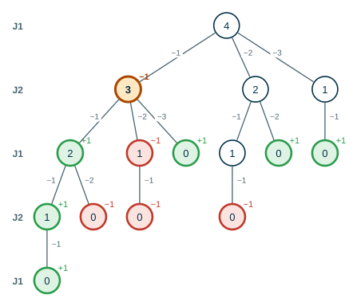

> Nodo con 3 fichas, juega J2. Sus hijos valen +1, −1, +1; J2 escoge el **mínimo**: $-1$.

:::
:::{tab-item} Paso 11
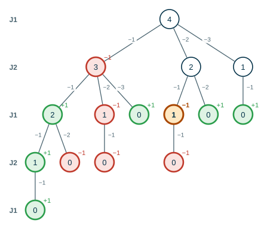

> Nodo con 1 fichas, juega J1. Sus hijos valen −1; J1 escoge el **máximo**: $-1$.

:::
:::{tab-item} Paso 12
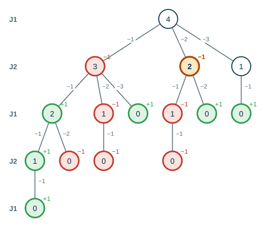

> Nodo con 2 fichas, juega J2. Sus hijos valen −1, +1; J2 escoge el **mínimo**: $-1$.

:::
:::{tab-item} Paso 13


> Nodo con 1 fichas, juega J2. Sus hijos valen +1; J2 escoge el **mínimo**: $+1$.

:::
:::{tab-item} Paso 14


> Nodo con 4 fichas, juega J1. Sus hijos valen −1, −1, +1; J1 escoge el **máximo**: $+1$.

:::
::::
:::::

La raíz vale $+1$: **J1 puede asegurar la victoria**. La jugada ganadora es tomar 3 ficha(s): quedan $1$ y J2 está obligado a tomar la última. El árbol completo tiene 15 nodos.

## 8. Implementación en Java

**Análisis.**

| | |
|---|---|
| **Entradas** | Estado inicial $(0, 0)$, capacidades $4$ y $3$. |
| **Salidas** | La secuencia de operadores y estados hasta la meta, y su profundidad. |
| **Proceso** | Búsqueda preferente por amplitud con una cola de nodos; un conjunto de estados creados evita repetirlos. |

**Diseño.** `Nodo` guarda estado, padre, operador y profundidad, como en la sección 3. `sucesores(n)` aplica los seis operadores. La solución se imprime siguiendo los padres de forma recursiva.

**Codificación.**

```java
import java.util.ArrayDeque;
import java.util.ArrayList;
import java.util.HashSet;
import java.util.List;
import java.util.Queue;
import java.util.Set;

public class Jarras {

    record Estado(int a, int b) { }          // a: litros en la jarra de 4, b: en la de 3

    record Nodo(Estado estado, Nodo padre, String operador, int profundidad) { }

    static final int CAP_A = 4;
    static final int CAP_B = 3;

    static boolean esMeta(Estado e) {
        return e.a() == 2;
    }

    static List<Nodo> sucesores(Nodo n) {
        int a = n.estado().a();
        int b = n.estado().b();
        int de4a3 = Math.min(a, CAP_B - b);
        int de3a4 = Math.min(b, CAP_A - a);
        Object[][] ops = {
            {"Llenar 4", new Estado(CAP_A, b)},
            {"Llenar 3", new Estado(a, CAP_B)},
            {"Vaciar 4", new Estado(0, b)},
            {"Vaciar 3", new Estado(a, 0)},
            {"4->3", new Estado(a - de4a3, b + de4a3)},
            {"3->4", new Estado(a + de3a4, b - de3a4)},
        };
        List<Nodo> hijos = new ArrayList<>();
        for (Object[] op : ops) {
            Estado e = (Estado) op[1];
            if (!e.equals(n.estado())) {
                hijos.add(new Nodo(e, n, (String) op[0], n.profundidad() + 1));
            }
        }
        return hijos;
    }

    // Búsqueda preferente por amplitud sin crear estados repetidos.
    static Nodo buscar(Estado inicial) {
        Queue<Nodo> cola = new ArrayDeque<>();
        Set<Estado> creados = new HashSet<>();
        cola.add(new Nodo(inicial, null, null, 0));
        creados.add(inicial);
        while (!cola.isEmpty()) {
            Nodo n = cola.remove();
            if (esMeta(n.estado())) {
                return n;
            }
            for (Nodo h : sucesores(n)) {
                if (creados.add(h.estado())) {
                    cola.add(h);
                }
            }
        }
        return null;
    }

    static void imprimir(Nodo n) {
        if (n.padre() != null) {
            imprimir(n.padre());
            System.out.print(" --" + n.operador() + "--> ");
        }
        System.out.print("(" + n.estado().a() + "," + n.estado().b() + ")");
    }

    public static void main(String[] args) {
        Nodo meta = buscar(new Estado(0, 0));
        imprimir(meta);
        System.out.println();
        System.out.println("profundidad = " + meta.profundidad());
    }
}
```

**Prueba.**

```text
(0,0) --Llenar 4--> (4,0) --4->3--> (1,3) --Vaciar 3--> (1,0) --4->3--> (0,1) --Llenar 4--> (4,1) --4->3--> (2,3)
profundidad = 6
```

Es la solución del Ejemplo 2. `creados.add(...)` devuelve `false` si el estado ya estaba en el conjunto: así se implementa «no crear un estado que ya se creó».

## 9. Formalización

- Un **espacio de estados** es un grafo dirigido $G = (V, E)$, en general implícito: $V$ son los estados y $(u, v) \in E$ si un operador transforma $u$ en $v$. Un problema de búsqueda es encontrar un camino desde el estado inicial hasta algún estado que cumpla la prueba de meta.
- El árbol de búsqueda **no es** el espacio de estados: un mismo estado puede aparecer en varios nodos del árbol si se llega a él por caminos distintos. Evitar estados repetidos convierte el árbol de búsqueda en un árbol BF (amplitud) o DF (profundidad) del espacio de estados.
- La búsqueda preferente por amplitud es completa cuando $b$ es finito, y es óptima cuando todos los operadores tienen el mismo costo. Su tiempo y su espacio son $O(b^d)$.
- La búsqueda preferente por profundidad usa espacio $O(b \cdot m)$, pero no es completa en espacios infinitos ni es óptima.
- El análisis *minimax* de un árbol de juego es un recorrido en **postorden**: el valor de un nodo se calcula a partir de los valores de sus hijos.

## Ejercicios

Practique con los [ejercicios de espacios de estados y juegos](exercises.md).

## Fuentes

- Bedoya, O. *Búsqueda no informada* (formulación de problemas, árboles de búsqueda, búsqueda preferente por amplitud). Diapositivas del curso, Universidad del Valle.
- Bedoya, O. *Árboles: árboles de juego*. Diapositivas del curso, Universidad del Valle.
- Russell, S., Norvig, P. *Inteligencia Artificial: un enfoque moderno*, 2.ª ed. Pearson, 2004. Capítulos 3 y 6.

---

*Material adaptado del material original del profesor Oscar Bedoya.*
