---
# Copyright (c) 2026 Angela Villota, and collaborators from the CyED block
# Licensed under the PolyForm Noncommercial License 1.0.0.
# Commercial use is prohibited without prior written authorization.
title: "Unidad 5: Recorridos en espacios de estados y juegos"
---

# Unidad 5: Recorridos en espacios de estados y juegos

## 1. El problema

Partiendo desde Arad, **llegar a Bucarest**.

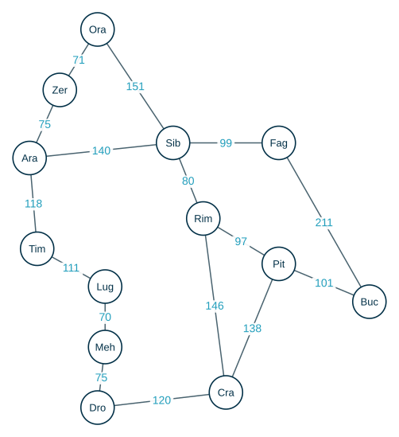

Para resolver un problema así hay tres pasos:

1. **Formulación del problema**: conjunto de estados, operadores, meta y costo asociado.
2. **Búsqueda**: evaluar las acciones posibles y decidir la más apropiada.
3. **Ejecución**: una vez encontrada la solución, ejecutar la secuencia de acciones.

Aquí el grafo está dibujado, pero en muchos problemas no: el grafo está **implícito**, y se va descubriendo al aplicar las acciones. Los dos se recorren con las ideas de las páginas de [BFS](../BFS/index.md) y [DFS](../DFS/index.md).

## 2. Problemas bien definidos

Un problema está **bien definido** cuando se conocen:

- **Estados**: cómo se representa el estado actual, cuáles son los posibles estados y cuál es el **estado inicial**.
- **Operadores**: aplicado sobre un estado particular, un operador genera un conjunto de estados posibles.
- **Prueba de meta**: permite saber si el estado actual es un estado meta.
- **Función costo de ruta**: le asigna un costo a una ruta. El costo es la suma de los costos de cada una de las acciones individuales a lo largo de la ruta, y se denota con la letra $g$.

| | Arad → Bucarest |
|---|---|
| **Estados** | la ciudad en la que se está; el inicial es Arad |
| **Operadores** | ir a una ciudad vecina |
| **Prueba de meta** | estar en Bucarest |
| **Costo de ruta** | la suma de los kilómetros de los tramos recorridos |

### El 8-puzzle

Un tablero de $3 \times 3$ con $8$ fichas numeradas y un espacio. Una ficha vecina al espacio se puede deslizar hacia él.


- **Estados**: la configuración de las $8$ piezas en el tablero. Se puede guardar como una matriz $3 \times 3$, con $0$ en la casilla del espacio. El estado de la figura es

$$
\begin{bmatrix} 6 & 3 & 7 \\ 8 & 1 & 4 \\ 2 & 0 & 5 \end{bmatrix}
$$

- **Operadores**: mover el espacio arriba, abajo, a la izquierda o a la derecha.

```text
MOVER-IZQUIERDA(puzzle)
1  (fil, col) ← la posición del 0 en puzzle
2  puzzle[fil][col] ← puzzle[fil][col − 1]     // la ficha de la izquierda pasa al espacio
3  puzzle[fil][col − 1] ← 0                     // el espacio queda donde estaba la ficha
```

- **Prueba de meta**: la configuración ordenada de la figura, con el espacio en la esquina inferior derecha.

```text
ES-META(puzzle)
1  return puzzle = [[1, 2, 3], [4, 5, 6], [7, 8, 0]]
```

- **Costo de ruta**: cada movimiento cuesta $1$; el costo $g$ de una ruta es la cantidad de movimientos.

> **¿Qué le falta a `MOVER-IZQUIERDA` antes de mover la ficha?**

:::{admonition} Respuesta
:class: dropdown
Verificar que el movimiento es posible: si el espacio está en la columna $0$, no se puede mover a la izquierda ($col - 1$ sería $-1$). Un operador solo se aplica a los estados en los que tiene sentido.
:::

## 3. Árboles de búsqueda

El árbol de búsqueda facilita la comprensión de las exploraciones:

- el estado inicial es el **nodo raíz**;
- se **expande** el nodo raíz al aplicar los operadores sobre él;
- en cada paso, el algoritmo de búsqueda escoge un nodo «hoja» y lo expande.

Cada nodo del árbol guarda:

- el estado del problema,
- una referencia al nodo **padre**,
- el **operador** que se aplicó para generar el nodo,
- la **profundidad** del nodo,
- el **costo** de la ruta desde la raíz hasta el nodo.

Y tiene dos métodos: `aplicarOperador()` y `esMeta()`.

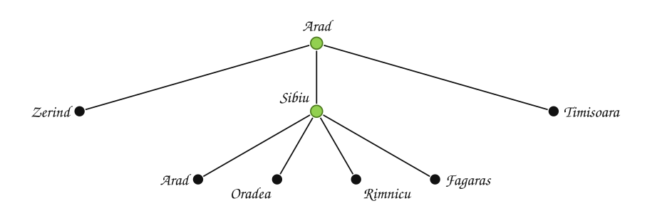

Se expandió Arad (sus hijos son las ciudades vecinas) y luego Sibiu. Uno de los hijos de Sibiu es otra vez Arad: el árbol de búsqueda puede repetir estados.

### Métodos de búsqueda

- **Búsqueda no informada**: no hay caminos prioritarios. La única diferencia entre las técnicas es el **orden** en que se expanden los nodos. Son la búsqueda preferente por amplitud, la de costo uniforme, la preferente por profundidad, la limitada por profundidad y la de profundización iterativa.
- **Búsqueda informada**: usa información del problema para escoger qué nodo expandir.

## 4. Búsqueda preferente por amplitud

**Búsqueda preferente por amplitud.**

- Expandir el nodo raíz: esto genera los nodos de profundidad $1$.
- Expandir, de izquierda a derecha, cada nodo de profundidad $1$.
- Continuar expandiendo, de izquierda a derecha, cada uno de los nodos de profundidad $d$ y luego los de profundidad $d + 1$.

**Expandir** un nodo es verificar si es meta y crear sus hijos. Al expandir un nodo meta **no se crean** sus hijos: la búsqueda termina.

### Ejemplo 1

$L$ y $G$ son los nodos meta. **¿Cuál meta encuentra? Liste los nodos creados y los nodos expandidos.**

Colores: verde = expandido, blanco = creado y en espera, rojo = lo nuevo del paso. Las metas tienen doble borde.

:::::{admonition} Búsqueda preferente por amplitud
:class: dropdown
::::{tab-set}
:::{tab-item} Paso 1


> Se crea el nodo raíz H y se mete en la cola. Las metas (G y L) tienen doble borde verde.

| Estado de la cola | Iteración |
|---|---|
| $\textcolor{#a94700}{\textbf{H}}$ | $\textcolor{#a94700}{\textbf{—}}$ |

:::
:::{tab-item} Paso 2


> Se extrae **H** y se expande: no es meta, así que se crean sus hijos A, B, C y se meten al final de la cola.

| Estado de la cola | Iteración |
|---|---|
| H | — |
| $\textcolor{#a94700}{\textbf{A B C}}$ | $\textcolor{#a94700}{\textbf{Extraer H, meter hijos de H}}$ |

:::
:::{tab-item} Paso 3


> Se extrae **A** y se expande: no es meta, así que se crean sus hijos D, E y se meten al final de la cola.

| Estado de la cola | Iteración |
|---|---|
| H | — |
| A B C | Extraer H, meter hijos de H |
| $\textcolor{#a94700}{\textbf{B C D E}}$ | $\textcolor{#a94700}{\textbf{Extraer A, meter hijos de A}}$ |

:::
:::{tab-item} Paso 4


> Se extrae **B** y se expande: no es meta, así que se crean sus hijos F y se meten al final de la cola.

| Estado de la cola | Iteración |
|---|---|
| H | — |
| A B C | Extraer H, meter hijos de H |
| B C D E | Extraer A, meter hijos de A |
| $\textcolor{#a94700}{\textbf{C D E F}}$ | $\textcolor{#a94700}{\textbf{Extraer B, meter hijos de B}}$ |

:::
:::{tab-item} Paso 5


> Se extrae **C** y se expande: no es meta, así que se crean sus hijos G, J y se meten al final de la cola.

| Estado de la cola | Iteración |
|---|---|
| H | — |
| A B C | Extraer H, meter hijos de H |
| B C D E | Extraer A, meter hijos de A |
| C D E F | Extraer B, meter hijos de B |
| $\textcolor{#a94700}{\textbf{D E F G J}}$ | $\textcolor{#a94700}{\textbf{Extraer C, meter hijos de C}}$ |

:::
:::{tab-item} Paso 6


> Se extrae **D** y se expande: no es meta, así que se crean sus hijos K, L y se meten al final de la cola.

| Estado de la cola | Iteración |
|---|---|
| H | — |
| A B C | Extraer H, meter hijos de H |
| B C D E | Extraer A, meter hijos de A |
| C D E F | Extraer B, meter hijos de B |
| D E F G J | Extraer C, meter hijos de C |
| $\textcolor{#a94700}{\textbf{E F G J K L}}$ | $\textcolor{#a94700}{\textbf{Extraer D, meter hijos de D}}$ |

:::
:::{tab-item} Paso 7


> Se extrae **E** y se expande: no es meta y no tiene hijos.

| Estado de la cola | Iteración |
|---|---|
| H | — |
| A B C | Extraer H, meter hijos de H |
| B C D E | Extraer A, meter hijos de A |
| C D E F | Extraer B, meter hijos de B |
| D E F G J | Extraer C, meter hijos de C |
| E F G J K L | Extraer D, meter hijos de D |
| $\textcolor{#a94700}{\textbf{F G J K L}}$ | $\textcolor{#a94700}{\textbf{Extraer E}}$ |

:::
:::{tab-item} Paso 8


> Se extrae **F** y se expande: no es meta y no tiene hijos.

| Estado de la cola | Iteración |
|---|---|
| H | — |
| A B C | Extraer H, meter hijos de H |
| B C D E | Extraer A, meter hijos de A |
| C D E F | Extraer B, meter hijos de B |
| D E F G J | Extraer C, meter hijos de C |
| E F G J K L | Extraer D, meter hijos de D |
| F G J K L | Extraer E |
| $\textcolor{#a94700}{\textbf{G J K L}}$ | $\textcolor{#a94700}{\textbf{Extraer F}}$ |

:::
:::{tab-item} Paso 9
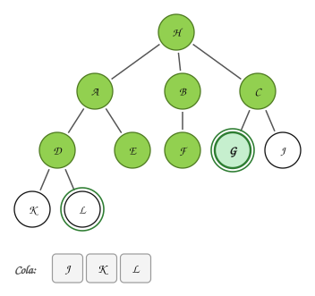

> Se extrae **G** y se expande: **es meta**. La búsqueda termina y no se crean sus hijos.

| Estado de la cola | Iteración |
|---|---|
| H | — |
| A B C | Extraer H, meter hijos de H |
| B C D E | Extraer A, meter hijos de A |
| C D E F | Extraer B, meter hijos de B |
| D E F G J | Extraer C, meter hijos de C |
| E F G J K L | Extraer D, meter hijos de D |
| F G J K L | Extraer E |
| G J K L | Extraer F |
| $\textcolor{#a94700}{\textbf{J K L}}$ | $\textcolor{#a94700}{\textbf{Extraer G: es meta}}$ |

:::
::::
:::::

Encuentra la meta **G**. Nodos creados: H, A, B, C, D, E, F, G, J, K, L. Nodos expandidos: H, A, B, C, D, E, F, G.

> $L$ también es meta, pero está a profundidad $3$: la búsqueda por amplitud termina todo el nivel $2$ antes, y allí está $G$.

Los nodos creados esperan en una **cola**:

```text
function BUSQUEDA-PREFERENTE-POR-AMPLITUD(problema) returns solución o falla
    Cola cola
    cola = nodo_raiz(problema)
    loop
        if estaVacia(cola) then return falló
        n = sacar(cola)
        if n es un nodo meta then return encontró solución
        expandir n y meter todos sus hijos al final de la cola
```

### Ejemplo 2: el agente minero

Aplicar búsqueda preferente por amplitud. El agente empieza en la casilla roja y busca el lingote (amarillo); las casillas grises son roca. Se puede mover a una casilla vecina libre, en el orden ←, →, ↑, ↓. Evite devolverse. **Indique el camino que sigue el agente.**

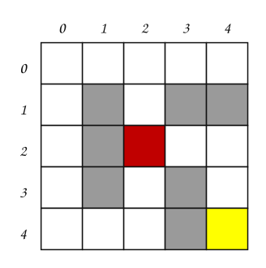

:::::{admonition} Búsqueda por amplitud del agente minero
:class: dropdown
::::{tab-set}
:::{tab-item} Paso 1
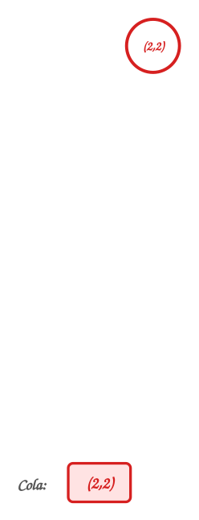

> Se crea el nodo raíz $(2,2)$ y se mete en la cola.

:::
:::{tab-item} Paso 2
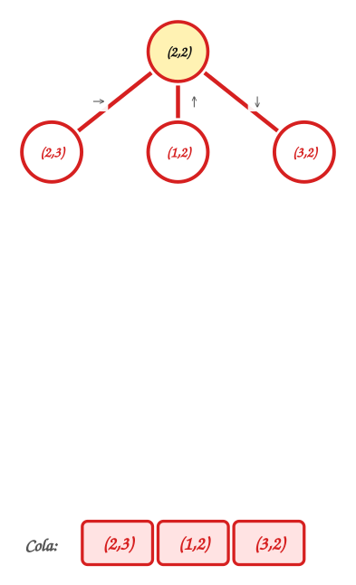

> Se expande $(2,2)$: no es meta; se crean $(2,3)$ (→), $(1,2)$ (↑), $(3,2)$ (↓).

:::
:::{tab-item} Paso 3
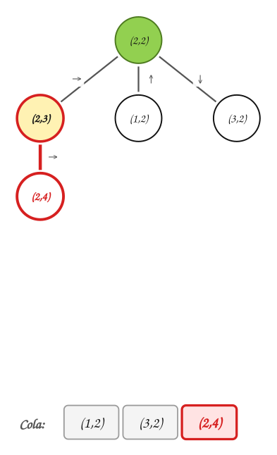

> Se expande $(2,3)$: no es meta; se crean $(2,4)$ (→).

:::
:::{tab-item} Paso 4
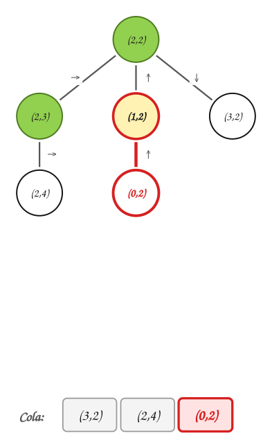

> Se expande $(1,2)$: no es meta; se crean $(0,2)$ (↑).

:::
:::{tab-item} Paso 5
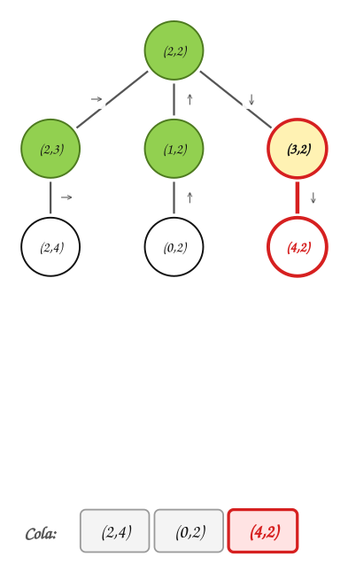

> Se expande $(3,2)$: no es meta; se crean $(4,2)$ (↓).

:::
:::{tab-item} Paso 6
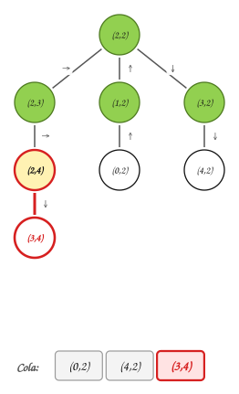

> Se expande $(2,4)$: no es meta; se crean $(3,4)$ (↓).

:::
:::{tab-item} Paso 7
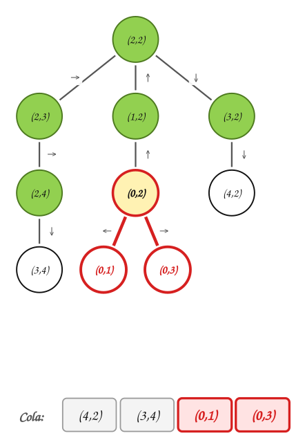

> Se expande $(0,2)$: no es meta; se crean $(0,1)$ (←), $(0,3)$ (→).

:::
:::{tab-item} Paso 8
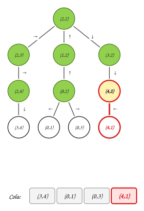

> Se expande $(4,2)$: no es meta; se crean $(4,1)$ (←).

:::
:::{tab-item} Paso 9
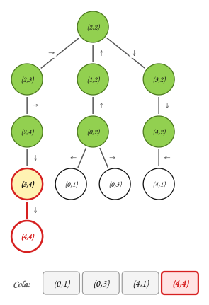

> Se expande $(3,4)$: no es meta; se crean $(4,4)$ (↓).

:::
:::{tab-item} Paso 10
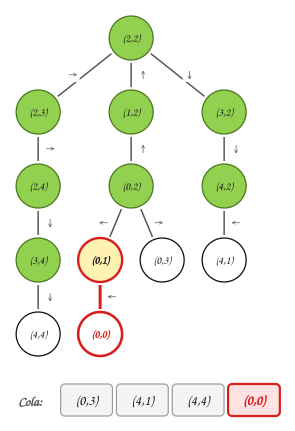

> Se expande $(0,1)$: no es meta; se crean $(0,0)$ (←).

:::
:::{tab-item} Paso 11
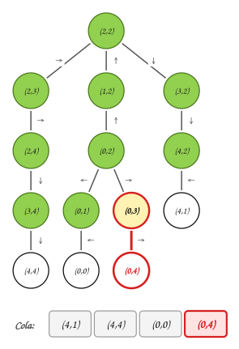

> Se expande $(0,3)$: no es meta; se crean $(0,4)$ (→).

:::
:::{tab-item} Paso 12
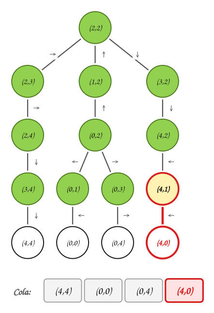

> Se expande $(4,1)$: no es meta; se crean $(4,0)$ (←).

:::
:::{tab-item} Paso 13
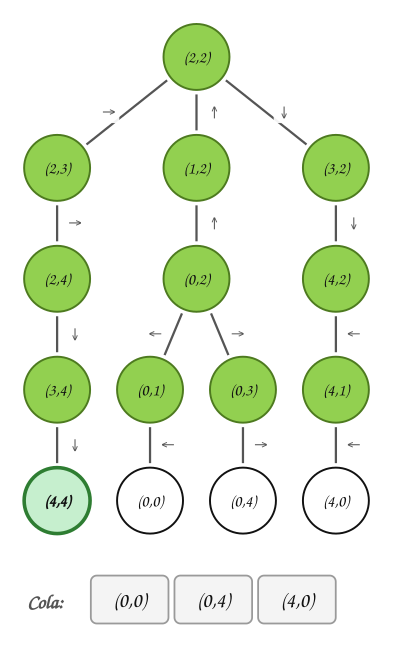

> Se expande $(4,4)$: **es meta**. La búsqueda termina.

:::
::::
:::::

El agente sigue el camino (2,2) → (2,3) → (2,4) → (3,4) → (4,4). Se crearon 15 nodos y se expandieron 12.

### Ejemplo 3: el 8-puzzle

Aplicar búsqueda preferente por amplitud. El espacio se mueve en el orden →, ↓, ←, ↑, y se evita devolverse: no se crea un hijo con un estado que ya está en la rama.

:::::{admonition} Búsqueda por amplitud en el 8-puzzle
:class: dropdown
::::{tab-set}
:::{tab-item} Paso 1


> Estado inicial: el espacio está arriba al centro.

:::
:::{tab-item} Paso 2


> Se expande el nodo: no es meta; se crean sus hijos con →, ↓, ←. No se crea el hijo que devolvería a un estado de la rama.

:::
:::{tab-item} Paso 3


> Se expande el nodo (se llegó con →): no es meta; se crean sus hijos con ↓. No se crea el hijo que devolvería a un estado de la rama.

:::
:::{tab-item} Paso 4


> Se expande el nodo (se llegó con ↓): no es meta; se crean sus hijos con →, ↓, ←. No se crea el hijo que devolvería a un estado de la rama.

:::
:::{tab-item} Paso 5


> Se expande el nodo (se llegó con ←): no es meta; se crean sus hijos con ↓. No se crea el hijo que devolvería a un estado de la rama.

:::
:::{tab-item} Paso 6


> Se expande el nodo (se llegó con ↓): no es meta; se crean sus hijos con ↓, ←. No se crea el hijo que devolvería a un estado de la rama.

:::
:::{tab-item} Paso 7


> Se expande el nodo (se llegó con →): no es meta; se crean sus hijos con ↓, ↑. No se crea el hijo que devolvería a un estado de la rama.

:::
:::{tab-item} Paso 8


> Se expande el nodo (se llegó con ↓): no es meta; se crean sus hijos con →, ←. No se crea el hijo que devolvería a un estado de la rama.

:::
:::{tab-item} Paso 9


> Se expande el nodo (se llegó con ←): no es meta; se crean sus hijos con ↓, ↑. No se crea el hijo que devolvería a un estado de la rama.

:::
:::{tab-item} Paso 10


> Se expande el nodo (se llegó con ↓): no es meta; se crean sus hijos con →, ↓. No se crea el hijo que devolvería a un estado de la rama.

:::
:::{tab-item} Paso 11
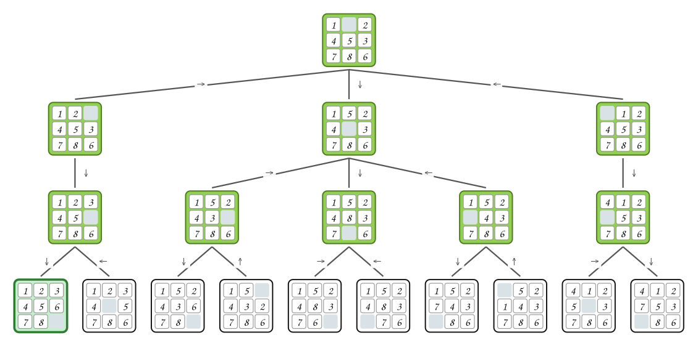

> Se expande el nodo (se llegó con ↓): es la configuración meta. Termina.

:::
::::
:::::

Resultado: 19 nodos creados y 10 expandidos. La solución es →, ↓, ↓.

> **¿Por qué se crearon nodos de profundidad 3 si la meta es el primero de ese nivel?**

:::{admonition} Respuesta
:class: dropdown
Porque la meta se reconoce al **expandirla**, no al crearla. Antes de expandirla hay que expandir todos los nodos de profundidad $2$, y cada uno crea sus hijos de profundidad $3$.
:::

### Propiedades

Una estrategia de búsqueda se evalúa con cuatro criterios:

- **Completitud**: si existe una solución, ¿la estrategia la encuentra?
- **Complejidad temporal**: cuánto tiempo se necesita para encontrar una solución.
- **Complejidad espacial**: cuánta memoria se necesita para efectuar la búsqueda.
- **Solución óptima**: en caso de que existan varias soluciones, ¿se encuentra la mejor?

Para la búsqueda preferente por amplitud:

- **Completitud**: si existe una solución, la estrategia garantiza que se encontrará. Los ciclos no la afectan: aunque no se evite devolverse, la búsqueda avanza nivel por nivel y llega a la meta.
- **Complejidad temporal**: sea $b$ el **factor de ramificación** (cuántos hijos tiene cada nodo) y $d$ la profundidad de la meta. La cantidad máxima de nodos expandidos es

$$
1 + b + b^2 + \cdots + b^d = O(b^d)
$$

| Profundidad | Nodos | Tiempo |
|---|---|---|
| 2 | 111 | 0,1 segundos |
| 4 | 11 111 | 11 segundos |
| 6 | $10^6$ | 18 minutos |
| 8 | $10^8$ | 31 horas |
| 10 | $10^{10}$ | 128 días |
| 12 | $10^{12}$ | 35 años |
| 14 | $10^{14}$ | 3500 años |

  con $b = 10$ y suponiendo una expansión de $1000$ nodos por segundo.

- **Complejidad espacial**: cada nodo del árbol se debe guardar en memoria; también es $O(b^d)$.
- **Solución óptima**: no. Encuentra la meta **menos profunda**, con menos operadores, pero si los operadores tienen costos distintos esa no tiene que ser la de menor costo.

## 5. Búsqueda preferente por profundidad

**Búsqueda preferente por profundidad.** Se expande siempre el nodo **más profundo** que haya sido creado. Es DFS sobre el árbol de búsqueda: los nodos creados se guardan en una **pila**, y los hijos se apilan de forma que el de más a la izquierda quede en el tope.

### Ejemplo 4

El mismo árbol del Ejemplo 1, metas $G$ y $L$.

:::::{admonition} Búsqueda preferente por profundidad
:class: dropdown
::::{tab-set}
:::{tab-item} Paso 1


> Se crea el nodo raíz H y se mete en la pila. Las metas (G y L) tienen doble borde verde.

| Estado de la pila | Iteración |
|---|---|
| $\textcolor{#a94700}{\textbf{H}}$ | $\textcolor{#a94700}{\textbf{—}}$ |

:::
:::{tab-item} Paso 2


> Se extrae **H** y se expande: no es meta, así que se crean sus hijos A, B, C y se meten al tope de la pila.

| Estado de la pila | Iteración |
|---|---|
| H | — |
| $\textcolor{#a94700}{\textbf{A B C}}$ | $\textcolor{#a94700}{\textbf{Extraer H, meter hijos de H}}$ |

:::
:::{tab-item} Paso 3


> Se extrae **A** y se expande: no es meta, así que se crean sus hijos D, E y se meten al tope de la pila.

| Estado de la pila | Iteración |
|---|---|
| H | — |
| A B C | Extraer H, meter hijos de H |
| $\textcolor{#a94700}{\textbf{D E B C}}$ | $\textcolor{#a94700}{\textbf{Extraer A, meter hijos de A}}$ |

:::
:::{tab-item} Paso 4


> Se extrae **D** y se expande: no es meta, así que se crean sus hijos K, L y se meten al tope de la pila.

| Estado de la pila | Iteración |
|---|---|
| H | — |
| A B C | Extraer H, meter hijos de H |
| D E B C | Extraer A, meter hijos de A |
| $\textcolor{#a94700}{\textbf{K L E B C}}$ | $\textcolor{#a94700}{\textbf{Extraer D, meter hijos de D}}$ |

:::
:::{tab-item} Paso 5


> Se extrae **K** y se expande: no es meta y no tiene hijos.

| Estado de la pila | Iteración |
|---|---|
| H | — |
| A B C | Extraer H, meter hijos de H |
| D E B C | Extraer A, meter hijos de A |
| K L E B C | Extraer D, meter hijos de D |
| $\textcolor{#a94700}{\textbf{L E B C}}$ | $\textcolor{#a94700}{\textbf{Extraer K}}$ |

:::
:::{tab-item} Paso 6


> Se extrae **L** y se expande: **es meta**. La búsqueda termina y no se crean sus hijos.

| Estado de la pila | Iteración |
|---|---|
| H | — |
| A B C | Extraer H, meter hijos de H |
| D E B C | Extraer A, meter hijos de A |
| K L E B C | Extraer D, meter hijos de D |
| L E B C | Extraer K |
| $\textcolor{#a94700}{\textbf{E B C}}$ | $\textcolor{#a94700}{\textbf{Extraer L: es meta}}$ |

:::
::::
:::::

Encuentra la meta **L**. Nodos creados: H, A, B, C, D, E, K, L. Nodos expandidos: H, A, D, K, L.

> **¿Cuál búsqueda encontró la meta más cercana a la raíz?** La de amplitud ($G$, profundidad $2$). La de profundidad bajó por la rama de $B$ y encontró $L$ (profundidad $3$), con menos nodos creados.

En un árbol de búsqueda **infinito**, o con ciclos si no se evita devolverse, la búsqueda por profundidad puede bajar para siempre por una rama sin meta. Variantes: la búsqueda **limitada por profundidad** (no expandir más allá de una profundidad $\ell$) y la búsqueda por **profundización iterativa** ($\ell = 0, 1, 2, \dots$).

## 6. Amplitud y profundidad

| | Amplitud | Profundidad |
|---|---|---|
| Completa | sí (si $b$ es finito) | no (puede bajar para siempre) |
| Tiempo | $O(b^d)$ | $O(b^m)$, $m$ = profundidad máxima |
| Espacio | $O(b^d)$ | $O(b \cdot m)$: solo la rama actual y sus hermanos |
| Óptima | no | no |

## 7. Juegos: el árbol de juego

**Árbol de juego.** Modela los posibles movimientos de cada jugador en un juego con adversario, y sirve para analizar el efecto de las jugadas. Para usarlo hay que (1) construir el árbol de juego y (2) analizarlo.

Construir el árbol de juego. La jugada es de X (el jugador 1):

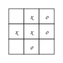

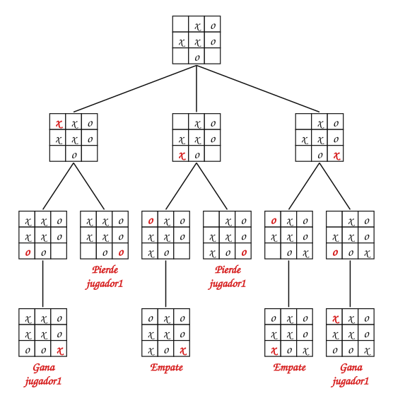

> **Si usted es el jugador 1, ¿con qué jugada empezaría?**

:::{admonition} Respuesta
:class: dropdown
Se analiza de las hojas hacia arriba. En cada jugada de O se supone que O escoge lo peor para el jugador 1: X arriba a la izquierda: el jugador 2 puede llevarlo a «pierde jugador1»; X abajo a la izquierda: el jugador 2 puede llevarlo a «pierde jugador1»; X abajo a la derecha: el jugador 2 puede llevarlo a «empate».

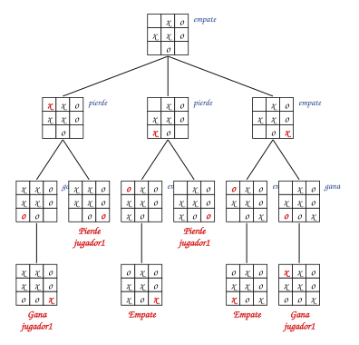

La mejor jugada es **X abajo a la derecha**: asegura al menos un empate. Con las otras dos, si O juega bien, el jugador 1 pierde.
:::

El análisis va **de las hojas hacia la raíz**: en las hojas se sabe quién ganó; en un nivel donde juega el jugador 1 se escoge la jugada que más le conviene, y en un nivel donde juega el jugador 2, la que menos le conviene al jugador 1. Es un recorrido en **postorden**: los hijos antes que el padre.

**El juego del NIM.** Hay una pila de $4$ fichas. Por turnos, cada jugador toma $1$, $2$ o $3$ fichas. Pierde el que toma la **última** ficha. Empieza J1.

> **¿Tiene J1 una jugada que le asegure ganar?**

Se construye el árbol y se analiza de las hojas a la raíz, poniendo un valor en cada nodo (método *minimax*):

- En las hojas se sabe quién ganó: $+1$ si gana J1, $-1$ si pierde.
- En un nivel donde juega J1, el nodo vale el **máximo** de sus hijos: J1 escoge la jugada que más le conviene.
- En un nivel donde juega J2, el nodo vale el **mínimo**: J2 escoge la que menos le conviene a J1.

:::::{admonition} Árbol del juego NIM con 4 fichas
:class: dropdown
::::{tab-set}
:::{tab-item} Paso 1


> La raíz: hay 4 fichas y juega J1.

:::
:::{tab-item} Paso 2


> Nivel 1: juega J2. Se agregan los 3 estados posibles; cada arista dice cuántas fichas se tomaron.

:::
:::{tab-item} Paso 3


> Nivel 2: juega J1. Se agregan los 6 estados posibles; cada arista dice cuántas fichas se tomaron.

:::
:::{tab-item} Paso 4


> Nivel 3: juega J2. Se agregan los 4 estados posibles; cada arista dice cuántas fichas se tomaron.

:::
:::{tab-item} Paso 5


> Nivel 4: juega J1. Se agregan los 1 estados posibles; cada arista dice cuántas fichas se tomaron.

:::
:::{tab-item} Paso 6


> Las hojas tienen $0$ fichas: el jugador anterior tomó la última y **perdió**. Si en la hoja le toca a J1, J1 gana ($+1$); si le toca a J2, J1 pierde ($-1$).

:::
:::{tab-item} Paso 7


> Nodo con 1 fichas, juega J2. Sus hijos valen +1; J2 escoge el **mínimo**: $+1$.

:::
:::{tab-item} Paso 8


> Nodo con 2 fichas, juega J1. Sus hijos valen +1, −1; J1 escoge el **máximo**: $+1$.

:::
:::{tab-item} Paso 9


> Nodo con 1 fichas, juega J1. Sus hijos valen −1; J1 escoge el **máximo**: $-1$.

:::
:::{tab-item} Paso 10


> Nodo con 3 fichas, juega J2. Sus hijos valen +1, −1, +1; J2 escoge el **mínimo**: $-1$.

:::
:::{tab-item} Paso 11


> Nodo con 1 fichas, juega J1. Sus hijos valen −1; J1 escoge el **máximo**: $-1$.

:::
:::{tab-item} Paso 12


> Nodo con 2 fichas, juega J2. Sus hijos valen −1, +1; J2 escoge el **mínimo**: $-1$.

:::
:::{tab-item} Paso 13


> Nodo con 1 fichas, juega J2. Sus hijos valen +1; J2 escoge el **mínimo**: $+1$.

:::
:::{tab-item} Paso 14


> Nodo con 4 fichas, juega J1. Sus hijos valen −1, −1, +1; J1 escoge el **máximo**: $+1$.

:::
::::
:::::

La raíz vale $+1$: **J1 puede asegurar la victoria**. La jugada ganadora es tomar 3 ficha(s): quedan $1$ y J2 está obligado a tomar la última. El árbol completo tiene 15 nodos.

## 8. Formalización

- Un **espacio de estados** es un grafo dirigido $G = (V, E)$, en general implícito: $V$ son los estados y $(u, v) \in E$ si un operador transforma $u$ en $v$. Un problema de búsqueda es encontrar un camino desde el estado inicial hasta algún estado que cumpla la prueba de meta.
- El árbol de búsqueda **no es** el espacio de estados: un mismo estado puede aparecer en varios nodos del árbol si se llega a él por caminos distintos. Evitar estados repetidos convierte el árbol de búsqueda en un árbol BF (amplitud) o DF (profundidad) del espacio de estados.
- La búsqueda preferente por amplitud es completa cuando $b$ es finito, y es óptima cuando todos los operadores tienen el mismo costo. Su tiempo y su espacio son $O(b^d)$.
- La búsqueda preferente por profundidad usa espacio $O(b \cdot m)$, pero no es completa en espacios infinitos ni es óptima.
- El análisis *minimax* de un árbol de juego es un recorrido en **postorden**: el valor de un nodo se calcula a partir de los valores de sus hijos.

## Ejercicios

Practique con los [ejercicios de espacios de estados y juegos](exercises.md).

## Fuentes

- Bedoya, O. *Búsqueda no informada* (cómo solucionar un problema, problemas bien definidos, 8-puzzle, mundo de la aspiradora, árboles de búsqueda, búsqueda preferente por amplitud, agente minero, propiedades). Diapositivas del curso, Universidad del Valle.
- Bedoya, O. *Árboles: árboles de juego* (tres en línea, NIM). Diapositivas del curso, Universidad del Valle.
- Russell, S., Norvig, P. *Inteligencia Artificial: un enfoque moderno*, 2.ª ed. Pearson, 2004. Capítulos 3 y 6.

---

*Material adaptado del material original del profesor Oscar Bedoya.*
