---
# Copyright (c) 2026 Angela Villota, and collaborators from the CyED block
# Licensed under the PolyForm Noncommercial License 1.0.0.
# Commercial use is prohibited without prior written authorization.
title: "Unidad 5: Grafos, conceptos básicos"
---

# Unidad 5: Grafos, conceptos básicos

Algunos ejemplos se desarrollan en desplegables con pestañas **Paso 1, Paso 2, …**: cada paso conserva lo anterior y muestra lo nuevo **en color**. Las preguntas tienen la respuesta en un desplegable justo debajo.

## 1. El problema

En un grupo de $5$ personas, cada una dice cuántos amigos tiene dentro del grupo (la amistad es mutua):

$$
3,\quad 3,\quad 3,\quad 3,\quad 2
$$

**¿Es posible?** ¿Y si las respuestas fueran $1, 1, 1, 1, 1$?

Intente dibujarlo: un punto por persona y una línea por amistad.

:::{admonition} ¿Se puede?
:class: dropdown
- $3, 3, 3, 3, 2$: **sí**. Con personas $u, v, w, x, y$ y las amistades $u-v$, $u-w$, $u-x$, $v-w$, $v-x$, $w-y$, $x-y$, las cuatro primeras personas tienen $3$ amigos y $y$ tiene $2$.
- $1, 1, 1, 1, 1$: **no**. Cada amistad empareja a dos personas, y con $5$ personas siempre sobra una.

Al final de la sección 3 hay una forma de responder **sin dibujar**.
:::

Ese dibujo de puntos y líneas es un **grafo**. Plano de estaciones del metro, mapa de autopistas, circuitos eléctricos, redes sociales, redes de computadores, moléculas: todos se modelan como grafos.

## 2. Definiciones

**Grafo.** Un grafo $G$ es un par ordenado $G = (V, E)$, donde $V$ es un conjunto de **vértices** (o nodos) y $E$ es un conjunto de **aristas** que relacionan los vértices.

- En un grafo **dirigido**, cada arista es un par **ordenado** $(u, v)$: va de $u$ a $v$.
- En un grafo **no dirigido**, cada arista es un conjunto $\{u, v\}$: no tiene sentido.

| | |
|---|---|
| 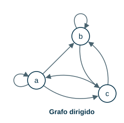 | 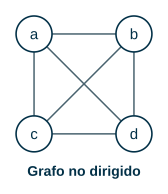 |
| $V = \{a, b, c\}$ | $V = \{a, b, c, d\}$ |
| $E = \{(a,a), (a,b), (a,c), (b,b), (b,c), (c,a), (c,b)\}$ | $E = \{\{a,b\}, \{a,c\}, \{a,d\}, \{b,c\}, \{b,d\}, \{c,d\}\}$ |

A las aristas $(a, a)$ y $(b, b)$, que van de un vértice a sí mismo, se les llama **bucles**. Dos o más aristas que relacionan el mismo par de vértices son **aristas paralelas**.

> **En el grafo dirigido, ¿$(a, c)$ y $(c, a)$ son aristas paralelas?**

:::{admonition} Respuesta
:class: dropdown
No. En un grafo dirigido $(a, c)$ y $(c, a)$ son pares ordenados **distintos**: una va de $a$ a $c$ y la otra de $c$ a $a$. Serían paralelas dos aristas $(a, c)$.
:::

### Tipos de grafo

- **Grafo simple:** sin aristas paralelas ni bucles.
- **Multigrafo:** puede tener aristas paralelas, pero no bucles.
- **Pseudografo:** puede tener aristas paralelas y bucles.

| | | |
|---|---|---|
| 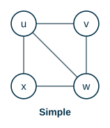 | 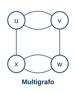 | 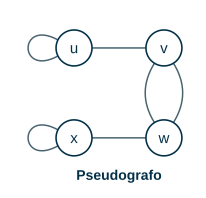 |

Clasifique cada grafo como simple, multigrafo o pseudografo.

| | | | |
|---|---|---|---|
| 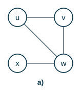 | 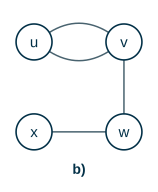 | 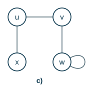 | 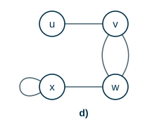 |

:::{admonition} Respuesta
:class: dropdown
a) simple; b) multigrafo (dos aristas entre $u$ y $v$); c) pseudografo (bucle en $w$); d) pseudografo (aristas paralelas entre $v$ y $w$ y bucle en $x$).
:::

## 3. Grado de un vértice

**Grado.** El grado de un vértice $v$ de un grafo no dirigido es el número de aristas incidentes con él, y se denota $\delta(v)$. Un bucle cuenta **dos** veces.

Calcule el grado de cada vértice:

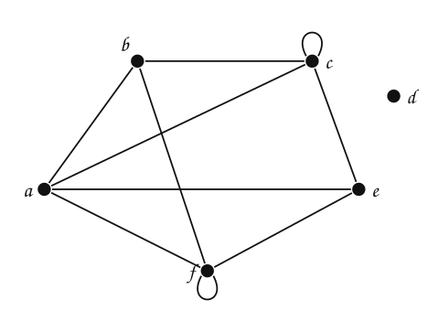

:::{admonition} Respuesta
:class: dropdown
$\delta(a) = 3$, $\delta(b) = 3$, $\delta(c) = 5$, $\delta(d) = 0$, $\delta(e) = 3$, $\delta(f) = 2$.

$d$ no tiene aristas: es un vértice **aislado**. Entre $c$ y $e$ hay dos aristas paralelas, y las dos cuentan.
:::

### Teorema de *handshaking*

Sume los grados de los vértices y compare con el número de aristas $e$:

:::::{admonition} Sumar los grados
:class: dropdown
::::{tab-set}
:::{tab-item} Paso 1
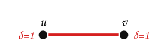

| $e$ | grados | suma |
|---|---|---|
| $\textcolor{#a94700}{\textbf{1}}$ | $\textcolor{#a94700}{\textbf{1 + 1}}$ | $\textcolor{#a94700}{\textbf{2}}$ |

:::
:::{tab-item} Paso 2
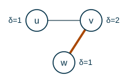

| $e$ | grados | suma |
|---|---|---|
| 1 | 1 + 1 | 2 |
| $\textcolor{#a94700}{\textbf{2}}$ | $\textcolor{#a94700}{\textbf{1 + 2 + 1}}$ | $\textcolor{#a94700}{\textbf{4}}$ |

:::
:::{tab-item} Paso 3
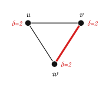

| $e$ | grados | suma |
|---|---|---|
| 1 | 1 + 1 | 2 |
| 2 | 1 + 2 + 1 | 4 |
| $\textcolor{#a94700}{\textbf{3}}$ | $\textcolor{#a94700}{\textbf{2 + 2 + 2}}$ | $\textcolor{#a94700}{\textbf{6}}$ |

:::
:::{tab-item} Paso 4
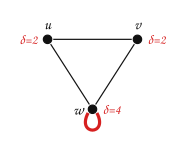

| $e$ | grados | suma |
|---|---|---|
| 1 | 1 + 1 | 2 |
| 2 | 1 + 2 + 1 | 4 |
| 3 | 2 + 2 + 2 | 6 |
| $\textcolor{#a94700}{\textbf{4}}$ | $\textcolor{#a94700}{\textbf{2 + 2 + 4}}$ | $\textcolor{#a94700}{\textbf{8}}$ |

> El bucle en $w$ suma **2** al grado de $w$: la arista toca a $w$ por sus dos extremos.

> **¿Qué relación hay entre la suma de los grados y $e$?**

:::
::::
:::::

:::{admonition} Respuesta
:class: dropdown
La suma de los grados es siempre $2e$. En el grafo de arriba: $3 + 3 + 5 + 0 + 3 + 2 = 16$ y $e = 8$.
:::

**Teorema de *handshaking* (de los apretones de manos).** Sea $G = (V, E)$ un grafo no dirigido con $e$ aristas. Entonces

$$
\sum_{v \in V} \delta(v) = 2e
$$

**Razón.** Cada arista $\{u, v\}$ aporta $1$ al grado de $u$ y $1$ al grado de $v$: aporta exactamente $2$ a la suma. Un bucle aporta $2$ al grado de su único vértice.

**Corolario.** Todo grafo no dirigido tiene un número **par** de vértices de grado impar.

**Razón.** La suma de todos los grados es par ($2e$). Los grados pares suman un número par, así que los grados impares también tienen que sumar un número par, y eso solo pasa si hay una cantidad par de ellos.

Volvamos al problema de la sección 1. $3 + 3 + 3 + 3 + 2 = 14 = 2 \cdot 7$: no hay contradicción, y en efecto existe un grafo con $7$ aristas. $1 + 1 + 1 + 1 + 1 = 5$ es impar: **no existe** ningún grafo con esos grados.

Indique si existen grafos no dirigidos de $5$ vértices con los siguientes grados (se permiten bucles y aristas paralelas):

| Grados | ¿Existe? |
|---|---|
| $3, 3, 3, 3, 2$ | |
| $1, 2, 3, 4, 4$ | |
| $0, 1, 2, 2, 3$ | |
| $1, 2, 3, 4, 5$ | |
| $3, 4, 3, 4, 3$ | |
| $1, 1, 1, 1, 1$ | |

:::{admonition} Respuesta
:class: dropdown
| Grados | Suma | ¿Existe? |
|---|---|---|
| $3, 3, 3, 3, 2$ | $14$ | sí |
| $1, 2, 3, 4, 4$ | $14$ | sí |
| $0, 1, 2, 2, 3$ | $8$ | sí |
| $1, 2, 3, 4, 5$ | $15$ | no |
| $3, 4, 3, 4, 3$ | $17$ | no |
| $1, 1, 1, 1, 1$ | $5$ | no |

Si la suma es par, se puede construir un **pseudografo** con esos grados (los bucles permiten ajustar). Si además se exige un grafo **simple**, la condición no basta: con $1, 2, 3, 4, 4$, los dos vértices de grado $4$ tendrían que ser vecinos de todos los demás, y entonces ningún vértice podría tener grado $1$.
:::

Indique la cantidad de aristas de un grafo si los grados de sus vértices son $4, 5, 5, 2, 2$ y $1, 3, 2, 2, 2, 2, 4$.

:::{admonition} Respuesta
:class: dropdown
$e = 18/2 = 9$ y $e = 16/2 = 8$.
:::

### Grado en un grafo dirigido

**Grado de entrada y de salida.** En un grafo dirigido, el grado de entrada de $v$, $\delta^-(v)$, es el número de aristas que **llegan** a $v$; el grado de salida, $\delta^+(v)$, es el número de aristas que **salen** de $v$. Un bucle suma $1$ a cada uno.

En el grafo dirigido de la sección 2: $\delta^-(a) = 2$, $\delta^+(a) = 3$; $\delta^-(b) = 3$, $\delta^+(b) = 2$; $\delta^-(c) = 2$, $\delta^+(c) = 2$.

**Teorema.** Sea $G = (V, E)$ un grafo dirigido. Entonces

$$
\sum_{v \in V} \delta^-(v) = \sum_{v \in V} \delta^+(v) = |E|
$$

porque cada arista sale de exactamente un vértice y llega a exactamente uno. En el ejemplo: $2 + 3 + 2 = 3 + 2 + 2 = 7$.

## 4. Familias de grafos

**Grafo completo $K_n$.** El grafo simple con $n$ vértices que tiene exactamente una arista entre cada par de vértices distintos.

 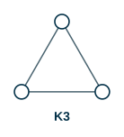 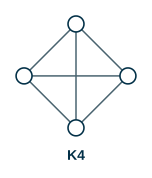 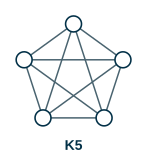 

> **¿Cuántas aristas tiene $K_n$?**

:::{admonition} Respuesta
:class: dropdown
Cada vértice tiene grado $n - 1$. Por *handshaking*: $2e = n(n-1)$, así que $e = \dfrac{n(n-1)}{2} = \binom{n}{2}$. Por ejemplo, $K_5$ tiene $10$ aristas.
:::

**Ciclo $C_n$** ($n \ge 3$). Vértices $v_1, \dots, v_n$ y aristas $\{v_1, v_2\}, \{v_2, v_3\}, \dots, \{v_{n-1}, v_n\}, \{v_n, v_1\}$.

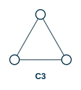 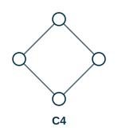 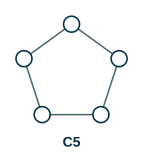 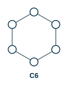

**Rueda $W_n$.** Se obtiene al añadir a $C_n$ un vértice nuevo conectado con cada uno de los $n$ vértices del ciclo.

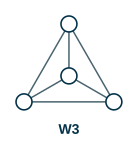 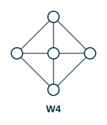 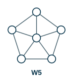 

**Grafo bipartito.** Un grafo simple $G = (V, E)$ es bipartito si $V$ se puede dividir en dos conjuntos disjuntos $V_1$ y $V_2$ tales que cada arista conecta un vértice de $V_1$ con uno de $V_2$: no hay aristas entre dos vértices de $V_1$ ni entre dos de $V_2$.

Indique cuáles de los siguientes grafos son bipartitos. Muestre $V_1$ y $V_2$ para los que lo sean.

| | | | |
|---|---|---|---|
| 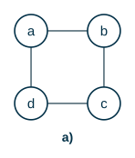 | 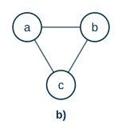 | 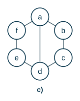 | 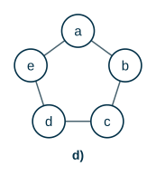 |

:::{admonition} Respuesta
:class: dropdown
- a) Sí: $V_1 = \{a, c\}$, $V_2 = \{b, d\}$.
- b) No: $a$ y $b$ tendrían que estar en conjuntos distintos, $c$ también tendría que ser distinto de los dos, y solo hay dos conjuntos.
- c) Sí: $V_1 = \{a, c, e\}$, $V_2 = \{b, d, f\}$. La arista $\{a, d\}$ no estorba porque $a$ y $d$ están en conjuntos distintos.

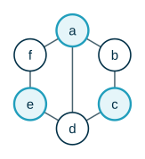

- d) No: es $C_5$. Al alternar los conjuntos alrededor del ciclo, el quinto vértice queda en el mismo conjunto que el primero, y son vecinos.

En general, un grafo es bipartito si y solo si no tiene ciclos de longitud impar.
:::

**Grafo bipartito completo $K_{m,n}$.** El grafo bipartito con $|V_1| = m$ y $|V_2| = n$ en el que cada vértice de $V_1$ está conectado con cada vértice de $V_2$. Tiene $m \cdot n$ aristas.

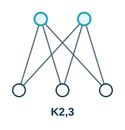 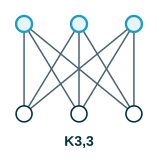 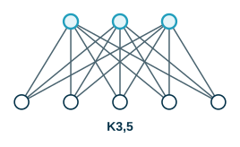

## 5. Grafo complementario y unión

**Grafo complementario.** Sea $G$ un grafo simple con $n$ vértices. Su complementario $\bar{G}$ tiene los mismos vértices que $G$, y dos vértices son adyacentes en $\bar{G}$ si y solo si **no** son adyacentes en $G$.

| | |
|---|---|
| 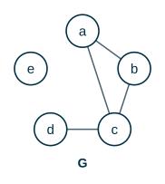 | 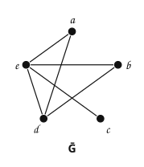 |

Si $G = K_n$, entonces $\bar{G}$ tiene $n$ vértices y ninguna arista: es el **grafo nulo**.

**Unión.** La unión de dos grafos simples $G_1 = (V_1, E_1)$ y $G_2 = (V_2, E_2)$ es el grafo simple $G_1 \cup G_2 = (V_1 \cup V_2,\ E_1 \cup E_2)$.

**Teorema.** Si $G$ es un grafo simple con $n$ vértices, entonces $G \cup \bar{G} = K_n$.

**Demostración.** Cada par de vértices distintos es adyacente en $G$ o en $\bar{G}$ (exactamente en uno de los dos). Por lo tanto, la unión tiene una arista entre cada par de vértices: es $K_n$. $\square$

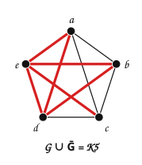

> **Si la secuencia de grados de $G$ es $d_1, d_2, \dots, d_n$, ¿cuál es la de $\bar{G}$?**

:::{admonition} Respuesta
:class: dropdown
$n - 1 - d_1,\ n - 1 - d_2,\ \dots,\ n - 1 - d_n$. En $K_n$ cada vértice tiene grado $n - 1$, y esas aristas se reparten entre $G$ y $\bar{G}$. En el ejemplo ($n = 5$):

|  | $a$ | $b$ | $c$ | $d$ | $e$ |
|---|---|---|---|---|---|
| $\delta_G$ | 2 | 2 | 3 | 1 | 0 |
| $\delta_{\bar G}$ | 2 | 2 | 1 | 3 | 4 |
:::

## Ejercicios

Practique con los [ejercicios de conceptos básicos](exercises.md).

## Fuentes

- Bedoya, O. *Grafos* (definiciones, teorema de *handshaking*, grafos completos, bipartitos). Diapositivas del curso, Universidad del Valle.
- Caicedo Mejía, J. M. *Unidad 5: Grafos* (Grafos 2: grafos complementarios). Computación y Estructuras Discretas I, Universidad Icesi, 2026.
- Rosen, K. H. *Discrete Mathematics and Its Applications*, 7.ª ed. McGraw-Hill, 2011. Secciones 10.1 y 10.2.

---

*Material adaptado del material original del profesor Oscar Bedoya.*
