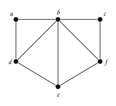
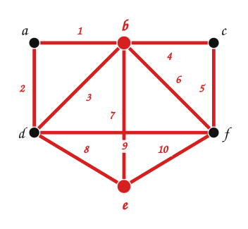

---
# Copyright (c) 2026 Angela Villota, and collaborators from the CyED block
# Licensed under the PolyForm Noncommercial License 1.0.0.
# Commercial use is prohibited without prior written authorization.
title: "Conectividad, Euler y Hamilton: Ejercicios"
---

# Conectividad, Euler y Hamilton: Ejercicios

Use esta página después de leer el [material de estudio](index.md). Cada ejercicio trae **pistas** y una **solución general**; intente resolverlo antes de abrirlas.

---

### Ejercicio 1

¿El siguiente grafo tiene camino de Euler? ¿Circuito de Euler? Si no tiene camino, ¿qué arista se puede **agregar** para que lo tenga? Encuentre el camino en el grafo modificado.

:::{admonition} Pistas
:class: dropdown
- Calcule todos los grados.
- Agregar una arista entre dos vértices de grado impar los vuelve pares a ambos.
- Para el camino, empiece en uno de los dos vértices de grado impar.
:::

:::{admonition} Solución general
:class: dropdown
Grados: $\delta(a) = 2$, $\delta(b) = 5$, $\delta(c) = 2$, $\delta(d) = 3$, $\delta(e) = 3$, $\delta(f) = 3$. Hay cuatro vértices de grado impar ($b, d, e, f$): no tiene camino ni circuito de Euler. Al agregar $\{d, f\}$ quedan dos impares ($b$ y $e$) y existe un camino de Euler de $b$ a $e$, por ejemplo: b, a, d, b, c, f, b, e, d, f, e.

:::

### Ejercicio 2

Muestre que $K_n$ tiene un circuito de Hamilton siempre que $n \ge 3$. ¿Para qué valores de $n$ tiene $K_n$ un circuito de Euler?

:::{admonition} Pistas
:class: dropdown
- En $K_n$ todos los pares de vértices son adyacentes.
- Cada vértice de $K_n$ tiene grado $n - 1$.
:::

:::{admonition} Solución general
:class: dropdown
Con vértices $v_1, \dots, v_n$, el circuito $v_1, v_2, \dots, v_n, v_1$ existe porque todas esas aristas están en $K_n$, y pasa una vez por cada vértice ($n \ge 3$ para que sea un circuito simple). Circuito de Euler: cuando $n - 1$ es par, es decir, cuando $n$ es **impar**.
:::

### Ejercicio 3

¿Para qué valores de $m$ y $n$ tiene $K_{m,n}$ un circuito de Euler? ¿Y un circuito de Hamilton?

:::{admonition} Pistas
:class: dropdown
- En $K_{m,n}$ los vértices de un lado tienen grado $n$ y los del otro, grado $m$.
- Un circuito en un grafo bipartito alterna entre los dos lados.
:::

:::{admonition} Solución general
:class: dropdown
Euler: cuando $m$ y $n$ son **ambos pares**. Hamilton: cuando $m = n \ge 2$, porque el circuito alterna lados y usa la misma cantidad de vértices de cada uno.
:::

### Ejercicio 4

Un grafo dirigido tiene un circuito de Euler (que respeta el sentido de las aristas) si y solo si es fuertemente conexo… y algo más sobre los grados. Enuncie la condición y justifíquela.

:::{admonition} Pistas
:class: dropdown
- Cada vez que el circuito pasa por un vértice, entra por una arista y sale por otra.
:::

:::{admonition} Solución general
:class: dropdown
Debe cumplirse $\delta^-(v) = \delta^+(v)$ para todo $v$ (y que los vértices con aristas formen un grafo fuertemente conexo). Cada paso por $v$ usa una arista de entrada y una de salida.
:::

### Ejercicio 5

Un museo tiene salas conectadas por puertas. Modele el problema de recorrer el museo pasando **una sola vez por cada puerta** y, aparte, el de pasar **una sola vez por cada sala**. ¿Cuál de los dos problemas se puede decidir rápidamente para cualquier museo? Justifique.

---

*Material adaptado del material original de los profesores Oscar Bedoya y Juan Marcos Caicedo Mejía.*
