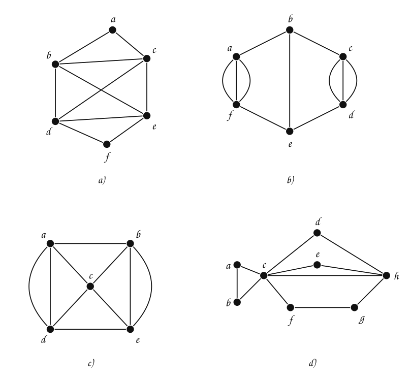
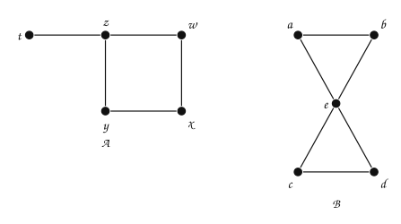
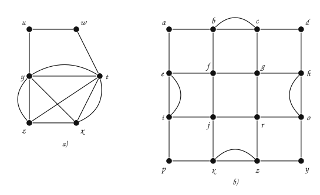
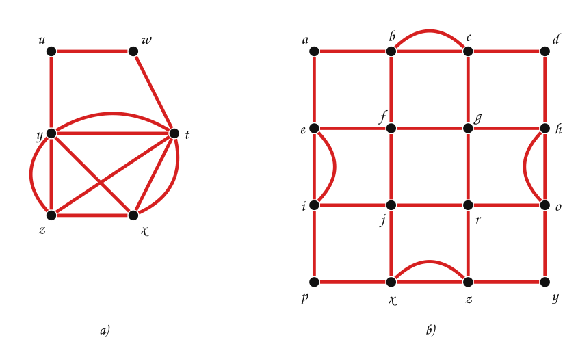
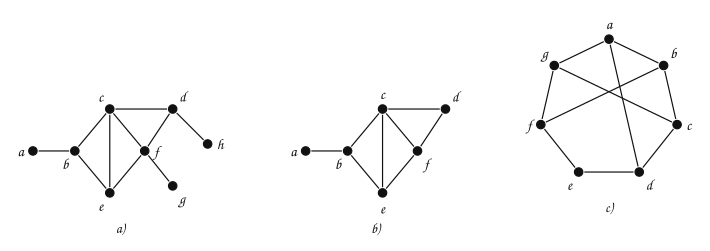

---
# Copyright (c) 2026 Angela Villota, and collaborators from the CyED block
# Licensed under the PolyForm Noncommercial License 1.0.0.
# Commercial use is prohibited without prior written authorization.
title: "Conectividad, Euler y Hamilton: Ejercicios"
---

# Conectividad, Euler y Hamilton: Ejercicios

Use esta página después de leer el [material de estudio](index.md). Cada ejercicio trae **pistas** y una **solución general**; intente resolverlo antes de abrirlas.

---

### Ejercicio 1

Indique si cada grafo tiene un camino de Euler y/o un circuito de Euler. Cuando exista, encuéntrelo.

:::{admonition} Pistas
:class: dropdown
- Calcule los grados; cada arista paralela cuenta por separado.
- Si hay dos vértices de grado impar, el camino empieza en uno y termina en el otro.
:::

:::{admonition} Solución general
:class: dropdown
- a) Grados: $\delta(a) = 2$, $\delta(b) = 4$, $\delta(c) = 4$, $\delta(d) = 4$, $\delta(e) = 4$, $\delta(f) = 2$. Como todos los grados son pares, tiene **circuito** de Euler: $a, c, d, f, e, b, c, e, d, b, a$.
- b) Grados: $\delta(a) = 4$, $\delta(b) = 3$, $\delta(c) = 4$, $\delta(d) = 4$, $\delta(e) = 3$, $\delta(f) = 4$. Como los vértices de grado impar son $b$ y $e$, tiene **camino** de Euler: $b, a, f, a, f, e, b, c, d, c, d, e$.
- c) Grados: $\delta(a) = 4$, $\delta(b) = 4$, $\delta(c) = 4$, $\delta(d) = 4$, $\delta(e) = 4$. Como todos los grados son pares, tiene **circuito** de Euler: $a, b, e, b, c, e, d, c, a, d, a$.
- d) Grados: $\delta(a) = 2$, $\delta(b) = 2$, $\delta(c) = 6$, $\delta(d) = 2$, $\delta(e) = 2$, $\delta(f) = 2$, $\delta(g) = 2$, $\delta(h) = 4$. Como todos los grados son pares, tiene **circuito** de Euler: $a, b, c, d, h, e, c, h, g, f, c, a$.
:::

### Ejercicio 2

Los grafos $A$ y $B$:

¿Tienen camino o circuito de Euler? ¿Camino o circuito de Hamilton?

:::{admonition} Pistas
:class: dropdown
- Para Euler, cuente los vértices de grado impar.
- Para Hamilton, mire los vértices de grado $1$ y los de grado $2$: sus aristas son obligatorias.
:::

:::{admonition} Solución general
:class: dropdown
- $A$: camino de Euler $t, z, w, x, y, z$ (los impares son $t$ y $z$); no hay circuito de Euler. Camino de Hamilton $t, z, y, x, w$; no hay circuito de Hamilton ($t$ tiene grado $1$).
- $B$: circuito de Euler $a, e, c, d, e, b, a$ (todos los grados son pares). Camino de Hamilton $a, b, e, d, c$; no hay circuito de Hamilton: $a, b, c, d$ tienen grado $2$, así que el circuito tendría que usar sus ocho aristas, y $e$ quedaría con cuatro aristas del circuito.
:::

### Ejercicio 3

Encuentre un circuito de Euler en cada grafo.

:::{admonition} Pistas
:class: dropdown
- Verifique primero que todos los grados son pares.
- Si se queda atascado antes de usar todas las aristas, inserte un circuito por las aristas que faltan (algoritmo de Hierholzer).
:::

:::{admonition} Solución general
:class: dropdown
- a) Por ejemplo $z, y, t, y, x, z, t, x, t, w, u, y, z$.
- b) Por ejemplo $a, b, c, b, f, g, c, d, h, g, r, o, h, o, y, z, r, j, x, z, x, p, i, j, f, e, i, e, a$.

Todos los vértices tienen grado par en los dos grafos.
:::

### Ejercicio 4

Indique si cada grafo tiene un camino y/o un circuito de Hamilton.

:::{admonition} Pistas
:class: dropdown
- Un vértice de grado $1$ solo puede ser el inicio o el fin de un camino de Hamilton. ¿Cuántos hay?
:::

:::{admonition} Solución general
:class: dropdown
- a) No tiene camino ni circuito de Hamilton: $a$, $g$ y $h$ tienen grado $1$, y un camino solo tiene dos extremos.
- b) Tiene el camino de Hamilton $a, b, c, d, f, e$. No tiene circuito: $a$ tiene grado $1$.
- c) Tiene el circuito de Hamilton $a, b, c, d, e, f, g, a$, el borde del heptágono.
:::

### Ejercicio 5

¿El siguiente grafo tiene camino de Euler? ¿Circuito de Euler? Si no tiene camino, ¿qué arista se puede **agregar** para que lo tenga? Encuentre el camino en el grafo modificado.

:::{admonition} Pistas
:class: dropdown
- Calcule todos los grados.
- Agregar una arista entre dos vértices de grado impar los vuelve pares a ambos.
:::

:::{admonition} Solución general
:class: dropdown
Grados: $\delta(a) = 2$, $\delta(b) = 5$, $\delta(c) = 2$, $\delta(d) = 3$, $\delta(e) = 3$, $\delta(f) = 3$. Hay cuatro vértices de grado impar ($b, d, e, f$): no tiene camino ni circuito de Euler. Al agregar $\{d, f\}$ quedan dos impares ($b$ y $e$) y existe un camino de Euler de $b$ a $e$, por ejemplo: $b, a, d, b, c, f, b, e, d, f, e$.

:::

### Ejercicio 6

Muestre que $K_n$ tiene un circuito de Hamilton siempre que $n \ge 3$. ¿Para qué valores de $n$ tiene $K_n$ un circuito de Euler?

:::{admonition} Pistas
:class: dropdown
- En $K_n$ todos los pares de vértices son adyacentes.
- Cada vértice de $K_n$ tiene grado $n - 1$.
:::

:::{admonition} Solución general
:class: dropdown
Con vértices $v_1, \dots, v_n$, el circuito $v_1, v_2, \dots, v_n, v_1$ existe porque todas esas aristas están en $K_n$, y pasa una vez por cada vértice ($n \ge 3$ para que sea un circuito simple). Circuito de Euler: cuando $n - 1$ es par, es decir, cuando $n$ es **impar**.
:::

### Ejercicio 7

¿Para qué valores de $m$ y $n$ tiene $K_{m,n}$ un circuito de Euler? ¿Y un circuito de Hamilton?

:::{admonition} Pistas
:class: dropdown
- En $K_{m,n}$ los vértices de un lado tienen grado $n$ y los del otro, grado $m$.
- Un circuito en un grafo bipartito alterna entre los dos lados.
:::

:::{admonition} Solución general
:class: dropdown
Euler: cuando $m$ y $n$ son **ambos pares**. Hamilton: cuando $m = n \ge 2$, porque el circuito alterna lados y usa la misma cantidad de vértices de cada uno.
:::

### Ejercicio 8

Un grafo dirigido tiene un circuito de Euler (que respeta el sentido de las aristas) si y solo si es fuertemente conexo… y algo más sobre los grados. Enuncie la condición y justifíquela.

:::{admonition} Pistas
:class: dropdown
- Cada vez que el circuito pasa por un vértice, entra por una arista y sale por otra.
:::

:::{admonition} Solución general
:class: dropdown
Debe cumplirse $\delta^-(v) = \delta^+(v)$ para todo $v$ (y que los vértices con aristas formen un grafo fuertemente conexo). Cada paso por $v$ usa una arista de entrada y una de salida.
:::

### Ejercicio 9

Un museo tiene salas conectadas por puertas. Modele el problema de recorrer el museo pasando **una sola vez por cada puerta** y, aparte, el de pasar **una sola vez por cada sala**. ¿Cuál de los dos problemas se puede decidir rápidamente para cualquier museo? Justifique.

---

*Material adaptado del material original del profesor Oscar Bedoya.*
