---
# Copyright (c) 2026 Angela Villota, and collaborators from the CyED block
# Licensed under the PolyForm Noncommercial License 1.0.0.
# Commercial use is prohibited without prior written authorization.
title: "Unidad 5: Conectividad, caminos de Euler y de Hamilton"
---

# Unidad 5: Conectividad, caminos de Euler y de Hamilton

Algunos ejemplos se desarrollan en desplegables con pestañas **Paso 1, Paso 2, …**: cada paso conserva lo anterior y muestra lo nuevo **en color**. En las figuras de caminos, los números indican el orden en que se recorren las aristas.

## 1. El problema

La ciudad de Königsberg (hoy Kaliningrado) tenía siete puentes que unían cuatro zonas: las dos orillas del río ($B$ y $C$), una isla ($A$) y otra zona ($D$). Los habitantes se preguntaban:

**¿Es posible dar un paseo que comience en cualquiera de las zonas, cruce cada puente exactamente una vez y regrese al punto de partida?**

Euler (1736) representó cada zona con un vértice y cada puente con una arista:

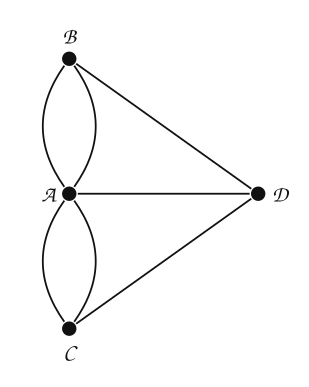

Intente encontrar el paseo antes de seguir. La respuesta está en la sección 4.

## 2. Caminos

**Camino.** Una trayectoria que comienza en un vértice $v_0$ y termina en un vértice $v_n$, en la que se pueden repetir aristas y vértices. Se escribe como la sucesión de vértices $v_0, v_1, \dots, v_n$ o como la de aristas $(v_0, v_1), (v_1, v_2), \dots, (v_{n-1}, v_n)$.

- **Longitud** de un camino: el número de aristas que recorre. Un camino de longitud $n$ tiene $n + 1$ vértices (contando repeticiones).
- **Camino simple:** no repite aristas.
- **Camino cerrado:** comienza y termina en el mismo vértice; puede repetir aristas y vértices.
- **Circuito simple:** camino cerrado que no repite aristas.

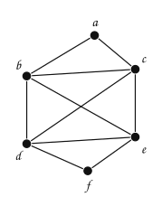

:::::{admonition} Caminos en el grafo
:class: dropdown
::::{tab-set}
:::{tab-item} Paso 1
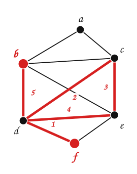

> Un camino **simple** de longitud $4$ que empieza en $b$: $b, a, c, e, f$. No repite aristas (ni vértices).

:::
:::{tab-item} Paso 2
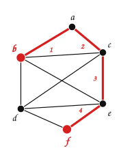

> Un camino **cerrado** de longitud $5$ que empieza en $f$: $f, d, c, d, e, f$. Repite la arista $\{c, d\}$, así que no es un circuito simple.

:::
:::{tab-item} Paso 3
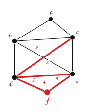

> Un camino de longitud $5$ de $d$ a $d$… y que repite aristas: $d, b, c, b, c, d$.

:::
:::{tab-item} Paso 4
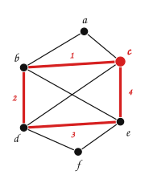

> Un **circuito simple** de longitud $4$ que empieza en $c$: $c, b, d, e, c$.

:::
::::
:::::

## 3. Conexidad

**Grafo conexo.** Un grafo no dirigido $G = (V, E)$ es conexo si para cualquier par de vértices $a, b \in V$ existe un camino entre ellos.

| | |
|---|---|
| 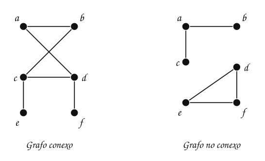 | 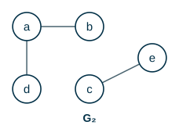 |

$G_1$ es conexo. $G_2$ no lo es: no hay camino de $a$ a $c$. Las partes conexas maximales de un grafo son sus **componentes conexas**; $G_2$ tiene dos: $\{a, b, d\}$ y $\{c, e\}$.

### Grafos dirigidos

- **Fuertemente conexo:** para cualquier par de vértices $a$ y $b$ hay un camino de $a$ a $b$ **y** uno de $b$ a $a$.
- **Débilmente conexo:** hay un camino entre cada par de vértices en el **grafo no dirigido subyacente** (el que resulta al ignorar el sentido de las aristas).

| | |
|---|---|
| 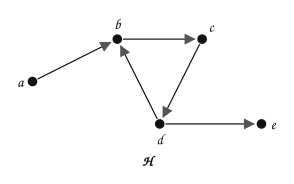 | 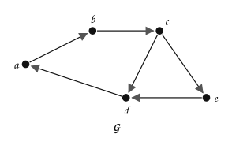 |

> **¿Cuál es fuertemente conexo?**

:::{admonition} Respuesta
:class: dropdown
- $G$ es **fuertemente conexo**: el circuito $a \to b \to c \to d \to a$ pasa por $a, b, c, d$, y $e$ se alcanza con $c \to e$ y regresa con $e \to d$.
- $H$ es solo **débilmente conexo**: sin sentidos es conexo, pero ninguna arista entra a $a$ (no se puede llegar a $a$) y ninguna sale de $e$ (desde $e$ no se llega a nada).
:::

**Componentes fuertemente conexas.** Los subgrafos maximales que son fuertemente conexos. $H$ tiene tres: $\{a\}$, $\{b, c, d\}$ y $\{e\}$.

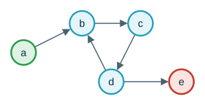

**Grafo acíclico dirigido** (DAG). Un grafo dirigido sin circuitos. Sus componentes fuertemente conexas son todas de un solo vértice.

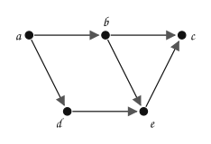

## 4. Caminos y circuitos de Euler

**Circuito de Euler.** Un circuito simple que pasa **exactamente una vez por cada arista** del grafo.
**Camino de Euler.** Un camino simple que pasa exactamente una vez por cada arista.

Se pueden repetir **vértices**, pero no aristas.

| | |
|---|---|
| 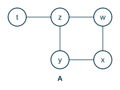 | 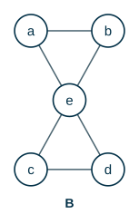 |

> **¿Tienen camino o circuito de Euler?**

:::{admonition} Respuesta
:class: dropdown
En $A$ hay un camino de Euler: $t, z, w, x, y, z$. No hay circuito: el camino tiene que empezar o terminar en $t$, que tiene una sola arista.

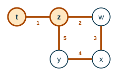

En $B$ hay un circuito de Euler: $a, e, c, d, e, b, a$.

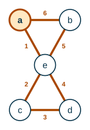
:::

Fíjese en los grados. En $A$: $\delta(t) = 1$, $\delta(z) = 3$ y los demás tienen grado $2$; hay **dos** vértices de grado impar, y el camino va de uno al otro. En $B$: $\delta(e) = 4$ y los demás tienen grado $2$; **todos** son pares.

**Teorema (Euler).** Un multigrafo conexo (con al menos dos vértices):

- tiene un **circuito** de Euler si y solo si **todos** sus vértices tienen grado par;
- tiene un **camino** de Euler que no es circuito si y solo si tiene **exactamente dos** vértices de grado impar. El camino empieza en uno de ellos y termina en el otro.

**Razón (de la parte «solo si»).** Cada vez que el camino pasa por un vértice intermedio, entra por una arista y sale por otra: usa $2$ aristas de ese vértice. Si el camino es cerrado, también el vértice inicial queda emparejado (sale al principio, entra al final). Solo el inicio y el fin de un camino abierto usan un número impar de aristas.

Volvamos a Königsberg:

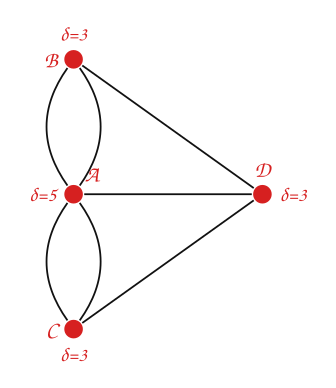

Los cuatro vértices tienen grado impar: **no hay circuito de Euler** (ni siquiera un camino de Euler). El paseo es imposible.

Indique si cada grafo tiene camino y/o circuito de Euler:

| | | |
|---|---|---|
| 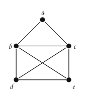 | 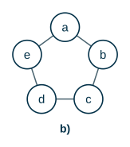 | 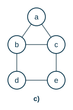 |

:::{admonition} Respuesta
:class: dropdown
- a) $K_4$: los cuatro vértices tienen grado $3$. Ni camino ni circuito.
- b) $C_5$: todos tienen grado $2$. Tiene circuito de Euler (el ciclo mismo).
- c) $\delta(b) = \delta(c) = 3$ y los demás tienen grado $2$. Tiene camino de Euler de $b$ a $c$, pero no circuito: b, a, c, b, d, e, c.

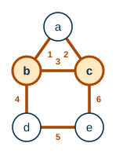
:::

### Construir un circuito de Euler

El teorema dice **cuándo** existe el circuito. Para **encontrarlo** sirve el algoritmo de Hierholzer: caminar sin repetir aristas hasta volver al inicio; si quedan aristas sin usar, partir de un vértice del circuito que tenga alguna, recorrer otro circuito e insertarlo.

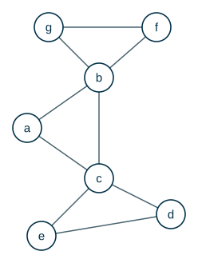

:::::{admonition} Construir un circuito de Euler
:class: dropdown
::::{tab-set}
:::{tab-item} Paso 1
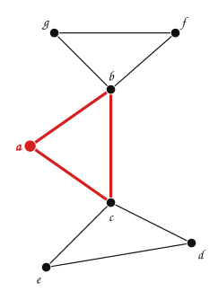

> Se parte de $a$ y se camina por aristas no usadas hasta que no se pueda seguir: $a, b, c, a$. Se quedó atascado en $a$ (todas sus aristas están usadas), pero $b$ y $c$ todavía tienen aristas sin usar.

$$
\textcolor{#a94700}{a, b, c, a}
$$

:::
:::{tab-item} Paso 2
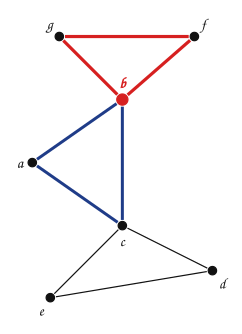

> Desde $b$, que está en el circuito y tiene aristas sin usar, se recorre otro circuito: $b, f, g, b$. Se **inserta** en el circuito en el lugar de $b$.

$$
\textcolor{#a94700}{a, b, f, g, b, c, a}
$$

:::
:::{tab-item} Paso 3
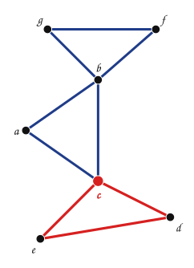

> Desde $c$, que está en el circuito y tiene aristas sin usar, se recorre otro circuito: $c, d, e, c$. Se **inserta** en el circuito en el lugar de $c$. Ya no quedan aristas sin usar.

$$
\textcolor{#a94700}{a, b, f, g, b, c, d, e, c, a}
$$

:::
::::
:::::

## 5. Caminos y circuitos de Hamilton

**Camino de Hamilton.** Un camino simple que pasa **exactamente una vez por cada vértice**.
**Circuito de Hamilton.** Un circuito simple que pasa exactamente una vez por cada vértice (y regresa al inicial).

Formalmente: el camino $x_0, x_1, \dots, x_n$ en $G = (V, E)$ es de Hamilton si $V = \{x_0, x_1, \dots, x_n\}$ y $x_i \neq x_j$ para $0 \le i < j \le n$; el circuito $x_0, x_1, \dots, x_n, x_0$ ($n > 0$) es de Hamilton si $x_0, x_1, \dots, x_n$ es un camino de Hamilton.

Los grafos $A$ y $B$ de la sección 4:

| | |
|---|---|
| 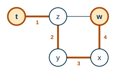 | 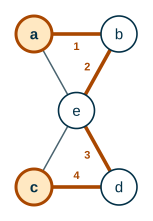 |

$A$ tiene el camino de Hamilton $t, z, y, x, w$ y $B$ tiene el camino de Hamilton $a, b, e, d, c$. **Ninguno** tiene circuito de Hamilton.

> **¿Por qué $B$ no tiene circuito de Hamilton?**

:::{admonition} Respuesta
:class: dropdown
$a$, $b$, $c$ y $d$ tienen grado $2$, así que un circuito de Hamilton tendría que usar **todas** sus aristas. Pero entonces $e$ quedaría con $4$ aristas del circuito ($e-a$, $e-b$, $e-c$, $e-d$), y en un circuito cada vértice usa exactamente $2$.
:::

> **¿Tiene este grafo un circuito de Hamilton?**

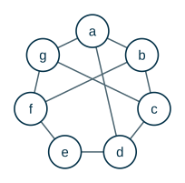

:::{admonition} Respuesta
:class: dropdown
Sí: $a, b, c, d, e, f, g, a$ (el borde del heptágono).

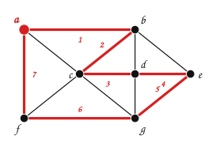
:::

A diferencia de Euler, **no se conoce** una condición sencilla (como «todos los grados pares») que diga si un grafo tiene un circuito de Hamilton, ni un algoritmo eficiente para encontrarlo. Hay condiciones **suficientes**:

**Teorema (Dirac).** Si $G$ es un grafo simple con $n \ge 3$ vértices y $\delta(v) \ge n/2$ para todo vértice $v$, entonces $G$ tiene un circuito de Hamilton.

### Euler y Hamilton

| | Euler | Hamilton |
|---|---|---|
| Pasa exactamente una vez por cada… | **arista** | **vértice** |
| ¿Puede repetir vértices? | sí | no |
| ¿Cuándo existe el circuito? | conexo y todos los grados pares | no hay condición sencilla |
| ¿Cómo encontrarlo? | Hierholzer, tiempo $O(E)$ | no se conoce un algoritmo eficiente |

Los dos circuitos especiales son circuitos simples, y los dos caminos especiales son caminos simples.

## Ejercicios

Practique con los [ejercicios de conectividad, Euler y Hamilton](exercises.md).

## Fuentes

- Caicedo Mejía, J. M. *Unidad 5: Grafos* (Grafos 2: conectividad, circuitos de Euler y Hamilton). Computación y Estructuras Discretas I, Universidad Icesi, 2026.
- Bedoya, O. *Grafos: camino y circuito de Euler, camino y circuito de Hamilton*. Diapositivas del curso, Universidad del Valle.
- Rosen, K. H. *Discrete Mathematics and Its Applications*, 7.ª ed. McGraw-Hill, 2011. Secciones 10.4 y 10.5.

---

*Material adaptado del material original de los profesores Oscar Bedoya y Juan Marcos Caicedo Mejía.*
