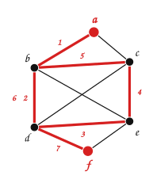
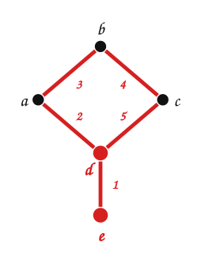
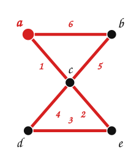
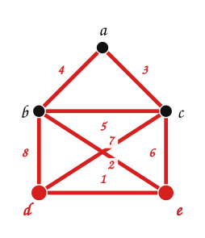
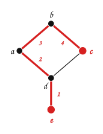
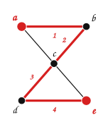
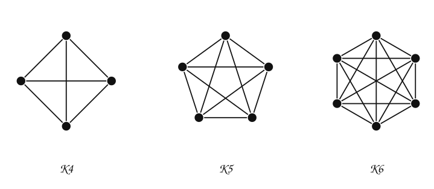

---
# Copyright (c) 2026 Angela Villota, and collaborators from the CyED block
# Licensed under the PolyForm Noncommercial License 1.0.0.
# Commercial use is prohibited without prior written authorization.
title: "Unidad 5: Conectividad, caminos de Euler y de Hamilton"
---

# Unidad 5: Conectividad, caminos de Euler y de Hamilton

En las figuras de caminos, los números indican el orden en que se recorren las aristas.

## 1. El problema

La ciudad de Königsberg (hoy Kaliningrado) tenía siete puentes que unían cuatro zonas: las dos orillas del río ($B$ y $C$), una isla ($A$) y otra zona ($D$). Los habitantes se preguntaban:

**¿Es posible dar un paseo que comience en cualquiera de las zonas, cruce cada puente exactamente una vez y regrese al punto de partida?**

Euler (1736) representó cada zona con un vértice y cada puente con una arista:

Intente encontrar el paseo antes de seguir. La respuesta está en la sección 4.

## 2. Caminos

**Camino.** Una trayectoria que comienza en un vértice $v_0$ y termina en un vértice $v_n$, en la que se pueden repetir aristas y vértices. Se escribe como la sucesión de vértices $v_0, v_1, \dots, v_n$ o como la de aristas $(v_0, v_1), (v_1, v_2), \dots, (v_{n-1}, v_n)$.

**Camino simple.** Un camino que **no repite aristas**.

**Circuito** (o camino cerrado). Un camino que comienza y termina en el mismo vértice; puede repetir aristas y vértices.

**Circuito simple.** Un circuito que no repite aristas.

La **longitud** de un camino es el número de aristas que recorre: un camino de longitud $n$ tiene $n + 1$ vértices, contando repeticiones.

:::::{admonition} Caminos en el grafo
:class: dropdown
::::{tab-set}
:::{tab-item} Paso 1

> Un **camino**: $a, b, d, e, c, b, d, f$. Repite la arista $\{b, d\}$ y los vértices $b$ y $d$: está permitido.

:::
:::{tab-item} Paso 2

> Un **camino simple**: $f, d, c, e, d, b$. Repite el vértice $d$, pero no repite aristas.

:::
:::{tab-item} Paso 3

> Un camino simple de longitud $4$ que empieza en $b$: $b, a, c, e, f$.

:::
:::{tab-item} Paso 4

> Un **circuito** de longitud $5$ que empieza en $f$: $f, d, c, d, e, f$. Repite la arista $\{c, d\}$, así que no es un circuito simple.

:::
:::{tab-item} Paso 5

> Un **circuito simple** de longitud $4$ que empieza en $c$: $c, b, d, e, c$.

:::
::::
:::::

## 3. Conexidad

**Grafo conexo.** Un grafo no dirigido $G = (V, E)$ es conexo si para cualquier par de vértices $a, b \in V$ existe un camino entre ellos.

El primero es conexo. El segundo no lo es: por ejemplo, no hay camino de $a$ a $d$. Las partes conexas maximales de un grafo son sus **componentes conexas**; el segundo tiene dos: $\{a, b, c\}$ y $\{d, e, f\}$.

### Grafos dirigidos

- **Fuertemente conexo:** para cualquier par de vértices $a$ y $b$ hay un camino de $a$ a $b$ **y** uno de $b$ a $a$.
- **Débilmente conexo:** hay un camino entre cada par de vértices en el **grafo no dirigido subyacente** (el que resulta al ignorar el sentido de las aristas).

| | |
|---|---|
|  |  |

> **¿Cuál es fuertemente conexo?**

:::{admonition} Respuesta
:class: dropdown
- $G$ es **fuertemente conexo**: el circuito $a \to b \to c \to d \to a$ pasa por $a, b, c, d$, y $e$ se alcanza con $c \to e$ y regresa con $e \to d$.
- $H$ es solo **débilmente conexo**: sin sentidos es conexo, pero ninguna arista entra a $a$ (no se puede llegar a $a$) y ninguna sale de $e$ (desde $e$ no se llega a nada).
:::

**Componentes fuertemente conexas.** Los subgrafos maximales que son fuertemente conexos. $H$ tiene tres: $\{a\}$, $\{b, c, d\}$ y $\{e\}$.

**Grafo acíclico dirigido** (DAG). Un grafo dirigido sin circuitos. Sus componentes fuertemente conexas son todas de un solo vértice.

## 4. Caminos y circuitos de Euler

**Camino de Euler.** Un camino simple que pasa **exactamente una vez por cada arista** del grafo: no se pueden repetir aristas.
**Circuito de Euler.** Un circuito simple que pasa exactamente una vez por cada arista del grafo.

Se pueden repetir **vértices**, pero no aristas.

| | |
|---|---|
|  |  |
| Camino de Euler: $e, d, a, b, c, d$ | Circuito de Euler: $a, c, e, d, c, b, a$ |

Fíjese en los grados. En el primero, $\delta(d) = 3$, $\delta(e) = 1$ y los demás tienen grado $2$: hay **dos** vértices de grado impar, y el camino va de uno al otro. En el segundo, $\delta(c) = 4$ y los demás tienen grado $2$: **todos** son pares.

**Teorema.** Sea $G$ un grafo no dirigido. $G$ tiene un **camino** de Euler si, y solo si, es conexo y tiene **dos** vértices de grado impar. El camino empieza en uno de ellos y termina en el otro.

**Teorema.** Sea $G$ un grafo no dirigido. $G$ tiene un **circuito** de Euler si, y solo si, es conexo y **todos** sus vértices tienen grado par.

Los dos valen también para multigrafos y pseudografos (un bucle suma $2$ al grado).

**Razón (de la parte «solo si»).** Cada vez que el camino pasa por un vértice intermedio, entra por una arista y sale por otra: usa $2$ aristas de ese vértice. Si el camino es cerrado, también el vértice inicial queda emparejado (sale al principio, entra al final). Solo el inicio y el fin de un camino abierto usan un número impar de aristas.

Indique si el siguiente grafo tiene un camino de Euler y/o un circuito de Euler:

:::{admonition} Respuesta
:class: dropdown
Grados: $\delta(a) = 2$, $\delta(b) = 4$, $\delta(c) = 4$, $\delta(d) = 3$, $\delta(e) = 3$. Hay dos vértices de grado impar, $d$ y $e$: tiene **camino** de Euler, de $e$ a $d$, pero **no** circuito.

Camino de Euler: $e, d, c, a, b, c, e, b, d$.
:::

### El problema de los puentes de Königsberg

Volvamos a la pregunta de la sección 1:

> **¿Hay un circuito de Euler? ¿Hay un camino de Euler?**

:::{admonition} Respuesta
:class: dropdown
Los cuatro vértices tienen grado impar. No hay circuito de Euler (haría falta que todos fueran pares) ni camino de Euler (haría falta que fueran exactamente dos). **El paseo es imposible**, empiece donde empiece.
:::

### Construir un circuito de Euler

El teorema dice **cuándo** existe el circuito. Para **encontrarlo** sirve el algoritmo de Hierholzer: caminar sin repetir aristas hasta volver al inicio; si quedan aristas sin usar, partir de un vértice del circuito que tenga alguna, recorrer otro circuito e insertarlo.

:::::{admonition} Construir un circuito de Euler
:class: dropdown
::::{tab-set}
:::{tab-item} Paso 1

> Se parte de $a$ y se camina por aristas no usadas hasta que no se pueda seguir: $a, b, c, a$. Se quedó atascado en $a$ (todas sus aristas están usadas), pero $b$ y $c$ todavía tienen aristas sin usar.

$$
\textcolor{#a94700}{a, b, c, a}
$$

:::
:::{tab-item} Paso 2

> Desde $b$, que está en el circuito y tiene aristas sin usar, se recorre otro circuito: $b, f, g, b$. Se **inserta** en el circuito en el lugar de $b$.

$$
\textcolor{#a94700}{a, b, f, g, b, c, a}
$$

:::
:::{tab-item} Paso 3

> Desde $c$, que está en el circuito y tiene aristas sin usar, se recorre otro circuito: $c, d, e, c$. Se **inserta** en el circuito en el lugar de $c$. Ya no quedan aristas sin usar.

$$
\textcolor{#a94700}{a, b, f, g, b, c, d, e, c, a}
$$

:::
::::
:::::

## 5. Caminos y circuitos de Hamilton

**Camino de Hamilton.** Un camino simple que pasa **exactamente una vez por cada vértice** del grafo: no se pueden repetir vértices.
**Circuito de Hamilton.** Un circuito simple que pasa exactamente una vez por cada vértice del grafo (y regresa al inicial).

Formalmente: el camino $x_0, x_1, \dots, x_n$ en $G = (V, E)$ es de Hamilton si $V = \{x_0, x_1, \dots, x_n\}$ y $x_i \neq x_j$ para $0 \le i < j \le n$; el circuito $x_0, x_1, \dots, x_n, x_0$ ($n > 0$) es de Hamilton si $x_0, x_1, \dots, x_n$ es un camino de Hamilton.

Los dos grafos de la sección 4:

| | |
|---|---|
|  |  |
| Camino de Hamilton: $e, d, a, b, c$ | Camino de Hamilton: $a, b, c, d, e$ |

> **¿Por qué el segundo no tiene circuito de Hamilton?**

:::{admonition} Respuesta
:class: dropdown
Todo circuito que pase por $a$ y por $b$ tiene que pasar por $c$ para llegar a $d$ y a $e$, y luego volver a pasar por $c$ para regresar: repite $c$. En el primero, $e$ tiene una sola arista: un circuito no puede pasar por $e$.
:::

> **Indique cuáles de estos grafos tienen caminos y/o circuitos de Hamilton.**

:::{admonition} Respuesta
:class: dropdown
$K_4$, $K_5$ y $K_6$ tienen circuitos de Hamilton (y por lo tanto caminos): como todos los vértices son adyacentes, se pueden visitar en cualquier orden y volver al primero.
:::

Indique si el siguiente grafo tiene un camino y/o un circuito de Hamilton:

:::{admonition} Respuesta
:class: dropdown
Tiene el circuito de Hamilton $a, b, c, d, e, g, f, a$ (y por lo tanto también un camino).

:::

A diferencia de Euler, **no se conoce** una condición sencilla (como «todos los grados pares») que diga si un grafo tiene un circuito de Hamilton, ni un algoritmo eficiente para encontrarlo. Hay condiciones **suficientes**:

**Teorema (Dirac).** Si $G$ es un grafo simple con $n \ge 3$ vértices y $\delta(v) \ge n/2$ para todo vértice $v$, entonces $G$ tiene un circuito de Hamilton.

### Euler y Hamilton

| | Euler | Hamilton |
|---|---|---|
| Pasa exactamente una vez por cada… | **arista** | **vértice** |
| ¿Puede repetir vértices? | sí | no |
| ¿Cuándo existe el circuito? | conexo y todos los grados pares | no hay condición sencilla |
| ¿Cómo encontrarlo? | Hierholzer, tiempo $O(E)$ | no se conoce un algoritmo eficiente |

Los dos circuitos especiales son circuitos simples, y los dos caminos especiales son caminos simples.

## Ejercicios

Practique con los [ejercicios de conectividad, Euler y Hamilton](exercises.md).

## Fuentes

- Bedoya, O. *Grafos: camino, camino simple, circuito, grafo conexo, camino y circuito de Euler, puentes de Königsberg, camino y circuito de Hamilton; conexidad de grafos dirigidos*. Diapositivas del curso, Universidad del Valle.
- Rosen, K. H. *Discrete Mathematics and Its Applications*, 7.ª ed. McGraw-Hill, 2011. Secciones 10.4 y 10.5.

---

*Material adaptado del material original del profesor Oscar Bedoya.*
