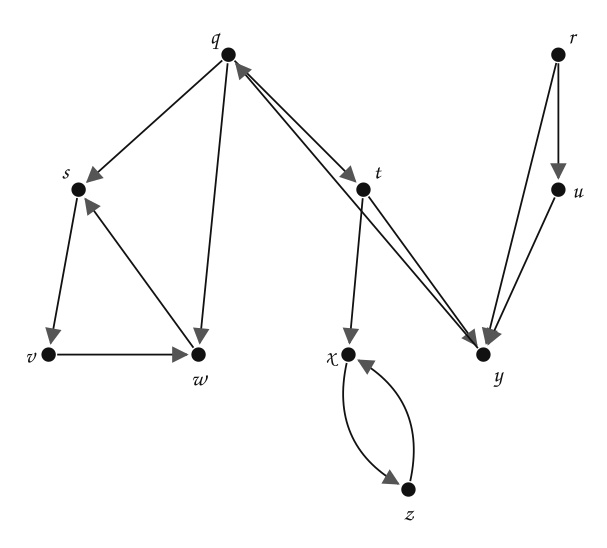
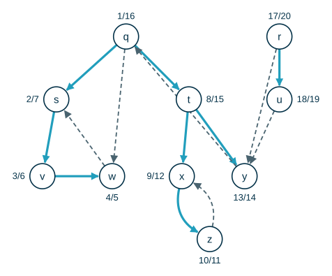
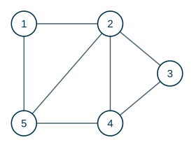

---
# Copyright (c) 2026 Angela Villota, and collaborators from the CyED block
# Licensed under the PolyForm Noncommercial License 1.0.0.
# Commercial use is prohibited without prior written authorization.
title: "DFS: Ejercicios"
---

# DFS: Ejercicios

Use esta página después de leer el [material de estudio de DFS](index.md). Cada ejercicio trae **pistas** y una **solución general**; intente resolverlo antes de abrirlas.

---

### Ejercicio 1

Muestre cómo funciona DFS en el siguiente grafo, empezando por $q$. Para el ciclo de las líneas 5–7 de `DFS(G)` y para cada lista de adyacencia, considere los vértices en orden alfabético. Muestre los tiempos de descubrimiento y finalización, y clasifique cada arista.



:::{admonition} Pistas
:class: dropdown
- Desde $q$, el primer vecino en orden alfabético es $s$; desde $s$, el único es $v$.
- Cuando la búsqueda desde $q$ termina, el siguiente vértice blanco en orden alfabético inicia un segundo árbol.
- Para clasificar $(u, v)$ mire el color de $v$ en el instante en que se explora la arista; si es negro, compare $u.d$ con $v.d$.
:::

:::{admonition} Solución general
:class: dropdown
|  | $q$ | $r$ | $s$ | $t$ | $u$ | $v$ | $w$ | $x$ | $y$ | $z$ |
|---|---|---|---|---|---|---|---|---|---|---|
| $d$ | 1 | 17 | 2 | 8 | 18 | 3 | 4 | 9 | 13 | 10 |
| $f$ | 16 | 20 | 7 | 15 | 19 | 6 | 5 | 12 | 14 | 11 |
| $\pi$ | NIL | NIL | q | q | r | s | v | t | t | x |



Hay dos árboles DF: uno con raíz $q$ (tiempos $1$ a $16$) y otro con raíz $r$ (tiempos $17$ a $20$).

| Arista | Tipo |
|---|---|
| $(q, s)$ | de árbol (T) |
| $(q, w)$ | de avance (F) |
| $(q, t)$ | de árbol (T) |
| $(r, u)$ | de árbol (T) |
| $(r, y)$ | de cruce (C) |
| $(s, v)$ | de árbol (T) |
| $(t, x)$ | de árbol (T) |
| $(t, y)$ | de árbol (T) |
| $(u, y)$ | de cruce (C) |
| $(v, w)$ | de árbol (T) |
| $(w, s)$ | de retorno (B) |
| $(x, z)$ | de árbol (T) |
| $(y, q)$ | de retorno (B) |
| $(z, x)$ | de retorno (B) |

Estructura de paréntesis:

```text
(q (s (v (w w) v) s) (t (x (z z) x) (y y) t) q) (r (u u) r)
```
:::

### Ejercicio 2

Corra DFS sobre el grafo no dirigido del Ejemplo 3, ahora empezando por el vértice $3$ (luego, si quedan vértices blancos, en orden $1, 2, 4, 5$). Listas de adyacencia en orden numérico. Muestre $d$, $f$ y $\pi$, y escriba la estructura de paréntesis.



:::{admonition} Pistas
:class: dropdown
- Los vecinos de $3$ son $2$ y $4$; se baja primero por $2$.
- En un grafo conexo, una sola llamada desde $3$ alcanza a todos los vértices.
:::

:::{admonition} Solución general
:class: dropdown
|  | $1$ | $2$ | $3$ | $4$ | $5$ |
|---|---|---|---|---|---|
| $d$ | 3 | 2 | 1 | 5 | 4 |
| $f$ | 8 | 9 | 10 | 6 | 7 |
| $\pi$ | 2 | 3 | NIL | 5 | 1 |

```text
(3 (2 (1 (5 (4 4) 5) 1) 2) 3)
```

El árbol DF vuelve a ser un camino, ahora $3 - 2 - 1 - 5 - 4$.
:::

### Ejercicio 3

Explique por qué en un grafo **no dirigido** DFS nunca produce aristas de avance ni de cruce.

:::{admonition} Pistas
:class: dropdown
- Tome una arista $\{u, v\}$ y suponga, sin pérdida de generalidad, que $u.d < v.d$.
- Use el teorema del camino blanco: en el instante $u.d$, ¿qué color tiene $v$?
:::

:::{admonition} Solución general
:class: dropdown
Como $u.d < v.d$ y $v$ es vecino de $u$, $v$ es blanco en el instante $u.d$ y la arista $\{u, v\}$ es un camino blanco: $v$ será descendiente de $u$ y terminará antes que $u$. Si la arista se explora primero desde $u$, $v$ todavía es blanco y la arista es **de árbol**. Si se explora primero desde $v$, $u$ todavía es gris y la arista es **de retorno**. No queda espacio para F ni C.
:::

### Ejercicio 4

Dé un grafo dirigido y un vértice $u$ tal que $u$ termine en un árbol DF que contiene **solo** a $u$, aunque $u$ tenga aristas que entran y aristas que salen.

:::{admonition} Pistas
:class: dropdown
- Si cuando se descubre $u$ todos sus vecinos de salida ya son negros, $u$ no descubre a nadie.
- Para que $u$ sea raíz, nadie debe haberlo descubierto antes: piense en el orden del ciclo de `DFS(G)`.
:::

:::{admonition} Solución general
:class: dropdown
Con vértices $w, u, v$ y aristas $(w, w)$, $(u, w)$ y $(v, u)$, recorriendo en el orden $w, u, v$: la primera búsqueda solo visita $w$; la segunda empieza en $u$, cuyo único vecino de salida, $w$, ya es negro, así que el árbol es solo $\{u\}$; la tercera empieza en $v$, y la arista $(v, u)$ es de cruce.
:::

### Ejercicio 5

Escriba en Java un método `boolean tieneCircuito()` para la clase `DFS` de la sección 6, que decida si el grafo dirigido tiene un circuito. Pruébelo con el grafo del Ejemplo 2 y con el grafo de la ropa de la sección 5.

---

*Material adaptado del material original de los profesores Andrés Aristizábal, Marlon Gómez y Oscar Bedoya.*
