---
# Copyright (c) 2026 Angela Villota, and collaborators from the CyED block
# Licensed under the PolyForm Noncommercial License 1.0.0.
# Commercial use is prohibited without prior written authorization.
title: "Unidad 5: Recorrido en profundidad (DFS)"
---

# Unidad 5: Recorrido en profundidad (DFS)

Los ejemplos se desarrollan en desplegables con pestañas **Paso 1, Paso 2, …**: cada paso conserva lo anterior y muestra lo nuevo **en color**.

## 1. El problema

Usted está dentro de un laberinto con un ovillo de hilo. Cada cruce es un vértice y cada pasillo es una arista. **¿Cómo recorrer todos los cruces sin perderse y sin dar vueltas para siempre?**

Una estrategia natural:

1. Tome un pasillo que lleve a un cruce **nuevo** y siga avanzando todo lo que pueda.
2. Cuando no haya pasillos hacia cruces nuevos, **regrese** por el hilo al cruce anterior y vuelva al paso 1 desde allí.

Esa es la idea del recorrido en profundidad. En BFS se avanzaba por capas usando una cola; aquí se avanza por un camino hasta el fondo, y el «hilo» es una **pila** (la pila de llamadas de la recursión).

**Recorrido en profundidad (DFS, *depth-first search*).** Se explora siempre desde el vértice descubierto **más recientemente** que todavía tenga aristas sin explorar; cuando no le quedan, se regresa al vértice desde el que fue descubierto.

### Ejemplo 1

El mismo árbol que se usó en BFS, desde la raíz $A$, con los hijos revisados de izquierda a derecha. Junto a cada vértice se anotan dos tiempos: $d$, cuando se **descubre**, y $f$, cuando se **termina** (ya no tiene vecinos por explorar). Un vértice con solo $d$ (por ejemplo `3/`) está en proceso.

:::::{admonition} Recorrido DFS desde A
:class: dropdown
::::{tab-set}
:::{tab-item} Paso 1
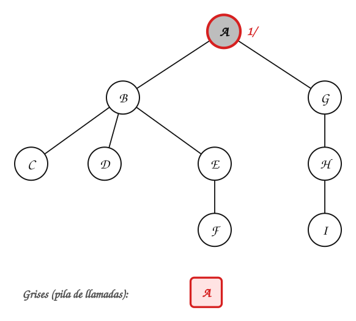

> Se inicia una búsqueda desde $A$: tiempo $1$, $A.d = 1$. $A$ queda gris.

:::
:::{tab-item} Paso 2
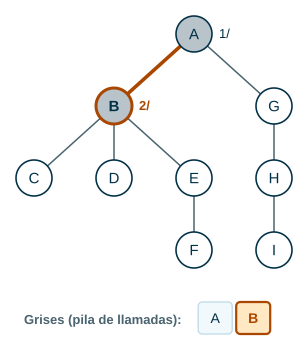

> Desde $A$ se llega a $B$, que es blanco: tiempo $2$, $B.d = 2$, $B.\pi = A$. $B$ queda gris.

:::
:::{tab-item} Paso 3
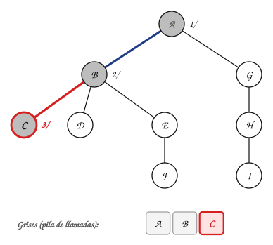

> Desde $B$ se llega a $C$, que es blanco: tiempo $3$, $C.d = 3$, $C.\pi = B$. $C$ queda gris.

> **C no tiene hijos. ¿Qué hace la búsqueda ahora?**

:::
:::{tab-item} Paso 4
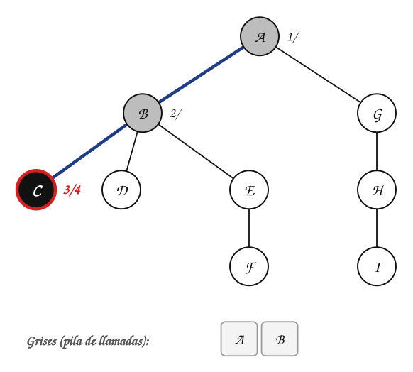

> $C$ ya no tiene vecinos blancos: tiempo $4$, $C.f = 4$. $C$ queda negro y la búsqueda regresa.

> Termina $C$ y **regresa** a $B$, que todavía tiene hijos sin visitar. Es el *backtracking*: se retrocede solo lo necesario.

:::
:::{tab-item} Paso 5
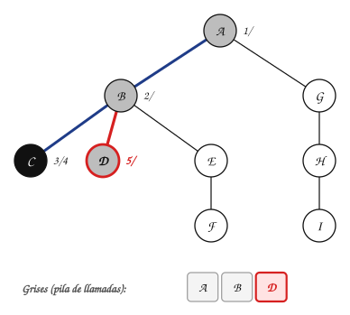

> Desde $B$ se llega a $D$, que es blanco: tiempo $5$, $D.d = 5$, $D.\pi = B$. $D$ queda gris.

:::
:::{tab-item} Paso 6
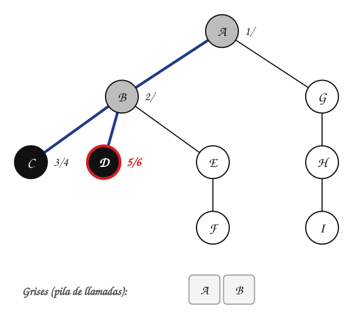

> $D$ ya no tiene vecinos blancos: tiempo $6$, $D.f = 6$. $D$ queda negro y la búsqueda regresa.

:::
:::{tab-item} Paso 7
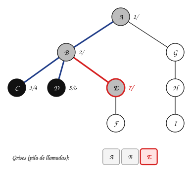

> Desde $B$ se llega a $E$, que es blanco: tiempo $7$, $E.d = 7$, $E.\pi = B$. $E$ queda gris.

:::
:::{tab-item} Paso 8
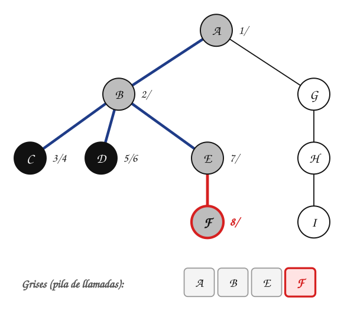

> Desde $E$ se llega a $F$, que es blanco: tiempo $8$, $F.d = 8$, $F.\pi = E$. $F$ queda gris.

:::
:::{tab-item} Paso 9
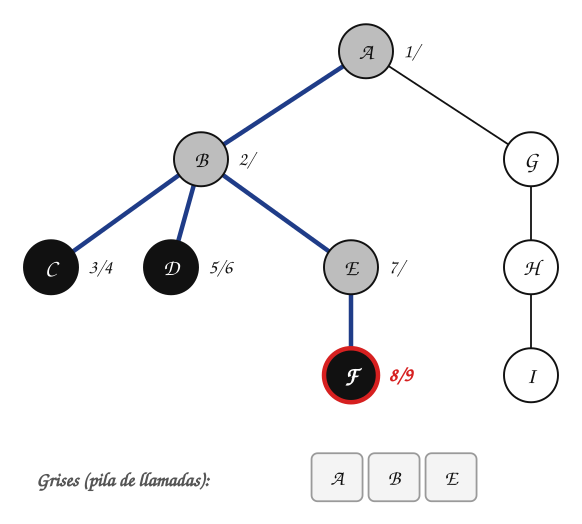

> $F$ ya no tiene vecinos blancos: tiempo $9$, $F.f = 9$. $F$ queda negro y la búsqueda regresa.

:::
:::{tab-item} Paso 10
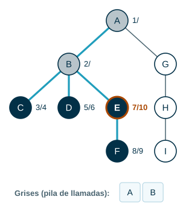

> $E$ ya no tiene vecinos blancos: tiempo $10$, $E.f = 10$. $E$ queda negro y la búsqueda regresa.

:::
:::{tab-item} Paso 11
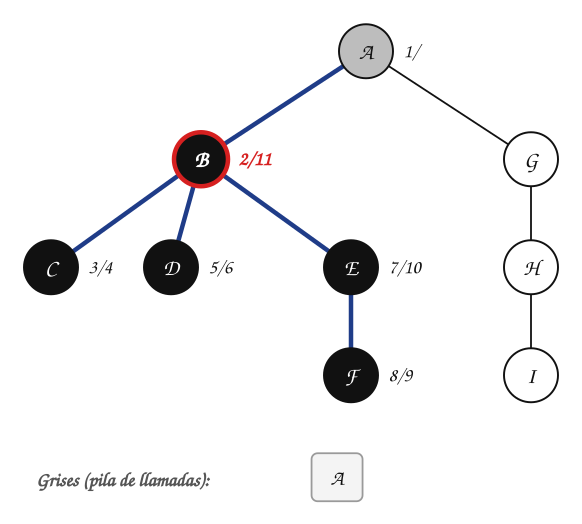

> $B$ ya no tiene vecinos blancos: tiempo $11$, $B.f = 11$. $B$ queda negro y la búsqueda regresa.

:::
:::{tab-item} Paso 12
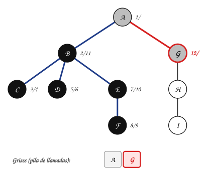

> Desde $A$ se llega a $G$, que es blanco: tiempo $12$, $G.d = 12$, $G.\pi = A$. $G$ queda gris.

:::
:::{tab-item} Paso 13
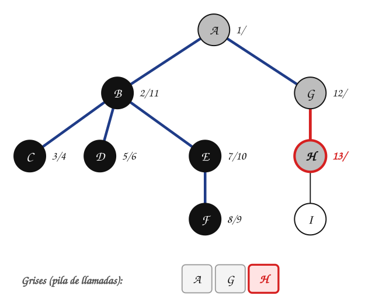

> Desde $G$ se llega a $H$, que es blanco: tiempo $13$, $H.d = 13$, $H.\pi = G$. $H$ queda gris.

:::
:::{tab-item} Paso 14
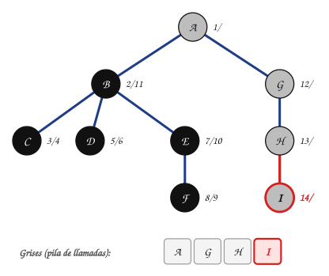

> Desde $H$ se llega a $I$, que es blanco: tiempo $14$, $I.d = 14$, $I.\pi = H$. $I$ queda gris.

:::
:::{tab-item} Paso 15
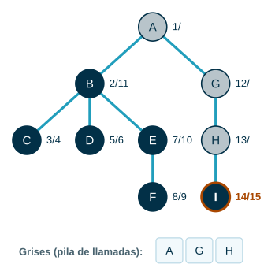

> $I$ ya no tiene vecinos blancos: tiempo $15$, $I.f = 15$. $I$ queda negro y la búsqueda regresa.

:::
:::{tab-item} Paso 16
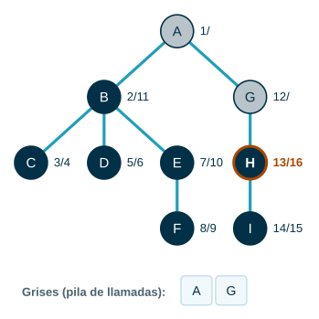

> $H$ ya no tiene vecinos blancos: tiempo $16$, $H.f = 16$. $H$ queda negro y la búsqueda regresa.

:::
:::{tab-item} Paso 17
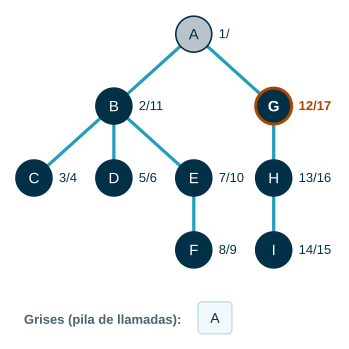

> $G$ ya no tiene vecinos blancos: tiempo $17$, $G.f = 17$. $G$ queda negro y la búsqueda regresa.

:::
:::{tab-item} Paso 18
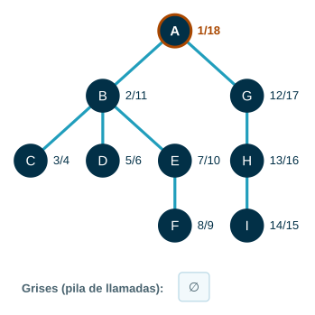

> $A$ ya no tiene vecinos blancos: tiempo $18$, $A.f = 18$. $A$ queda negro y la búsqueda regresa.

:::
::::
:::::

Orden de descubrimiento: A, B, C, D, E, F, G, H, I. En BFS el orden era $A, B, G, C, D, E, H, F, I$. DFS baja por $B$ hasta el fondo antes de tocar $G$.

## 2. El algoritmo

Como en BFS, cada vértice tiene un **color**: blanco (no descubierto), gris (descubierto, en la pila de llamadas) y negro (terminado). Además, una variable global `tiempo` sirve para poner las **marcas de tiempo** $u.d$ y $u.f$.

```text
DFS(G)
1  for cada vértice u ∈ G.V
2      u.color = BLANCO
3      u.π = NIL
4  tiempo = 0
5  for cada vértice u ∈ G.V
6      if u.color == BLANCO
7          DFS-VISIT(G, u)

DFS-VISIT(G, u)
1  tiempo = tiempo + 1          // u se acaba de descubrir
2  u.d = tiempo
3  u.color = GRIS
4  for cada v ∈ G.Adj[u]        // explorar la arista (u, v)
5      if v.color == BLANCO
6          v.π = u
7          DFS-VISIT(G, v)
8  u.color = NEGRO              // u terminó
9  tiempo = tiempo + 1
10 u.f = tiempo
```

A diferencia de BFS, `DFS(G)` no recibe un origen: si después de una búsqueda quedan vértices blancos, arranca otra desde el siguiente vértice blanco (línea 5). Por eso el resultado puede ser **varios árboles**: un **bosque DF**.

### Ejemplo 2

Grafo dirigido; los vértices y las listas de adyacencia se recorren en orden alfabético.

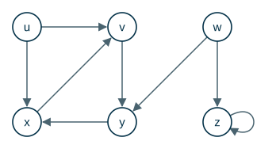

Las aristas en azul son las del bosque DF. Las punteadas son aristas que no descubren a nadie; la letra indica su tipo (sección 3).

:::::{admonition} Recorrido DFS (grafo dirigido)
:class: dropdown
::::{tab-set}
:::{tab-item} Paso 1
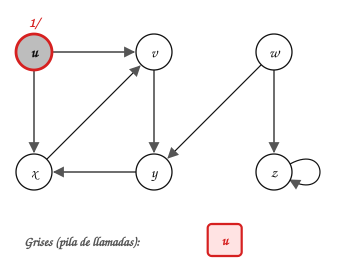

> Se inicia una búsqueda desde $u$: tiempo $1$, $u.d = 1$. $u$ queda gris.

:::
:::{tab-item} Paso 2
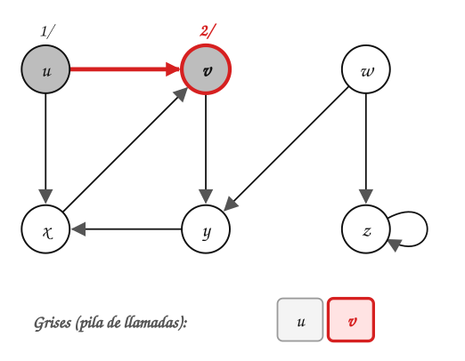

> Desde $u$ se llega a $v$, que es blanco: tiempo $2$, $v.d = 2$, $v.\pi = u$. $v$ queda gris.

:::
:::{tab-item} Paso 3
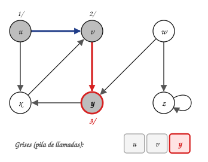

> Desde $v$ se llega a $y$, que es blanco: tiempo $3$, $y.d = 3$, $y.\pi = v$. $y$ queda gris.

:::
:::{tab-item} Paso 4
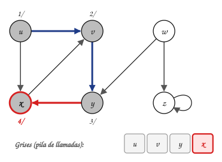

> Desde $y$ se llega a $x$, que es blanco: tiempo $4$, $x.d = 4$, $x.\pi = y$. $x$ queda gris.

> **Desde x se llega a v, que es gris. ¿Se visita?**

:::
:::{tab-item} Paso 5
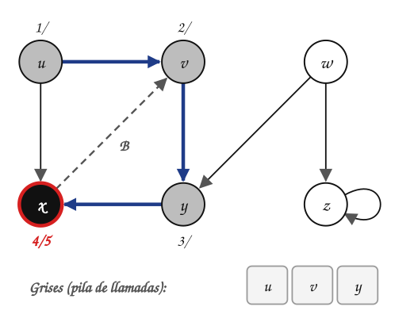

> $x$ ya no tiene vecinos blancos: tiempo $5$, $x.f = 5$. $x$ queda negro y la búsqueda regresa.

> No: $v$ ya está gris, es decir, está en la pila de llamadas (es un **antecesor** de $x$). La arista $(x, v)$ cierra un circuito $v \to y \to x \to v$; se marca **B** (de retorno).

:::
:::{tab-item} Paso 6
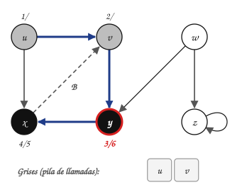

> $y$ ya no tiene vecinos blancos: tiempo $6$, $y.f = 6$. $y$ queda negro y la búsqueda regresa.

:::
:::{tab-item} Paso 7
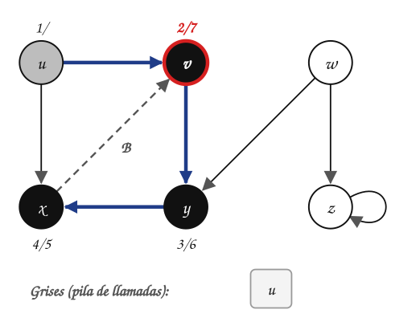

> $v$ ya no tiene vecinos blancos: tiempo $7$, $v.f = 7$. $v$ queda negro y la búsqueda regresa.

:::
:::{tab-item} Paso 8
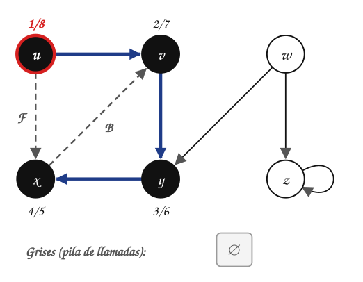

> $u$ ya no tiene vecinos blancos: tiempo $8$, $u.f = 8$. $u$ queda negro y la búsqueda regresa.

:::
:::{tab-item} Paso 9
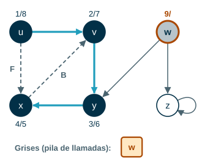

> Se inicia una búsqueda desde $w$: tiempo $9$, $w.d = 9$. $w$ queda gris.

:::
:::{tab-item} Paso 10
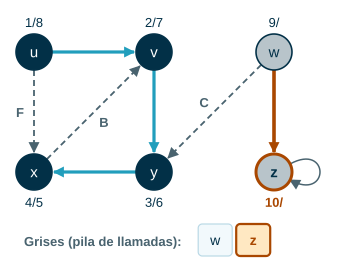

> Desde $w$ se llega a $z$, que es blanco: tiempo $10$, $z.d = 10$, $z.\pi = w$. $z$ queda gris.

:::
:::{tab-item} Paso 11
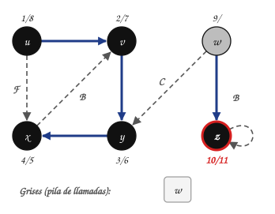

> $z$ ya no tiene vecinos blancos: tiempo $11$, $z.f = 11$. $z$ queda negro y la búsqueda regresa.

:::
:::{tab-item} Paso 12
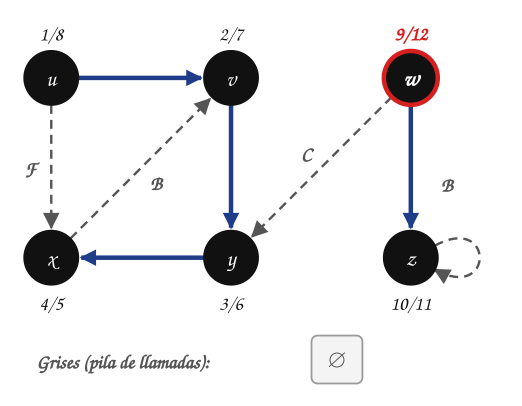

> $w$ ya no tiene vecinos blancos: tiempo $12$, $w.f = 12$. $w$ queda negro y la búsqueda regresa.

:::
::::
:::::

Resultado:

|  | $u$ | $v$ | $w$ | $x$ | $y$ | $z$ |
|---|---|---|---|---|---|---|
| $d$ | 1 | 2 | 9 | 4 | 3 | 10 |
| $f$ | 8 | 7 | 12 | 5 | 6 | 11 |
| $\pi$ | NIL | u | NIL | y | v | w |

> **¿Por qué hubo dos búsquedas?** Desde $u$ no se puede llegar a $w$ ni a $z$. Cuando termina la búsqueda desde $u$, el ciclo de `DFS(G)` encuentra a $w$ todavía blanco y arranca otra. El bosque DF tiene dos árboles: uno con raíz $u$ y otro con raíz $w$.

### Ejemplo 3

DFS sobre un grafo **no dirigido**, empezando por el vértice $1$, con listas en orden numérico.


:::::{admonition} Recorrido DFS desde 1 (no dirigido)
:class: dropdown
::::{tab-set}
:::{tab-item} Paso 1
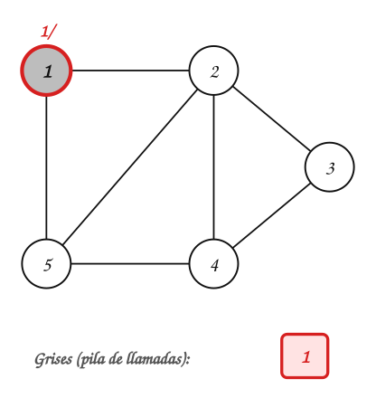

> Se inicia una búsqueda desde $1$: tiempo $1$, $1.d = 1$. $1$ queda gris.

:::
:::{tab-item} Paso 2
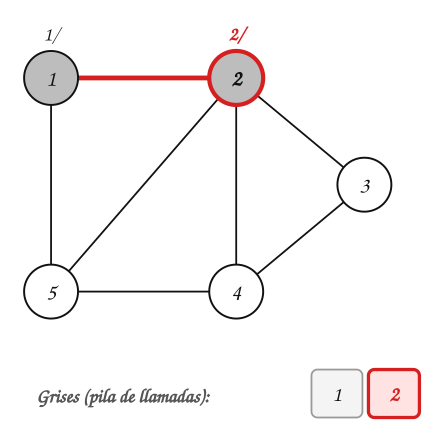

> Desde $1$ se llega a $2$, que es blanco: tiempo $2$, $2.d = 2$, $2.\pi = 1$. $2$ queda gris.

:::
:::{tab-item} Paso 3
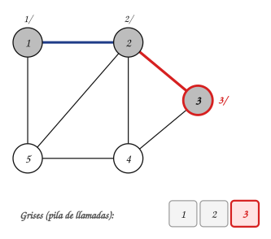

> Desde $2$ se llega a $3$, que es blanco: tiempo $3$, $3.d = 3$, $3.\pi = 2$. $3$ queda gris.

:::
:::{tab-item} Paso 4
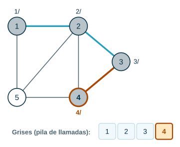

> Desde $3$ se llega a $4$, que es blanco: tiempo $4$, $4.d = 4$, $4.\pi = 3$. $4$ queda gris.

:::
:::{tab-item} Paso 5
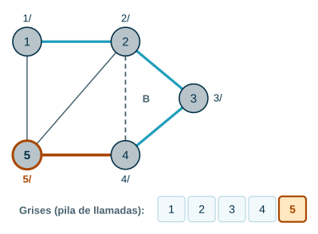

> Desde $4$ se llega a $5$, que es blanco: tiempo $5$, $5.d = 5$, $5.\pi = 4$. $5$ queda gris.

:::
:::{tab-item} Paso 6
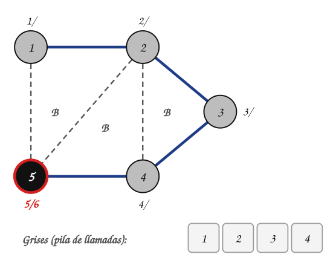

> $5$ ya no tiene vecinos blancos: tiempo $6$, $5.f = 6$. $5$ queda negro y la búsqueda regresa.

:::
:::{tab-item} Paso 7
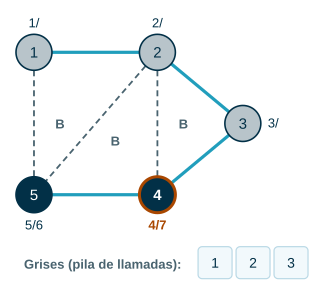

> $4$ ya no tiene vecinos blancos: tiempo $7$, $4.f = 7$. $4$ queda negro y la búsqueda regresa.

:::
:::{tab-item} Paso 8
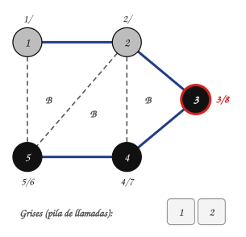

> $3$ ya no tiene vecinos blancos: tiempo $8$, $3.f = 8$. $3$ queda negro y la búsqueda regresa.

:::
:::{tab-item} Paso 9
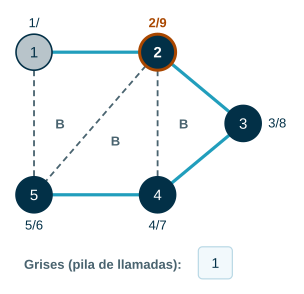

> $2$ ya no tiene vecinos blancos: tiempo $9$, $2.f = 9$. $2$ queda negro y la búsqueda regresa.

:::
:::{tab-item} Paso 10
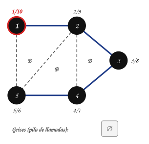

> $1$ ya no tiene vecinos blancos: tiempo $10$, $1.f = 10$. $1$ queda negro y la búsqueda regresa.

:::
::::
:::::

|  | $1$ | $2$ | $3$ | $4$ | $5$ |
|---|---|---|---|---|---|
| $d$ | 1 | 2 | 3 | 4 | 5 |
| $f$ | 10 | 9 | 8 | 7 | 6 |
| $\pi$ | NIL | 1 | 2 | 3 | 4 |

El árbol DF es el camino $1 - 2 - 3 - 4 - 5$: DFS se fue «hasta el fondo». En BFS desde $1$ el árbol sería mucho más bajo, porque $2$ y $5$ son vecinos de $1$ y quedarían en el nivel $1$.

## 3. Lo que dejan las marcas de tiempo

### Estructura de paréntesis

Escriba «$(u$» cuando se descubre $u$ y «$u)$» cuando termina. Para el Ejemplo 2:

```text
(u (v (y (x x) y) v) u) (w (z z) w)
```

Los paréntesis quedan **bien anidados**: nunca aparece algo como $(u\ (v\ u)\ v)$. Para cualquier par de vértices $u$ y $v$, los intervalos $[u.d, u.f]$ y $[v.d, v.f]$ son **disjuntos** o uno está **contenido** en el otro. Si $[v.d, v.f] \subset [u.d, u.f]$, entonces $v$ es descendiente de $u$ en el bosque DF.

### Clasificación de aristas

Cada arista $(u, v)$ se clasifica según el color de $v$ en el momento en que se explora:

| Tipo | Cuándo | Qué indica |
|---|---|---|
| **T** de árbol | $v$ es blanco | $v$ se descubre por esa arista |
| **B** de retorno | $v$ es gris | $v$ es antecesor de $u$: hay un **circuito** |
| **F** de avance | $v$ es negro y $u.d < v.d$ | $v$ es descendiente de $u$, pero ya se había descubierto por otro camino |
| **C** de cruce | $v$ es negro y $u.d > v.d$ | $v$ no es antecesor ni descendiente de $u$ (puede estar en otro árbol) |

Para el Ejemplo 2:

| Arista | Tipo |
|---|---|
| $(u, v)$ | de árbol (T) |
| $(u, x)$ | de avance (F) |
| $(x, v)$ | de retorno (B) |
| $(v, y)$ | de árbol (T) |
| $(y, x)$ | de árbol (T) |
| $(w, y)$ | de cruce (C) |
| $(w, z)$ | de árbol (T) |
| $(z, z)$ | de retorno (B) |

> **¿Qué tipos de arista pueden aparecer en un grafo no dirigido?**

:::{admonition} Respuesta
:class: dropdown
Solo **de árbol** y **de retorno**. Cada arista $\{u, v\}$ se explora primero desde el extremo que se descubrió antes; si en ese momento el otro extremo ya fue descubierto, sigue gris, porque es un antecesor. En el Ejemplo 3 todas las aristas que no son del árbol son de retorno.
:::

**Consecuencia.** Un grafo dirigido tiene un circuito **si y solo si** DFS encuentra una arista de retorno.

## 4. Complejidad

- Los ciclos de `DFS(G)` (sin contar las llamadas) cuestan $\Theta(V)$.
- `DFS-VISIT` se llama exactamente una vez por vértice: solo se llama sobre vértices blancos, y lo primero que hace es pintarlos de gris.
- Dentro de `DFS-VISIT(G, u)` el ciclo recorre $G.Adj[u]$ una vez. Sumando sobre todos los vértices: $\sum_{u} |G.Adj[u]| = \Theta(E)$.

$$
T_{DFS}(V, E) = \Theta(V + E)
$$

## 5. Aplicación: orden topológico

Un profesor tiene que vestirse; una flecha $a \to b$ significa «$a$ va antes que $b$» (las medias antes que los zapatos, por ejemplo). El reloj no depende de nada.

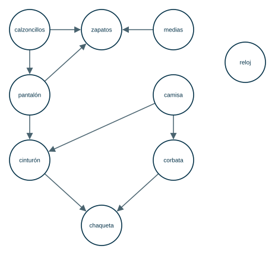

**¿En qué orden puede ponerse la ropa?** Hace falta un **orden topológico**: una lista de los vértices de un grafo dirigido **acíclico** en la que toda arista $(u, v)$ va de izquierda a derecha.

**Método.** Correr DFS y listar los vértices de **mayor a menor $f$**.

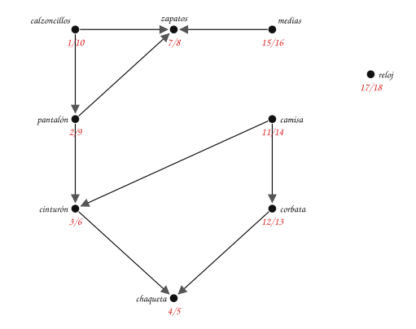

Ordenando por $f$ decreciente:

**reloj (18) → medias (16) → camisa (14) → corbata (13) → calzoncillos (10) → pantalón (9) → zapatos (8) → cinturón (6) → chaqueta (5)**

Funciona porque, en un grafo sin circuitos, toda arista $(u, v)$ cumple $v.f < u.f$: cuando se explora $(u, v)$, el vértice $v$ no puede ser gris (sería una arista de retorno, es decir, un circuito), así que es blanco y termina antes que $u$, o ya es negro y terminó antes.

## 6. Implementación en Java

**Análisis.**

| | |
|---|---|
| **Entradas** | Número de vértices $n$ y lista de arcos (grafo dirigido). |
| **Salidas** | Arreglos `d[]`, `f[]` y `pi[]`. |
| **Proceso** | `dfs()` recorre los vértices y llama al método recursivo `dfsVisit(u)` sobre cada vértice blanco; `tiempo` es un atributo de la clase. |

**Diseño.** El pseudocódigo `DFS(G)` y `DFS-VISIT(G, u)` de la sección 2. La pila de llamadas de Java hace el papel de la pila de vértices grises.

**Codificación.**

```java
import java.util.ArrayList;
import java.util.Arrays;
import java.util.List;

public class DFS {

    enum Color { BLANCO, GRIS, NEGRO }

    private final List<List<Integer>> adj;
    private final Color[] color;
    private final int[] d;
    private final int[] f;
    private final int[] pi;
    private int tiempo;

    public DFS(int n) {
        adj = new ArrayList<>();
        for (int i = 0; i < n; i++) {
            adj.add(new ArrayList<>());
        }
        color = new Color[n];
        d = new int[n];
        f = new int[n];
        pi = new int[n];
    }

    public void agregarArco(int u, int v) {
        adj.get(u).add(v);
    }

    public void dfs() {
        Arrays.fill(color, Color.BLANCO);
        Arrays.fill(pi, -1);
        tiempo = 0;
        for (int u = 0; u < adj.size(); u++) {
            if (color[u] == Color.BLANCO) {
                dfsVisit(u);
            }
        }
    }

    private void dfsVisit(int u) {
        tiempo++;
        d[u] = tiempo;
        color[u] = Color.GRIS;
        for (int v : adj.get(u)) {
            if (color[v] == Color.BLANCO) {
                pi[v] = u;
                dfsVisit(v);
            }
        }
        color[u] = Color.NEGRO;
        tiempo++;
        f[u] = tiempo;
    }

    public static void main(String[] args) {
        String nombres = "uvwxyz";
        DFS g = new DFS(6);
        String[] arcos = {"uv", "ux", "vy", "wy", "wz", "xv", "yx", "zz"};
        for (String a : arcos) {
            g.agregarArco(nombres.indexOf(a.charAt(0)), nombres.indexOf(a.charAt(1)));
        }
        g.dfs();
        for (int u = 0; u < 6; u++) {
            System.out.println(nombres.charAt(u) + ": " + g.d[u] + "/" + g.f[u]);
        }
    }
}
```

**Prueba.** Con el grafo del Ejemplo 2:

```text
u: 1/8
v: 2/7
w: 9/12
x: 4/5
y: 3/6
z: 10/11
```

Son los mismos tiempos de la tabla del Ejemplo 2.

## 7. Formalización

Las propiedades que se usaron en los ejemplos (Cormen et al., sección 22.3):

- **Subgrafo de predecesores.** $G_\pi = (V, E_\pi)$ con $E_\pi = \{(v.\pi, v) \mid v \in V \wedge v.\pi \neq \text{NIL}\}$. Es un **bosque DF** formado por uno o varios **árboles DF** disjuntos.
- $u = v.\pi$ si y solo si se llamó `DFS-VISIT(G, v)` mientras se recorría la lista de adyacencia de $u$. La forma del bosque DF es la forma del árbol de llamadas recursivas.
- Para todo $u$: $1 \le u.d < u.f \le 2|V|$. $u$ es blanco antes de $u.d$, gris entre $u.d$ y $u.f$, y negro después.
- **Teorema del paréntesis.** Para todo par $u, v$, exactamente una de estas condiciones se cumple: los intervalos $[u.d, u.f]$ y $[v.d, v.f]$ son disjuntos y ninguno es descendiente del otro; $[u.d, u.f] \subset [v.d, v.f]$ y $u$ es descendiente de $v$; o $[v.d, v.f] \subset [u.d, u.f]$ y $v$ es descendiente de $u$.
- **Teorema del camino blanco.** $v$ es descendiente de $u$ en el bosque DF si y solo si, en el instante $u.d$, existe un camino de $u$ a $v$ formado solo por vértices blancos.
- En un grafo no dirigido, toda arista es de árbol o de retorno.

## Ejercicios

Practique con los [ejercicios de DFS](exercises.md).

## Fuentes

- Caicedo Mejía, J. M. *Unidad 5: Grafos - Recorridos*. Computación y Estructuras Discretas I, Universidad Icesi, 2026 (adaptado de material de A. Aristizábal y M. Gómez).
- Bedoya, O. *Búsqueda no informada*. Diapositivas del curso, Universidad del Valle.
- Cormen, T. H., Leiserson, C. E., Rivest, R. L., Stein, C. *Introduction to Algorithms*, 3.ª ed. The MIT Press, 2009. Secciones 22.3 y 22.4.

---

*Material adaptado del material original de los profesores Andrés Aristizábal, Marlon Gómez y Oscar Bedoya.*
