---
# Copyright (c) 2026 Angela Villota, and collaborators from the CyED block
# Licensed under the PolyForm Noncommercial License 1.0.0.
# Commercial use is prohibited without prior written authorization.
title: "Dijkstra: Ejercicios"
---

# Dijkstra: Ejercicios

Use esta página después de leer el [material de estudio de Dijkstra](index.md). Cada ejercicio trae **pistas** y una **solución general**; intente resolverlo antes de abrirlas.

---

### Ejercicio 1

Aplique el algoritmo de Dijkstra para conocer el camino de valor mínimo entre $a$ y $f$ en cada grafo dirigido. Muestre el valor acumulado y el predecesor de cada vértice.

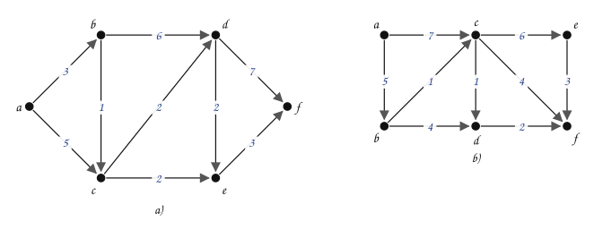

:::{admonition} Pistas
:class: dropdown
- En cada paso, el vértice no permanente de **menor** valor acumulado se vuelve permanente; luego se etiquetan sus vecinos.
- Si un vértice ya tiene etiqueta, se reemplaza solo si el nuevo valor es **menor**.
- Al final, el camino se lee al revés: desde $f$, siguiendo los predecesores.
:::

:::{admonition} Solución general
:class: dropdown
a) Orden en que los vértices se vuelven permanentes: $a$, $b$, $c$, $d$, $e$, $f$.

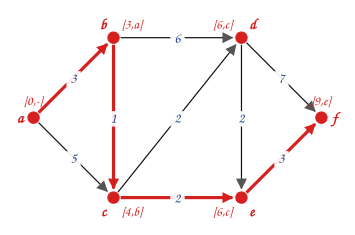

El acumulado mínimo en $f$ es $9$. El camino mínimo es $a \to b \to c \to e \to f$.

b) Orden en que los vértices se vuelven permanentes: $a$, $b$, $c$, $d$, $f$, $e$.

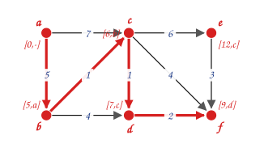

El acumulado mínimo en $f$ es $9$. El camino mínimo es $a \to b \to c \to d \to f$.
:::

### Ejercicio 2

Aplique el algoritmo de Dijkstra para conocer el camino de valor mínimo entre $a$ y $f$.

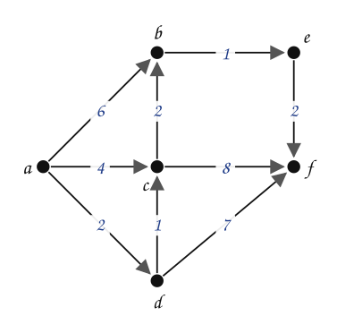

:::{admonition} Pistas
:class: dropdown
- El primer permanente después de $a$ es $d$, el vecino más barato.
- Desde $d$, la etiqueta de $c$ baja.
:::

:::{admonition} Solución general
:class: dropdown
Orden en que los vértices se vuelven permanentes: $a$, $d$, $c$, $b$, $e$, $f$.

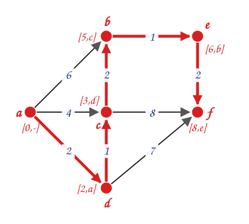

El acumulado mínimo en $f$ es $8$. El camino mínimo es $a \to d \to c \to b \to e \to f$.
:::

### Ejercicio 3

Aplique el algoritmo de Dijkstra para conocer el camino de valor mínimo entre $a$ y $h$.

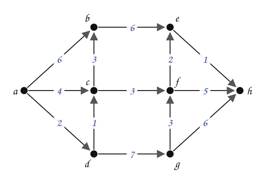

:::{admonition} Pistas
:class: dropdown
- Hay un empate: dos vértices con valor acumulado $6$. Se escoge cualquiera; el resultado final no cambia.
- $h$ recibe etiquetas desde $f$, desde $g$ y desde $e$. Quédese con la menor.
:::

:::{admonition} Solución general
:class: dropdown
Orden en que los vértices se vuelven permanentes: $a$, $d$, $c$, $b$, $f$, $e$, $g$, $h$.

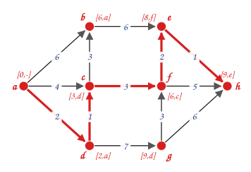

El acumulado mínimo en $h$ es $9$. El camino mínimo es $a \to d \to c \to f \to e \to h$.
:::

### Ejercicio 4

Aplique el algoritmo de Dijkstra para conocer el camino de valor mínimo entre $a$ y $j$.

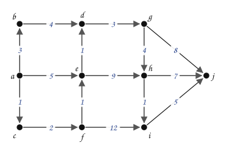

:::{admonition} Pistas
:class: dropdown
- El camino directo $a \to e$ cuesta $5$, pero hay uno más barato que pasa por $c$ y $f$.
- $j$ recibe etiquetas desde $g$, $h$ e $i$.
:::

:::{admonition} Solución general
:class: dropdown
Orden en que los vértices se vuelven permanentes: $a$, $c$, $b$, $f$, $e$, $d$, $g$, $h$, $i$, $j$.

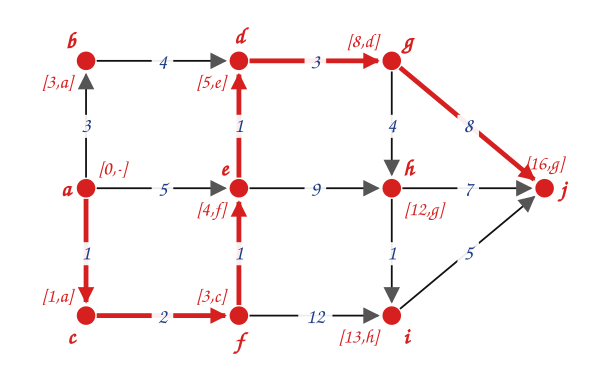

El acumulado mínimo en $j$ es $16$. El camino mínimo es $a \to c \to f \to e \to d \to g \to j$.
:::

### Ejercicio 5

Aplique el algoritmo de Dijkstra para conocer el camino de valor mínimo entre $a$ y $h$.

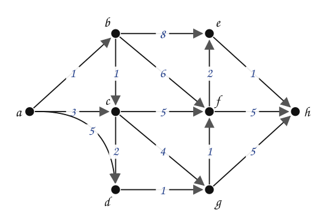

:::{admonition} Pistas
:class: dropdown
- El camino mínimo pasa por siete aristas: tener pocas aristas no es lo que importa.
:::

:::{admonition} Solución general
:class: dropdown
Orden en que los vértices se vuelven permanentes: $a$, $b$, $c$, $d$, $g$, $f$, $e$, $h$.

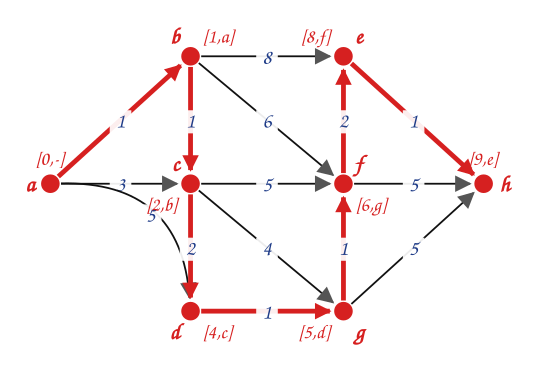

El acumulado mínimo en $h$ es $9$. El camino mínimo es $a \to b \to c \to d \to g \to f \to e \to h$.
:::

### Ejercicio 6

Este es el grafo del Ejemplo 2 (de Bogotá a Buenos Aires) con el sentido de **todos** los tramos invertido. Aplique Dijkstra desde Buenos Aires. ¿Cuál es el camino mínimo de Buenos Aires a Bogotá? ¿Es el mismo camino del Ejemplo 2 recorrido al revés?

:::{admonition} Pistas
:class: dropdown
- Al invertir todas las aristas, cada camino de $x$ a $y$ se convierte en un camino de $y$ a $x$ con el mismo costo.
- El **camino** que encuentra el algoritmo puede ser distinto si hay empates.
:::

:::{admonition} Solución general
:class: dropdown
Orden de permanentes: BA (0), Asu (3), Paz (5), Lim (10), Qui (11), Bog (13).

| Destino | Costo mínimo | Camino |
|---|---|---|
| $\text{Bog}$ | 13 | BA → Asu → Lim → Qui → Bog |
| $\text{Lim}$ | 10 | BA → Asu → Lim |
| $\text{Qui}$ | 11 | BA → Asu → Lim → Qui |
| $\text{Paz}$ | 5 | BA → Asu → Paz |
| $\text{Asu}$ | 3 | BA → Asu |
| $\text{BA}$ | 0 | BA |

La longitud a Bogotá vuelve a ser $13$ y el camino es el del Ejemplo 2 recorrido al revés. No siempre pasa: cuando hay empates, el algoritmo puede escoger caminos distintos, y cualquiera de longitud mínima es correcto. Sin invertir las aristas, desde Buenos Aires no se llega a ninguna ciudad: no sale ningún tramo.
:::

### Ejercicio 7

Construya un grafo **dirigido** con $4$ vértices y un solo peso negativo en el que Dijkstra, desde $s$, entregue una distancia equivocada para **dos** vértices.

:::{admonition} Pistas
:class: dropdown
- Parta del contraejemplo de la sección 3: allí falla un solo vértice ($b$).
- Si $b$ queda con una distancia equivocada y de $b$ sale una arista hacia otro vértice, ese vértice hereda el error.
:::

:::{admonition} Solución general
:class: dropdown
Aristas $s \to b$ ($2$), $s \to c$ ($3$), $c \to b$ ($-2$) y $b \to d$ ($1$). Dijkstra hace permanentes a $s$, $b$ (con $2$), $c$ (con $3$) y $d$ (con $3$, por $b$). Cuando $c$ se vuelve permanente, $b$ ya es permanente y no se reetiqueta. Los valores correctos son $b = 1$ y $d = 2$, por $s \to c \to b \to d$.
:::

### Ejercicio 8

Dijkstra devuelve **un** camino mínimo. Modifique el algoritmo para que también cuente **cuántos** caminos mínimos distintos hay desde $s$ hasta cada vértice. Pruebe su modificación con el grafo de la sección 1 del material de estudio.

:::{admonition} Pistas
:class: dropdown
- Lleve, junto a la etiqueta de cada vértice, un contador $N[v]$.
- Si llegar por $u$ cuesta **menos**, $N[v] = N[u]$; si cuesta **lo mismo**, $N[v] = N[v] + N[u]$.
:::

:::{admonition} Solución general
:class: dropdown
Con $N[s] = 1$ y la regla de las pistas, cada vez que $u$ se vuelve permanente ya tiene su cuenta definitiva, porque todos los caminos mínimos a $u$ llegan desde vértices permanentes. En el grafo de la sección 1 hay un solo camino mínimo a cada vértice.
:::

### Ejercicio 9

Aplicar el algoritmo de Dijkstra para conocer el camino de valor mínimo entre $a$ y $h$. Muestre el valor acumulado y el predecesor en cada nodo.

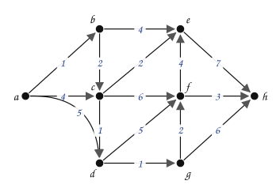

---

*Material adaptado del material original del profesor Oscar Bedoya.*
