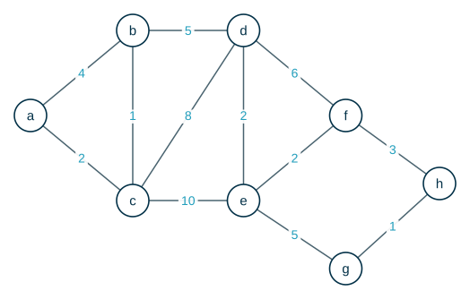
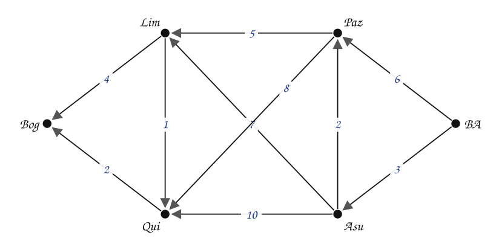

---
# Copyright (c) 2026 Angela Villota, and collaborators from the CyED block
# Licensed under the PolyForm Noncommercial License 1.0.0.
# Commercial use is prohibited without prior written authorization.
title: "Dijkstra: Ejercicios"
---

# Dijkstra: Ejercicios

Use esta página después de leer el [material de estudio de Dijkstra](index.md). Cada ejercicio trae **pistas** y una **solución general**; intente resolverlo antes de abrirlas.

---

### Ejercicio 1

Aplique el algoritmo de Dijkstra para conocer el camino de valor mínimo entre $a$ y $h$. Muestre el valor acumulado y el predecesor de cada vértice en cada iteración (la tabla de iteraciones). En caso de empate, escoja el vértice que va primero en orden alfabético.

:::{admonition} Pistas
:class: dropdown
- Después de etiquetar los vecinos de $a$, el permanente es $c$ (etiqueta $2$), no $b$.
- Desde $c$, la etiqueta de $b$ baja de $[4,a]$ a $[3,c]$.
- $h$ se alcanza por dos lados. Compare $f \to h$ con $g \to h$.
:::

:::{admonition} Solución general
:class: dropdown
Orden en que los vértices se vuelven permanentes: $a$ (0), $c$ (2), $b$ (3), $d$ (8), $e$ (10), $f$ (12), $g$ (15), $h$ (15).

| Destino | Costo mínimo | Camino |
|---|---|---|
| $a$ | 0 | a |
| $b$ | 3 | a → c → b |
| $c$ | 2 | a → c |
| $d$ | 8 | a → c → b → d |
| $e$ | 10 | a → c → b → d → e |
| $f$ | 12 | a → c → b → d → e → f |
| $g$ | 15 | a → c → b → d → e → g |
| $h$ | 15 | a → c → b → d → e → f → h |

El camino mínimo de $a$ a $h$ es $a \to c \to b \to d \to e \to f \to h$, con valor $15$. $g$ y $h$ terminan ambos con $15$. Por orden alfabético $g$ se vuelve permanente primero, pero eso no cambia la etiqueta $[15,f]$ de $h$: pasando por $g$ costaría $15 + 1 = 16$.
:::

### Ejercicio 2

Use el grafo del Ejemplo 2 (de Bogotá a Buenos Aires), pero ahora con origen en Buenos Aires. ¿Cuál es el camino mínimo de Buenos Aires a Bogotá? ¿Es el mismo camino del Ejemplo 2 recorrido al revés?

:::{admonition} Pistas
:class: dropdown
- En un grafo no dirigido, la **longitud** mínima de $x$ a $y$ es la misma que de $y$ a $x$.
- El **camino** que encuentra el algoritmo puede ser distinto si hay empates.
:::

:::{admonition} Solución general
:class: dropdown
Orden de permanentes: BA (0), Asu (3), Paz (5), Lim (10), Qui (11), Bog (13).

| Destino | Costo mínimo | Camino |
|---|---|---|
| $\text{Bog}$ | 13 | BA → Asu → Lim → Qui → Bog |
| $\text{Lim}$ | 10 | BA → Asu → Lim |
| $\text{Qui}$ | 11 | BA → Asu → Lim → Qui |
| $\text{Paz}$ | 5 | BA → Asu → Paz |
| $\text{Asu}$ | 3 | BA → Asu |
| $\text{BA}$ | 0 | BA |

La longitud a Bogotá vuelve a ser $13$ y el camino es el del Ejemplo 2 recorrido al revés. No siempre pasa: cuando hay empates, el algoritmo puede escoger caminos distintos en cada sentido, y cualquiera de longitud mínima es correcto.
:::

### Ejercicio 3

Construya un grafo **dirigido** con $4$ vértices y un solo peso negativo en el que Dijkstra, desde $s$, entregue una distancia equivocada para **dos** vértices.

:::{admonition} Pistas
:class: dropdown
- Parta del contraejemplo de la sección 3: allí falla un solo vértice ($b$).
- Si $b$ queda con una distancia equivocada y de $b$ sale una arista hacia otro vértice, ese vértice hereda el error.
:::

:::{admonition} Solución general
:class: dropdown
Aristas $s \to b$ ($2$), $s \to c$ ($3$), $c \to b$ ($-2$) y $b \to d$ ($1$). Dijkstra hace permanentes a $s$, $b$ (con $2$), $c$ (con $3$) y $d$ (con $3$, por $b$). Cuando $c$ se vuelve permanente, $b$ ya es permanente y no se reetiqueta. Los valores correctos son $b = 1$ y $d = 2$, por $s \to c \to b \to d$.
:::

### Ejercicio 4

Dijkstra devuelve **un** camino mínimo. Modifique el algoritmo para que también cuente **cuántos** caminos mínimos distintos hay desde $s$ hasta cada vértice. Pruebe su modificación con el grafo de la sección 1 y con el del Ejercicio 1.

---

*Material adaptado del material original del profesor Oscar Bedoya.*
