---
# Copyright (c) 2026 Angela Villota, and collaborators from the CyED block
# Licensed under the PolyForm Noncommercial License 1.0.0.
# Commercial use is prohibited without prior written authorization.
title: "Unidad 5: Algoritmo de Dijkstra"
---

# Unidad 5: Algoritmo de Dijkstra

Los ejemplos se desarrollan en desplegables con pestañas **Paso 1, Paso 2, …**: cada paso conserva lo anterior y muestra lo nuevo **en color**.

## 1. El problema

En este grafo cada arista tiene un **peso** (un costo, una distancia, un tiempo).

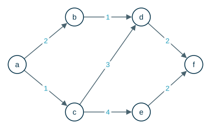

**¿Cuál es el costo mínimo para ir desde $a$ hasta $f$?**

:::{admonition} Algunos caminos de $a$ a $f$
:class: dropdown
- $a \to b \to d \to f$: $2 + 1 + 2 = 5$
- $a \to c \to d \to f$: $1 + 3 + 2 = 6$
- $a \to c \to e \to f$: $1 + 4 + 2 = 7$

El mínimo es $5$. Con $6$ vértices se pueden listar todos los caminos; con miles de vértices, no.
:::

**Grafo con pesos.** Cada arista $(u, v)$ tiene un valor $w(u, v)$. La **longitud** (o costo) de un camino es la **suma** de los pesos de sus aristas, no el número de aristas.

### ¿Sirve BFS?

BFS encuentra el camino con **menos aristas**. Pruébelo en este grafo, desde $s$ hasta $t$:

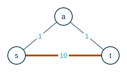

:::{admonition} ¿Qué camino da BFS? ¿Es el más barato?
:class: dropdown
BFS descubre $t$ directamente desde $s$ (una arista) y devuelve $s \to t$, que cuesta $10$. Pero $s \to a \to t$ tiene dos aristas y cuesta $1 + 1 = 2$. **Menos aristas no significa menos costo.**
:::

### ¿Entendimos el problema?

| | |
|---|---|
| **Entradas** | Un grafo (dirigido o no) con pesos **no negativos** y un vértice origen $s$. |
| **Salidas** | Para cada vértice $v$: el costo mínimo de un camino de $s$ a $v$ y el vértice anterior a $v$ en ese camino. |

Traza a mano con el grafo de la sección 1: el costo mínimo de $a$ a $f$ es $5$ y el anterior a $f$ es $d$; el de $a$ a $d$ es $3$ y el anterior a $d$ es $b$.

## 2. El método

**Algoritmo de Dijkstra.** Cada vértice lleva una etiqueta $[\text{valor acumulado}, \text{predecesor}]$. En cada paso, el vértice **no permanente** con **menor valor acumulado** se vuelve **permanente**, y se reetiquetan sus vecinos cuando llegar a ellos a través de él cuesta menos.

### Ejemplo 1

El grafo de la sección 1, desde $a$. Los vértices negros son permanentes; las flechas en azul van del predecesor al vértice.

:::::{admonition} Dijkstra desde a
:class: dropdown
::::{tab-set}
:::{tab-item} Paso 1
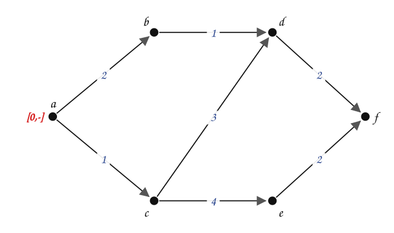

> Se etiqueta el origen $a$ con $[0,-]$: distancia $0$, sin predecesor.

| Iteración | Permanente | $a$ | $b$ | $c$ | $d$ | $e$ | $f$ |
|---|---|---|---|---|---|---|---|
| inicio | — | $\textcolor{#a94700}{\textbf{[0,-]}}$ | ∞ | ∞ | ∞ | ∞ | ∞ |

:::
:::{tab-item} Paso 2
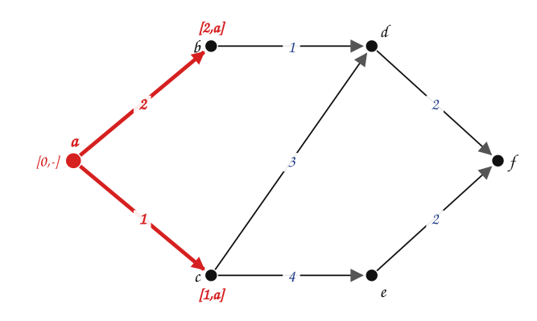

> El vértice no permanente de menor etiqueta es $a$ con $0$: **$a$ se vuelve permanente**. Se reetiquetan los vecinos $b$ y $c$, porque llegar por $a$ cuesta menos que su etiqueta anterior.

| Iteración | Permanente | $a$ | $b$ | $c$ | $d$ | $e$ | $f$ |
|---|---|---|---|---|---|---|---|
| inicio | — | $\textcolor{#a94700}{\textbf{[0,-]}}$ | ∞ | ∞ | ∞ | ∞ | ∞ |
| 1 | $a$ | **[0,-]** ✓ | $\textcolor{#a94700}{\textbf{[2,a]}}$ | $\textcolor{#a94700}{\textbf{[1,a]}}$ | ∞ | ∞ | ∞ |

:::
:::{tab-item} Paso 3
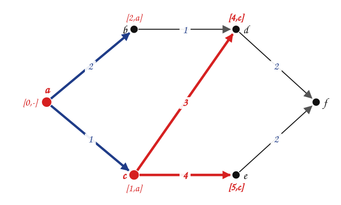

> El vértice no permanente de menor etiqueta es $c$ con $1$: **$c$ se vuelve permanente**. Se reetiquetan los vecinos $d$ y $e$, porque llegar por $c$ cuesta menos que su etiqueta anterior.

| Iteración | Permanente | $a$ | $b$ | $c$ | $d$ | $e$ | $f$ |
|---|---|---|---|---|---|---|---|
| inicio | — | $\textcolor{#a94700}{\textbf{[0,-]}}$ | ∞ | ∞ | ∞ | ∞ | ∞ |
| 1 | $a$ | **[0,-]** ✓ | $\textcolor{#a94700}{\textbf{[2,a]}}$ | $\textcolor{#a94700}{\textbf{[1,a]}}$ | ∞ | ∞ | ∞ |
| 2 | $c$ | ✓ | [2,a] | **[1,a]** ✓ | $\textcolor{#a94700}{\textbf{[4,c]}}$ | $\textcolor{#a94700}{\textbf{[5,c]}}$ | ∞ |

> **c ya tiene etiqueta [1,a] y ahora es permanente. ¿Puede aparecer después un camino más barato hasta c?**

:::
:::{tab-item} Paso 4
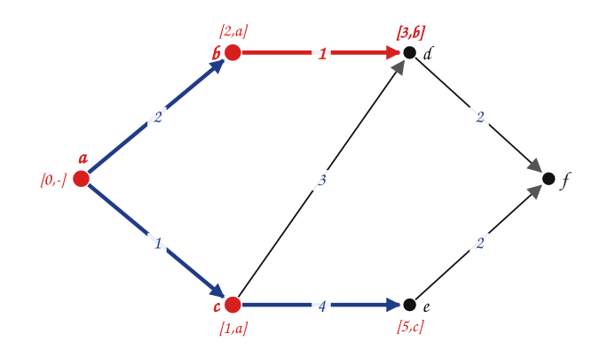

> El vértice no permanente de menor etiqueta es $b$ con $2$: **$b$ se vuelve permanente**. Se reetiquetan los vecinos $d$, porque llegar por $b$ cuesta menos que su etiqueta anterior.

| Iteración | Permanente | $a$ | $b$ | $c$ | $d$ | $e$ | $f$ |
|---|---|---|---|---|---|---|---|
| inicio | — | $\textcolor{#a94700}{\textbf{[0,-]}}$ | ∞ | ∞ | ∞ | ∞ | ∞ |
| 1 | $a$ | **[0,-]** ✓ | $\textcolor{#a94700}{\textbf{[2,a]}}$ | $\textcolor{#a94700}{\textbf{[1,a]}}$ | ∞ | ∞ | ∞ |
| 2 | $c$ | ✓ | [2,a] | **[1,a]** ✓ | $\textcolor{#a94700}{\textbf{[4,c]}}$ | $\textcolor{#a94700}{\textbf{[5,c]}}$ | ∞ |
| 3 | $b$ | ✓ | **[2,a]** ✓ | ✓ | $\textcolor{#a94700}{\textbf{[3,b]}}$ | [5,c] | ∞ |

> No. Cualquier otro camino de $a$ a $c$ tendría que pasar antes por un vértice no permanente, y todos tienen etiqueta $\geq 1$. Como los pesos no son negativos, ese camino no puede costar menos que $1$. Por eso una etiqueta permanente **no cambia nunca**.

:::
:::{tab-item} Paso 5
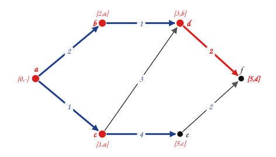

> El vértice no permanente de menor etiqueta es $d$ con $3$: **$d$ se vuelve permanente**. Se reetiquetan los vecinos $f$, porque llegar por $d$ cuesta menos que su etiqueta anterior.

| Iteración | Permanente | $a$ | $b$ | $c$ | $d$ | $e$ | $f$ |
|---|---|---|---|---|---|---|---|
| inicio | — | $\textcolor{#a94700}{\textbf{[0,-]}}$ | ∞ | ∞ | ∞ | ∞ | ∞ |
| 1 | $a$ | **[0,-]** ✓ | $\textcolor{#a94700}{\textbf{[2,a]}}$ | $\textcolor{#a94700}{\textbf{[1,a]}}$ | ∞ | ∞ | ∞ |
| 2 | $c$ | ✓ | [2,a] | **[1,a]** ✓ | $\textcolor{#a94700}{\textbf{[4,c]}}$ | $\textcolor{#a94700}{\textbf{[5,c]}}$ | ∞ |
| 3 | $b$ | ✓ | **[2,a]** ✓ | ✓ | $\textcolor{#a94700}{\textbf{[3,b]}}$ | [5,c] | ∞ |
| 4 | $d$ | ✓ | ✓ | ✓ | **[3,b]** ✓ | [5,c] | $\textcolor{#a94700}{\textbf{[5,d]}}$ |

:::
:::{tab-item} Paso 6
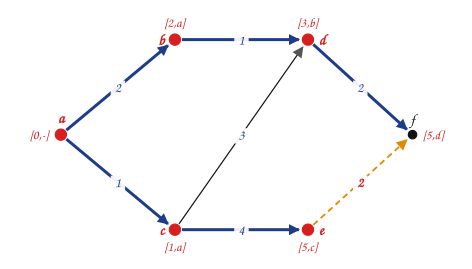

> El vértice no permanente de menor etiqueta es $e$ con $5$: **$e$ se vuelve permanente**. Ningún vecino mejora: $f$ ya tienen una etiqueta menor o igual pasando por $e$.

| Iteración | Permanente | $a$ | $b$ | $c$ | $d$ | $e$ | $f$ |
|---|---|---|---|---|---|---|---|
| inicio | — | $\textcolor{#a94700}{\textbf{[0,-]}}$ | ∞ | ∞ | ∞ | ∞ | ∞ |
| 1 | $a$ | **[0,-]** ✓ | $\textcolor{#a94700}{\textbf{[2,a]}}$ | $\textcolor{#a94700}{\textbf{[1,a]}}$ | ∞ | ∞ | ∞ |
| 2 | $c$ | ✓ | [2,a] | **[1,a]** ✓ | $\textcolor{#a94700}{\textbf{[4,c]}}$ | $\textcolor{#a94700}{\textbf{[5,c]}}$ | ∞ |
| 3 | $b$ | ✓ | **[2,a]** ✓ | ✓ | $\textcolor{#a94700}{\textbf{[3,b]}}$ | [5,c] | ∞ |
| 4 | $d$ | ✓ | ✓ | ✓ | **[3,b]** ✓ | [5,c] | $\textcolor{#a94700}{\textbf{[5,d]}}$ |
| 5 | $e$ | ✓ | ✓ | ✓ | ✓ | **[5,c]** ✓ | [5,d] |

:::
:::{tab-item} Paso 7
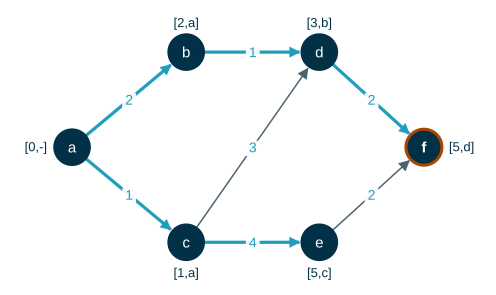

> El vértice no permanente de menor etiqueta es $f$ con $5$: **$f$ se vuelve permanente**. No le quedan vecinos que no sean permanentes.

| Iteración | Permanente | $a$ | $b$ | $c$ | $d$ | $e$ | $f$ |
|---|---|---|---|---|---|---|---|
| inicio | — | $\textcolor{#a94700}{\textbf{[0,-]}}$ | ∞ | ∞ | ∞ | ∞ | ∞ |
| 1 | $a$ | **[0,-]** ✓ | $\textcolor{#a94700}{\textbf{[2,a]}}$ | $\textcolor{#a94700}{\textbf{[1,a]}}$ | ∞ | ∞ | ∞ |
| 2 | $c$ | ✓ | [2,a] | **[1,a]** ✓ | $\textcolor{#a94700}{\textbf{[4,c]}}$ | $\textcolor{#a94700}{\textbf{[5,c]}}$ | ∞ |
| 3 | $b$ | ✓ | **[2,a]** ✓ | ✓ | $\textcolor{#a94700}{\textbf{[3,b]}}$ | [5,c] | ∞ |
| 4 | $d$ | ✓ | ✓ | ✓ | **[3,b]** ✓ | [5,c] | $\textcolor{#a94700}{\textbf{[5,d]}}$ |
| 5 | $e$ | ✓ | ✓ | ✓ | ✓ | **[5,c]** ✓ | [5,d] |
| 6 | $f$ | ✓ | ✓ | ✓ | ✓ | ✓ | **[5,d]** ✓ |

:::
::::
:::::

Ahora se leen los caminos. **Para encontrar el camino de costo mínimo** se parte del destino y se siguen los predecesores hasta llegar al origen.

:::::{admonition} Camino mínimo de a a d
:class: dropdown
::::{tab-set}
:::{tab-item} Paso 1
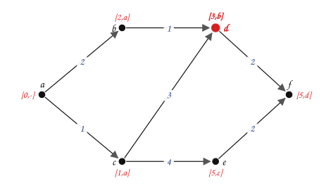

> La etiqueta de $d$ es $[3,b]$: se llega a $d$ desde $b$.

:::
:::{tab-item} Paso 2
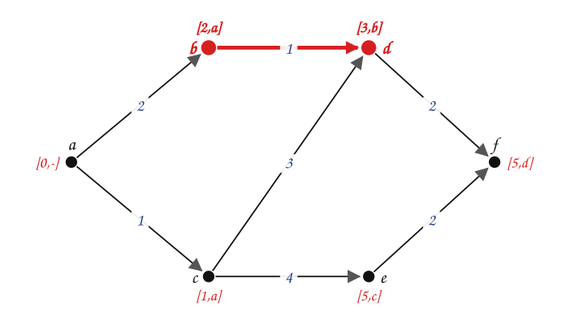

> La etiqueta de $b$ es $[2,a]$: se llega a $b$ desde $a$.

:::
:::{tab-item} Paso 3
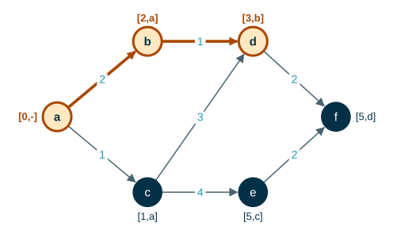

> $a$ es el origen: no tiene predecesor. El camino, leído al revés, es $a \to b \to d$ con costo $3$.

:::
::::
:::::

:::::{admonition} Camino mínimo de a a f
:class: dropdown
::::{tab-set}
:::{tab-item} Paso 1
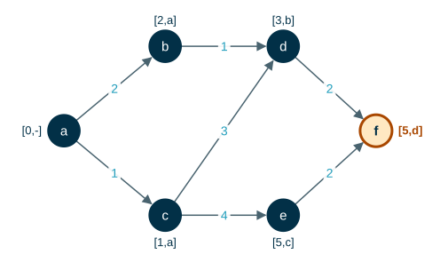

> La etiqueta de $f$ es $[5,d]$: se llega a $f$ desde $d$.

:::
:::{tab-item} Paso 2
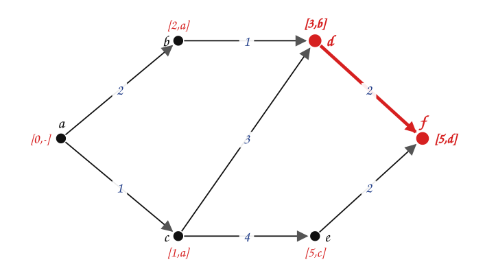

> La etiqueta de $d$ es $[3,b]$: se llega a $d$ desde $b$.

:::
:::{tab-item} Paso 3
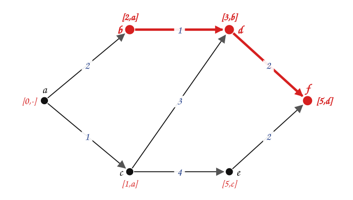

> La etiqueta de $b$ es $[2,a]$: se llega a $b$ desde $a$.

:::
:::{tab-item} Paso 4
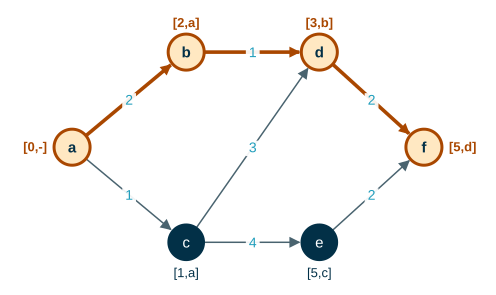

> $a$ es el origen: no tiene predecesor. El camino, leído al revés, es $a \to b \to d \to f$ con costo $5$.

:::
::::
:::::

Todos los resultados:

| Destino | Costo mínimo | Camino |
|---|---|---|
| $a$ | 0 | a |
| $b$ | 2 | a → b |
| $c$ | 1 | a → c |
| $d$ | 3 | a → b → d |
| $e$ | 5 | a → c → e |
| $f$ | 5 | a → b → d → f |

### Ejemplo 2

Aplique el algoritmo de Dijkstra para encontrar el camino más corto entre Bogotá y Buenos Aires. El grafo es no dirigido; las abreviaturas son Bog (Bogotá), Lim (Lima), Qui (Quito), Paz (La Paz), Asu (Asunción) y BA (Buenos Aires).

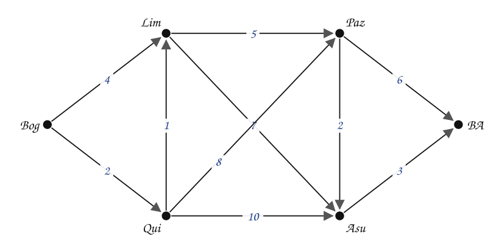

:::::{admonition} Dijkstra desde Bogotá
:class: dropdown
::::{tab-set}
:::{tab-item} Paso 1
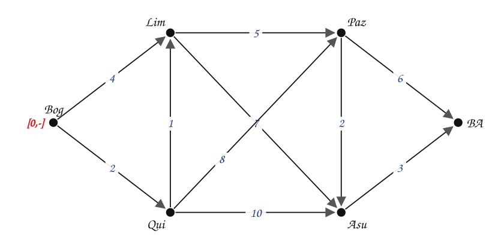

> Se etiqueta el origen $\text{Bog}$ con $[0,-]$: distancia $0$, sin predecesor.

| Iteración | Permanente | $\text{Bog}$ | $\text{Lim}$ | $\text{Qui}$ | $\text{Paz}$ | $\text{Asu}$ | $\text{BA}$ |
|---|---|---|---|---|---|---|---|
| inicio | — | $\textcolor{#a94700}{\textbf{[0,-]}}$ | ∞ | ∞ | ∞ | ∞ | ∞ |

:::
:::{tab-item} Paso 2
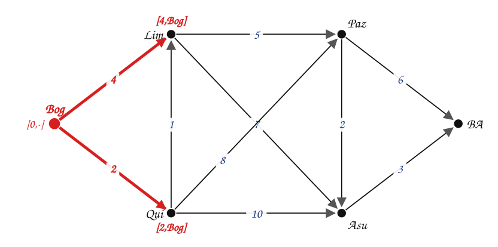

> El vértice no permanente de menor etiqueta es $\text{Bog}$ con $0$: **$\text{Bog}$ se vuelve permanente**. Se reetiquetan los vecinos $\text{Lim}$ y $\text{Qui}$, porque llegar por $\text{Bog}$ cuesta menos que su etiqueta anterior.

| Iteración | Permanente | $\text{Bog}$ | $\text{Lim}$ | $\text{Qui}$ | $\text{Paz}$ | $\text{Asu}$ | $\text{BA}$ |
|---|---|---|---|---|---|---|---|
| inicio | — | $\textcolor{#a94700}{\textbf{[0,-]}}$ | ∞ | ∞ | ∞ | ∞ | ∞ |
| 1 | $\text{Bog}$ | **[0,-]** ✓ | $\textcolor{#a94700}{\textbf{[4,Bog]}}$ | $\textcolor{#a94700}{\textbf{[2,Bog]}}$ | ∞ | ∞ | ∞ |

:::
:::{tab-item} Paso 3
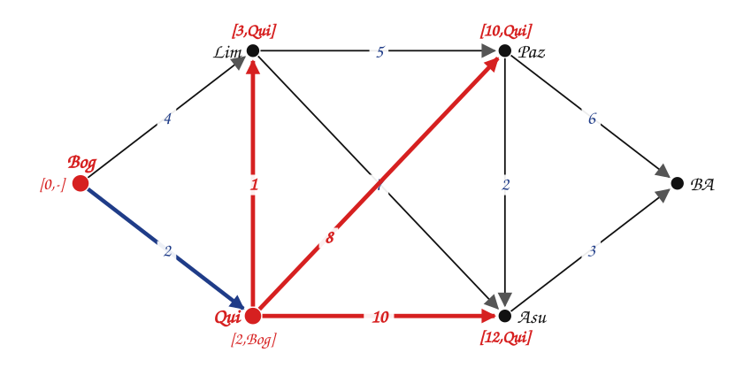

> El vértice no permanente de menor etiqueta es $\text{Qui}$ con $2$: **$\text{Qui}$ se vuelve permanente**. Se reetiquetan los vecinos $\text{Lim}$, $\text{Paz}$ y $\text{Asu}$, porque llegar por $\text{Qui}$ cuesta menos que su etiqueta anterior.

| Iteración | Permanente | $\text{Bog}$ | $\text{Lim}$ | $\text{Qui}$ | $\text{Paz}$ | $\text{Asu}$ | $\text{BA}$ |
|---|---|---|---|---|---|---|---|
| inicio | — | $\textcolor{#a94700}{\textbf{[0,-]}}$ | ∞ | ∞ | ∞ | ∞ | ∞ |
| 1 | $\text{Bog}$ | **[0,-]** ✓ | $\textcolor{#a94700}{\textbf{[4,Bog]}}$ | $\textcolor{#a94700}{\textbf{[2,Bog]}}$ | ∞ | ∞ | ∞ |
| 2 | $\text{Qui}$ | ✓ | $\textcolor{#a94700}{\textbf{[3,Qui]}}$ | **[2,Bog]** ✓ | $\textcolor{#a94700}{\textbf{[10,Qui]}}$ | $\textcolor{#a94700}{\textbf{[12,Qui]}}$ | ∞ |

:::
:::{tab-item} Paso 4
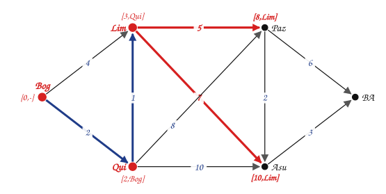

> El vértice no permanente de menor etiqueta es $\text{Lim}$ con $3$: **$\text{Lim}$ se vuelve permanente**. Se reetiquetan los vecinos $\text{Paz}$ y $\text{Asu}$, porque llegar por $\text{Lim}$ cuesta menos que su etiqueta anterior.

| Iteración | Permanente | $\text{Bog}$ | $\text{Lim}$ | $\text{Qui}$ | $\text{Paz}$ | $\text{Asu}$ | $\text{BA}$ |
|---|---|---|---|---|---|---|---|
| inicio | — | $\textcolor{#a94700}{\textbf{[0,-]}}$ | ∞ | ∞ | ∞ | ∞ | ∞ |
| 1 | $\text{Bog}$ | **[0,-]** ✓ | $\textcolor{#a94700}{\textbf{[4,Bog]}}$ | $\textcolor{#a94700}{\textbf{[2,Bog]}}$ | ∞ | ∞ | ∞ |
| 2 | $\text{Qui}$ | ✓ | $\textcolor{#a94700}{\textbf{[3,Qui]}}$ | **[2,Bog]** ✓ | $\textcolor{#a94700}{\textbf{[10,Qui]}}$ | $\textcolor{#a94700}{\textbf{[12,Qui]}}$ | ∞ |
| 3 | $\text{Lim}$ | ✓ | **[3,Qui]** ✓ | ✓ | $\textcolor{#a94700}{\textbf{[8,Lim]}}$ | $\textcolor{#a94700}{\textbf{[10,Lim]}}$ | ∞ |

> **Paz es el siguiente permanente. Por Paz, Asu costaría 8 + 2 = 10, igual a su etiqueta actual [10,Lim]. ¿Se cambia la etiqueta de Asu?**

:::
:::{tab-item} Paso 5
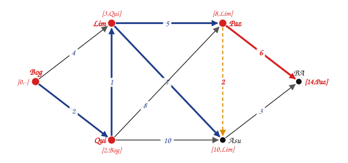

> El vértice no permanente de menor etiqueta es $\text{Paz}$ con $8$: **$\text{Paz}$ se vuelve permanente**. Se reetiquetan los vecinos $\text{BA}$, porque llegar por $\text{Paz}$ cuesta menos que su etiqueta anterior.

| Iteración | Permanente | $\text{Bog}$ | $\text{Lim}$ | $\text{Qui}$ | $\text{Paz}$ | $\text{Asu}$ | $\text{BA}$ |
|---|---|---|---|---|---|---|---|
| inicio | — | $\textcolor{#a94700}{\textbf{[0,-]}}$ | ∞ | ∞ | ∞ | ∞ | ∞ |
| 1 | $\text{Bog}$ | **[0,-]** ✓ | $\textcolor{#a94700}{\textbf{[4,Bog]}}$ | $\textcolor{#a94700}{\textbf{[2,Bog]}}$ | ∞ | ∞ | ∞ |
| 2 | $\text{Qui}$ | ✓ | $\textcolor{#a94700}{\textbf{[3,Qui]}}$ | **[2,Bog]** ✓ | $\textcolor{#a94700}{\textbf{[10,Qui]}}$ | $\textcolor{#a94700}{\textbf{[12,Qui]}}$ | ∞ |
| 3 | $\text{Lim}$ | ✓ | **[3,Qui]** ✓ | ✓ | $\textcolor{#a94700}{\textbf{[8,Lim]}}$ | $\textcolor{#a94700}{\textbf{[10,Lim]}}$ | ∞ |
| 4 | $\text{Paz}$ | ✓ | ✓ | ✓ | **[8,Lim]** ✓ | [10,Lim] | $\textcolor{#a94700}{\textbf{[14,Paz]}}$ |

> No se cambia: Dijkstra reetiqueta solo si el nuevo valor es **estrictamente menor**. Los dos caminos cuestan $10$; se conserva el que se encontró primero.

:::
:::{tab-item} Paso 6
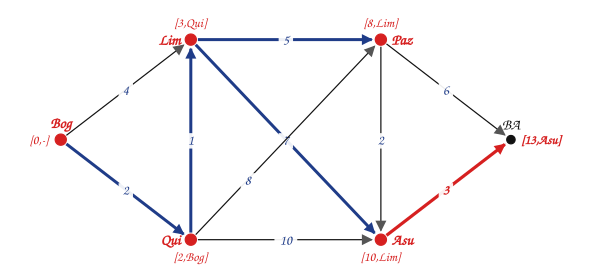

> El vértice no permanente de menor etiqueta es $\text{Asu}$ con $10$: **$\text{Asu}$ se vuelve permanente**. Se reetiquetan los vecinos $\text{BA}$, porque llegar por $\text{Asu}$ cuesta menos que su etiqueta anterior.

| Iteración | Permanente | $\text{Bog}$ | $\text{Lim}$ | $\text{Qui}$ | $\text{Paz}$ | $\text{Asu}$ | $\text{BA}$ |
|---|---|---|---|---|---|---|---|
| inicio | — | $\textcolor{#a94700}{\textbf{[0,-]}}$ | ∞ | ∞ | ∞ | ∞ | ∞ |
| 1 | $\text{Bog}$ | **[0,-]** ✓ | $\textcolor{#a94700}{\textbf{[4,Bog]}}$ | $\textcolor{#a94700}{\textbf{[2,Bog]}}$ | ∞ | ∞ | ∞ |
| 2 | $\text{Qui}$ | ✓ | $\textcolor{#a94700}{\textbf{[3,Qui]}}$ | **[2,Bog]** ✓ | $\textcolor{#a94700}{\textbf{[10,Qui]}}$ | $\textcolor{#a94700}{\textbf{[12,Qui]}}$ | ∞ |
| 3 | $\text{Lim}$ | ✓ | **[3,Qui]** ✓ | ✓ | $\textcolor{#a94700}{\textbf{[8,Lim]}}$ | $\textcolor{#a94700}{\textbf{[10,Lim]}}$ | ∞ |
| 4 | $\text{Paz}$ | ✓ | ✓ | ✓ | **[8,Lim]** ✓ | [10,Lim] | $\textcolor{#a94700}{\textbf{[14,Paz]}}$ |
| 5 | $\text{Asu}$ | ✓ | ✓ | ✓ | ✓ | **[10,Lim]** ✓ | $\textcolor{#a94700}{\textbf{[13,Asu]}}$ |

:::
:::{tab-item} Paso 7
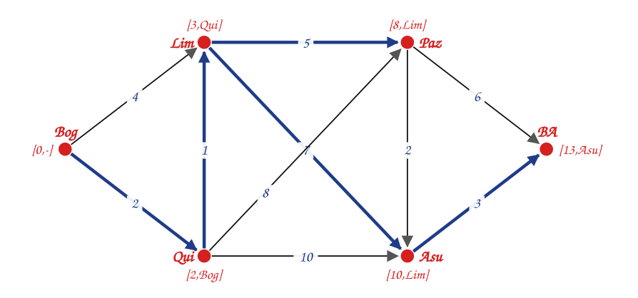

> El vértice no permanente de menor etiqueta es $\text{BA}$ con $13$: **$\text{BA}$ se vuelve permanente**. No le quedan vecinos que no sean permanentes.

| Iteración | Permanente | $\text{Bog}$ | $\text{Lim}$ | $\text{Qui}$ | $\text{Paz}$ | $\text{Asu}$ | $\text{BA}$ |
|---|---|---|---|---|---|---|---|
| inicio | — | $\textcolor{#a94700}{\textbf{[0,-]}}$ | ∞ | ∞ | ∞ | ∞ | ∞ |
| 1 | $\text{Bog}$ | **[0,-]** ✓ | $\textcolor{#a94700}{\textbf{[4,Bog]}}$ | $\textcolor{#a94700}{\textbf{[2,Bog]}}$ | ∞ | ∞ | ∞ |
| 2 | $\text{Qui}$ | ✓ | $\textcolor{#a94700}{\textbf{[3,Qui]}}$ | **[2,Bog]** ✓ | $\textcolor{#a94700}{\textbf{[10,Qui]}}$ | $\textcolor{#a94700}{\textbf{[12,Qui]}}$ | ∞ |
| 3 | $\text{Lim}$ | ✓ | **[3,Qui]** ✓ | ✓ | $\textcolor{#a94700}{\textbf{[8,Lim]}}$ | $\textcolor{#a94700}{\textbf{[10,Lim]}}$ | ∞ |
| 4 | $\text{Paz}$ | ✓ | ✓ | ✓ | **[8,Lim]** ✓ | [10,Lim] | $\textcolor{#a94700}{\textbf{[14,Paz]}}$ |
| 5 | $\text{Asu}$ | ✓ | ✓ | ✓ | ✓ | **[10,Lim]** ✓ | $\textcolor{#a94700}{\textbf{[13,Asu]}}$ |
| 6 | $\text{BA}$ | ✓ | ✓ | ✓ | ✓ | ✓ | **[13,Asu]** ✓ |

:::
::::
:::::

:::::{admonition} Camino mínimo de Bogotá a Buenos Aires
:class: dropdown
::::{tab-set}
:::{tab-item} Paso 1
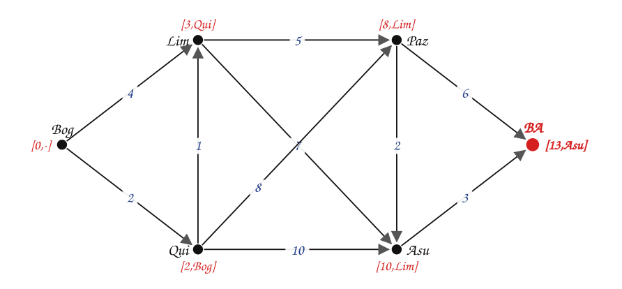

> La etiqueta de $\text{BA}$ es $[13,Asu]$: se llega a $\text{BA}$ desde $\text{Asu}$.

:::
:::{tab-item} Paso 2
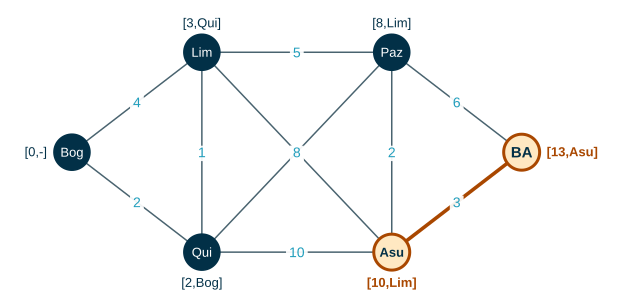

> La etiqueta de $\text{Asu}$ es $[10,Lim]$: se llega a $\text{Asu}$ desde $\text{Lim}$.

:::
:::{tab-item} Paso 3
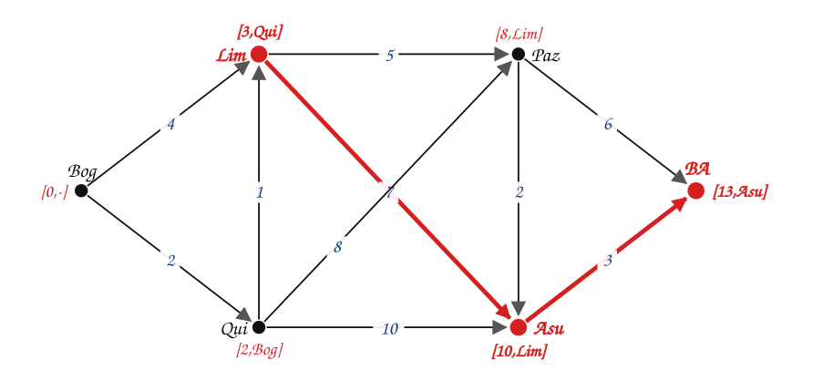

> La etiqueta de $\text{Lim}$ es $[3,Qui]$: se llega a $\text{Lim}$ desde $\text{Qui}$.

:::
:::{tab-item} Paso 4
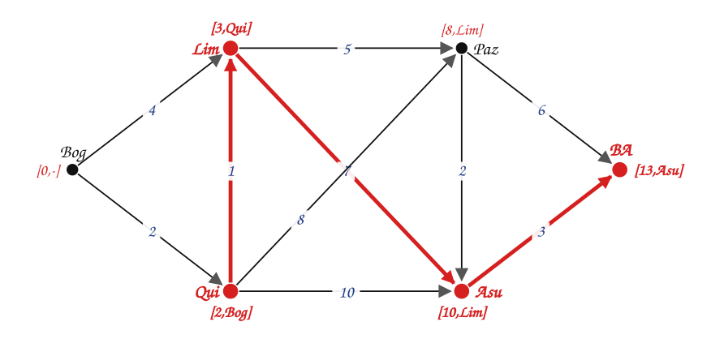

> La etiqueta de $\text{Qui}$ es $[2,Bog]$: se llega a $\text{Qui}$ desde $\text{Bog}$.

:::
:::{tab-item} Paso 5
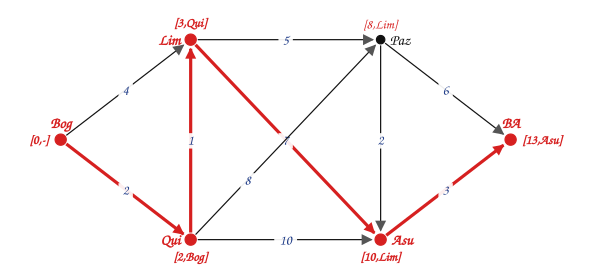

> $\text{Bog}$ es el origen: no tiene predecesor. El camino, leído al revés, es $\text{Bog} \to \text{Qui} \to \text{Lim} \to \text{Asu} \to \text{BA}$ con costo $13$.

:::
::::
:::::

El camino más corto es Bogotá $\to$ Quito $\to$ Lima $\to$ Asunción $\to$ Buenos Aires, con longitud $13$.

### Ejemplo 3

El mapa del sur de Alemania del ejercicio de BFS, ahora con las distancias en kilómetros. Origen: Frankfurt.

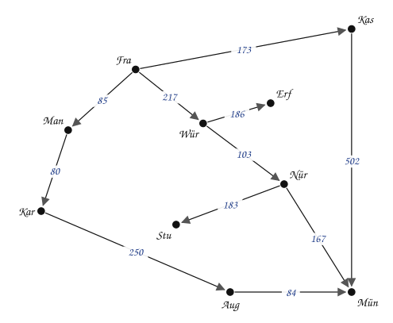

:::::{admonition} Dijkstra desde Frankfurt
:class: dropdown
::::{tab-set}
:::{tab-item} Paso 1
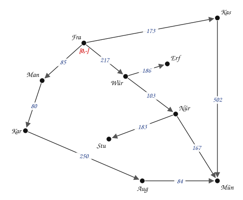

> Se etiqueta el origen $\text{Fra}$ con $[0,-]$: distancia $0$, sin predecesor.

| Iteración | Permanente | $\text{Fra}$ | $\text{Man}$ | $\text{Wür}$ | $\text{Kas}$ | $\text{Kar}$ | $\text{Erf}$ | $\text{Nür}$ | $\text{Aug}$ | $\text{Stu}$ | $\text{Mün}$ |
|---|---|---|---|---|---|---|---|---|---|---|---|
| inicio | — | $\textcolor{#a94700}{\textbf{[0,-]}}$ | ∞ | ∞ | ∞ | ∞ | ∞ | ∞ | ∞ | ∞ | ∞ |

:::
:::{tab-item} Paso 2
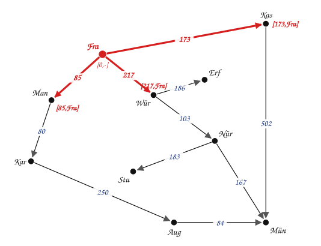

> El vértice no permanente de menor etiqueta es $\text{Fra}$ con $0$: **$\text{Fra}$ se vuelve permanente**. Se reetiquetan los vecinos $\text{Man}$, $\text{Wür}$ y $\text{Kas}$, porque llegar por $\text{Fra}$ cuesta menos que su etiqueta anterior.

| Iteración | Permanente | $\text{Fra}$ | $\text{Man}$ | $\text{Wür}$ | $\text{Kas}$ | $\text{Kar}$ | $\text{Erf}$ | $\text{Nür}$ | $\text{Aug}$ | $\text{Stu}$ | $\text{Mün}$ |
|---|---|---|---|---|---|---|---|---|---|---|---|
| inicio | — | $\textcolor{#a94700}{\textbf{[0,-]}}$ | ∞ | ∞ | ∞ | ∞ | ∞ | ∞ | ∞ | ∞ | ∞ |
| 1 | $\text{Fra}$ | **[0,-]** ✓ | $\textcolor{#a94700}{\textbf{[85,Fra]}}$ | $\textcolor{#a94700}{\textbf{[217,Fra]}}$ | $\textcolor{#a94700}{\textbf{[173,Fra]}}$ | ∞ | ∞ | ∞ | ∞ | ∞ | ∞ |

:::
:::{tab-item} Paso 3
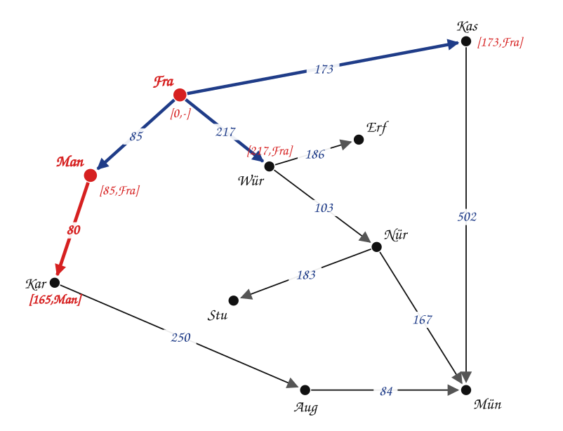

> El vértice no permanente de menor etiqueta es $\text{Man}$ con $85$: **$\text{Man}$ se vuelve permanente**. Se reetiquetan los vecinos $\text{Kar}$, porque llegar por $\text{Man}$ cuesta menos que su etiqueta anterior.

| Iteración | Permanente | $\text{Fra}$ | $\text{Man}$ | $\text{Wür}$ | $\text{Kas}$ | $\text{Kar}$ | $\text{Erf}$ | $\text{Nür}$ | $\text{Aug}$ | $\text{Stu}$ | $\text{Mün}$ |
|---|---|---|---|---|---|---|---|---|---|---|---|
| inicio | — | $\textcolor{#a94700}{\textbf{[0,-]}}$ | ∞ | ∞ | ∞ | ∞ | ∞ | ∞ | ∞ | ∞ | ∞ |
| 1 | $\text{Fra}$ | **[0,-]** ✓ | $\textcolor{#a94700}{\textbf{[85,Fra]}}$ | $\textcolor{#a94700}{\textbf{[217,Fra]}}$ | $\textcolor{#a94700}{\textbf{[173,Fra]}}$ | ∞ | ∞ | ∞ | ∞ | ∞ | ∞ |
| 2 | $\text{Man}$ | ✓ | **[85,Fra]** ✓ | [217,Fra] | [173,Fra] | $\textcolor{#a94700}{\textbf{[165,Man]}}$ | ∞ | ∞ | ∞ | ∞ | ∞ |

:::
:::{tab-item} Paso 4
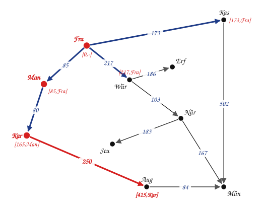

> El vértice no permanente de menor etiqueta es $\text{Kar}$ con $165$: **$\text{Kar}$ se vuelve permanente**. Se reetiquetan los vecinos $\text{Aug}$, porque llegar por $\text{Kar}$ cuesta menos que su etiqueta anterior.

| Iteración | Permanente | $\text{Fra}$ | $\text{Man}$ | $\text{Wür}$ | $\text{Kas}$ | $\text{Kar}$ | $\text{Erf}$ | $\text{Nür}$ | $\text{Aug}$ | $\text{Stu}$ | $\text{Mün}$ |
|---|---|---|---|---|---|---|---|---|---|---|---|
| inicio | — | $\textcolor{#a94700}{\textbf{[0,-]}}$ | ∞ | ∞ | ∞ | ∞ | ∞ | ∞ | ∞ | ∞ | ∞ |
| 1 | $\text{Fra}$ | **[0,-]** ✓ | $\textcolor{#a94700}{\textbf{[85,Fra]}}$ | $\textcolor{#a94700}{\textbf{[217,Fra]}}$ | $\textcolor{#a94700}{\textbf{[173,Fra]}}$ | ∞ | ∞ | ∞ | ∞ | ∞ | ∞ |
| 2 | $\text{Man}$ | ✓ | **[85,Fra]** ✓ | [217,Fra] | [173,Fra] | $\textcolor{#a94700}{\textbf{[165,Man]}}$ | ∞ | ∞ | ∞ | ∞ | ∞ |
| 3 | $\text{Kar}$ | ✓ | ✓ | [217,Fra] | [173,Fra] | **[165,Man]** ✓ | ∞ | ∞ | $\textcolor{#a94700}{\textbf{[415,Kar]}}$ | ∞ | ∞ |

:::
:::{tab-item} Paso 5
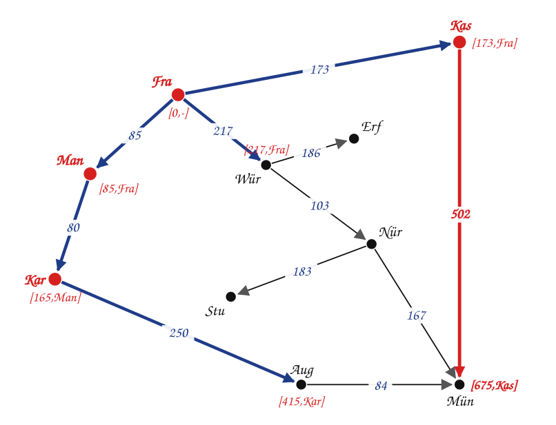

> El vértice no permanente de menor etiqueta es $\text{Kas}$ con $173$: **$\text{Kas}$ se vuelve permanente**. Se reetiquetan los vecinos $\text{Mün}$, porque llegar por $\text{Kas}$ cuesta menos que su etiqueta anterior.

| Iteración | Permanente | $\text{Fra}$ | $\text{Man}$ | $\text{Wür}$ | $\text{Kas}$ | $\text{Kar}$ | $\text{Erf}$ | $\text{Nür}$ | $\text{Aug}$ | $\text{Stu}$ | $\text{Mün}$ |
|---|---|---|---|---|---|---|---|---|---|---|---|
| inicio | — | $\textcolor{#a94700}{\textbf{[0,-]}}$ | ∞ | ∞ | ∞ | ∞ | ∞ | ∞ | ∞ | ∞ | ∞ |
| 1 | $\text{Fra}$ | **[0,-]** ✓ | $\textcolor{#a94700}{\textbf{[85,Fra]}}$ | $\textcolor{#a94700}{\textbf{[217,Fra]}}$ | $\textcolor{#a94700}{\textbf{[173,Fra]}}$ | ∞ | ∞ | ∞ | ∞ | ∞ | ∞ |
| 2 | $\text{Man}$ | ✓ | **[85,Fra]** ✓ | [217,Fra] | [173,Fra] | $\textcolor{#a94700}{\textbf{[165,Man]}}$ | ∞ | ∞ | ∞ | ∞ | ∞ |
| 3 | $\text{Kar}$ | ✓ | ✓ | [217,Fra] | [173,Fra] | **[165,Man]** ✓ | ∞ | ∞ | $\textcolor{#a94700}{\textbf{[415,Kar]}}$ | ∞ | ∞ |
| 4 | $\text{Kas}$ | ✓ | ✓ | [217,Fra] | **[173,Fra]** ✓ | ✓ | ∞ | ∞ | [415,Kar] | ∞ | $\textcolor{#a94700}{\textbf{[675,Kas]}}$ |

:::
:::{tab-item} Paso 6
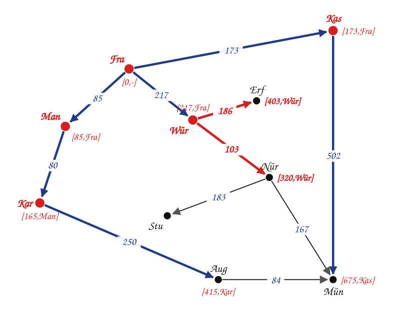

> El vértice no permanente de menor etiqueta es $\text{Wür}$ con $217$: **$\text{Wür}$ se vuelve permanente**. Se reetiquetan los vecinos $\text{Erf}$ y $\text{Nür}$, porque llegar por $\text{Wür}$ cuesta menos que su etiqueta anterior.

| Iteración | Permanente | $\text{Fra}$ | $\text{Man}$ | $\text{Wür}$ | $\text{Kas}$ | $\text{Kar}$ | $\text{Erf}$ | $\text{Nür}$ | $\text{Aug}$ | $\text{Stu}$ | $\text{Mün}$ |
|---|---|---|---|---|---|---|---|---|---|---|---|
| inicio | — | $\textcolor{#a94700}{\textbf{[0,-]}}$ | ∞ | ∞ | ∞ | ∞ | ∞ | ∞ | ∞ | ∞ | ∞ |
| 1 | $\text{Fra}$ | **[0,-]** ✓ | $\textcolor{#a94700}{\textbf{[85,Fra]}}$ | $\textcolor{#a94700}{\textbf{[217,Fra]}}$ | $\textcolor{#a94700}{\textbf{[173,Fra]}}$ | ∞ | ∞ | ∞ | ∞ | ∞ | ∞ |
| 2 | $\text{Man}$ | ✓ | **[85,Fra]** ✓ | [217,Fra] | [173,Fra] | $\textcolor{#a94700}{\textbf{[165,Man]}}$ | ∞ | ∞ | ∞ | ∞ | ∞ |
| 3 | $\text{Kar}$ | ✓ | ✓ | [217,Fra] | [173,Fra] | **[165,Man]** ✓ | ∞ | ∞ | $\textcolor{#a94700}{\textbf{[415,Kar]}}$ | ∞ | ∞ |
| 4 | $\text{Kas}$ | ✓ | ✓ | [217,Fra] | **[173,Fra]** ✓ | ✓ | ∞ | ∞ | [415,Kar] | ∞ | $\textcolor{#a94700}{\textbf{[675,Kas]}}$ |
| 5 | $\text{Wür}$ | ✓ | ✓ | **[217,Fra]** ✓ | ✓ | ✓ | $\textcolor{#a94700}{\textbf{[403,Wür]}}$ | $\textcolor{#a94700}{\textbf{[320,Wür]}}$ | [415,Kar] | ∞ | [675,Kas] |

> **Mün tiene la etiqueta [675,Kas]. ¿Puede mejorar todavía?**

:::
:::{tab-item} Paso 7
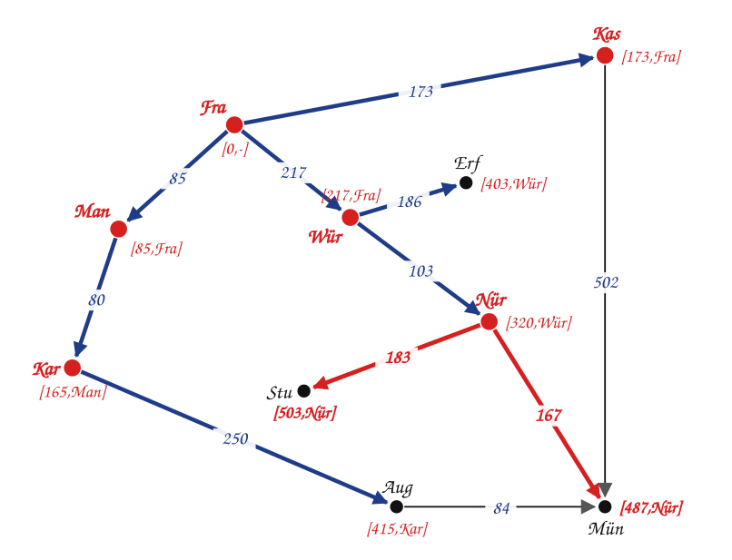

> El vértice no permanente de menor etiqueta es $\text{Nür}$ con $320$: **$\text{Nür}$ se vuelve permanente**. Se reetiquetan los vecinos $\text{Stu}$ y $\text{Mün}$, porque llegar por $\text{Nür}$ cuesta menos que su etiqueta anterior.

| Iteración | Permanente | $\text{Fra}$ | $\text{Man}$ | $\text{Wür}$ | $\text{Kas}$ | $\text{Kar}$ | $\text{Erf}$ | $\text{Nür}$ | $\text{Aug}$ | $\text{Stu}$ | $\text{Mün}$ |
|---|---|---|---|---|---|---|---|---|---|---|---|
| inicio | — | $\textcolor{#a94700}{\textbf{[0,-]}}$ | ∞ | ∞ | ∞ | ∞ | ∞ | ∞ | ∞ | ∞ | ∞ |
| 1 | $\text{Fra}$ | **[0,-]** ✓ | $\textcolor{#a94700}{\textbf{[85,Fra]}}$ | $\textcolor{#a94700}{\textbf{[217,Fra]}}$ | $\textcolor{#a94700}{\textbf{[173,Fra]}}$ | ∞ | ∞ | ∞ | ∞ | ∞ | ∞ |
| 2 | $\text{Man}$ | ✓ | **[85,Fra]** ✓ | [217,Fra] | [173,Fra] | $\textcolor{#a94700}{\textbf{[165,Man]}}$ | ∞ | ∞ | ∞ | ∞ | ∞ |
| 3 | $\text{Kar}$ | ✓ | ✓ | [217,Fra] | [173,Fra] | **[165,Man]** ✓ | ∞ | ∞ | $\textcolor{#a94700}{\textbf{[415,Kar]}}$ | ∞ | ∞ |
| 4 | $\text{Kas}$ | ✓ | ✓ | [217,Fra] | **[173,Fra]** ✓ | ✓ | ∞ | ∞ | [415,Kar] | ∞ | $\textcolor{#a94700}{\textbf{[675,Kas]}}$ |
| 5 | $\text{Wür}$ | ✓ | ✓ | **[217,Fra]** ✓ | ✓ | ✓ | $\textcolor{#a94700}{\textbf{[403,Wür]}}$ | $\textcolor{#a94700}{\textbf{[320,Wür]}}$ | [415,Kar] | ∞ | [675,Kas] |
| 6 | $\text{Nür}$ | ✓ | ✓ | ✓ | ✓ | ✓ | [403,Wür] | **[320,Wür]** ✓ | [415,Kar] | $\textcolor{#a94700}{\textbf{[503,Nür]}}$ | $\textcolor{#a94700}{\textbf{[487,Nür]}}$ |

> Sí: por Nür, Mün cuesta $320 + 167 = 487 < 675$. Se reetiqueta con $[487,\text{Nür}]$. La etiqueta de un vértice que **no** es permanente todavía puede bajar.

:::
:::{tab-item} Paso 8
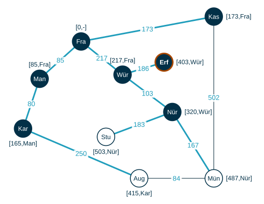

> El vértice no permanente de menor etiqueta es $\text{Erf}$ con $403$: **$\text{Erf}$ se vuelve permanente**. No le quedan vecinos que no sean permanentes.

| Iteración | Permanente | $\text{Fra}$ | $\text{Man}$ | $\text{Wür}$ | $\text{Kas}$ | $\text{Kar}$ | $\text{Erf}$ | $\text{Nür}$ | $\text{Aug}$ | $\text{Stu}$ | $\text{Mün}$ |
|---|---|---|---|---|---|---|---|---|---|---|---|
| inicio | — | $\textcolor{#a94700}{\textbf{[0,-]}}$ | ∞ | ∞ | ∞ | ∞ | ∞ | ∞ | ∞ | ∞ | ∞ |
| 1 | $\text{Fra}$ | **[0,-]** ✓ | $\textcolor{#a94700}{\textbf{[85,Fra]}}$ | $\textcolor{#a94700}{\textbf{[217,Fra]}}$ | $\textcolor{#a94700}{\textbf{[173,Fra]}}$ | ∞ | ∞ | ∞ | ∞ | ∞ | ∞ |
| 2 | $\text{Man}$ | ✓ | **[85,Fra]** ✓ | [217,Fra] | [173,Fra] | $\textcolor{#a94700}{\textbf{[165,Man]}}$ | ∞ | ∞ | ∞ | ∞ | ∞ |
| 3 | $\text{Kar}$ | ✓ | ✓ | [217,Fra] | [173,Fra] | **[165,Man]** ✓ | ∞ | ∞ | $\textcolor{#a94700}{\textbf{[415,Kar]}}$ | ∞ | ∞ |
| 4 | $\text{Kas}$ | ✓ | ✓ | [217,Fra] | **[173,Fra]** ✓ | ✓ | ∞ | ∞ | [415,Kar] | ∞ | $\textcolor{#a94700}{\textbf{[675,Kas]}}$ |
| 5 | $\text{Wür}$ | ✓ | ✓ | **[217,Fra]** ✓ | ✓ | ✓ | $\textcolor{#a94700}{\textbf{[403,Wür]}}$ | $\textcolor{#a94700}{\textbf{[320,Wür]}}$ | [415,Kar] | ∞ | [675,Kas] |
| 6 | $\text{Nür}$ | ✓ | ✓ | ✓ | ✓ | ✓ | [403,Wür] | **[320,Wür]** ✓ | [415,Kar] | $\textcolor{#a94700}{\textbf{[503,Nür]}}$ | $\textcolor{#a94700}{\textbf{[487,Nür]}}$ |
| 7 | $\text{Erf}$ | ✓ | ✓ | ✓ | ✓ | ✓ | **[403,Wür]** ✓ | ✓ | [415,Kar] | [503,Nür] | [487,Nür] |

:::
:::{tab-item} Paso 9
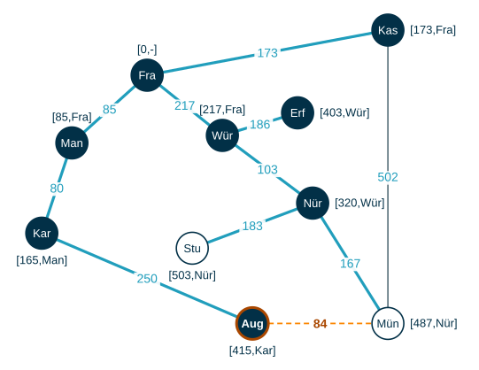

> El vértice no permanente de menor etiqueta es $\text{Aug}$ con $415$: **$\text{Aug}$ se vuelve permanente**. Ningún vecino mejora: $\text{Mün}$ ya tienen una etiqueta menor o igual pasando por $\text{Aug}$.

| Iteración | Permanente | $\text{Fra}$ | $\text{Man}$ | $\text{Wür}$ | $\text{Kas}$ | $\text{Kar}$ | $\text{Erf}$ | $\text{Nür}$ | $\text{Aug}$ | $\text{Stu}$ | $\text{Mün}$ |
|---|---|---|---|---|---|---|---|---|---|---|---|
| inicio | — | $\textcolor{#a94700}{\textbf{[0,-]}}$ | ∞ | ∞ | ∞ | ∞ | ∞ | ∞ | ∞ | ∞ | ∞ |
| 1 | $\text{Fra}$ | **[0,-]** ✓ | $\textcolor{#a94700}{\textbf{[85,Fra]}}$ | $\textcolor{#a94700}{\textbf{[217,Fra]}}$ | $\textcolor{#a94700}{\textbf{[173,Fra]}}$ | ∞ | ∞ | ∞ | ∞ | ∞ | ∞ |
| 2 | $\text{Man}$ | ✓ | **[85,Fra]** ✓ | [217,Fra] | [173,Fra] | $\textcolor{#a94700}{\textbf{[165,Man]}}$ | ∞ | ∞ | ∞ | ∞ | ∞ |
| 3 | $\text{Kar}$ | ✓ | ✓ | [217,Fra] | [173,Fra] | **[165,Man]** ✓ | ∞ | ∞ | $\textcolor{#a94700}{\textbf{[415,Kar]}}$ | ∞ | ∞ |
| 4 | $\text{Kas}$ | ✓ | ✓ | [217,Fra] | **[173,Fra]** ✓ | ✓ | ∞ | ∞ | [415,Kar] | ∞ | $\textcolor{#a94700}{\textbf{[675,Kas]}}$ |
| 5 | $\text{Wür}$ | ✓ | ✓ | **[217,Fra]** ✓ | ✓ | ✓ | $\textcolor{#a94700}{\textbf{[403,Wür]}}$ | $\textcolor{#a94700}{\textbf{[320,Wür]}}$ | [415,Kar] | ∞ | [675,Kas] |
| 6 | $\text{Nür}$ | ✓ | ✓ | ✓ | ✓ | ✓ | [403,Wür] | **[320,Wür]** ✓ | [415,Kar] | $\textcolor{#a94700}{\textbf{[503,Nür]}}$ | $\textcolor{#a94700}{\textbf{[487,Nür]}}$ |
| 7 | $\text{Erf}$ | ✓ | ✓ | ✓ | ✓ | ✓ | **[403,Wür]** ✓ | ✓ | [415,Kar] | [503,Nür] | [487,Nür] |
| 8 | $\text{Aug}$ | ✓ | ✓ | ✓ | ✓ | ✓ | ✓ | ✓ | **[415,Kar]** ✓ | [503,Nür] | [487,Nür] |

:::
:::{tab-item} Paso 10
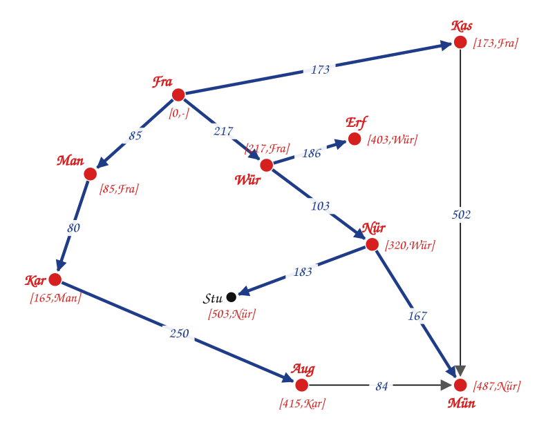

> El vértice no permanente de menor etiqueta es $\text{Mün}$ con $487$: **$\text{Mün}$ se vuelve permanente**. No le quedan vecinos que no sean permanentes.

| Iteración | Permanente | $\text{Fra}$ | $\text{Man}$ | $\text{Wür}$ | $\text{Kas}$ | $\text{Kar}$ | $\text{Erf}$ | $\text{Nür}$ | $\text{Aug}$ | $\text{Stu}$ | $\text{Mün}$ |
|---|---|---|---|---|---|---|---|---|---|---|---|
| inicio | — | $\textcolor{#a94700}{\textbf{[0,-]}}$ | ∞ | ∞ | ∞ | ∞ | ∞ | ∞ | ∞ | ∞ | ∞ |
| 1 | $\text{Fra}$ | **[0,-]** ✓ | $\textcolor{#a94700}{\textbf{[85,Fra]}}$ | $\textcolor{#a94700}{\textbf{[217,Fra]}}$ | $\textcolor{#a94700}{\textbf{[173,Fra]}}$ | ∞ | ∞ | ∞ | ∞ | ∞ | ∞ |
| 2 | $\text{Man}$ | ✓ | **[85,Fra]** ✓ | [217,Fra] | [173,Fra] | $\textcolor{#a94700}{\textbf{[165,Man]}}$ | ∞ | ∞ | ∞ | ∞ | ∞ |
| 3 | $\text{Kar}$ | ✓ | ✓ | [217,Fra] | [173,Fra] | **[165,Man]** ✓ | ∞ | ∞ | $\textcolor{#a94700}{\textbf{[415,Kar]}}$ | ∞ | ∞ |
| 4 | $\text{Kas}$ | ✓ | ✓ | [217,Fra] | **[173,Fra]** ✓ | ✓ | ∞ | ∞ | [415,Kar] | ∞ | $\textcolor{#a94700}{\textbf{[675,Kas]}}$ |
| 5 | $\text{Wür}$ | ✓ | ✓ | **[217,Fra]** ✓ | ✓ | ✓ | $\textcolor{#a94700}{\textbf{[403,Wür]}}$ | $\textcolor{#a94700}{\textbf{[320,Wür]}}$ | [415,Kar] | ∞ | [675,Kas] |
| 6 | $\text{Nür}$ | ✓ | ✓ | ✓ | ✓ | ✓ | [403,Wür] | **[320,Wür]** ✓ | [415,Kar] | $\textcolor{#a94700}{\textbf{[503,Nür]}}$ | $\textcolor{#a94700}{\textbf{[487,Nür]}}$ |
| 7 | $\text{Erf}$ | ✓ | ✓ | ✓ | ✓ | ✓ | **[403,Wür]** ✓ | ✓ | [415,Kar] | [503,Nür] | [487,Nür] |
| 8 | $\text{Aug}$ | ✓ | ✓ | ✓ | ✓ | ✓ | ✓ | ✓ | **[415,Kar]** ✓ | [503,Nür] | [487,Nür] |
| 9 | $\text{Mün}$ | ✓ | ✓ | ✓ | ✓ | ✓ | ✓ | ✓ | ✓ | [503,Nür] | **[487,Nür]** ✓ |

:::
:::{tab-item} Paso 11
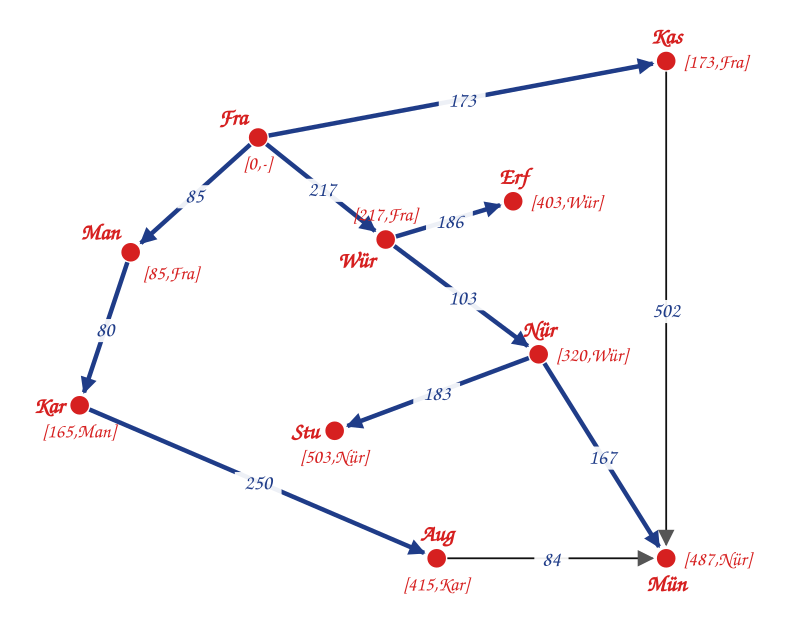

> El vértice no permanente de menor etiqueta es $\text{Stu}$ con $503$: **$\text{Stu}$ se vuelve permanente**. No le quedan vecinos que no sean permanentes.

| Iteración | Permanente | $\text{Fra}$ | $\text{Man}$ | $\text{Wür}$ | $\text{Kas}$ | $\text{Kar}$ | $\text{Erf}$ | $\text{Nür}$ | $\text{Aug}$ | $\text{Stu}$ | $\text{Mün}$ |
|---|---|---|---|---|---|---|---|---|---|---|---|
| inicio | — | $\textcolor{#a94700}{\textbf{[0,-]}}$ | ∞ | ∞ | ∞ | ∞ | ∞ | ∞ | ∞ | ∞ | ∞ |
| 1 | $\text{Fra}$ | **[0,-]** ✓ | $\textcolor{#a94700}{\textbf{[85,Fra]}}$ | $\textcolor{#a94700}{\textbf{[217,Fra]}}$ | $\textcolor{#a94700}{\textbf{[173,Fra]}}$ | ∞ | ∞ | ∞ | ∞ | ∞ | ∞ |
| 2 | $\text{Man}$ | ✓ | **[85,Fra]** ✓ | [217,Fra] | [173,Fra] | $\textcolor{#a94700}{\textbf{[165,Man]}}$ | ∞ | ∞ | ∞ | ∞ | ∞ |
| 3 | $\text{Kar}$ | ✓ | ✓ | [217,Fra] | [173,Fra] | **[165,Man]** ✓ | ∞ | ∞ | $\textcolor{#a94700}{\textbf{[415,Kar]}}$ | ∞ | ∞ |
| 4 | $\text{Kas}$ | ✓ | ✓ | [217,Fra] | **[173,Fra]** ✓ | ✓ | ∞ | ∞ | [415,Kar] | ∞ | $\textcolor{#a94700}{\textbf{[675,Kas]}}$ |
| 5 | $\text{Wür}$ | ✓ | ✓ | **[217,Fra]** ✓ | ✓ | ✓ | $\textcolor{#a94700}{\textbf{[403,Wür]}}$ | $\textcolor{#a94700}{\textbf{[320,Wür]}}$ | [415,Kar] | ∞ | [675,Kas] |
| 6 | $\text{Nür}$ | ✓ | ✓ | ✓ | ✓ | ✓ | [403,Wür] | **[320,Wür]** ✓ | [415,Kar] | $\textcolor{#a94700}{\textbf{[503,Nür]}}$ | $\textcolor{#a94700}{\textbf{[487,Nür]}}$ |
| 7 | $\text{Erf}$ | ✓ | ✓ | ✓ | ✓ | ✓ | **[403,Wür]** ✓ | ✓ | [415,Kar] | [503,Nür] | [487,Nür] |
| 8 | $\text{Aug}$ | ✓ | ✓ | ✓ | ✓ | ✓ | ✓ | ✓ | **[415,Kar]** ✓ | [503,Nür] | [487,Nür] |
| 9 | $\text{Mün}$ | ✓ | ✓ | ✓ | ✓ | ✓ | ✓ | ✓ | ✓ | [503,Nür] | **[487,Nür]** ✓ |
| 10 | $\text{Stu}$ | ✓ | ✓ | ✓ | ✓ | ✓ | ✓ | ✓ | ✓ | **[503,Nür]** ✓ | ✓ |

:::
::::
:::::

| Destino | Costo mínimo | Camino |
|---|---|---|
| $\text{Fra}$ | 0 | Fra |
| $\text{Man}$ | 85 | Fra → Man |
| $\text{Wür}$ | 217 | Fra → Wür |
| $\text{Kas}$ | 173 | Fra → Kas |
| $\text{Kar}$ | 165 | Fra → Man → Kar |
| $\text{Erf}$ | 403 | Fra → Wür → Erf |
| $\text{Nür}$ | 320 | Fra → Wür → Nür |
| $\text{Aug}$ | 415 | Fra → Man → Kar → Aug |
| $\text{Stu}$ | 503 | Fra → Wür → Nür → Stu |
| $\text{Mün}$ | 487 | Fra → Wür → Nür → Mün |

> **¿Qué cambió respecto a BFS?** Con BFS, München quedaba como hijo de Kassel: es el camino con menos tramos (dos), pero cuesta $675$ km. Dijkstra encuentra Frankfurt $\to$ Würzburg $\to$ Nürnberg $\to$ München, con tres tramos y $487$ km.

## 3. El algoritmo

El pseudocódigo del curso (Rosen, sección 10.6), para un grafo $G$ conexo con pesos positivos, desde $a$ hasta $z$:

```text
Procedimiento Dijkstra(G: grafo ponderado conexo y todos los pesos positivos)
    para i = 1 hasta n
        L(v_i) = ∞
    L(a) = 0
    S = ∅
    mientras z ∉ S
        u = vértice con L(u) mínima entre los vértices que no están en S
        S = S ∪ {u}
        para todos los vértices v que no están en S
            si L(u) + w(u, v) < L(v)
                L(v) = L(u) + w(u, v)
                pred(v) = u
```

$L(v)$ es el valor acumulado de la etiqueta y $S$ es el conjunto de vértices permanentes. Si se quiere la distancia a **todos** los vértices, se cambia la condición del `mientras` por «mientras $S \neq V$».

### Complejidad

> **¿Cuántas veces se busca el mínimo, y cuánto cuesta cada búsqueda?**

:::{admonition} Respuesta
:class: dropdown
Se busca una vez por vértice ($|V|$ veces). Si las etiquetas están en un arreglo, cada búsqueda revisa hasta $|V|$ vértices: $O(V^2)$ en total. Revisar los vecinos suma $O(E)$ en todo el algoritmo. Total: $O(V^2 + E) = O(V^2)$.
:::

Con una **cola de prioridad** (un *heap*, Unidad 3), obtener el mínimo cuesta $O(\log V)$ y cada reetiquetado también. El total queda en $O((V + E) \log V)$, que es mejor cuando el grafo tiene pocas aristas.

### Cuando hay pesos negativos

La regla «una etiqueta permanente no cambia nunca» depende de que los pesos sean **no negativos**. Con un solo peso negativo puede fallar:

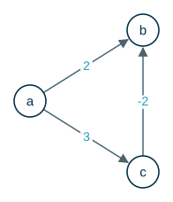

:::::{admonition} Dijkstra con un peso negativo
:class: dropdown
::::{tab-set}
:::{tab-item} Paso 1
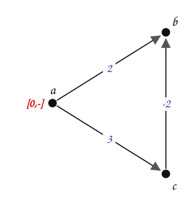

> Se etiqueta el origen $a$ con $[0,-]$: distancia $0$, sin predecesor.

| Iteración | Permanente | $a$ | $b$ | $c$ |
|---|---|---|---|---|
| inicio | — | $\textcolor{#a94700}{\textbf{[0,-]}}$ | ∞ | ∞ |

:::
:::{tab-item} Paso 2
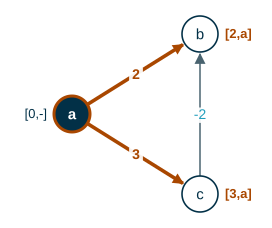

> El vértice no permanente de menor etiqueta es $a$ con $0$: **$a$ se vuelve permanente**. Se reetiquetan los vecinos $b$ y $c$, porque llegar por $a$ cuesta menos que su etiqueta anterior.

| Iteración | Permanente | $a$ | $b$ | $c$ |
|---|---|---|---|---|
| inicio | — | $\textcolor{#a94700}{\textbf{[0,-]}}$ | ∞ | ∞ |
| 1 | $a$ | **[0,-]** ✓ | $\textcolor{#a94700}{\textbf{[2,a]}}$ | $\textcolor{#a94700}{\textbf{[3,a]}}$ |

:::
:::{tab-item} Paso 3
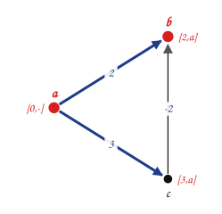

> El vértice no permanente de menor etiqueta es $b$ con $2$: **$b$ se vuelve permanente**. No le quedan vecinos que no sean permanentes.

| Iteración | Permanente | $a$ | $b$ | $c$ |
|---|---|---|---|---|
| inicio | — | $\textcolor{#a94700}{\textbf{[0,-]}}$ | ∞ | ∞ |
| 1 | $a$ | **[0,-]** ✓ | $\textcolor{#a94700}{\textbf{[2,a]}}$ | $\textcolor{#a94700}{\textbf{[3,a]}}$ |
| 2 | $b$ | ✓ | **[2,a]** ✓ | [3,a] |

:::
:::{tab-item} Paso 4
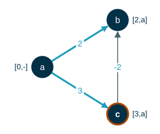

> El vértice no permanente de menor etiqueta es $c$ con $3$: **$c$ se vuelve permanente**. No le quedan vecinos que no sean permanentes.

| Iteración | Permanente | $a$ | $b$ | $c$ |
|---|---|---|---|---|
| inicio | — | $\textcolor{#a94700}{\textbf{[0,-]}}$ | ∞ | ∞ |
| 1 | $a$ | **[0,-]** ✓ | $\textcolor{#a94700}{\textbf{[2,a]}}$ | $\textcolor{#a94700}{\textbf{[3,a]}}$ |
| 2 | $b$ | ✓ | **[2,a]** ✓ | [3,a] |
| 3 | $c$ | ✓ | ✓ | **[3,a]** ✓ |

> Dijkstra termina con $b = [2,a]$, pero el camino $a \to c \to b$ cuesta $3 + (-2) = 1$. Cuando $b$ se volvió permanente se supuso que nada podía abaratarlo, y con un peso negativo eso es falso.

:::
::::
:::::

Para grafos con pesos negativos (y sin circuitos de costo negativo) se usan otros algoritmos, como Floyd-Warshall o Bellman-Ford.

## 4. Implementación en Java

**Análisis.**

| | |
|---|---|
| **Entradas** | Número de vértices, aristas no dirigidas con peso entero no negativo, origen $s$. |
| **Salidas** | Arreglos `dist[]` (valor acumulado) y `pred[]` (predecesor); el camino a cualquier destino. |
| **Proceso** | Etiquetas en arreglos; el siguiente permanente se obtiene de una `PriorityQueue`. |

**Diseño.** Se sigue el pseudocódigo de la sección 3 con una decisión: `PriorityQueue` de Java no permite bajar la prioridad de un elemento. Cada vez que se reetiqueta $v$ se agrega **otra** entrada $\{dist[v], v\}$, y al sacar una entrada de un vértice que ya es permanente, se ignora.

**Codificación.**

```java
import java.util.ArrayList;
import java.util.Arrays;
import java.util.List;
import java.util.PriorityQueue;

public class Dijkstra {

    record Arista(int destino, int peso) { }

    static final int INF = Integer.MAX_VALUE;

    private final List<List<Arista>> adj;
    private final int[] dist;
    private final int[] pred;

    public Dijkstra(int n) {
        adj = new ArrayList<>();
        for (int i = 0; i < n; i++) {
            adj.add(new ArrayList<>());
        }
        dist = new int[n];
        pred = new int[n];
    }

    public void agregarArista(int u, int v, int w) {
        adj.get(u).add(new Arista(v, w));
        adj.get(v).add(new Arista(u, w));
    }

    public void dijkstra(int s) {
        int n = adj.size();
        boolean[] permanente = new boolean[n];
        Arrays.fill(dist, INF);
        Arrays.fill(pred, -1);
        dist[s] = 0;
        // Cada entrada es {distancia, vértice}; la cola entrega primero la menor distancia.
        PriorityQueue<int[]> cola = new PriorityQueue<>((a, b) -> Integer.compare(a[0], b[0]));
        cola.add(new int[] {0, s});
        while (!cola.isEmpty()) {
            int u = cola.remove()[1];
            if (permanente[u]) {
                continue;   // entrada vieja: u ya tiene su distancia definitiva
            }
            permanente[u] = true;
            for (Arista a : adj.get(u)) {
                int v = a.destino();
                if (!permanente[v] && dist[u] + a.peso() < dist[v]) {
                    dist[v] = dist[u] + a.peso();
                    pred[v] = u;
                    cola.add(new int[] {dist[v], v});
                }
            }
        }
    }

    public String camino(String[] nombres, int v) {
        if (pred[v] == -1) {
            return nombres[v];
        }
        return camino(nombres, pred[v]) + " -> " + nombres[v];
    }

    public static void main(String[] args) {
        String[] nombres = {"Bogota", "Lima", "Quito", "La Paz", "Asuncion", "B. Aires"};
        Dijkstra g = new Dijkstra(6);
        int[][] aristas = {{0, 1, 4}, {0, 2, 2}, {1, 2, 1}, {1, 3, 5}, {1, 4, 7},
                           {2, 3, 8}, {2, 4, 10}, {3, 4, 2}, {3, 5, 6}, {4, 5, 3}};
        for (int[] a : aristas) {
            g.agregarArista(a[0], a[1], a[2]);
        }
        g.dijkstra(0);
        for (int v = 0; v < nombres.length; v++) {
            System.out.println(nombres[v] + ": " + g.dist[v] + "  (" + g.camino(nombres, v) + ")");
        }
    }
}
```

**Prueba.** Con el grafo del Ejemplo 2:

```text
Bogota: 0  (Bogota)
Lima: 3  (Bogota -> Quito -> Lima)
Quito: 2  (Bogota -> Quito)
La Paz: 8  (Bogota -> Quito -> Lima -> La Paz)
Asuncion: 10  (Bogota -> Quito -> Lima -> Asuncion)
B. Aires: 13  (Bogota -> Quito -> Lima -> Asuncion -> B. Aires)
```

Son las etiquetas finales de la tabla del Ejemplo 2.

## 5. Formalización

- El algoritmo de Dijkstra (Edsger Dijkstra, 1959) determina la longitud del camino más corto entre dos vértices de un grafo ponderado simple, conexo y no dirigido, con pesos positivos (Rosen, sección 10.6, Teorema 1). La misma idea funciona en grafos dirigidos: los vecinos de $u$ son los vértices a los que sale una arista desde $u$.
- **Invariante.** Cuando un vértice $u$ entra a $S$, $L(u)$ es la longitud de un camino más corto de $s$ a $u$. Para todo $v \notin S$, $L(v)$ es la longitud del camino más corto de $s$ a $v$ cuyos vértices, salvo $v$, están todos en $S$.
- **Complejidad.** $O(V^2)$ con arreglos (Rosen, sección 10.6, Teorema 2); $O((V + E)\log V)$ con un *heap* binario.
- Es un algoritmo **voraz**: en cada paso toma la decisión que parece mejor (el vértice de menor etiqueta) y nunca la deshace.

## Ejercicios

Practique con los [ejercicios de Dijkstra](exercises.md).

## Fuentes

- Caicedo Mejía, J. M. *Unidad 5: Grafos* (Grafos 3: algoritmo de Dijkstra). Computación y Estructuras Discretas I, Universidad Icesi, 2026.
- Bedoya, O. *Grafos: grafos con pesos y algoritmo de Dijkstra*. Diapositivas del curso, Universidad del Valle.
- Rosen, K. H. *Discrete Mathematics and Its Applications*, 7.ª ed. McGraw-Hill, 2011. Sección 10.6.
- Cormen, T. H., Leiserson, C. E., Rivest, R. L., Stein, C. *Introduction to Algorithms*, 3.ª ed. The MIT Press, 2009. Sección 24.3.

---

*Material adaptado del material original del profesor Oscar Bedoya.*
