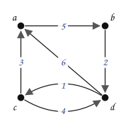
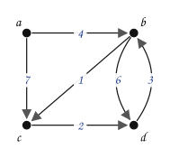
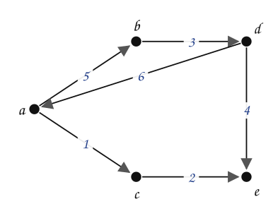
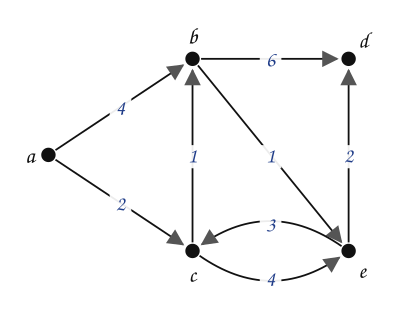
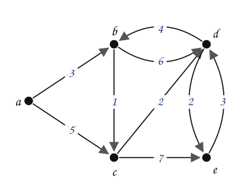
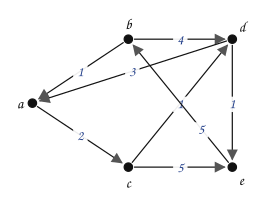
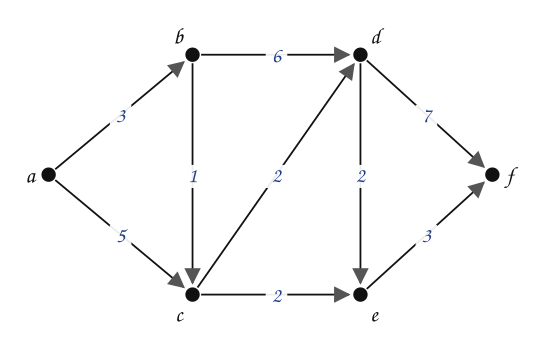
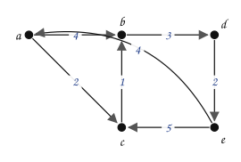

---
# Copyright (c) 2026 Angela Villota, and collaborators from the CyED block
# Licensed under the PolyForm Noncommercial License 1.0.0.
# Commercial use is prohibited without prior written authorization.
title: "Floyd-Warshall: Ejercicios"
---

# Floyd-Warshall: Ejercicios

Use esta página después de leer el [material de estudio de Floyd-Warshall](index.md). Cada ejercicio trae **pistas** y una **solución general**; intente resolverlo antes de abrirlas.

---

### Ejercicio 1

Aplique el algoritmo de Floyd-Warshall a cada grafo. Muestre las matrices $W$ y $P$ después de cada pivote y encuentre los valores mínimos y los recorridos que se piden.

a) Encuentre los valores mínimos y los recorridos entre $b$ y $a$ y entre $a$ y $c$.

b) Encuentre los valores mínimos y los recorridos entre $a$ y $d$ y entre $d$ y $c$.

c) Encuentre los valores mínimos y los recorridos entre $b$ y $c$ y entre $a$ y $e$.

d) Encuentre los valores mínimos y los recorridos entre $a$ y $d$ y entre $c$ y $d$.

:::{admonition} Pistas
:class: dropdown
- En $W_0$ hay $\infty$ donde no hay arco y $0$ en la diagonal; el grafo es dirigido: $W[a][b] \neq W[b][a]$.
- Con el pivote $k$ solo pueden mejorar las casillas $(i, j)$ con $W[i][k]$ y $W[k][j]$ finitos.
- Para el recorrido, inserte pivotes hasta que todos los tramos digan «ir directo».
:::

:::{admonition} Solución general
:class: dropdown
a) Casillas que mejoran con cada pivote: $a$: 2, $b$: 1, $c$: 2, $d$: 3.

$$
W_{4} = \begin{array}{c|cccc} & \mathbf{a} & \mathbf{b} & \mathbf{c} & \mathbf{d} \\ \hline \mathbf{a} & 0 & 5 & 8 & 7 \\ \mathbf{b} & 6 & 0 & 3 & 2 \\ \mathbf{c} & 3 & 8 & 0 & 4 \\ \mathbf{d} & 4 & 9 & 1 & 0\end{array} \qquad P_{4} = \begin{array}{c|cccc} & \mathbf{a} & \mathbf{b} & \mathbf{c} & \mathbf{d} \\ \hline \mathbf{a} & a & b & d & b \\ \mathbf{b} & d & b & d & d \\ \mathbf{c} & a & a & c & d \\ \mathbf{d} & c & c & c & d\end{array}
$$

entre $b$ y $a$: valor mínimo $6$, recorrido $b, d, c, a$; entre $a$ y $c$: valor mínimo $8$, recorrido $a, b, d, c$.

b) Casillas que mejoran con cada pivote: $a$: 0, $b$: 3, $c$: 2, $d$: 1.

$$
W_{4} = \begin{array}{c|cccc} & \mathbf{a} & \mathbf{b} & \mathbf{c} & \mathbf{d} \\ \hline \mathbf{a} & 0 & 4 & 5 & 7 \\ \mathbf{b} & \infty & 0 & 1 & 3 \\ \mathbf{c} & \infty & 5 & 0 & 2 \\ \mathbf{d} & \infty & 3 & 4 & 0\end{array} \qquad P_{4} = \begin{array}{c|cccc} & \mathbf{a} & \mathbf{b} & \mathbf{c} & \mathbf{d} \\ \hline \mathbf{a} & a & b & b & c \\ \mathbf{b} & a & b & c & c \\ \mathbf{c} & a & d & c & d \\ \mathbf{d} & a & b & b & d\end{array}
$$

entre $a$ y $d$: valor mínimo $7$, recorrido $a, b, c, d$; entre $d$ y $c$: valor mínimo $4$, recorrido $d, b, c$.

c) Casillas que mejoran con cada pivote: $a$: 2, $b$: 1, $c$: 1, $d$: 3, $e$: 0.

$$
W_{5} = \begin{array}{c|ccccc} & \mathbf{a} & \mathbf{b} & \mathbf{c} & \mathbf{d} & \mathbf{e} \\ \hline \mathbf{a} & 0 & 5 & 1 & 8 & 3 \\ \mathbf{b} & 9 & 0 & 10 & 3 & 7 \\ \mathbf{c} & \infty & \infty & 0 & \infty & 2 \\ \mathbf{d} & 6 & 11 & 7 & 0 & 4 \\ \mathbf{e} & \infty & \infty & \infty & \infty & 0\end{array} \qquad P_{5} = \begin{array}{c|ccccc} & \mathbf{a} & \mathbf{b} & \mathbf{c} & \mathbf{d} & \mathbf{e} \\ \hline \mathbf{a} & a & b & c & b & c \\ \mathbf{b} & d & b & d & d & d \\ \mathbf{c} & a & b & c & d & e \\ \mathbf{d} & a & a & a & d & e \\ \mathbf{e} & a & b & c & d & e\end{array}
$$

entre $b$ y $c$: valor mínimo $10$, recorrido $b, d, a, c$; entre $a$ y $e$: valor mínimo $3$, recorrido $a, c, e$.

d) Casillas que mejoran con cada pivote: $a$: 0, $b$: 4, $c$: 4, $d$: 0, $e$: 4.

$$
W_{5} = \begin{array}{c|ccccc} & \mathbf{a} & \mathbf{b} & \mathbf{c} & \mathbf{d} & \mathbf{e} \\ \hline \mathbf{a} & 0 & 3 & 2 & 6 & 4 \\ \mathbf{b} & \infty & 0 & 4 & 3 & 1 \\ \mathbf{c} & \infty & 1 & 0 & 4 & 2 \\ \mathbf{d} & \infty & \infty & \infty & 0 & \infty \\ \mathbf{e} & \infty & 4 & 3 & 2 & 0\end{array} \qquad P_{5} = \begin{array}{c|ccccc} & \mathbf{a} & \mathbf{b} & \mathbf{c} & \mathbf{d} & \mathbf{e} \\ \hline \mathbf{a} & a & c & c & e & c \\ \mathbf{b} & a & b & e & e & e \\ \mathbf{c} & a & b & c & e & b \\ \mathbf{d} & a & b & c & d & e \\ \mathbf{e} & a & c & c & d & e\end{array}
$$

entre $a$ y $d$: valor mínimo $6$, recorrido $a, c, b, e, d$; entre $c$ y $d$: valor mínimo $4$, recorrido $c, b, e, d$.
:::

### Ejercicio 2

Aplique el algoritmo de Floyd-Warshall a cada grafo y encuentre los valores mínimos y los recorridos que se piden.

a) Encuentre los valores mínimos y los recorridos entre $a$ y $e$ y entre $e$ y $c$.

b) Encuentre los valores mínimos y los recorridos entre $a$ y $e$ y entre $e$ y $c$.

c) Encuentre los valores mínimos y los recorridos entre $a$ y $d$ y entre $a$ y $f$.

:::{admonition} Pistas
:class: dropdown
- Escriba primero $W_0$ y $P_0$ a partir del grafo.
- Cuando un vértice no tiene arcos de entrada, su columna se queda en $\infty$ (salvo la diagonal).
:::

:::{admonition} Solución general
:class: dropdown
a) Casillas que mejoran con cada pivote: $a$: 0, $b$: 3, $c$: 4, $d$: 6, $e$: 0.

$$
W_{5} = \begin{array}{c|ccccc} & \mathbf{a} & \mathbf{b} & \mathbf{c} & \mathbf{d} & \mathbf{e} \\ \hline \mathbf{a} & 0 & 3 & 4 & 6 & 8 \\ \mathbf{b} & \infty & 0 & 1 & 3 & 5 \\ \mathbf{c} & \infty & 6 & 0 & 2 & 4 \\ \mathbf{d} & \infty & 4 & 5 & 0 & 2 \\ \mathbf{e} & \infty & 7 & 8 & 3 & 0\end{array} \qquad P_{5} = \begin{array}{c|ccccc} & \mathbf{a} & \mathbf{b} & \mathbf{c} & \mathbf{d} & \mathbf{e} \\ \hline \mathbf{a} & a & b & b & c & d \\ \mathbf{b} & a & b & c & c & d \\ \mathbf{c} & a & d & c & d & d \\ \mathbf{d} & a & b & b & d & e \\ \mathbf{e} & a & d & d & d & e\end{array}
$$

entre $a$ y $e$: valor mínimo $8$, recorrido $a, b, c, d, e$; entre $e$ y $c$: valor mínimo $8$, recorrido $e, d, b, c$.

b) Casillas que mejoran con cada pivote: $a$: 2, $b$: 3, $c$: 3, $d$: 4, $e$: 3.

$$
W_{5} = \begin{array}{c|ccccc} & \mathbf{a} & \mathbf{b} & \mathbf{c} & \mathbf{d} & \mathbf{e} \\ \hline \mathbf{a} & 0 & 9 & 2 & 3 & 4 \\ \mathbf{b} & 1 & 0 & 3 & 4 & 5 \\ \mathbf{c} & 4 & 7 & 0 & 1 & 2 \\ \mathbf{d} & 3 & 6 & 5 & 0 & 1 \\ \mathbf{e} & 6 & 5 & 8 & 9 & 0\end{array} \qquad P_{5} = \begin{array}{c|ccccc} & \mathbf{a} & \mathbf{b} & \mathbf{c} & \mathbf{d} & \mathbf{e} \\ \hline \mathbf{a} & a & e & c & c & d \\ \mathbf{b} & a & b & a & d & d \\ \mathbf{c} & d & e & c & d & d \\ \mathbf{d} & a & e & a & d & e \\ \mathbf{e} & b & b & b & b & e\end{array}
$$

entre $a$ y $e$: valor mínimo $4$, recorrido $a, c, d, e$; entre $e$ y $c$: valor mínimo $8$, recorrido $e, b, a, c$.

c) Casillas que mejoran con cada pivote: $a$: 0, $b$: 2, $c$: 4, $d$: 3, $e$: 4, $f$: 0.

$$
W_{6} = \begin{array}{c|cccccc} & \mathbf{a} & \mathbf{b} & \mathbf{c} & \mathbf{d} & \mathbf{e} & \mathbf{f} \\ \hline \mathbf{a} & 0 & 3 & 4 & 6 & 6 & 9 \\ \mathbf{b} & \infty & 0 & 1 & 3 & 3 & 6 \\ \mathbf{c} & \infty & \infty & 0 & 2 & 2 & 5 \\ \mathbf{d} & \infty & \infty & \infty & 0 & 2 & 5 \\ \mathbf{e} & \infty & \infty & \infty & \infty & 0 & 3 \\ \mathbf{f} & \infty & \infty & \infty & \infty & \infty & 0\end{array} \qquad P_{6} = \begin{array}{c|cccccc} & \mathbf{a} & \mathbf{b} & \mathbf{c} & \mathbf{d} & \mathbf{e} & \mathbf{f} \\ \hline \mathbf{a} & a & b & b & c & c & e \\ \mathbf{b} & a & b & c & c & c & e \\ \mathbf{c} & a & b & c & d & e & e \\ \mathbf{d} & a & b & c & d & e & e \\ \mathbf{e} & a & b & c & d & e & f \\ \mathbf{f} & a & b & c & d & e & f\end{array}
$$

entre $a$ y $d$: valor mínimo $6$, recorrido $a, b, c, d$; entre $a$ y $f$: valor mínimo $9$, recorrido $a, b, c, e, f$.
:::

### Ejercicio 3

En el Ejemplo 1, cambie el orden de los pivotes a $d, c, b, a$. ¿Cambia $W_4$? ¿Cambia $P_4$?

:::{admonition} Pistas
:class: dropdown
- $W_4$ guarda valores mínimos, y el valor mínimo entre dos vértices no depende de cómo se calcule.
- $P_4$ guarda **un** pivote por casilla. ¿Un mismo recorrido mínimo puede describirse con pivotes distintos?
:::

:::{admonition} Solución general
:class: dropdown
$W_4$ no cambia: sus casillas son los valores mínimos, que son únicos. $P_4$ puede cambiar: por ejemplo, el recorrido $b \to d \to a \to c$ se puede registrar en $P[b][c]$ con el pivote $d$ o con el pivote $a$, según cuál se pruebe primero. En ambos casos se reconstruye el mismo recorrido.
:::

### Ejercicio 4

Agregue al grafo del Ejemplo 1 el arco $c \to a$ con peso $-8$. Corra el algoritmo y muestre que aparece un valor negativo en la diagonal. ¿Qué circuito lo produce?

:::{admonition} Pistas
:class: dropdown
- Busque un circuito que use el arco nuevo.
- Sume los pesos de $a \to c \to a$.
:::

:::{admonition} Solución general
:class: dropdown
El circuito $a \to c \to a$ cuesta $4 + (-8) = -4 < 0$. Con el pivote $a$ ya se obtiene $W[c][c] = -8 + 4 = -4$, y con el pivote $c$, $W[a][a] = 4 + (-8) = -4$. Un valor negativo en la diagonal indica un circuito de costo negativo, y los demás valores de $W$ dejan de tener sentido como «valor mínimo».
:::

### Ejercicio 5

Escriba el algoritmo de **Warshall** (matriz de conectividad) como una modificación de Floyd-Warshall: ¿qué reemplaza a la suma? ¿Y al mínimo? Pruébelo con el grafo del Ejemplo 1 y verifique que la matriz de conectividad tiene solo unos.

:::{admonition} Pistas
:class: dropdown
- En Warshall cada casilla dice si **hay** camino, no cuánto cuesta.
:::

:::{admonition} Solución general
:class: dropdown
La suma $W[i][k] + W[k][j]$ se reemplaza por $W[i][k] \wedge W[k][j]$ y el mínimo por $\vee$. En el Ejemplo 1 todos los vértices están en el circuito $a \to b \to d \to a$ o llegan a él y salen de él ($a \to c \to d$), así que de cualquier vértice se llega a cualquier otro: la matriz de conectividad tiene solo unos.
:::

### Ejercicio 6

Aplicar el algoritmo de Floyd-Warshall. Mostrar las matrices $W_0, W_1, W_2, W_3, W_4, W_5$, $P_0, P_1, P_2, P_3, P_4, P_5$. Encuentre el valor mínimo y el recorrido entre $a$ y $e$, y entre $d$ y $b$.

---

*Material adaptado del material original del profesor Oscar Bedoya.*
