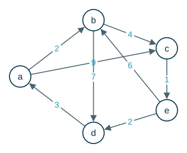

---
# Copyright (c) 2026 Angela Villota, and collaborators from the CyED block
# Licensed under the PolyForm Noncommercial License 1.0.0.
# Commercial use is prohibited without prior written authorization.
title: "Floyd-Warshall: Ejercicios"
---

# Floyd-Warshall: Ejercicios

Use esta página después de leer el [material de estudio de Floyd-Warshall](index.md). Cada ejercicio trae **pistas** y una **solución general**; intente resolverlo antes de abrirlas.

---

### Ejercicio 1

Aplique el algoritmo de Floyd-Warshall al siguiente grafo. Muestre las matrices $W_0, W_1, \dots, W_5$ y $P_0, P_1, \dots, P_5$. Encuentre el valor mínimo y el recorrido entre $a$ y $e$, y entre $d$ y $b$.

:::{admonition} Pistas
:class: dropdown
- En $W_0$ hay $\infty$ donde no hay arco, y recuerde que el grafo es dirigido: $W[a][b] \neq W[b][a]$.
- Con el pivote $k$ solo pueden mejorar las casillas $(i, j)$ con $W[i][k]$ y $W[k][j]$ finitos.
- Para el recorrido, inserte pivotes hasta que todos los tramos digan «ir directo».
:::

:::{admonition} Solución general
:class: dropdown
Casillas que cambian con cada pivote: $W_{1}$ (pivote $a$): 2, $W_{2}$ (pivote $b$): 4, $W_{3}$ (pivote $c$): 3, $W_{4}$ (pivote $d$): 2, $W_{5}$ (pivote $e$): 3.

Matrices finales:

$$
W_{5} = \begin{array}{c|ccccc} & \mathbf{a} & \mathbf{b} & \mathbf{c} & \mathbf{d} & \mathbf{e} \\ \hline \mathbf{a} & 0 & 2 & 6 & 9 & 7 \\ \mathbf{b} & 10 & 0 & 4 & 7 & 5 \\ \mathbf{c} & 6 & 7 & 0 & 3 & 1 \\ \mathbf{d} & 3 & 5 & 9 & 0 & 10 \\ \mathbf{e} & 5 & 6 & 10 & 2 & 0\end{array} \qquad P_{5} = \begin{array}{c|ccccc} & \mathbf{a} & \mathbf{b} & \mathbf{c} & \mathbf{d} & \mathbf{e} \\ \hline \mathbf{a} & a & b & b & b & c \\ \mathbf{b} & d & b & c & d & c \\ \mathbf{c} & e & e & c & e & e \\ \mathbf{d} & a & a & b & d & c \\ \mathbf{e} & d & b & b & d & e\end{array}
$$

- Entre $a$ y $e$: valor mínimo $7$, recorrido $a \to b \to c \to e$.
- Entre $d$ y $b$: valor mínimo $5$, recorrido $d \to a \to b$.
:::

### Ejercicio 2

En el Ejemplo 1, cambie el orden de los pivotes a $d, c, b, a$. ¿Cambia $W_4$? ¿Cambia $P_4$?

:::{admonition} Pistas
:class: dropdown
- $W_4$ guarda valores mínimos, y el valor mínimo entre dos vértices no depende de cómo se calcule.
- $P_4$ guarda **un** pivote por casilla. ¿Un mismo recorrido mínimo puede describirse con pivotes distintos?
:::

:::{admonition} Solución general
:class: dropdown
$W_4$ no cambia: sus casillas son los valores mínimos, que son únicos. $P_4$ puede cambiar: por ejemplo, el recorrido $b \to d \to a \to c$ se puede registrar en $P[b][c]$ con el pivote $d$ o con el pivote $a$, según cuál se pruebe primero. En ambos casos se reconstruye el mismo recorrido.
:::

### Ejercicio 3

Agregue al grafo del Ejemplo 1 el arco $c \to a$ con peso $-8$. Corra el algoritmo y muestre que aparece un valor negativo en la diagonal. ¿Qué circuito lo produce?

:::{admonition} Pistas
:class: dropdown
- Busque un circuito que use el arco nuevo.
- Sume los pesos de $a \to c \to a$.
:::

:::{admonition} Solución general
:class: dropdown
El circuito $a \to c \to a$ cuesta $4 + (-8) = -4 < 0$. Con el pivote $a$ ya se obtiene $W[c][c] = -8 + 4 = -4$, y con el pivote $c$, $W[a][a] = 4 + (-8) = -4$. Un valor negativo en la diagonal indica un circuito de costo negativo, y los demás valores de $W$ dejan de tener sentido como «valor mínimo».
:::

### Ejercicio 4

Escriba el algoritmo de **Warshall** (matriz de conectividad) como una modificación de Floyd-Warshall: ¿qué reemplaza a la suma? ¿Y al mínimo? Pruébelo con el grafo del Ejemplo 1 y verifique que la matriz de conectividad tiene solo unos.

---

*Material adaptado del material original del profesor Oscar Bedoya.*
