---
# Copyright (c) 2026 Angela Villota, and collaborators from the CyED block
# Licensed under the PolyForm Noncommercial License 1.0.0.
# Commercial use is prohibited without prior written authorization.
title: "Unidad 5: Algoritmo de Floyd-Warshall"
---

# Unidad 5: Algoritmo de Floyd-Warshall

Los ejemplos se desarrollan en desplegables con pestañas **Paso 1, Paso 2, …**: cada paso conserva lo anterior y muestra lo nuevo **en color**.

## 1. El problema

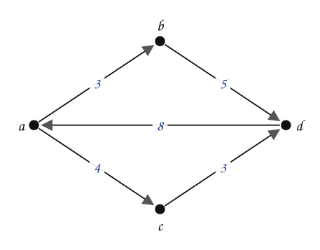

**¿Cuál es el valor mínimo para ir de cada vértice a cada uno de los demás, y por qué recorrido?** No se pide desde un solo origen: se pide la **tabla completa**, como la tabla de distancias entre ciudades de un atlas de carreteras.

Pruebe con dos pares antes de seguir.

:::{admonition} ¿Valor mínimo de $a$ a $d$? ¿Y de $b$ a $c$?
:class: dropdown
- De $a$ a $d$: por $b$ cuesta $3 + 5 = 8$; por $c$ cuesta $4 + 3 = 7$. El mínimo es $7$, con el recorrido $a \to c \to d$.
- De $b$ a $c$ no hay arista. Hay que ir $b \to d \to a \to c$: $5 + 8 + 4 = 17$.
:::

Una idea: correr **Dijkstra desde cada vértice**. Funciona si todos los pesos son no negativos, pero ya se vio que Dijkstra puede fallar con un solo peso negativo. Se necesita un método que calcule todos los pares a la vez y que acepte pesos negativos (siempre que no haya circuitos de costo negativo).

### ¿Entendimos el problema?

| | |
|---|---|
| **Entradas** | Un grafo dirigido con pesos (pueden ser negativos), sin circuitos de costo negativo. |
| **Salidas** | Una matriz $W$ con $W[i][j]$ = valor mínimo de $i$ a $j$, y una matriz $P$ para reconstruir cada recorrido. |

## 2. El método

**Pivote.** Para ir de $i$ a $j$, se prueba si **pasar por un vértice $k$** (el pivote) es más barato que lo que se conoce:

$$
W[i][j] \;\leftarrow\; \min\big(W[i][j],\; W[i][k] + W[k][j]\big)
$$

**Algoritmo de Floyd-Warshall.** Se toma cada vértice como pivote, uno por uno. Con cada pivote se revisan todas las casillas de la matriz. Si pasar por el pivote mejora una casilla $(i, j)$, se actualiza $W[i][j]$ y se guarda el pivote en $P[i][j]$.

- $W_0$: los pesos de las aristas; $0$ en la diagonal y $\infty$ donde no hay arista.
- $P_0$: en cada casilla $(i, j)$, el vértice $j$, que significa «ir directo de $i$ a $j$».
- $W_k$, $P_k$: las matrices después de usar el pivote número $k$.

### Ejemplo 1

El grafo de la sección 1. Orden de los pivotes: $a, b, c, d$. En el grafo se resalta el pivote de cada paso.

:::::{admonition} Floyd-Warshall: matrices W y P
:class: dropdown
::::{tab-set}
:::{tab-item} Paso 1


$$
W_{0} = \begin{array}{c|cccc} & \mathbf{a} & \mathbf{b} & \mathbf{c} & \mathbf{d} \\ \hline \mathbf{a} & 0 & 3 & 4 & \infty \\ \mathbf{b} & \infty & 0 & \infty & 5 \\ \mathbf{c} & \infty & \infty & 0 & 3 \\ \mathbf{d} & 8 & \infty & \infty & 0\end{array}\qquad P_{0} = \begin{array}{c|cccc} & \mathbf{a} & \mathbf{b} & \mathbf{c} & \mathbf{d} \\ \hline \mathbf{a} & a & b & c & d \\ \mathbf{b} & a & b & c & d \\ \mathbf{c} & a & b & c & d \\ \mathbf{d} & a & b & c & d\end{array}
$$

> $W_0$ tiene los pesos de las aristas ($\infty$ si no hay arista, $0$ en la diagonal). $P_0$ dice «ir directo»: para ir de $i$ a $j$ el siguiente vértice es $j$.

:::
:::{tab-item} Paso 2
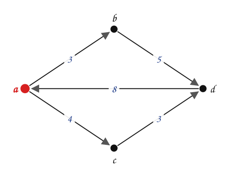

$$
W_{1} = \begin{array}{c|cccc} & \mathbf{a} & \mathbf{b} & \mathbf{c} & \mathbf{d} \\ \hline \mathbf{a} & 0 & 3 & 4 & \infty \\ \mathbf{b} & \infty & 0 & \infty & 5 \\ \mathbf{c} & \infty & \infty & 0 & 3 \\ \mathbf{d} & 8 & \textcolor{#a94700}{\mathbf{11}} & \textcolor{#a94700}{\mathbf{12}} & 0\end{array}\qquad P_{1} = \begin{array}{c|cccc} & \mathbf{a} & \mathbf{b} & \mathbf{c} & \mathbf{d} \\ \hline \mathbf{a} & a & b & c & d \\ \mathbf{b} & a & b & c & d \\ \mathbf{c} & a & b & c & d \\ \mathbf{d} & a & \textcolor{#a94700}{\mathbf{a}} & \textcolor{#a94700}{\mathbf{a}} & d\end{array}
$$

> Pivote $a$: se prueba pasar por $a$. Mejoran $(d,b)$, $(d,c)$; en esas casillas $P_{1}$ guarda $a$.

> **Para el pivote b: ¿qué filas y columnas pueden mejorar? Pista: solo sirven las casillas (i, j) con W[i][b] y W[b][j] finitos.**

:::
:::{tab-item} Paso 3
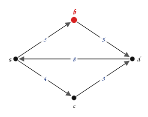

$$
W_{2} = \begin{array}{c|cccc} & \mathbf{a} & \mathbf{b} & \mathbf{c} & \mathbf{d} \\ \hline \mathbf{a} & 0 & 3 & 4 & \textcolor{#a94700}{\mathbf{8}} \\ \mathbf{b} & \infty & 0 & \infty & 5 \\ \mathbf{c} & \infty & \infty & 0 & 3 \\ \mathbf{d} & 8 & 11 & 12 & 0\end{array}\qquad P_{2} = \begin{array}{c|cccc} & \mathbf{a} & \mathbf{b} & \mathbf{c} & \mathbf{d} \\ \hline \mathbf{a} & a & b & c & \textcolor{#a94700}{\mathbf{b}} \\ \mathbf{b} & a & b & c & d \\ \mathbf{c} & a & b & c & d \\ \mathbf{d} & a & a & a & d\end{array}
$$

> Pivote $b$: se prueba pasar por $b$. Mejoran $(a,d)$; en esas casillas $P_{2}$ guarda $b$.

> Solo $d$ y $a$ llegan a $b$ (columna $b$ finita) y desde $b$ solo se llega a $d$ (fila $b$). Por eso las únicas casillas que se revisan con esperanza son $(a,d)$ y $(d,d)$; mejora $(a,d)$ (de $\infty$ a $8$).

:::
:::{tab-item} Paso 4
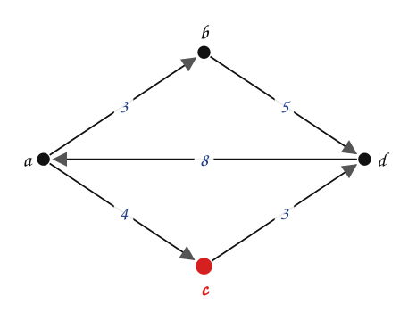

$$
W_{3} = \begin{array}{c|cccc} & \mathbf{a} & \mathbf{b} & \mathbf{c} & \mathbf{d} \\ \hline \mathbf{a} & 0 & 3 & 4 & \textcolor{#a94700}{\mathbf{7}} \\ \mathbf{b} & \infty & 0 & \infty & 5 \\ \mathbf{c} & \infty & \infty & 0 & 3 \\ \mathbf{d} & 8 & 11 & 12 & 0\end{array}\qquad P_{3} = \begin{array}{c|cccc} & \mathbf{a} & \mathbf{b} & \mathbf{c} & \mathbf{d} \\ \hline \mathbf{a} & a & b & c & \textcolor{#a94700}{\mathbf{c}} \\ \mathbf{b} & a & b & c & d \\ \mathbf{c} & a & b & c & d \\ \mathbf{d} & a & a & a & d\end{array}
$$

> Pivote $c$: se prueba pasar por $c$. Mejoran $(a,d)$; en esas casillas $P_{3}$ guarda $c$.

:::
:::{tab-item} Paso 5
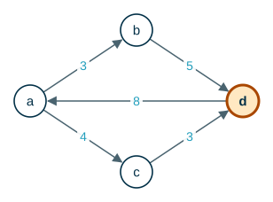

$$
W_{4} = \begin{array}{c|cccc} & \mathbf{a} & \mathbf{b} & \mathbf{c} & \mathbf{d} \\ \hline \mathbf{a} & 0 & 3 & 4 & 7 \\ \mathbf{b} & \textcolor{#a94700}{\mathbf{13}} & 0 & \textcolor{#a94700}{\mathbf{17}} & 5 \\ \mathbf{c} & \textcolor{#a94700}{\mathbf{11}} & \textcolor{#a94700}{\mathbf{14}} & 0 & 3 \\ \mathbf{d} & 8 & 11 & 12 & 0\end{array}\qquad P_{4} = \begin{array}{c|cccc} & \mathbf{a} & \mathbf{b} & \mathbf{c} & \mathbf{d} \\ \hline \mathbf{a} & a & b & c & c \\ \mathbf{b} & \textcolor{#a94700}{\mathbf{d}} & b & \textcolor{#a94700}{\mathbf{d}} & d \\ \mathbf{c} & \textcolor{#a94700}{\mathbf{d}} & \textcolor{#a94700}{\mathbf{d}} & c & d \\ \mathbf{d} & a & a & a & d\end{array}
$$

> Pivote $d$: se prueba pasar por $d$. Mejoran $(b,a)$, $(b,c)$, $(c,a)$, $(c,b)$; en esas casillas $P_{4}$ guarda $d$.

:::
::::
:::::

### Leer el recorrido en $P$

$W_4$ da los valores mínimos. Para el recorrido se usa $P_4$: si $P[i][j] = j$, se va directo; si $P[i][j] = k \neq j$, el recorrido pasa por $k$, y se repite el proceso con $(i, k)$ y con $(k, j)$.

¿Cuál es el valor mínimo entre $a$ y $d$? ¿Cuál es el recorrido con el que se obtiene ese valor mínimo?

:::::{admonition} Recorrido mínimo de a a d
:class: dropdown
::::{tab-set}
:::{tab-item} Paso 1
$$ a \to d $$

> Se busca $(a,d)$ en $P$: el valor mínimo es $W[a][d] = 7$.

:::
:::{tab-item} Paso 2
$$ a \to c \to d $$

> Se inserta $c$ en el recorrido.

:::
:::{tab-item} Paso 3
$$ a \to c \to d $$

> Se buscan $(a,c)$, $(c,d)$ en $P$: todas dicen «ir directo». No se insertan nuevos vértices. Costo: $7$.

:::
::::
:::::

¿Cuál es el valor mínimo entre $b$ y $c$?

:::::{admonition} Recorrido mínimo de b a c
:class: dropdown
::::{tab-set}
:::{tab-item} Paso 1
$$ b \to c $$

> Se busca $(b,c)$ en $P$: el valor mínimo es $W[b][c] = 17$.

:::
:::{tab-item} Paso 2
$$ b \to d \to c $$

> Se inserta $d$ en el recorrido.

:::
:::{tab-item} Paso 3
$$ b \to d \to a \to c $$

> Se inserta $a$ en el recorrido.

:::
:::{tab-item} Paso 4
$$ b \to d \to a \to c $$

> Se buscan $(b,d)$, $(d,a)$, $(a,c)$ en $P$: todas dicen «ir directo». No se insertan nuevos vértices. Costo: $17$.

:::
::::
:::::

¿Cuál es el valor mínimo entre $c$ y $b$?

:::::{admonition} Recorrido mínimo de c a b
:class: dropdown
::::{tab-set}
:::{tab-item} Paso 1
$$ c \to b $$

> Se busca $(c,b)$ en $P$: el valor mínimo es $W[c][b] = 14$.

:::
:::{tab-item} Paso 2
$$ c \to d \to b $$

> Se inserta $d$ en el recorrido.

:::
:::{tab-item} Paso 3
$$ c \to d \to a \to b $$

> Se inserta $a$ en el recorrido.

:::
:::{tab-item} Paso 4
$$ c \to d \to a \to b $$

> Se buscan $(c,d)$, $(d,a)$, $(a,b)$ en $P$: todas dicen «ir directo». No se insertan nuevos vértices. Costo: $14$.

:::
::::
:::::

> **¿Es lo mismo ir de $b$ a $c$ que de $c$ a $b$?** No: el grafo es dirigido. De $b$ a $c$ cuesta $17$ y de $c$ a $b$ cuesta $14$.

### Ejemplo 2

Floyd-Warshall acepta pesos **negativos**, siempre que no haya un circuito de costo negativo.


:::::{admonition} Floyd-Warshall con pesos negativos
:class: dropdown
::::{tab-set}
:::{tab-item} Paso 1
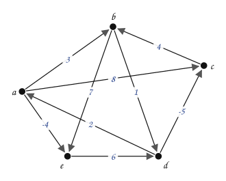

$$
W_{0} = \begin{array}{c|ccccc} & \mathbf{a} & \mathbf{b} & \mathbf{c} & \mathbf{d} & \mathbf{e} \\ \hline \mathbf{a} & 0 & 3 & 8 & \infty & -4 \\ \mathbf{b} & \infty & 0 & \infty & 1 & 7 \\ \mathbf{c} & \infty & 4 & 0 & \infty & \infty \\ \mathbf{d} & 2 & \infty & -5 & 0 & \infty \\ \mathbf{e} & \infty & \infty & \infty & 6 & 0\end{array}\qquad P_{0} = \begin{array}{c|ccccc} & \mathbf{a} & \mathbf{b} & \mathbf{c} & \mathbf{d} & \mathbf{e} \\ \hline \mathbf{a} & a & b & c & d & e \\ \mathbf{b} & a & b & c & d & e \\ \mathbf{c} & a & b & c & d & e \\ \mathbf{d} & a & b & c & d & e \\ \mathbf{e} & a & b & c & d & e\end{array}
$$

> $W_0$ tiene los pesos de las aristas ($\infty$ si no hay arista, $0$ en la diagonal). $P_0$ dice «ir directo»: para ir de $i$ a $j$ el siguiente vértice es $j$.

:::
:::{tab-item} Paso 2
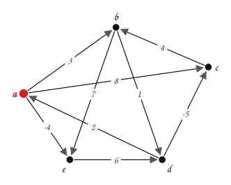

$$
W_{1} = \begin{array}{c|ccccc} & \mathbf{a} & \mathbf{b} & \mathbf{c} & \mathbf{d} & \mathbf{e} \\ \hline \mathbf{a} & 0 & 3 & 8 & \infty & -4 \\ \mathbf{b} & \infty & 0 & \infty & 1 & 7 \\ \mathbf{c} & \infty & 4 & 0 & \infty & \infty \\ \mathbf{d} & 2 & \textcolor{#a94700}{\mathbf{5}} & -5 & 0 & \textcolor{#a94700}{\mathbf{-2}} \\ \mathbf{e} & \infty & \infty & \infty & 6 & 0\end{array}\qquad P_{1} = \begin{array}{c|ccccc} & \mathbf{a} & \mathbf{b} & \mathbf{c} & \mathbf{d} & \mathbf{e} \\ \hline \mathbf{a} & a & b & c & d & e \\ \mathbf{b} & a & b & c & d & e \\ \mathbf{c} & a & b & c & d & e \\ \mathbf{d} & a & \textcolor{#a94700}{\mathbf{a}} & c & d & \textcolor{#a94700}{\mathbf{a}} \\ \mathbf{e} & a & b & c & d & e\end{array}
$$

> Pivote $a$: se prueba pasar por $a$. Mejoran $(d,b)$, $(d,e)$; en esas casillas $P_{1}$ guarda $a$.

:::
:::{tab-item} Paso 3
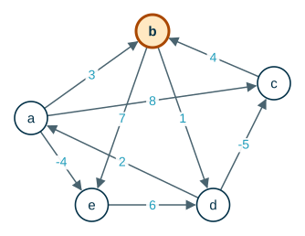

$$
W_{2} = \begin{array}{c|ccccc} & \mathbf{a} & \mathbf{b} & \mathbf{c} & \mathbf{d} & \mathbf{e} \\ \hline \mathbf{a} & 0 & 3 & 8 & \textcolor{#a94700}{\mathbf{4}} & -4 \\ \mathbf{b} & \infty & 0 & \infty & 1 & 7 \\ \mathbf{c} & \infty & 4 & 0 & \textcolor{#a94700}{\mathbf{5}} & \textcolor{#a94700}{\mathbf{11}} \\ \mathbf{d} & 2 & 5 & -5 & 0 & -2 \\ \mathbf{e} & \infty & \infty & \infty & 6 & 0\end{array}\qquad P_{2} = \begin{array}{c|ccccc} & \mathbf{a} & \mathbf{b} & \mathbf{c} & \mathbf{d} & \mathbf{e} \\ \hline \mathbf{a} & a & b & c & \textcolor{#a94700}{\mathbf{b}} & e \\ \mathbf{b} & a & b & c & d & e \\ \mathbf{c} & a & b & c & \textcolor{#a94700}{\mathbf{b}} & \textcolor{#a94700}{\mathbf{b}} \\ \mathbf{d} & a & a & c & d & a \\ \mathbf{e} & a & b & c & d & e\end{array}
$$

> Pivote $b$: se prueba pasar por $b$. Mejoran $(a,d)$, $(c,d)$, $(c,e)$; en esas casillas $P_{2}$ guarda $b$.

:::
:::{tab-item} Paso 4
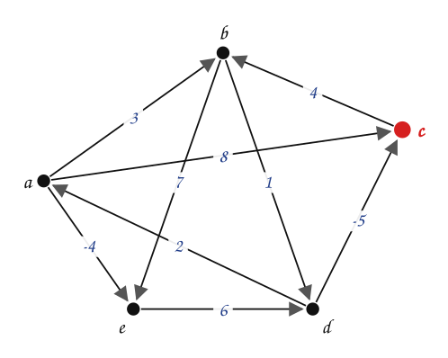

$$
W_{3} = \begin{array}{c|ccccc} & \mathbf{a} & \mathbf{b} & \mathbf{c} & \mathbf{d} & \mathbf{e} \\ \hline \mathbf{a} & 0 & 3 & 8 & 4 & -4 \\ \mathbf{b} & \infty & 0 & \infty & 1 & 7 \\ \mathbf{c} & \infty & 4 & 0 & 5 & 11 \\ \mathbf{d} & 2 & \textcolor{#a94700}{\mathbf{-1}} & -5 & 0 & -2 \\ \mathbf{e} & \infty & \infty & \infty & 6 & 0\end{array}\qquad P_{3} = \begin{array}{c|ccccc} & \mathbf{a} & \mathbf{b} & \mathbf{c} & \mathbf{d} & \mathbf{e} \\ \hline \mathbf{a} & a & b & c & b & e \\ \mathbf{b} & a & b & c & d & e \\ \mathbf{c} & a & b & c & b & b \\ \mathbf{d} & a & \textcolor{#a94700}{\mathbf{c}} & c & d & a \\ \mathbf{e} & a & b & c & d & e\end{array}
$$

> Pivote $c$: se prueba pasar por $c$. Mejoran $(d,b)$; en esas casillas $P_{3}$ guarda $c$.

:::
:::{tab-item} Paso 5
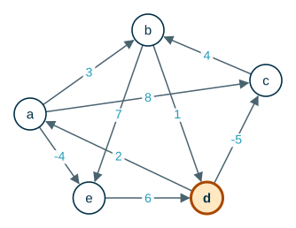

$$
W_{4} = \begin{array}{c|ccccc} & \mathbf{a} & \mathbf{b} & \mathbf{c} & \mathbf{d} & \mathbf{e} \\ \hline \mathbf{a} & 0 & 3 & \textcolor{#a94700}{\mathbf{-1}} & 4 & -4 \\ \mathbf{b} & \textcolor{#a94700}{\mathbf{3}} & 0 & \textcolor{#a94700}{\mathbf{-4}} & 1 & \textcolor{#a94700}{\mathbf{-1}} \\ \mathbf{c} & \textcolor{#a94700}{\mathbf{7}} & 4 & 0 & 5 & \textcolor{#a94700}{\mathbf{3}} \\ \mathbf{d} & 2 & -1 & -5 & 0 & -2 \\ \mathbf{e} & \textcolor{#a94700}{\mathbf{8}} & \textcolor{#a94700}{\mathbf{5}} & \textcolor{#a94700}{\mathbf{1}} & 6 & 0\end{array}\qquad P_{4} = \begin{array}{c|ccccc} & \mathbf{a} & \mathbf{b} & \mathbf{c} & \mathbf{d} & \mathbf{e} \\ \hline \mathbf{a} & a & b & \textcolor{#a94700}{\mathbf{d}} & b & e \\ \mathbf{b} & \textcolor{#a94700}{\mathbf{d}} & b & \textcolor{#a94700}{\mathbf{d}} & d & \textcolor{#a94700}{\mathbf{d}} \\ \mathbf{c} & \textcolor{#a94700}{\mathbf{d}} & b & c & b & \textcolor{#a94700}{\mathbf{d}} \\ \mathbf{d} & a & c & c & d & a \\ \mathbf{e} & \textcolor{#a94700}{\mathbf{d}} & \textcolor{#a94700}{\mathbf{d}} & \textcolor{#a94700}{\mathbf{d}} & d & e\end{array}
$$

> Pivote $d$: se prueba pasar por $d$. Mejoran $(a,c)$, $(b,a)$, $(b,c)$, $(b,e)$, $(c,a)$, $(c,e)$, $(e,a)$, $(e,b)$, $(e,c)$; en esas casillas $P_{4}$ guarda $d$.

:::
:::{tab-item} Paso 6
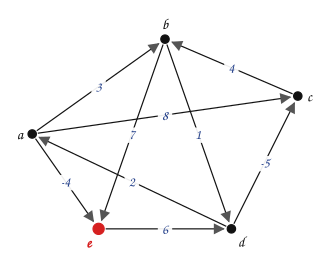

$$
W_{5} = \begin{array}{c|ccccc} & \mathbf{a} & \mathbf{b} & \mathbf{c} & \mathbf{d} & \mathbf{e} \\ \hline \mathbf{a} & 0 & \textcolor{#a94700}{\mathbf{1}} & \textcolor{#a94700}{\mathbf{-3}} & \textcolor{#a94700}{\mathbf{2}} & -4 \\ \mathbf{b} & 3 & 0 & -4 & 1 & -1 \\ \mathbf{c} & 7 & 4 & 0 & 5 & 3 \\ \mathbf{d} & 2 & -1 & -5 & 0 & -2 \\ \mathbf{e} & 8 & 5 & 1 & 6 & 0\end{array}\qquad P_{5} = \begin{array}{c|ccccc} & \mathbf{a} & \mathbf{b} & \mathbf{c} & \mathbf{d} & \mathbf{e} \\ \hline \mathbf{a} & a & \textcolor{#a94700}{\mathbf{e}} & \textcolor{#a94700}{\mathbf{e}} & \textcolor{#a94700}{\mathbf{e}} & e \\ \mathbf{b} & d & b & d & d & d \\ \mathbf{c} & d & b & c & b & d \\ \mathbf{d} & a & c & c & d & a \\ \mathbf{e} & d & d & d & d & e\end{array}
$$

> Pivote $e$: se prueba pasar por $e$. Mejoran $(a,b)$, $(a,c)$, $(a,d)$; en esas casillas $P_{5}$ guarda $e$.

> Hay valores negativos en $W_5$, como $W[a][c] = -3$, pero ningún valor de la diagonal es negativo: el grafo no tiene circuitos de costo negativo y los resultados son válidos.

:::
::::
:::::

:::::{admonition} Recorrido mínimo de c a e
:class: dropdown
::::{tab-set}
:::{tab-item} Paso 1
$$ c \to e $$

> Se busca $(c,e)$ en $P$: el valor mínimo es $W[c][e] = 3$.

:::
:::{tab-item} Paso 2
$$ c \to d \to e $$

> Se inserta $d$ en el recorrido.

:::
:::{tab-item} Paso 3
$$ c \to b \to d \to a \to e $$

> Se inserta $b$ y $a$ en el recorrido.

:::
:::{tab-item} Paso 4
$$ c \to b \to d \to a \to e $$

> Se buscan $(c,b)$, $(b,d)$, $(d,a)$, $(a,e)$ en $P$: todas dicen «ir directo». No se insertan nuevos vértices. Costo: $3$.

:::
::::
:::::

## 3. El algoritmo

```text
FLOYD-WARSHALL(W)            // W: matriz n × n de pesos
1  n = número de filas de W
2  P = matriz n × n con P[i][j] = j
3  for k = 1 to n            // pivote
4      for i = 1 to n
5          for j = 1 to n
6              if W[i][k] + W[k][j] < W[i][j]
7                  W[i][j] = W[i][k] + W[k][j]
8                  P[i][j] = k
9  return W, P
```

### Complejidad

> **¿Cuántas veces se ejecuta la línea 6?**

:::{admonition} Respuesta
:class: dropdown
Una vez por cada combinación de $k$, $i$ y $j$: $n \cdot n \cdot n = n^3$ veces.
:::

$$
T(n) = \Theta(n^3)
$$

El espacio es $\Theta(n^2)$: las matrices se pueden actualizar en el mismo lugar, sin guardar $W_0, W_1, \dots$ por separado.

> **¿Por qué se puede sobrescribir $W$ sin dañar el cálculo?** Durante el pivote $k$, la fila $k$ y la columna $k$ no cambian: $W[k][k] = 0$, así que $W[i][k] + W[k][k] = W[i][k]$ nunca mejora a $W[i][k]$.

Comparación con correr Dijkstra $n$ veces: con arreglos cuesta $n \cdot O(n^2) = O(n^3)$, lo mismo, pero solo sirve con pesos no negativos.

### Circuitos de costo negativo

Si después de correr el algoritmo algún valor de la diagonal queda **negativo**, $W[i][i] < 0$, hay un circuito de costo negativo que pasa por $i$: dando vueltas en él, el costo baja sin límite y «el camino más barato» no existe.

## 4. Implementación en Java

**Análisis.**

| | |
|---|---|
| **Entradas** | Número de vértices y lista de arcos con peso. |
| **Salidas** | Matrices `w` (valores mínimos) y `p` (pivotes); el recorrido entre dos vértices. |
| **Proceso** | Tres ciclos anidados; el recorrido se arma recursivamente insertando pivotes. |

**Diseño.** El pseudocódigo de la sección 3. Para representar $\infty$ se usa `Integer.MAX_VALUE / 2`, de modo que $\infty + \infty$ no se desborde.

**Codificación.**

```java
public class FloydWarshall {

    static final int INF = Integer.MAX_VALUE / 2;   // evita desbordar al sumar dos INF

    private final int n;
    private final int[][] w;
    private final int[][] p;

    public FloydWarshall(int n) {
        this.n = n;
        w = new int[n][n];
        p = new int[n][n];
        for (int i = 0; i < n; i++) {
            for (int j = 0; j < n; j++) {
                w[i][j] = (i == j) ? 0 : INF;
                p[i][j] = j;   // P0: ir directo
            }
        }
    }

    public void agregarArco(int u, int v, int peso) {
        w[u][v] = peso;
    }

    public void floydWarshall() {
        for (int k = 0; k < n; k++) {           // pivote
            for (int i = 0; i < n; i++) {
                for (int j = 0; j < n; j++) {
                    if (w[i][k] + w[k][j] < w[i][j]) {
                        w[i][j] = w[i][k] + w[k][j];
                        p[i][j] = k;            // el recorrido de i a j pasa por k
                    }
                }
            }
        }
    }

    // Inserta pivotes recursivamente, como en las diapositivas.
    public String recorrido(String nombres, int i, int j) {
        int k = p[i][j];
        if (k == j) {
            return nombres.charAt(i) + " -> " + nombres.charAt(j);
        }
        return recorrido(nombres, i, k) + recorrido(nombres, k, j).substring(1);
    }

    public static void main(String[] args) {
        String nombres = "abcd";
        FloydWarshall g = new FloydWarshall(4);
        g.agregarArco(0, 1, 3);
        g.agregarArco(0, 2, 4);
        g.agregarArco(1, 3, 5);
        g.agregarArco(2, 3, 3);
        g.agregarArco(3, 0, 8);
        g.floydWarshall();
        for (int i = 0; i < 4; i++) {
            StringBuilder fila = new StringBuilder();
            for (int j = 0; j < 4; j++) {
                fila.append(String.format("%4d", g.w[i][j]));
            }
            System.out.println(fila);
        }
        System.out.println(g.recorrido(nombres, 0, 3) + "   costo " + g.w[0][3]);
        System.out.println(g.recorrido(nombres, 1, 2) + "   costo " + g.w[1][2]);
    }
}
```

**Prueba.** Con el grafo del Ejemplo 1:

```text
   0   3   4   7
  13   0  17   5
  11  14   0   3
   8  11  12   0
a -> c -> d   costo 7
b -> d -> a -> c   costo 17
```

Es la matriz $W_4$ del Ejemplo 1, y los recorridos coinciden con los de la sección «Leer el recorrido en $P$».

## 5. Formalización

- Numere los vértices $v_1, \dots, v_n$. Sea $d_{ij}^{(k)}$ el valor mínimo de un camino de $v_i$ a $v_j$ cuyos vértices **intermedios** están todos en $\{v_1, \dots, v_k\}$. Entonces

$$
d_{ij}^{(0)} = w_{ij}
\qquad
d_{ij}^{(k)} = \min\big(d_{ij}^{(k-1)},\; d_{ik}^{(k-1)} + d_{kj}^{(k-1)}\big) \quad (k \ge 1)
$$

- La razón: un camino mínimo con intermedios en $\{v_1, \dots, v_k\}$ o **no** usa $v_k$ (y su valor es $d_{ij}^{(k-1)}$), o lo usa **una sola vez** (si no hay circuitos negativos) y se parte en dos caminos mínimos con intermedios en $\{v_1, \dots, v_{k-1}\}$.
- $W_k$ es la matriz $\big(d_{ij}^{(k)}\big)$ y $W_n$ contiene los valores mínimos entre todos los pares.
- Es un algoritmo de **programación dinámica**: construye la solución de cada subproblema ($k$) a partir de la del anterior ($k-1$).
- Con valores booleanos (hay camino / no hay camino) en lugar de pesos, la misma recurrencia es el **algoritmo de Warshall** para la matriz de conectividad (ver [Representación y conectividad](../RepresentacionConectividad/index.md)).

## Ejercicios

Practique con los [ejercicios de Floyd-Warshall](exercises.md).

## Fuentes

- Bedoya, O. *Grafos: algoritmo de Floyd-Warshall*. Diapositivas del curso, Universidad del Valle.
- Cormen, T. H., Leiserson, C. E., Rivest, R. L., Stein, C. *Introduction to Algorithms*, 3.ª ed. The MIT Press, 2009. Sección 25.2.

---

*Material adaptado del material original del profesor Oscar Bedoya.*
