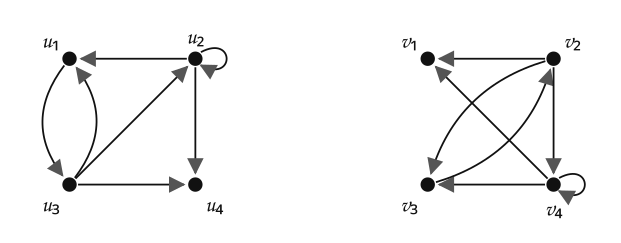
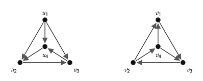
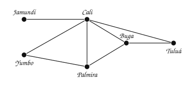
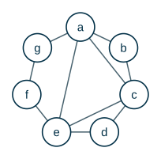

---
# Copyright (c) 2026 Angela Villota, and collaborators from the CyED block
# Licensed under the PolyForm Noncommercial License 1.0.0.
# Commercial use is prohibited without prior written authorization.
title: "Isomorfismo, planaridad y coloración: Ejercicios"
---

# Isomorfismo, planaridad y coloración: Ejercicios

Use esta página después de leer el [material de estudio](index.md). Cada ejercicio trae **pistas** y una **solución general**; intente resolverlo antes de abrirlas.

---

### Ejercicio 1

¿Cuántos grafos simples **no isomorfos** de $3$ vértices hay? ¿Y de $4$ vértices con exactamente $3$ aristas? Dibújelos.

:::{admonition} Pistas
:class: dropdown
- Clasifique por número de aristas.
- Con $4$ vértices y $3$ aristas, piense en la secuencia de grados.
:::

:::{admonition} Solución general
:class: dropdown
Con $3$ vértices hay $4$: con $0$, $1$, $2$ y $3$ aristas (uno por cada número de aristas). Con $4$ vértices y $3$ aristas hay $3$: el triángulo más un vértice aislado (grados $2, 2, 2, 0$), el camino $P_4$ (grados $1, 2, 2, 1$) y la estrella $K_{1,3}$ (grados $3, 1, 1, 1$).
:::

### Ejercicio 2

Determine si los grafos dirigidos de cada par son isomorfos. Si lo son, encuentre una función de correspondencia entre sus vértices.

:::{admonition} Pistas
:class: dropdown
- En un grafo dirigido, un isomorfismo conserva el grado de entrada y el de salida de cada vértice, y los bucles.
- Empiece por los vértices que son únicos en algo: el que tiene bucle, el que no tiene aristas de salida.
:::

:::{admonition} Solución general
:class: dropdown
- Par de arriba: **sí**. $f(u_1) = v_3$, $f(u_2) = v_4$, $f(u_3) = v_2$, $f(u_4) = v_1$. El bucle obliga $f(u_2) = v_4$, y $u_4$, sin aristas de salida, va a $v_1$.
- Par de abajo: **no**. Los grados de salida son $3, 1, 1, 1$ en el primero y $2, 2, 1, 1$ en el segundo: en el primero $u_1$ tiene grado de salida $3$ y en el segundo ningún vértice lo tiene. Además, el triángulo de afuera es un circuito dirigido en el segundo y no en el primero.
:::

### Ejercicio 3

¿Cuál es el número cromático de este grafo?

:::{admonition} Pistas
:class: dropdown
- Busque un triángulo: da una cota inferior.
- Intente colorear con esa cantidad, empezando por Cali, que tiene el mayor grado.
:::

:::{admonition} Solución general
:class: dropdown
$\chi = 3$. Cali, Yumbo y Palmira forman un triángulo, así que hacen falta al menos $3$ colores, y con $3$ alcanza: Cali: azul, Jamundí: amarillo, Yumbo: amarillo, Palmira: verde, Buga: amarillo, Tuluá: verde.
:::

### Ejercicio 4

Muestre que un grafo plano, simple y conexo tiene algún vértice de grado **menor o igual que 5**.

:::{admonition} Pistas
:class: dropdown
- Suponga que todos los vértices tienen grado al menos $6$ y use *handshaking*.
- Compare con $e \le 3v - 6$.
:::

:::{admonition} Solución general
:class: dropdown
Si todos los grados fueran $\ge 6$, por *handshaking* $2e \ge 6v$, es decir, $e \ge 3v$. Pero el corolario de la fórmula de Euler dice $e \le 3v - 6 < 3v$. Contradicción.
:::

### Ejercicio 5

Calcule el número cromático del siguiente grafo. Aplique la coloración voraz (orden: de mayor a menor grado; empates en orden alfabético) y compare.

:::{admonition} Pistas
:class: dropdown
- Busque un triángulo: da una cota inferior.
- El borde es un ciclo de longitud $7$ (impar).
:::

:::{admonition} Solución general
:class: dropdown
$\chi = 3$. Una coloración: $a$: azul, $b$: amarillo, $c$: verde, $d$: azul, $e$: amarillo, $f$: azul, $g$: amarillo.

Coloración voraz (3 colores): $a$: azul, $c$: amarillo, $e$: verde, $b$: verde, $d$: azul, $f$: azul, $g$: amarillo.
:::

### Ejercicio 6

Encuentre un grafo y un orden de sus vértices para el cual la coloración voraz use **más** colores que $\chi(G)$.

:::{admonition} Pistas
:class: dropdown
- Basta con un grafo bipartito ($\chi = 2$).
- Haga que dos vértices no adyacentes reciban colores «equivocados» al principio.
:::

:::{admonition} Solución general
:class: dropdown
El camino $a - b - c - d$ con el orden $a, d, b, c$: $a$ y $d$ reciben el color 1; $b$ (vecino de $a$) recibe el 2; $c$ es vecino de $b$ (color 2) y de $d$ (color 1) y recibe el **3**. Pero $\chi = 2$.
:::

### Ejercicio 7

Determine si el grafo de Petersen es plano y calcule su número cromático. Justifique sus respuestas.

---

*Material adaptado del material original del profesor Oscar Bedoya.*
