---
# Copyright (c) 2026 Angela Villota, and collaborators from the CyED block
# Licensed under the PolyForm Noncommercial License 1.0.0.
# Commercial use is prohibited without prior written authorization.
title: "Unidad 5: Isomorfismo, grafos planos y coloración"
---

# Unidad 5: Isomorfismo, grafos planos y coloración

## 1. Isomorfismo

### El problema

| | |
|---|---|
| 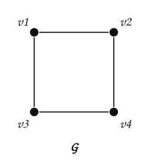 | 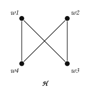 |

**¿$G$ y $H$ son «el mismo grafo» dibujado de dos formas?** $G$ parece un cuadrado y $H$ un corbatín con un cruce. Pero un dibujo no es el grafo: lo que importa es **quién es adyacente a quién**.

:::{admonition} Pista
:class: dropdown
Los dos tienen $4$ vértices, $4$ aristas y todos los vértices de grado $2$. Intente renombrar los vértices de $H$ para que sus aristas coincidan con las de $G$.
:::

**Isomorfismo de grafos.** Los grafos simples $G_1 = (V_1, E_1)$ y $G_2 = (V_2, E_2)$ son **isomorfos** si existe una función biyectiva $f: V_1 \to V_2$ tal que, para todo par de vértices $a, b \in V_1$,

$$
\{a, b\} \in E_1 \iff \{f(a), f(b)\} \in E_2
$$

Es decir: $f$ es inyectiva y sobreyectiva, y **preserva la adyacencia** en los dos sentidos. Una función así se llama **isomorfismo**.

Para $G$ y $H$, sea $f(v_1) = w_1$, $f(v_2) = w_4$, $f(v_3) = w_3$, $f(v_4) = w_2$:

:::::{admonition} Verificar que f preserva la adyacencia
:class: dropdown
::::{tab-set}
:::{tab-item} Paso 1
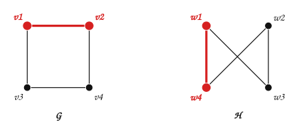

> $\{v_1, v_2\}$ es arista de $G$ y $\{f(v_1), f(v_2)\} = \{w_1, w_4\}$ es arista de $H$.

:::
:::{tab-item} Paso 2
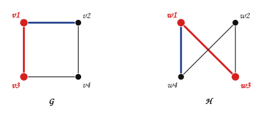

> $\{v_1, v_3\}$ es arista de $G$ y $\{f(v_1), f(v_3)\} = \{w_1, w_3\}$ es arista de $H$.

:::
:::{tab-item} Paso 3
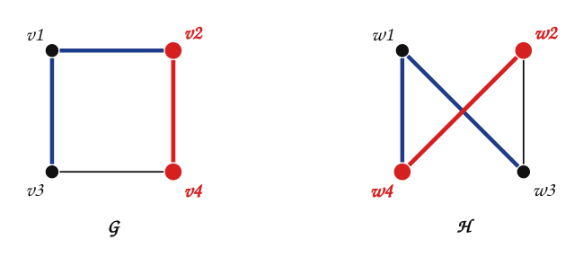

> $\{v_2, v_4\}$ es arista de $G$ y $\{f(v_2), f(v_4)\} = \{w_4, w_2\}$ es arista de $H$.

:::
:::{tab-item} Paso 4
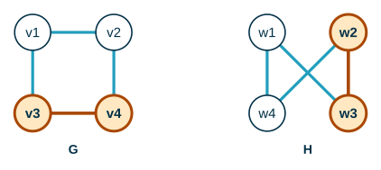

> $\{v_3, v_4\}$ es arista de $G$ y $\{f(v_3), f(v_4)\} = \{w_3, w_2\}$ es arista de $H$.

:::
:::{tab-item} Paso 5

> Las $4$ aristas de $G$ van a aristas de $H$, y $H$ tiene exactamente $4$ aristas: $f$ también lleva no-aristas a no-aristas. **$f$ es un isomorfismo.**

:::
::::
:::::

### Con matrices de adyacencia

Determinar si $G$ y $H$ son isomorfos:

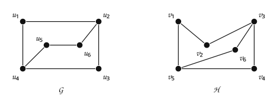

Los dos tienen $6$ vértices, $7$ aristas y cuatro vértices de grado $2$ y dos de grado $3$. Se propone $f(u_1) = v_6$, $f(u_2) = v_3$, $f(u_3) = v_4$, $f(u_4) = v_5$, $f(u_5) = v_1$, $f(u_6) = v_2$. Para verificarla, se escribe la matriz de adyacencia de $G$ en el orden $u_1, \dots, u_6$ y la de $H$ en el orden de las imágenes $v_6, v_3, v_4, v_5, v_1, v_2$:

$$
A_G = \begin{array}{c|cccccc} & \mathbf{u_1} & \mathbf{u_2} & \mathbf{u_3} & \mathbf{u_4} & \mathbf{u_5} & \mathbf{u_6} \\ \hline \mathbf{u_1} & 0 & 1 & 0 & 1 & 0 & 0 \\ \mathbf{u_2} & 1 & 0 & 1 & 0 & 0 & 1 \\ \mathbf{u_3} & 0 & 1 & 0 & 1 & 0 & 0 \\ \mathbf{u_4} & 1 & 0 & 1 & 0 & 1 & 0 \\ \mathbf{u_5} & 0 & 0 & 0 & 1 & 0 & 1 \\ \mathbf{u_6} & 0 & 1 & 0 & 0 & 1 & 0\end{array} \qquad A_H = \begin{array}{c|cccccc} & \mathbf{v_6} & \mathbf{v_3} & \mathbf{v_4} & \mathbf{v_5} & \mathbf{v_1} & \mathbf{v_2} \\ \hline \mathbf{v_6} & 0 & 1 & 0 & 1 & 0 & 0 \\ \mathbf{v_3} & 1 & 0 & 1 & 0 & 0 & 1 \\ \mathbf{v_4} & 0 & 1 & 0 & 1 & 0 & 0 \\ \mathbf{v_5} & 1 & 0 & 1 & 0 & 1 & 0 \\ \mathbf{v_1} & 0 & 0 & 0 & 1 & 0 & 1 \\ \mathbf{v_2} & 0 & 1 & 0 & 0 & 1 & 0\end{array}
$$

Las dos matrices son **iguales**: cada arista de $G$ va a una arista de $H$ y cada no-arista a una no-arista. $f$ es un isomorfismo.

> **¿Son isomorfos los grafos de cada par?**

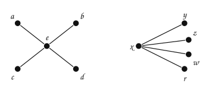

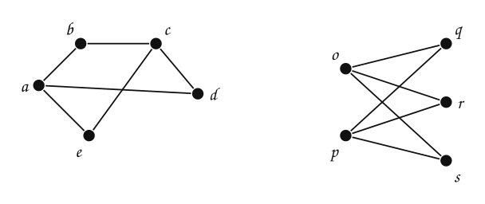

:::{admonition} Respuesta
:class: dropdown
Sí, los dos pares.

- Arriba: los dos son una estrella, un vértice unido a otros cuatro. $f(e) = x$ y $a, b, c, d$ van a $y, z, w, r$ en cualquier orden.
- Abajo: los dos son $K_{2,3}$. En el de la izquierda, $a$ y $c$ son vecinos de $b$, $d$ y $e$, y no entre sí. $f(a) = o$, $f(c) = p$, $f(b) = q$, $f(d) = r$, $f(e) = s$.
:::

### ¿Cómo mostrar que dos grafos **no** son isomorfos?

Basta encontrar una propiedad que un isomorfismo conserva (un **invariante**) y que tome valores distintos en los dos grafos. Invariantes útiles:

- número de vértices y de aristas;
- la secuencia de grados;
- que haya un vértice de cierto grado adyacente a otro de cierto grado;
- la existencia de circuitos de cierta longitud;
- ser conexo, ser bipartito.

| | |
|---|---|
| 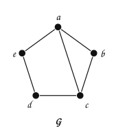 | 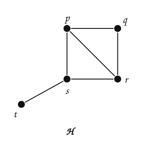 |

> **¿Son isomorfos?**

:::{admonition} Respuesta
:class: dropdown
No. Los dos tienen $5$ vértices y $6$ aristas, pero $H$ tiene un vértice de grado $1$ ($t$) y $G$ no tiene ninguno. Un isomorfismo conserva el grado de cada vértice.
:::

| | |
|---|---|
| 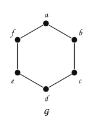 | 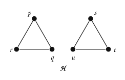 |

> **¿Y estos?** Los dos tienen $6$ vértices, $6$ aristas y todos los grados iguales a $2$.

:::{admonition} Respuesta
:class: dropdown
No. $G$ es conexo y $H$ no lo es. Que coincidan los invariantes **no** garantiza que los grafos sean isomorfos; que uno solo difiera sí garantiza que no lo son.
:::

A veces hay que mirar **a quién** es adyacente cada vértice:

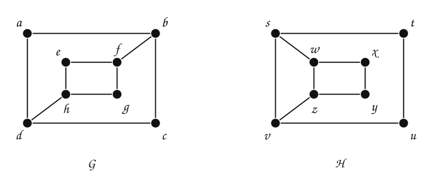

> **¿$G$ y $H$ son isomorfos?** Los dos tienen $8$ vértices, $10$ aristas, cuatro vértices de grado $2$ y cuatro de grado $3$.

:::{admonition} Respuesta
:class: dropdown
No. En $G$, $\delta(a) = 2$, así que $a$ tendría que corresponder con $t$, $u$, $x$ o $y$, los vértices de grado $2$ de $H$. Pero cada uno de esos cuatro vértices de $H$ es adyacente a **otro** de grado $2$, y $a$ no lo es: sus dos vecinos, $b$ y $d$, tienen grado $3$. Pasa lo mismo con $c$, $e$ y $g$ en $G$.
:::

Los mejores algoritmos conocidos para decidir si dos grafos arbitrarios son isomorfos tienen complejidad exponencial en el peor caso. En la práctica, programas como NAUTY resuelven grafos de cientos de vértices.

## 2. Grafos planos

### El problema

Se quieren conectar $3$ casas con $3$ servicios (agua, luz, gas), cada casa con cada servicio, **sin que dos conexiones se crucen**. ¿Es posible? El grafo es $K_{3,3}$. Antes de responder, un caso más sencillo.

**Grafo plano.** Un grafo (o multigrafo) $G$ es plano si se puede dibujar en el plano de modo que sus aristas solo se intersequen en los vértices. Ese dibujo se llama **inmersión** (*embedding*) de $G$.

| | |
|---|---|
| 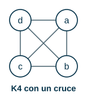 | 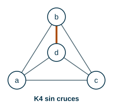 |

$K_4$ **es** plano: el primer dibujo tiene un cruce, pero el segundo no. Ser plano es una propiedad del grafo, no de un dibujo particular. $K_1$, $K_2$, $K_3$ y $K_4$ son planos.

> **¿Es plano este grafo?**

:::::{admonition} ¿Es plano?
:class: dropdown
::::{tab-set}
:::{tab-item} Paso 1
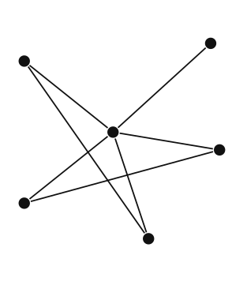

> En este dibujo hay aristas que se cruzan.

:::
:::{tab-item} Paso 2
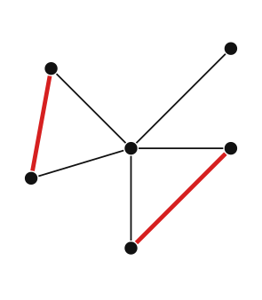

> Moviendo los vértices, el mismo grafo se dibuja **sin cruces**: dos triángulos que comparten un vértice y una arista que cuelga. **El grafo es plano.**

:::
::::
:::::

### Fórmula de Euler

Un dibujo plano divide el plano en **regiones** (la exterior también cuenta):

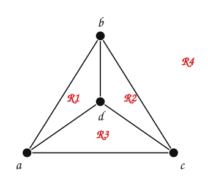

$K_4$: $e = 6$, $v = 4$, y hay $r = 4$ regiones.

**Teorema (fórmula de Euler).** Sea $G$ un grafo plano simple y conexo con $e$ aristas y $v$ vértices, y sea $r$ el número de regiones de una representación plana de $G$. Entonces

$$
r = e - v + 2
$$

Compruébelo con $K_4$: $6 - 4 + 2 = 4$.

> **¿Cuántas regiones tiene una representación plana de este grafo?**

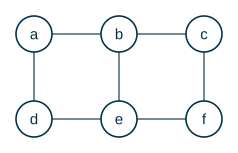

:::{admonition} Respuesta
:class: dropdown
$e = 7$, $v = 6$: $r = 7 - 6 + 2 = 3$. Son los dos triángulos y la región exterior; la arista que cuelga no encierra ninguna región.

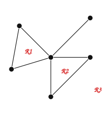
:::

**Corolario.** Si $G$ es un grafo plano simple y conexo con $v \ge 3$ vértices y $e$ aristas, entonces

$$
e \le 3v - 6
$$

**Razón.** Cada región está rodeada por al menos $3$ aristas (no hay bucles ni aristas paralelas) y cada arista toca a lo sumo $2$ regiones: $3r \le 2e$. Reemplazando $r = e - v + 2$ se obtiene $e \le 3v - 6$.

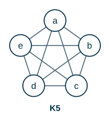

> **¿$K_5$ es plano?**

:::{admonition} Respuesta
:class: dropdown
No. $v = 5$ y $e = 10$, pero $3v - 6 = 9$ y $10 > 9$. Ningún dibujo de $K_5$ evita los cruces.

Para $K_4$: $e = 6 \le 3 \cdot 4 - 6 = 6$. Se cumple, como debe ser.
:::

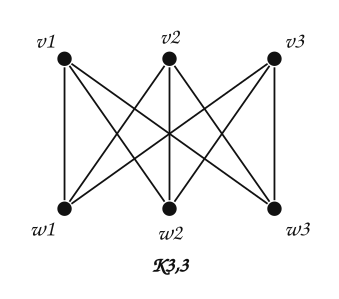

> **¿$K_{3,3}$ es plano?** Aquí $e = 9 \le 3 \cdot 6 - 6 = 12$. El corolario no lo descarta.

:::{admonition} Respuesta
:class: dropdown
No es plano, pero hace falta un argumento más fino. $K_{3,3}$ es bipartito: no tiene triángulos, así que cada región está rodeada por al menos **$4$** aristas: $4r \le 2e$, lo que lleva a $e \le 2v - 4$. Para $K_{3,3}$: $9 > 2 \cdot 6 - 4 = 8$. El problema de las casas y los servicios **no** tiene solución.
:::

**Teorema (Kuratowski).** Un grafo es plano si y solo si no contiene un subgrafo que sea una subdivisión de $K_5$ o de $K_{3,3}$.

## 3. Coloración

### El problema

Dado un mapa, **¿cuál es el menor número de colores con que se puede colorear, de modo que dos regiones vecinas nunca tengan el mismo color?**

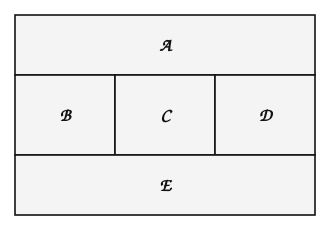

**Grafo dual de un mapa.** Cada región es un vértice; si dos regiones comparten una frontera, hay una arista entre ellas. Dos regiones que se tocan en un solo punto no se consideran adyacentes.

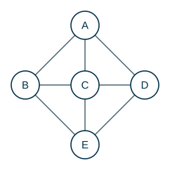

**Coloración.** Asignar un color a cada vértice de un grafo simple de modo que vértices adyacentes tengan colores distintos.
**Número cromático** $\chi(G)$. El mínimo número de colores necesarios para colorear $G$.

### Un método: coloración voraz

Se recorren los vértices en algún orden (por ejemplo, de mayor a menor grado) y a cada uno se le asigna el **primer** color que no use ninguno de sus vecinos ya coloreados.

:::::{admonition} Coloración voraz del mapa
:class: dropdown
::::{tab-set}
:::{tab-item} Paso 1
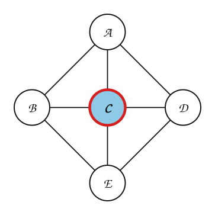

> $C$ (grado $4$): sus vecinos ya coloreados usan ninguno. Se le asigna el primer color libre: **azul**.

:::
:::{tab-item} Paso 2
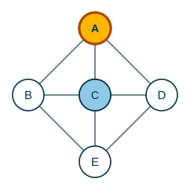

> $A$ (grado $3$): sus vecinos ya coloreados usan azul. Se le asigna el primer color libre: **amarillo**.

:::
:::{tab-item} Paso 3
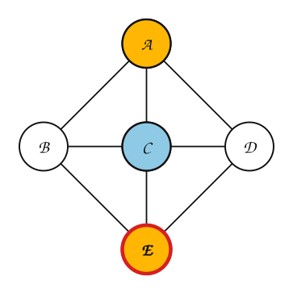

> $E$ (grado $3$): sus vecinos ya coloreados usan azul. Se le asigna el primer color libre: **amarillo**.

:::
:::{tab-item} Paso 4
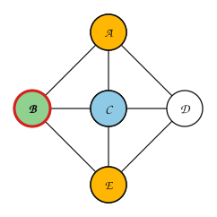

> $B$ (grado $3$): sus vecinos ya coloreados usan azul, amarillo. Se le asigna el primer color libre: **verde**.

:::
:::{tab-item} Paso 5
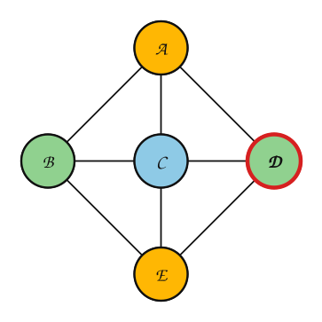

> $D$ (grado $3$): sus vecinos ya coloreados usan azul, amarillo. Se le asigna el primer color libre: **verde**.

> Se usaron **3** colores.

:::
::::
:::::

> **¿Se puede con 2 colores?**

:::{admonition} Respuesta
:class: dropdown
No. $A$, $B$ y $C$ son vecinos entre sí (un triángulo): necesitan $3$ colores distintos. Entonces $\chi = 3$ y la coloración voraz encontró el óptimo.
:::

La coloración voraz **no siempre** usa el mínimo de colores: depende del orden. Se usa porque es rápida; calcular $\chi(G)$ exactamente es un problema computacionalmente difícil (los mejores algoritmos conocidos son exponenciales en el número de vértices).

### Números cromáticos conocidos

> **Indique $\chi(K_n)$, $\chi(K_{m,n})$ y $\chi(C_n)$.**

:::{admonition} Respuesta
:class: dropdown
- $\chi(K_n) = n$: todos los vértices son vecinos entre sí.
- $\chi(K_{m,n}) = 2$: un color por lado. En general, un grafo con al menos una arista es bipartito si y solo si $\chi = 2$.
- $\chi(C_n) = 2$ si $n$ es par y $3$ si $n$ es impar.
:::

**Teorema de los cuatro colores.** El número cromático de un grafo plano es menor o igual que $4$.

Se propuso en 1852 y lo demostraron Kenneth Appel y Wolfgang Haken en 1976. Mostraron que, si el teorema fuera falso, habría un contraejemplo en una lista de unas $2000$ configuraciones, y con más de $1000$ horas de cómputo verificaron que ninguna lo era. Fue una de las primeras demostraciones importantes que dependieron de un computador.

### Aplicación: programar exámenes

Seis asignaturas deben programar su examen final. Si un estudiante está inscrito en dos asignaturas, sus exámenes no pueden ser en la misma franja horaria. **Vértices:** asignaturas. **Aristas:** pares de asignaturas con algún estudiante en común. Cada color es una franja.

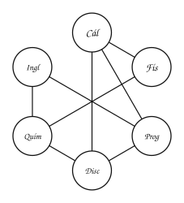

Orden por grado (de mayor a menor): Cál (3), Prog (3), Disc (3), Quím (3), Fís (2), Ingl (2).

:::::{admonition} Coloración voraz de los exámenes
:class: dropdown
::::{tab-set}
:::{tab-item} Paso 1
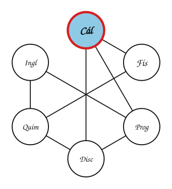

> Cál (grado 3): sus vecinos coloreados usan ninguno. Color: **azul**.

:::
:::{tab-item} Paso 2
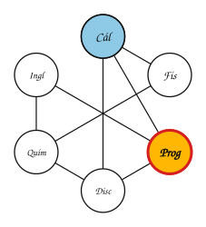

> Prog (grado 3): sus vecinos coloreados usan azul. Color: **amarillo**.

:::
:::{tab-item} Paso 3
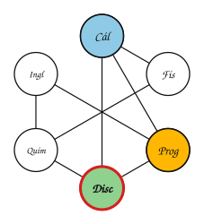

> Disc (grado 3): sus vecinos coloreados usan azul, amarillo. Color: **verde**.

:::
:::{tab-item} Paso 4
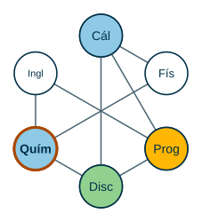

> Quím (grado 3): sus vecinos coloreados usan verde. Color: **azul**.

:::
:::{tab-item} Paso 5
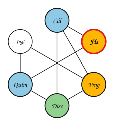

> Fís (grado 2): sus vecinos coloreados usan azul. Color: **amarillo**.

:::
:::{tab-item} Paso 6
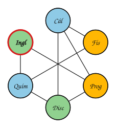

> Ingl (grado 2): sus vecinos coloreados usan azul, amarillo. Color: **verde**.

> 3 colores = 3 franjas de examen: franja 1 (azul): Cál, Quím; franja 2 (amarillo): Prog, Fís; franja 3 (verde): Disc, Ingl.

:::
::::
:::::

Cálculo, Programación y Discretas forman un triángulo, así que no se puede con menos de $3$ franjas.

Otras aplicaciones: asignación de frecuencias a antenas (vértices: antenas; aristas: antenas cercanas que interferirían) y asignación de registros en compiladores.

## Ejercicios

Practique con los [ejercicios de isomorfismo, planaridad y coloración](exercises.md).

## Fuentes

- Bedoya, O. *Grafos: grafo plano, fórmula de Euler; isomorfismos, coloreo de grafos y grafo dual*. Diapositivas del curso, Universidad del Valle.
- Rosen, K. H. *Discrete Mathematics and Its Applications*, 7.ª ed. McGraw-Hill, 2011. Secciones 10.3, 10.7 y 10.8.

---

*Material adaptado del material original del profesor Oscar Bedoya.*
