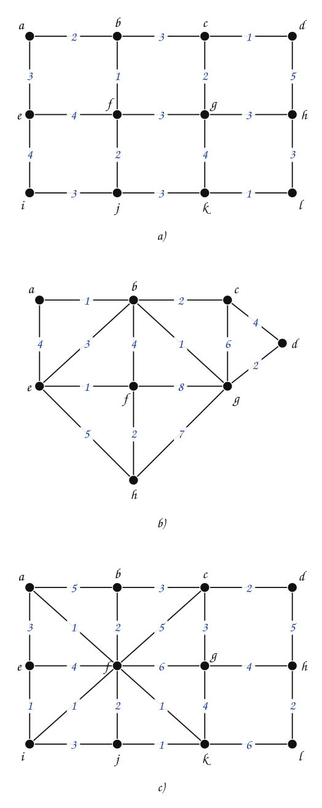
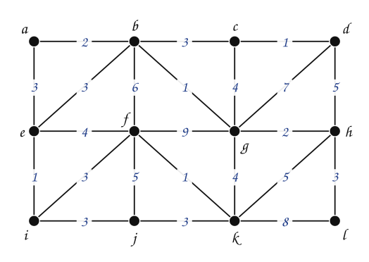

---
# Copyright (c) 2026 Angela Villota, and collaborators from the CyED block
# Licensed under the PolyForm Noncommercial License 1.0.0.
# Commercial use is prohibited without prior written authorization.
title: "Kruskal: Ejercicios"
---

# Kruskal: Ejercicios

Use esta página después de leer el [material de estudio de Kruskal](index.md). Cada ejercicio trae **pistas** y una **solución general**; intente resolverlo antes de abrirlas.

---

### Ejercicio 1

Encontrar un árbol recubridor mínimo usando el algoritmo de Kruskal en cada grafo (son los grafos de los ejercicios de Prim). Liste las aristas en el orden en que las adiciona y compare el árbol con el que se obtiene con Prim.

:::{admonition} Pistas
:class: dropdown
- Ordene primero las aristas por peso.
- Lleve las componentes después de cada paso; una arista con los dos extremos en la misma componente se descarta.
:::

:::{admonition} Solución general
:class: dropdown
a) Orden: $\{c,d\}$ (1), $\{b,f\}$ (1), $\{k,l\}$ (1), $\{a,b\}$ (2), $\{c,g\}$ (2), $\{f,j\}$ (2), $\{b,c\}$ (3), $\{a,e\}$ (3), $\{g,h\}$ (3), $\{h,l\}$ (3), $\{i,j\}$ (3). Descartadas: $\{f,g\}$. Costo **24**, igual que con Prim; es el **mismo** árbol.

b) Orden: $\{a,b\}$ (1), $\{b,g\}$ (1), $\{e,f\}$ (1), $\{b,c\}$ (2), $\{d,g\}$ (2), $\{f,h\}$ (2), $\{b,e\}$ (3). Descartadas: ninguna. Costo **12**, igual que con Prim; es el **mismo** árbol.

c) Orden: $\{a,f\}$ (1), $\{e,i\}$ (1), $\{f,i\}$ (1), $\{f,k\}$ (1), $\{j,k\}$ (1), $\{c,d\}$ (2), $\{b,f\}$ (2), $\{h,l\}$ (2), $\{b,c\}$ (3), $\{c,g\}$ (3), $\{g,h\}$ (4). Descartadas: $\{f,j\}$, $\{a,e\}$, $\{i,j\}$, $\{e,f\}$. Costo **21**, igual que con Prim; es el **mismo** árbol.

:::

### Ejercicio 2

En el Ejemplo 1, ¿en qué paso de Kruskal hay **dos componentes** con más de un vértice al mismo tiempo? ¿Podría pasar eso en Prim?

:::{admonition} Pistas
:class: dropdown
- Mire las componentes que aparecen debajo de cada figura del Ejemplo 1.
- En Prim, ¿cuántos árboles hay en cada paso?
:::

:::{admonition} Solución general
:class: dropdown
Desde que se agrega $\{d,e\}$ (paso 4) hay dos componentes con más de un vértice: $\{a,b,c\}$ y $\{d,e\}$; con $\{f,g\}$ son tres. En Prim nunca: siempre hay un único árbol, y los demás vértices están solos.
:::

### Ejercicio 3

Sea $G$ un grafo conexo con pesos y sea $e$ la arista de **mayor** peso de un circuito de $G$. Muestre que existe un árbol recubridor mínimo de $G$ que **no** contiene a $e$. ¿Cómo se ve esto al correr Kruskal?

:::{admonition} Pistas
:class: dropdown
- Cuando Kruskal llega a $e$, todas las demás aristas del circuito ya se procesaron (son más baratas o empatan antes en el orden).
- ¿Qué se puede decir de los extremos de $e$ en ese momento?
:::

:::{admonition} Solución general
:class: dropdown
Ordene las aristas de modo que $e$ quede después de las demás aristas del circuito (si hay empates de peso, póngala de última entre ellas). Cuando Kruskal llega a $e$, el resto del circuito ya se procesó: cada una de esas aristas se agregó o se descartó porque sus extremos ya estaban conectados. En cualquier caso, los extremos de $e$ ya están en la misma componente y $e$ se descarta. El árbol que produce Kruskal es mínimo y no contiene a $e$.
:::

### Ejercicio 4

Escriba en pseudocódigo `ENCONTRAR(x)` (la componente de $x$) y `UNIR(x, y)` con **unión por rango** y **compresión de caminos**. Compare el número de pasos de `ENCONTRAR` con y sin esas mejoras al correr Kruskal sobre un grafo «camino» de $10\,000$ vértices con aristas $\{i, i+1\}$ de peso $1$.

:::{admonition} Pistas
:class: dropdown
- Unión por rango: el árbol más bajo se cuelga del más alto.
- Compresión de caminos: al terminar `ENCONTRAR(x)`, todos los nodos del camino apuntan directo a la raíz.
:::

:::{admonition} Solución general
:class: dropdown
Sin las dos mejoras, uniendo en el orden de las aristas se forma una cadena y `ENCONTRAR` puede tardar $\Theta(n)$. Con las dos, cada operación cuesta en la práctica una cantidad casi constante ($O(\alpha(n))$ amortizado), y el número total de pasos queda cerca de $n$.
:::

### Ejercicio 5

Encontrar un árbol recubridor mínimo usando los algoritmos de Prim y Kruskal. Liste las aristas en el orden en que las adiciona a cada árbol recubridor mínimo.

---

*Material adaptado del material original del profesor Oscar Bedoya.*
