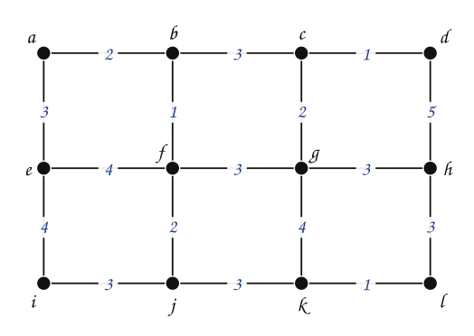
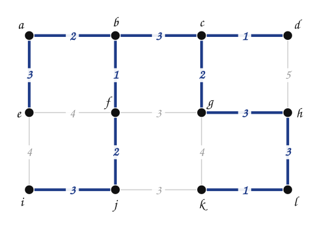
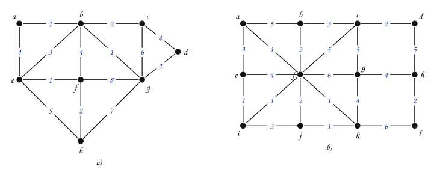
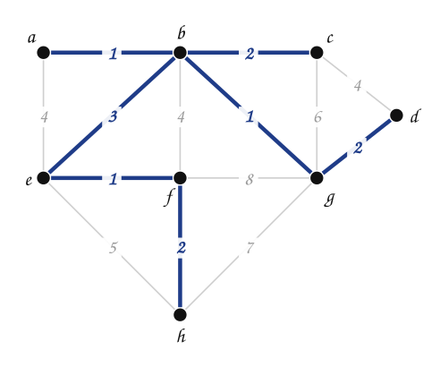
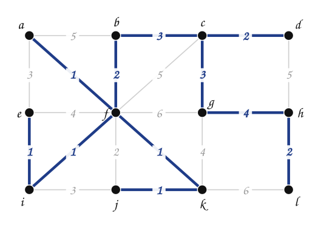

---
# Copyright (c) 2026 Angela Villota, and collaborators from the CyED block
# Licensed under the PolyForm Noncommercial License 1.0.0.
# Commercial use is prohibited without prior written authorization.
title: "Prim: Ejercicios"
---

# Prim: Ejercicios

Use esta página después de leer el [material de estudio de Prim](index.md). Cada ejercicio trae **pistas** y una **solución general**; intente resolverlo antes de abrirlas.

---

### Ejercicio 1

Encontrar un árbol recubridor mínimo usando el algoritmo de Prim. Liste las aristas en el orden en que las adiciona al árbol.

:::{admonition} Pistas
:class: dropdown
- Hay tres aristas de peso $1$: la primera que se escoge es cualquiera de ellas.
- El árbol debe terminar con $12 - 1 = 11$ aristas.
:::

:::{admonition} Solución general
:class: dropdown
Orden de las aristas: $\{c,d\}$ (1), $\{c,g\}$ (2), $\{b,c\}$ (3), $\{b,f\}$ (1), $\{a,b\}$ (2), $\{f,j\}$ (2), $\{a,e\}$ (3), $\{g,h\}$ (3), $\{h,l\}$ (3), $\{k,l\}$ (1), $\{i,j\}$ (3).

Costo **24**.
:::

### Ejercicio 2

Encontrar un árbol recubridor mínimo usando el algoritmo de Prim, en cada grafo.

:::{admonition} Pistas
:class: dropdown
- Lleve la lista de candidatas en cada paso y descarte las que tengan los dos extremos en el árbol.
- Cuando hay empate, escoja cualquiera: el peso final no cambia.
:::

:::{admonition} Solución general
:class: dropdown
a) Orden: $\{a,b\}$ (1), $\{b,g\}$ (1), $\{b,c\}$ (2), $\{d,g\}$ (2), $\{b,e\}$ (3), $\{e,f\}$ (1), $\{f,h\}$ (2). Costo **12**.

b) Orden: $\{a,f\}$ (1), $\{f,i\}$ (1), $\{e,i\}$ (1), $\{f,k\}$ (1), $\{j,k\}$ (1), $\{b,f\}$ (2), $\{b,c\}$ (3), $\{c,d\}$ (2), $\{c,g\}$ (3), $\{g,h\}$ (4), $\{h,l\}$ (2). Costo **21**.

:::

### Ejercicio 3

Muestre con un ejemplo que, si en Prim se elimina la condición «incidente con el árbol» (es decir, se toma siempre la arista de menor peso de todo el grafo que no cree circuito **dentro de $T$**), lo que se va construyendo deja de ser un árbol en los pasos intermedios.

:::{admonition} Pistas
:class: dropdown
- Busque dos aristas baratas que estén lejos una de la otra.
- En el grafo del Ejemplo 2 del material de estudio, ¿cuáles son las cuatro aristas más baratas?
:::

:::{admonition} Solución general
:class: dropdown
En el grafo del Ejemplo 2, las aristas más baratas son $\{a,b\}$ ($1$), $\{b,c\}$ ($2$), $\{d,e\}$ ($3$) y $\{f,g\}$ ($3$). Después de tomarlas, $T$ tiene tres componentes: $\{a,b,c\}$, $\{d,e\}$ y $\{f,g\}$; es un **bosque**, no un árbol. Esa variante es el algoritmo de Kruskal, que también llega a un árbol recubridor mínimo, pero por otro camino.
:::

### Ejercicio 4

Demuestre que si todos los pesos de un grafo conexo son **distintos**, su árbol recubridor mínimo es **único**.

---

*Material adaptado del material original del profesor Oscar Bedoya.*
