---
# Copyright (c) 2026 Angela Villota, and collaborators from the CyED block
# Licensed under the PolyForm Noncommercial License 1.0.0.
# Commercial use is prohibited without prior written authorization.
title: "Unidad 5: Algoritmo de Prim"
---

# Unidad 5: Algoritmo de Prim

## 1. El problema

El siguiente grafo indica los costos de una red de comunicaciones. **¿Qué enlaces se deben mantener para asegurar que hay una forma de comunicar cada dos ciudades?** Se quiere gastar lo menos posible.

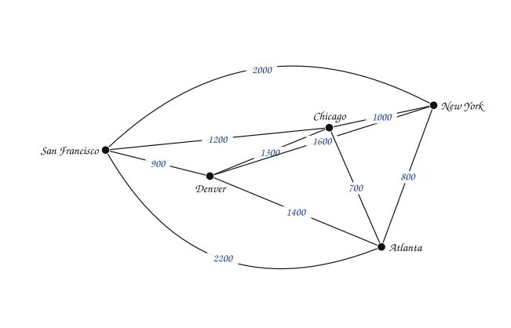

Pruebe con una selección propia antes de seguir.

:::{admonition} Dos selecciones
:class: dropdown
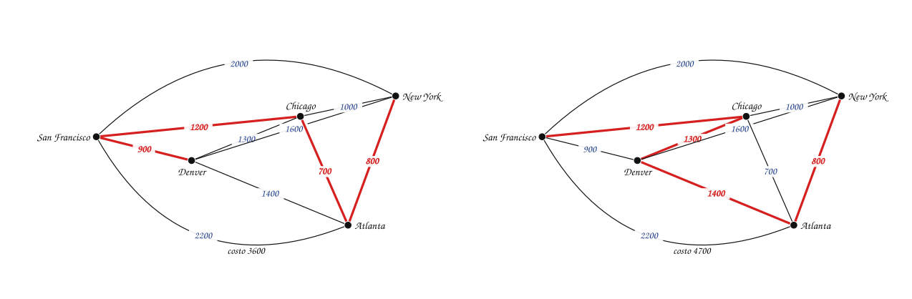

Las dos comunican todas las ciudades con $4$ enlaces, pero la primera cuesta $3600$ y la segunda $4700$.

- Si una selección tiene un **circuito**, se puede quitar cualquier enlace del circuito y todo sigue comunicado, más barato. La solución no tiene circuitos.
- Si la selección no **conecta** todas las ciudades, no sirve.
- Un subgrafo conexo, sin circuitos y con los $5$ vértices es un **árbol**: tiene exactamente $5 - 1 = 4$ aristas.
:::

Una primera idea es listar **todos** los árboles que contienen a todos los vértices y quedarse con el de menor peso. Pero son demasiados: un grafo completo de $n$ vértices tiene $n^{n-2}$ de esos árboles (fórmula de Cayley); con $n = 20$ son más de $10^{23}$.

## 2. Árbol recubridor

**Árbol recubridor.** Sea $G$ un grafo simple. Un árbol recubridor de $G$ es un subgrafo de $G$ que es un **árbol** y que contiene **todos** los vértices de $G$.

Ejemplo. El grafo $G$:

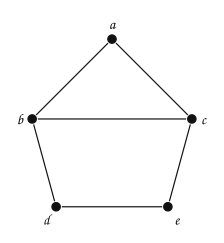

| Es árbol recubridor | Es árbol recubridor | No: tiene un circuito y no es conexo | No: no contiene a $e$ |
|---|---|---|---|
| 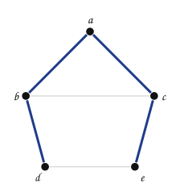 | 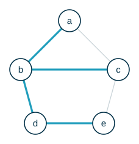 | 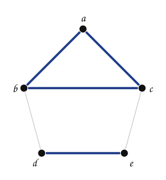 | 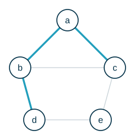 |

**Árbol recubridor mínimo.** En un grafo con pesos, el peso de un árbol recubridor es la suma de los pesos de sus aristas. Un árbol recubridor mínimo es uno cuyo peso es menor o igual que el de cualquier otro árbol recubridor.

El problema de la red de comunicaciones pide un árbol recubridor mínimo. La selección de costo $3600$ lo es.

### ¿Entendimos el problema?

| | |
|---|---|
| **Entradas** | Un grafo no dirigido, conexo y con pesos. |
| **Salidas** | Un conjunto de $n - 1$ aristas que forman un árbol recubridor de peso mínimo, y ese peso. |

> **¿Por qué el grafo tiene que ser conexo?** Si no lo es, ningún subgrafo con todos sus vértices puede ser conexo, y no existe árbol recubridor.

## 3. El método

**Algoritmo de Prim.** Se escoge la arista de menor peso y se agrega al árbol. Después, se agrega la arista de menor peso que sea **incidente** con el árbol (un extremo dentro, otro fuera) y que no cree un circuito. Se repite hasta que el árbol tenga $n - 1$ aristas.

### Ejemplo 1

Encontrar un árbol recubridor mínimo usando el algoritmo de Prim. En cada paso, las aristas punteadas son las **candidatas**: tienen un extremo en el árbol y el otro fuera.

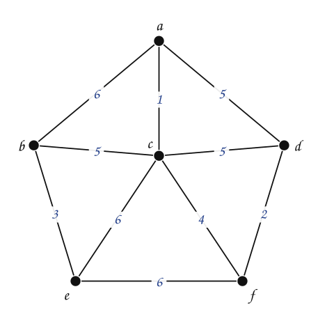

:::::{admonition} Prim, empezando por la arista de menor peso
:class: dropdown
::::{tab-set}
:::{tab-item} Paso 1
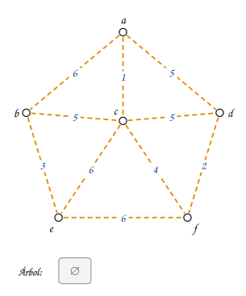

> Todas las aristas son candidatas. Se busca la de menor peso de todo el grafo.

:::
:::{tab-item} Paso 2
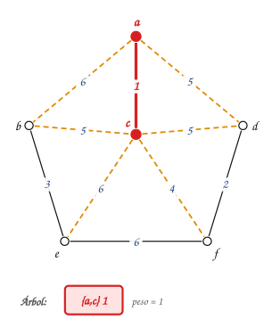

> La arista de menor peso es $\{a,c\}$ con peso $1$: se agrega al árbol. Ahora las candidatas (punteadas) son las aristas con un extremo en el árbol y el otro fuera.

:::
:::{tab-item} Paso 3
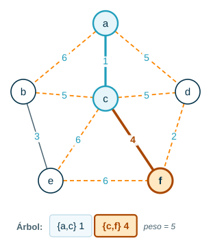

> Entre las candidatas, la de menor peso es $\{c,f\}$ con peso $4$: se agrega al árbol junto con el vértice $f$.

:::
:::{tab-item} Paso 4
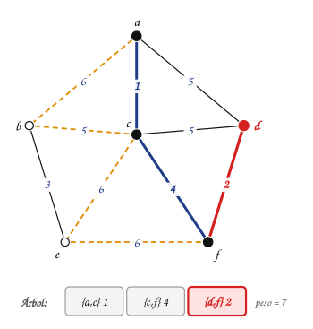

> Entre las candidatas, la de menor peso es $\{d,f\}$ con peso $2$: se agrega al árbol junto con el vértice $d$.

:::
:::{tab-item} Paso 5
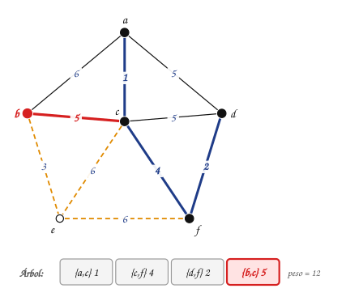

> Entre las candidatas, la de menor peso es $\{b,c\}$ con peso $5$: se agrega al árbol junto con el vértice $b$.

:::
:::{tab-item} Paso 6
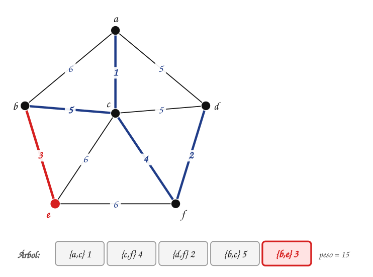

> Entre las candidatas, la de menor peso es $\{b,e\}$ con peso $3$: se agrega al árbol junto con el vértice $e$.

> El árbol ya tiene $n-1 = 5$ aristas: terminó. Peso total: $15$.

:::
::::
:::::

Árbol recubridor mínimo obtenido con el algoritmo de Prim: $\{a,c\}$ (1), $\{c,f\}$ (4), $\{d,f\}$ (2), $\{b,c\}$ (5), $\{b,e\}$ (3). Peso: **15**.

### Ejemplo 2

Encontrar un árbol recubridor mínimo usando el algoritmo de Prim.

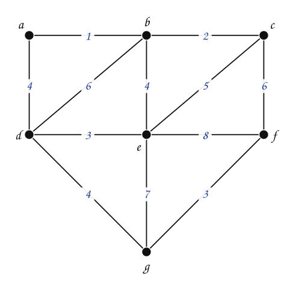

:::::{admonition} Prim, empezando por la arista de menor peso
:class: dropdown
::::{tab-set}
:::{tab-item} Paso 1
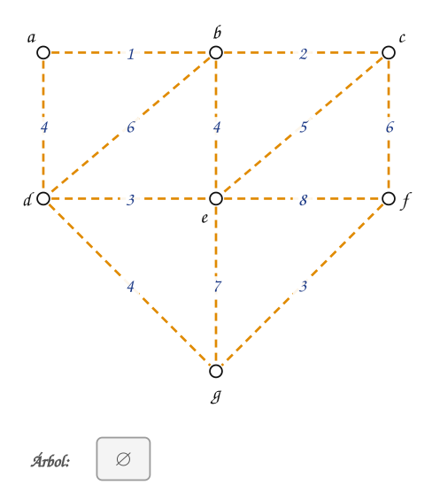

> Todas las aristas son candidatas. Se busca la de menor peso de todo el grafo.

:::
:::{tab-item} Paso 2
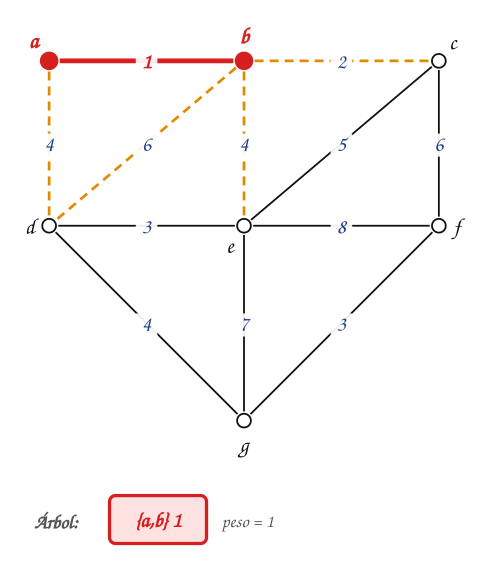

> La arista de menor peso es $\{a,b\}$ con peso $1$: se agrega al árbol. Ahora las candidatas (punteadas) son las aristas con un extremo en el árbol y el otro fuera.

:::
:::{tab-item} Paso 3
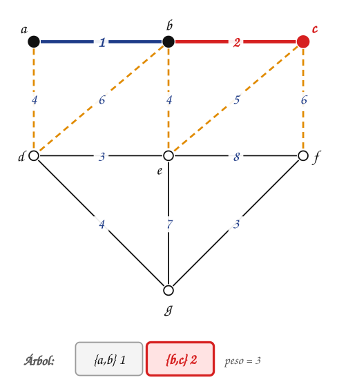

> Entre las candidatas, la de menor peso es $\{b,c\}$ con peso $2$: se agrega al árbol junto con el vértice $c$.

> **La arista {b,d} pesa 6 y tiene un extremo en el árbol. ¿Se puede escoger ahora?**

:::
:::{tab-item} Paso 4
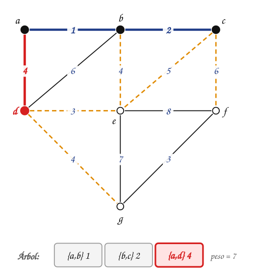

> Entre las candidatas, la de menor peso es $\{a,d\}$ con peso $4$: se agrega al árbol junto con el vértice $d$. Hay empate con $\{b,e\}$; se escoge cualquiera (aquí, la primera en la lista).

> No se escogió: no era la de **menor** peso entre las candidatas ($\{a,d\}$ y $\{b,e\}$ pesan $4$). Y ahora que $d$ entró al árbol, $\{b,d\}$ ya no es candidata: sus dos extremos están en el árbol y agregarla crearía un circuito.

:::
:::{tab-item} Paso 5
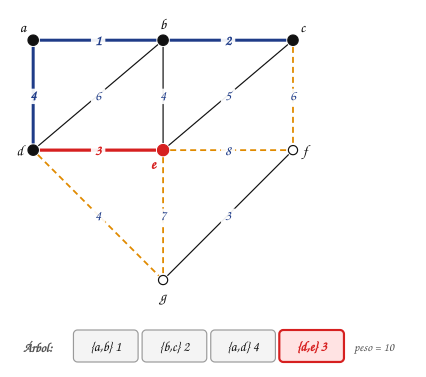

> Entre las candidatas, la de menor peso es $\{d,e\}$ con peso $3$: se agrega al árbol junto con el vértice $e$.

:::
:::{tab-item} Paso 6
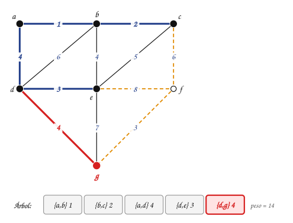

> Entre las candidatas, la de menor peso es $\{d,g\}$ con peso $4$: se agrega al árbol junto con el vértice $g$.

:::
:::{tab-item} Paso 7
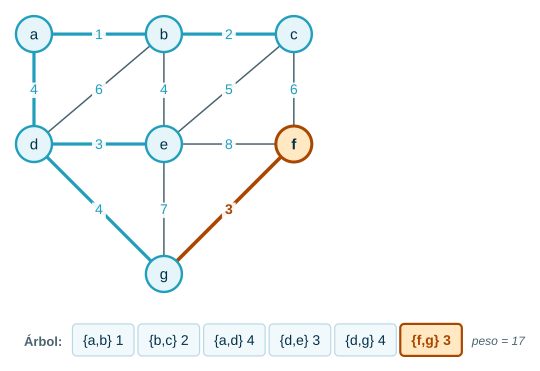

> Entre las candidatas, la de menor peso es $\{f,g\}$ con peso $3$: se agrega al árbol junto con el vértice $f$.

> El árbol ya tiene $n-1 = 6$ aristas: terminó. Peso total: $17$.

:::
::::
:::::

Árbol recubridor mínimo obtenido con el algoritmo de Prim: $\{a,b\}$ (1), $\{b,c\}$ (2), $\{a,d\}$ (4), $\{d,e\}$ (3), $\{d,g\}$ (4), $\{f,g\}$ (3). Peso: **17**.

### Ejemplo 3

Al usar el algoritmo de Prim se pueden obtener árboles recubridores **diferentes** para un mismo grafo. También se puede empezar desde un **vértice**, en lugar de hacerlo desde la arista más barata: el árbol inicial tiene solo ese vértice. El grafo del Ejemplo 1, empezando desde $e$:

:::::{admonition} Prim desde e
:class: dropdown
::::{tab-set}
:::{tab-item} Paso 1
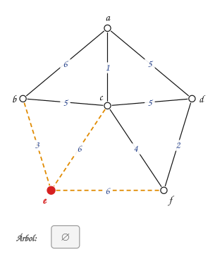

> Se empieza con el árbol que solo tiene a $e$. Las aristas candidatas (punteadas) son las que tienen un extremo en el árbol y el otro fuera: $\{b,e\}$ (3), $\{c,e\}$ (6), $\{e,f\}$ (6).

:::
:::{tab-item} Paso 2
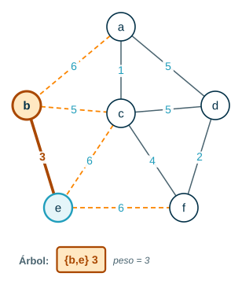

> Entre las candidatas, la de menor peso es $\{b,e\}$ con peso $3$: se agrega al árbol junto con el vértice $b$.

:::
:::{tab-item} Paso 3
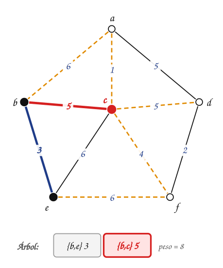

> Entre las candidatas, la de menor peso es $\{b,c\}$ con peso $5$: se agrega al árbol junto con el vértice $c$.

:::
:::{tab-item} Paso 4
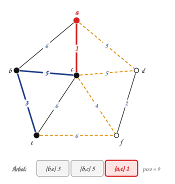

> Entre las candidatas, la de menor peso es $\{a,c\}$ con peso $1$: se agrega al árbol junto con el vértice $a$.

:::
:::{tab-item} Paso 5
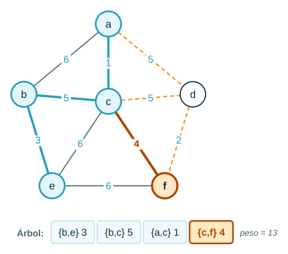

> Entre las candidatas, la de menor peso es $\{c,f\}$ con peso $4$: se agrega al árbol junto con el vértice $f$.

:::
:::{tab-item} Paso 6
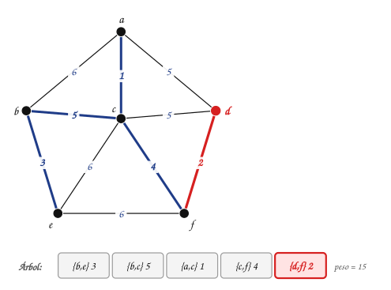

> Entre las candidatas, la de menor peso es $\{d,f\}$ con peso $2$: se agrega al árbol junto con el vértice $d$.

> El árbol ya tiene $n-1 = 5$ aristas: terminó. Peso total: $15$.

:::
::::
:::::

Aristas: $\{b,e\}$ (3), $\{b,c\}$ (5), $\{a,c\}$ (1), $\{c,f\}$ (4), $\{d,f\}$ (2). Peso: **15**.

> **¿Cambió el resultado?**

:::{admonition} Respuesta
:class: dropdown
El **orden** en que entran las aristas cambió, pero el árbol y el peso son los mismos. Cuando hay empates, Prim puede producir árboles distintos según el punto de partida o la arista que escoja en un empate; todos tienen el mismo peso mínimo.
:::

## 4. El algoritmo

```text
procedure Prim(G: grafo conexo no dirigido con pesos y n vértices)
    T = una arista de peso mínimo
    for i = 1 to n − 2
        e = una arista de peso mínimo incidente con un vértice de T
            y que no forme un circuito simple en T si se agrega a T
        T = T con e agregada
    return T   {T es un árbol recubridor mínimo de G}
```

«Que no forme un circuito» equivale a «que tenga exactamente un extremo en $T$»: si los dos extremos ya están en $T$, la arista cierra un circuito.

### Complejidad

> **¿Qué operación se repite en cada paso?**

:::{admonition} Respuesta
:class: dropdown
Encontrar la candidata de menor peso. Si se revisan todas las aristas en cada uno de los $n - 1$ pasos, el costo es $O(V \cdot E)$. Si se guarda, para cada vértice fuera del árbol, el peso de la arista más barata que lo une al árbol, cada paso cuesta $O(V)$ y el total es $O(V^2)$.
:::

Con una **cola de prioridad** (un *heap*) que entrega la candidata de menor peso, el total es $O(E \log V)$.

## 5. Formalización

- **Propiedad del corte.** Sea $S$ un conjunto de vértices con $\emptyset \neq S \neq V$. Si $e$ es una arista de peso mínimo entre las que tienen un extremo en $S$ y el otro en $V - S$, entonces existe un árbol recubridor mínimo que contiene a $e$.
- Prim aplica la propiedad del corte en cada paso con $S$ = vértices del árbol: la arista que agrega es la de menor peso que cruza de $S$ a $V - S$. Por eso el resultado es un árbol recubridor mínimo.
- Es un algoritmo **voraz**: en cada paso toma la arista más barata posible y nunca la quita.
- Complejidad: $O(V^2)$ con arreglos; $O(E \log V)$ con un *heap* binario.

## Ejercicios

Practique con los [ejercicios de Prim](exercises.md).

## Fuentes

- Bedoya, O. *Árboles: árbol recubridor, algoritmos de Prim y Kruskal*. Diapositivas del curso, Universidad del Valle.
- Rosen, K. H. *Discrete Mathematics and Its Applications*, 7.ª ed. McGraw-Hill, 2011. Sección 11.5.
- Cormen, T. H., Leiserson, C. E., Rivest, R. L., Stein, C. *Introduction to Algorithms*, 3.ª ed. The MIT Press, 2009. Capítulo 23.

---

*Material adaptado del material original del profesor Oscar Bedoya.*
