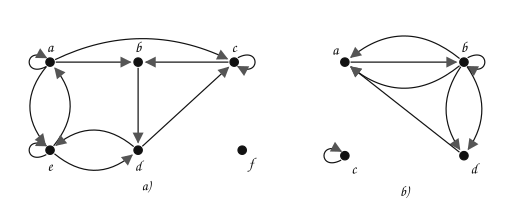
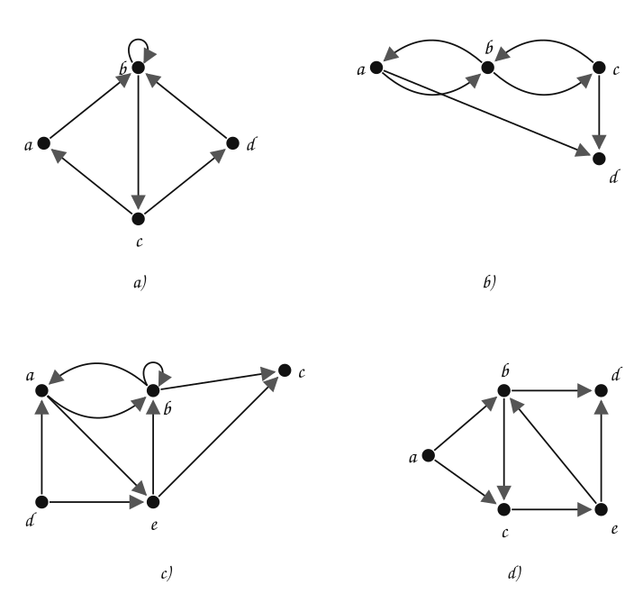

---
# Copyright (c) 2026 Angela Villota, and collaborators from the CyED block
# Licensed under the PolyForm Noncommercial License 1.0.0.
# Commercial use is prohibited without prior written authorization.
title: "Representación y conectividad: Ejercicios"
---

# Representación y conectividad: Ejercicios

Use esta página después de leer el [material de estudio](index.md). Cada ejercicio trae **pistas** y una **solución general**; intente resolverlo antes de abrirlas.

---

### Ejercicio 1

Escriba la matriz de adyacencia de cada grafo dirigido. Verifique que la suma de cada fila es el grado de salida del vértice.

:::{admonition} Pistas
:class: dropdown
- La fila de $v_i$ tiene un $1$ en cada columna $v_j$ a la que llega una arista que sale de $v_i$.
- Un bucle en $v_i$ va en la diagonal, en la posición $(i, i)$.
:::

:::{admonition} Solución general
:class: dropdown
a) $$
M_R = \begin{array}{c|cccccc} & \mathbf{a} & \mathbf{b} & \mathbf{c} & \mathbf{d} & \mathbf{e} & \mathbf{f} \\ \hline \mathbf{a} & 1 & 1 & 1 & 0 & 1 & 0 \\ \mathbf{b} & 0 & 0 & 0 & 1 & 0 & 0 \\ \mathbf{c} & 0 & 1 & 1 & 0 & 0 & 0 \\ \mathbf{d} & 0 & 0 & 1 & 0 & 1 & 0 \\ \mathbf{e} & 1 & 0 & 0 & 1 & 1 & 0 \\ \mathbf{f} & 0 & 0 & 0 & 0 & 0 & 0\end{array}
$$

b) $$
M_R = \begin{array}{c|cccc} & \mathbf{a} & \mathbf{b} & \mathbf{c} & \mathbf{d} \\ \hline \mathbf{a} & 0 & 1 & 0 & 0 \\ \mathbf{b} & 2 & 1 & 0 & 2 \\ \mathbf{c} & 0 & 0 & 1 & 0 \\ \mathbf{d} & 1 & 0 & 0 & 0\end{array}
$$

En b) hay dos aristas de $b$ a $a$ y dos de $b$ a $d$: la matriz cuenta aristas, así que esas casillas valen $2$.
:::

### Ejercicio 2

Muestre $M_R$, $M_R^{[2]}$ y $M_R^{[3]}$ para cada grafo.

:::{admonition} Pistas
:class: dropdown
- $M_R^{[2]} = M_R \odot M_R$ y $M_R^{[3]} = M_R^{[2]} \odot M_R$.
- Para revisar una casilla $(i, j)$ de $M_R^{[2]}$, busque un vértice $t$ con una arista de $v_i$ a $t$ y otra de $t$ a $v_j$.
:::

:::{admonition} Solución general
:class: dropdown
a)

$$
M_R = \begin{array}{c|cccc} & \mathbf{a} & \mathbf{b} & \mathbf{c} & \mathbf{d} \\ \hline \mathbf{a} & 0 & 1 & 0 & 0 \\ \mathbf{b} & 0 & 1 & 1 & 0 \\ \mathbf{c} & 1 & 0 & 0 & 1 \\ \mathbf{d} & 0 & 1 & 0 & 0\end{array} \quad M_R^{[2]} = \begin{array}{c|cccc} & \mathbf{a} & \mathbf{b} & \mathbf{c} & \mathbf{d} \\ \hline \mathbf{a} & 0 & 1 & 1 & 0 \\ \mathbf{b} & 1 & 1 & 1 & 1 \\ \mathbf{c} & 0 & 1 & 0 & 0 \\ \mathbf{d} & 0 & 1 & 1 & 0\end{array} \quad M_R^{[3]} = \begin{array}{c|cccc} & \mathbf{a} & \mathbf{b} & \mathbf{c} & \mathbf{d} \\ \hline \mathbf{a} & 1 & 1 & 1 & 1 \\ \mathbf{b} & 1 & 1 & 1 & 1 \\ \mathbf{c} & 0 & 1 & 1 & 0 \\ \mathbf{d} & 1 & 1 & 1 & 1\end{array}
$$

b)

$$
M_R = \begin{array}{c|cccc} & \mathbf{a} & \mathbf{b} & \mathbf{c} & \mathbf{d} \\ \hline \mathbf{a} & 0 & 1 & 0 & 1 \\ \mathbf{b} & 1 & 0 & 1 & 0 \\ \mathbf{c} & 0 & 1 & 0 & 1 \\ \mathbf{d} & 0 & 0 & 0 & 0\end{array} \quad M_R^{[2]} = \begin{array}{c|cccc} & \mathbf{a} & \mathbf{b} & \mathbf{c} & \mathbf{d} \\ \hline \mathbf{a} & 1 & 0 & 1 & 0 \\ \mathbf{b} & 0 & 1 & 0 & 1 \\ \mathbf{c} & 1 & 0 & 1 & 0 \\ \mathbf{d} & 0 & 0 & 0 & 0\end{array} \quad M_R^{[3]} = \begin{array}{c|cccc} & \mathbf{a} & \mathbf{b} & \mathbf{c} & \mathbf{d} \\ \hline \mathbf{a} & 0 & 1 & 0 & 1 \\ \mathbf{b} & 1 & 0 & 1 & 0 \\ \mathbf{c} & 0 & 1 & 0 & 1 \\ \mathbf{d} & 0 & 0 & 0 & 0\end{array}
$$

c)

$$
M_R = \begin{array}{c|ccccc} & \mathbf{a} & \mathbf{b} & \mathbf{c} & \mathbf{d} & \mathbf{e} \\ \hline \mathbf{a} & 0 & 1 & 0 & 0 & 1 \\ \mathbf{b} & 1 & 1 & 1 & 0 & 0 \\ \mathbf{c} & 0 & 0 & 0 & 0 & 0 \\ \mathbf{d} & 1 & 0 & 0 & 0 & 1 \\ \mathbf{e} & 0 & 1 & 1 & 0 & 0\end{array} \quad M_R^{[2]} = \begin{array}{c|ccccc} & \mathbf{a} & \mathbf{b} & \mathbf{c} & \mathbf{d} & \mathbf{e} \\ \hline \mathbf{a} & 1 & 1 & 1 & 0 & 0 \\ \mathbf{b} & 1 & 1 & 1 & 0 & 1 \\ \mathbf{c} & 0 & 0 & 0 & 0 & 0 \\ \mathbf{d} & 0 & 1 & 1 & 0 & 1 \\ \mathbf{e} & 1 & 1 & 1 & 0 & 0\end{array} \quad M_R^{[3]} = \begin{array}{c|ccccc} & \mathbf{a} & \mathbf{b} & \mathbf{c} & \mathbf{d} & \mathbf{e} \\ \hline \mathbf{a} & 1 & 1 & 1 & 0 & 1 \\ \mathbf{b} & 1 & 1 & 1 & 0 & 1 \\ \mathbf{c} & 0 & 0 & 0 & 0 & 0 \\ \mathbf{d} & 1 & 1 & 1 & 0 & 0 \\ \mathbf{e} & 1 & 1 & 1 & 0 & 1\end{array}
$$

d)

$$
M_R = \begin{array}{c|ccccc} & \mathbf{a} & \mathbf{b} & \mathbf{c} & \mathbf{d} & \mathbf{e} \\ \hline \mathbf{a} & 0 & 1 & 1 & 0 & 0 \\ \mathbf{b} & 0 & 0 & 1 & 1 & 0 \\ \mathbf{c} & 0 & 0 & 0 & 0 & 1 \\ \mathbf{d} & 0 & 0 & 0 & 0 & 0 \\ \mathbf{e} & 0 & 1 & 0 & 1 & 0\end{array} \quad M_R^{[2]} = \begin{array}{c|ccccc} & \mathbf{a} & \mathbf{b} & \mathbf{c} & \mathbf{d} & \mathbf{e} \\ \hline \mathbf{a} & 0 & 0 & 1 & 1 & 1 \\ \mathbf{b} & 0 & 0 & 0 & 0 & 1 \\ \mathbf{c} & 0 & 1 & 0 & 1 & 0 \\ \mathbf{d} & 0 & 0 & 0 & 0 & 0 \\ \mathbf{e} & 0 & 0 & 1 & 1 & 0\end{array} \quad M_R^{[3]} = \begin{array}{c|ccccc} & \mathbf{a} & \mathbf{b} & \mathbf{c} & \mathbf{d} & \mathbf{e} \\ \hline \mathbf{a} & 0 & 1 & 0 & 1 & 1 \\ \mathbf{b} & 0 & 1 & 0 & 1 & 0 \\ \mathbf{c} & 0 & 0 & 1 & 1 & 0 \\ \mathbf{d} & 0 & 0 & 0 & 0 & 0 \\ \mathbf{e} & 0 & 0 & 0 & 0 & 1\end{array}
$$
:::

### Ejercicio 3

Aplique el algoritmo de Warshall para obtener la matriz de conectividad de cada grafo.

a)

$$
M_R = \begin{array}{c|cccc} & \mathbf{a} & \mathbf{b} & \mathbf{c} & \mathbf{d} \\ \hline \mathbf{a} & 0 & 1 & 0 & 0 \\ \mathbf{b} & 1 & 0 & 1 & 0 \\ \mathbf{c} & 0 & 0 & 0 & 1 \\ \mathbf{d} & 0 & 0 & 0 & 0\end{array}
$$

b)

$$
M_R = \begin{array}{c|cccc} & \mathbf{a} & \mathbf{b} & \mathbf{c} & \mathbf{d} \\ \hline \mathbf{a} & 0 & 1 & 0 & 0 \\ \mathbf{b} & 0 & 1 & 1 & 1 \\ \mathbf{c} & 0 & 0 & 0 & 0 \\ \mathbf{d} & 0 & 0 & 1 & 0\end{array}
$$

c)

$$
M_R = \begin{array}{c|cccc} & \mathbf{a} & \mathbf{b} & \mathbf{c} & \mathbf{d} \\ \hline \mathbf{a} & 1 & 1 & 1 & 0 \\ \mathbf{b} & 0 & 0 & 0 & 1 \\ \mathbf{c} & 0 & 1 & 1 & 1 \\ \mathbf{d} & 0 & 0 & 0 & 0\end{array}
$$

d)

$$
M_R = \begin{array}{c|ccccc} & \mathbf{a} & \mathbf{b} & \mathbf{c} & \mathbf{d} & \mathbf{e} \\ \hline \mathbf{a} & 0 & 1 & 0 & 0 & 0 \\ \mathbf{b} & 0 & 0 & 1 & 1 & 0 \\ \mathbf{c} & 0 & 0 & 0 & 1 & 0 \\ \mathbf{d} & 0 & 0 & 0 & 0 & 1 \\ \mathbf{e} & 1 & 0 & 0 & 0 & 0\end{array}
$$

e)

$$
M_R = \begin{array}{c|ccccc} & \mathbf{a} & \mathbf{b} & \mathbf{c} & \mathbf{d} & \mathbf{e} \\ \hline \mathbf{a} & 0 & 1 & 0 & 0 & 1 \\ \mathbf{b} & 1 & 1 & 1 & 0 & 0 \\ \mathbf{c} & 0 & 0 & 0 & 0 & 0 \\ \mathbf{d} & 1 & 0 & 0 & 0 & 1 \\ \mathbf{e} & 0 & 1 & 1 & 0 & 0\end{array}
$$

f)

$$
M_R = \begin{array}{c|ccccc} & \mathbf{a} & \mathbf{b} & \mathbf{c} & \mathbf{d} & \mathbf{e} \\ \hline \mathbf{a} & 1 & 1 & 0 & 0 & 0 \\ \mathbf{b} & 0 & 0 & 1 & 1 & 1 \\ \mathbf{c} & 0 & 0 & 1 & 1 & 0 \\ \mathbf{d} & 0 & 1 & 0 & 0 & 1 \\ \mathbf{e} & 0 & 0 & 0 & 0 & 0\end{array}
$$

g)

$$
M_R = \begin{array}{c|ccccc} & \mathbf{a} & \mathbf{b} & \mathbf{c} & \mathbf{d} & \mathbf{e} \\ \hline \mathbf{a} & 1 & 0 & 1 & 1 & 0 \\ \mathbf{b} & 1 & 0 & 1 & 0 & 0 \\ \mathbf{c} & 0 & 0 & 0 & 1 & 0 \\ \mathbf{d} & 0 & 0 & 0 & 1 & 1 \\ \mathbf{e} & 0 & 0 & 0 & 1 & 0\end{array}
$$

:::{admonition} Pistas
:class: dropdown
- Para el pivote $k$, liste las filas con $1$ en la columna $k$ y las columnas con $1$ en la fila $k$; ponga un $1$ en cada cruce.
- Una fila de ceros (nadie sale de ese vértice) sigue en ceros hasta el final.
:::

:::{admonition} Solución general
:class: dropdown
a) Unos nuevos con cada pivote: $W_{1}$: 1, $W_{2}$: 2, $W_{3}$: 2, $W_{4}$: 0.

$$
W_4 = \begin{array}{c|cccc} & \mathbf{a} & \mathbf{b} & \mathbf{c} & \mathbf{d} \\ \hline \mathbf{a} & \textcolor{#a94700}{\mathbf{1}} & 1 & \textcolor{#a94700}{\mathbf{1}} & \textcolor{#a94700}{\mathbf{1}} \\ \mathbf{b} & 1 & \textcolor{#a94700}{\mathbf{1}} & 1 & \textcolor{#a94700}{\mathbf{1}} \\ \mathbf{c} & 0 & 0 & 0 & 1 \\ \mathbf{d} & 0 & 0 & 0 & 0\end{array}
$$

b) Unos nuevos con cada pivote: $W_{1}$: 0, $W_{2}$: 2, $W_{3}$: 0, $W_{4}$: 0.

$$
W_4 = \begin{array}{c|cccc} & \mathbf{a} & \mathbf{b} & \mathbf{c} & \mathbf{d} \\ \hline \mathbf{a} & 0 & 1 & \textcolor{#a94700}{\mathbf{1}} & \textcolor{#a94700}{\mathbf{1}} \\ \mathbf{b} & 0 & 1 & 1 & 1 \\ \mathbf{c} & 0 & 0 & 0 & 0 \\ \mathbf{d} & 0 & 0 & 1 & 0\end{array}
$$

c) Unos nuevos con cada pivote: $W_{1}$: 0, $W_{2}$: 1, $W_{3}$: 0, $W_{4}$: 0.

$$
W_4 = \begin{array}{c|cccc} & \mathbf{a} & \mathbf{b} & \mathbf{c} & \mathbf{d} \\ \hline \mathbf{a} & 1 & 1 & 1 & \textcolor{#a94700}{\mathbf{1}} \\ \mathbf{b} & 0 & 0 & 0 & 1 \\ \mathbf{c} & 0 & 1 & 1 & 1 \\ \mathbf{d} & 0 & 0 & 0 & 0\end{array}
$$

d) Unos nuevos con cada pivote: $W_{1}$: 1, $W_{2}$: 4, $W_{3}$: 0, $W_{4}$: 4, $W_{5}$: 10.

$$
W_5 = \begin{array}{c|ccccc} & \mathbf{a} & \mathbf{b} & \mathbf{c} & \mathbf{d} & \mathbf{e} \\ \hline \mathbf{a} & \textcolor{#a94700}{\mathbf{1}} & 1 & \textcolor{#a94700}{\mathbf{1}} & \textcolor{#a94700}{\mathbf{1}} & \textcolor{#a94700}{\mathbf{1}} \\ \mathbf{b} & \textcolor{#a94700}{\mathbf{1}} & \textcolor{#a94700}{\mathbf{1}} & 1 & 1 & \textcolor{#a94700}{\mathbf{1}} \\ \mathbf{c} & \textcolor{#a94700}{\mathbf{1}} & \textcolor{#a94700}{\mathbf{1}} & \textcolor{#a94700}{\mathbf{1}} & 1 & \textcolor{#a94700}{\mathbf{1}} \\ \mathbf{d} & \textcolor{#a94700}{\mathbf{1}} & \textcolor{#a94700}{\mathbf{1}} & \textcolor{#a94700}{\mathbf{1}} & \textcolor{#a94700}{\mathbf{1}} & 1 \\ \mathbf{e} & 1 & \textcolor{#a94700}{\mathbf{1}} & \textcolor{#a94700}{\mathbf{1}} & \textcolor{#a94700}{\mathbf{1}} & \textcolor{#a94700}{\mathbf{1}}\end{array}
$$

e) Unos nuevos con cada pivote: $W_{1}$: 2, $W_{2}$: 5, $W_{3}$: 0, $W_{4}$: 0, $W_{5}$: 0.

$$
W_5 = \begin{array}{c|ccccc} & \mathbf{a} & \mathbf{b} & \mathbf{c} & \mathbf{d} & \mathbf{e} \\ \hline \mathbf{a} & \textcolor{#a94700}{\mathbf{1}} & 1 & \textcolor{#a94700}{\mathbf{1}} & 0 & 1 \\ \mathbf{b} & 1 & 1 & 1 & 0 & \textcolor{#a94700}{\mathbf{1}} \\ \mathbf{c} & 0 & 0 & 0 & 0 & 0 \\ \mathbf{d} & 1 & \textcolor{#a94700}{\mathbf{1}} & \textcolor{#a94700}{\mathbf{1}} & 0 & 1 \\ \mathbf{e} & \textcolor{#a94700}{\mathbf{1}} & 1 & 1 & 0 & \textcolor{#a94700}{\mathbf{1}}\end{array}
$$

f) Unos nuevos con cada pivote: $W_{1}$: 0, $W_{2}$: 5, $W_{3}$: 0, $W_{4}$: 3, $W_{5}$: 0.

$$
W_5 = \begin{array}{c|ccccc} & \mathbf{a} & \mathbf{b} & \mathbf{c} & \mathbf{d} & \mathbf{e} \\ \hline \mathbf{a} & 1 & 1 & \textcolor{#a94700}{\mathbf{1}} & \textcolor{#a94700}{\mathbf{1}} & \textcolor{#a94700}{\mathbf{1}} \\ \mathbf{b} & 0 & \textcolor{#a94700}{\mathbf{1}} & 1 & 1 & 1 \\ \mathbf{c} & 0 & \textcolor{#a94700}{\mathbf{1}} & 1 & 1 & \textcolor{#a94700}{\mathbf{1}} \\ \mathbf{d} & 0 & 1 & \textcolor{#a94700}{\mathbf{1}} & \textcolor{#a94700}{\mathbf{1}} & 1 \\ \mathbf{e} & 0 & 0 & 0 & 0 & 0\end{array}
$$

g) Unos nuevos con cada pivote: $W_{1}$: 1, $W_{2}$: 0, $W_{3}$: 0, $W_{4}$: 4, $W_{5}$: 0.

$$
W_5 = \begin{array}{c|ccccc} & \mathbf{a} & \mathbf{b} & \mathbf{c} & \mathbf{d} & \mathbf{e} \\ \hline \mathbf{a} & 1 & 0 & 1 & 1 & \textcolor{#a94700}{\mathbf{1}} \\ \mathbf{b} & 1 & 0 & 1 & \textcolor{#a94700}{\mathbf{1}} & \textcolor{#a94700}{\mathbf{1}} \\ \mathbf{c} & 0 & 0 & 0 & 1 & \textcolor{#a94700}{\mathbf{1}} \\ \mathbf{d} & 0 & 0 & 0 & 1 & 1 \\ \mathbf{e} & 0 & 0 & 0 & 1 & \textcolor{#a94700}{\mathbf{1}}\end{array}
$$

En color, los unos que no estaban en $M_R$.
:::

### Ejercicio 4

Sea $A$ la matriz de adyacencia de un grafo simple no dirigido. ¿Qué representan los elementos de la **diagonal** de $A^2$ (producto usual)?

:::{admonition} Pistas
:class: dropdown
- La posición $(i, i)$ de $A^2$ cuenta caminos de longitud $2$ de $v_i$ a $v_i$.
- En un grafo simple, un camino de longitud $2$ que empieza y termina en $v_i$ es «ir a un vecino y volver».
:::

:::{admonition} Solución general
:class: dropdown
$(A^2)_{ii} = \delta(v_i)$: hay un camino $v_i, v_t, v_i$ por cada vecino $v_t$. Por *handshaking*, la **traza** de $A^2$ es $2e$.
:::

### Ejercicio 5

¿Qué se puede decir de un grafo dirigido cuya matriz de conectividad $M_R^\infty$ tiene **solo unos**? ¿Y de uno no dirigido?

:::{admonition} Pistas
:class: dropdown
- La posición $(i, j)$ de $M_R^\infty$ es $1$ si hay un camino de $v_i$ a $v_j$.
- ¿Qué pasa con la diagonal en un grafo no dirigido con al menos una arista en cada vértice?
:::

:::{admonition} Solución general
:class: dropdown
En un grafo dirigido, que todas las posiciones fuera de la diagonal sean $1$ significa que hay camino en ambos sentidos entre cualquier par de vértices: el grafo es **fuertemente conexo**. En uno no dirigido, que sea **conexo** (y, para que la diagonal también sea $1$, que cada vértice tenga al menos una arista: se va al vecino y se vuelve).
:::

### Ejercicio 6

Para la matriz e) del Ejercicio 3, calcule $M_R \vee M_R^{[2]} \vee \cdots \vee M_R^{[5]}$ con productos booleanos y compare el resultado con el de Warshall. ¿Cuántas operaciones $\wedge$ hace cada método para un grafo de $n$ vértices?

---

*Material adaptado del material original del profesor Oscar Bedoya.*
