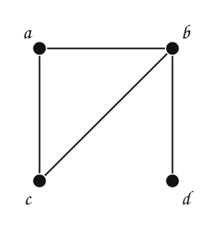
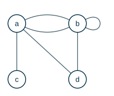
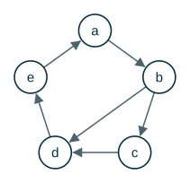
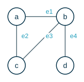
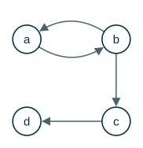
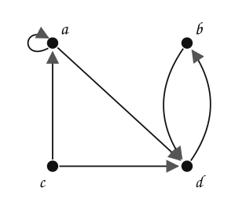

---
# Copyright (c) 2026 Angela Villota, and collaborators from the CyED block
# Licensed under the PolyForm Noncommercial License 1.0.0.
# Commercial use is prohibited without prior written authorization.
title: "Unidad 5: Representación de grafos y matriz de conectividad"
---

# Unidad 5: Representación de grafos y matriz de conectividad

Algunos ejemplos se desarrollan en desplegables con pestañas **Paso 1, Paso 2, …**: cada paso conserva lo anterior y muestra lo nuevo **en color**.

## 1. El problema



**¿Cómo se le entrega este grafo a un programa?** Un dibujo no sirve: hay que guardar qué vértices existen y cuáles son adyacentes, de forma que se pueda preguntar rápido «¿$b$ y $d$ son adyacentes?» o «¿quiénes son los vecinos de $b$?».

## 2. Listas de adyacencia

Para cada vértice se guarda la lista de sus vecinos:

- $a$: $b$, $c$
- $b$: $a$, $c$, $d$
- $c$: $a$, $b$
- $d$: $b$

Es la representación que usan BFS y DFS. Ocupa espacio $\Theta(V + E)$ y permite recorrer los vecinos de un vértice en tiempo proporcional a su grado. En Java: `List<List<Integer>>`.

## 3. Matriz de adyacencia

**Matriz de adyacencia.** Sea $G = (V, E)$ un grafo simple con $|V| = n$ y los vértices listados en algún orden $v_1, \dots, v_n$. Su matriz de adyacencia es la matriz booleana $A = [a_{ij}]$ de $n \times n$ con

$$
a_{ij} = \begin{cases} 1 & \text{si } \{v_i, v_j\} \text{ es una arista de } G \\ 0 & \text{en caso contrario} \end{cases}
$$

:::::{admonition} Construir la matriz de adyacencia
:class: dropdown
::::{tab-set}
:::{tab-item} Paso 1
$$
A = \begin{array}{c|cccc} & \mathbf{a} & \mathbf{b} & \mathbf{c} & \mathbf{d} \\ \hline \mathbf{a} & \textcolor{#a94700}{\mathbf{0}} & \textcolor{#a94700}{\mathbf{1}} & \textcolor{#a94700}{\mathbf{1}} & \textcolor{#a94700}{\mathbf{0}} \\ \mathbf{b} & ? & ? & ? & ? \\ \mathbf{c} & ? & ? & ? & ? \\ \mathbf{d} & ? & ? & ? & ?\end{array}
$$

> Fila $a$: es adyacente a $b$, $c$; en esas columnas va un $1$.

:::
:::{tab-item} Paso 2
$$
A = \begin{array}{c|cccc} & \mathbf{a} & \mathbf{b} & \mathbf{c} & \mathbf{d} \\ \hline \mathbf{a} & 0 & 1 & 1 & 0 \\ \mathbf{b} & \textcolor{#a94700}{\mathbf{1}} & \textcolor{#a94700}{\mathbf{0}} & \textcolor{#a94700}{\mathbf{1}} & \textcolor{#a94700}{\mathbf{1}} \\ \mathbf{c} & ? & ? & ? & ? \\ \mathbf{d} & ? & ? & ? & ?\end{array}
$$

> Fila $b$: es adyacente a $a$, $c$, $d$; en esas columnas va un $1$.

:::
:::{tab-item} Paso 3
$$
A = \begin{array}{c|cccc} & \mathbf{a} & \mathbf{b} & \mathbf{c} & \mathbf{d} \\ \hline \mathbf{a} & 0 & 1 & 1 & 0 \\ \mathbf{b} & 1 & 0 & 1 & 1 \\ \mathbf{c} & \textcolor{#a94700}{\mathbf{1}} & \textcolor{#a94700}{\mathbf{1}} & \textcolor{#a94700}{\mathbf{0}} & \textcolor{#a94700}{\mathbf{0}} \\ \mathbf{d} & ? & ? & ? & ?\end{array}
$$

> Fila $c$: es adyacente a $a$, $b$; en esas columnas va un $1$.

:::
:::{tab-item} Paso 4
$$
A = \begin{array}{c|cccc} & \mathbf{a} & \mathbf{b} & \mathbf{c} & \mathbf{d} \\ \hline \mathbf{a} & 0 & 1 & 1 & 0 \\ \mathbf{b} & 1 & 0 & 1 & 1 \\ \mathbf{c} & 1 & 1 & 0 & 0 \\ \mathbf{d} & \textcolor{#a94700}{\mathbf{0}} & \textcolor{#a94700}{\mathbf{1}} & \textcolor{#a94700}{\mathbf{0}} & \textcolor{#a94700}{\mathbf{0}}\end{array}
$$

> Fila $d$: es adyacente a $b$; en esas columnas va un $1$.

:::
::::
:::::

- La matriz de un grafo no dirigido es **simétrica**: $a_{ij} = a_{ji}$.
- Depende del orden de los vértices: un grafo de $n$ vértices tiene hasta $n!$ matrices de adyacencia distintas.
- Ocupa espacio $\Theta(V^2)$, pero responde «¿$v_i$ y $v_j$ son adyacentes?» en tiempo $O(1)$.

### Pseudografos y grafos dirigidos

Con aristas paralelas, $a_{ij}$ es el **número** de aristas entre $v_i$ y $v_j$ (la matriz deja de ser booleana). Un bucle en $v_i$ se representa con un $1$ en la posición $(i, i)$.



> **Escriba la matriz de adyacencia de este pseudografo.**

:::{admonition} Respuesta
:class: dropdown
$$
A = \begin{array}{c|cccc} & \mathbf{a} & \mathbf{b} & \mathbf{c} & \mathbf{d} \\ \hline \mathbf{a} & 0 & 2 & 1 & 1 \\ \mathbf{b} & 2 & 1 & 0 & 1 \\ \mathbf{c} & 1 & 0 & 0 & 0 \\ \mathbf{d} & 1 & 1 & 0 & 0\end{array}
$$

Sigue siendo simétrica: el grafo no es dirigido.
:::

En un grafo **dirigido**, $a_{ij} = 1$ si hay una arista **de** $v_i$ **a** $v_j$. Ya no tiene que ser simétrica.



> **Escriba la matriz de adyacencia de este grafo dirigido.**

:::{admonition} Respuesta
:class: dropdown
$$
M_R = \begin{array}{c|ccccc} & \mathbf{a} & \mathbf{b} & \mathbf{c} & \mathbf{d} & \mathbf{e} \\ \hline \mathbf{a} & 0 & 1 & 0 & 0 & 0 \\ \mathbf{b} & 0 & 0 & 1 & 1 & 0 \\ \mathbf{c} & 0 & 0 & 0 & 1 & 0 \\ \mathbf{d} & 0 & 0 & 0 & 0 & 1 \\ \mathbf{e} & 1 & 0 & 0 & 0 & 0\end{array}
$$

La fila de $v_i$ tiene sus aristas de **salida**; la columna, sus aristas de **entrada**. La suma de la fila $i$ es $\delta^+(v_i)$ y la de la columna $i$ es $\delta^-(v_i)$.
:::

## 4. Matriz de incidencia

**Matriz de incidencia.** Sea $G = (V, E)$ no dirigido, con vértices $v_1, \dots, v_n$ y aristas $e_1, \dots, e_m$. Su matriz de incidencia es la matriz $M = [m_{ij}]$ de $n \times m$ con

$$
m_{ij} = \begin{cases} 1 & \text{si la arista } e_j \text{ es incidente con } v_i \\ 0 & \text{en caso contrario} \end{cases}
$$



$$
M = \begin{array}{c|cccc} & \mathbf{e_1} & \mathbf{e_2} & \mathbf{e_3} & \mathbf{e_4} \\ \hline \mathbf{a} & 1 & 1 & 0 & 0 \\ \mathbf{b} & 1 & 0 & 1 & 1 \\ \mathbf{c} & 0 & 1 & 1 & 0 \\ \mathbf{d} & 0 & 0 & 0 & 1\end{array}
$$

Cada columna tiene exactamente dos unos (los extremos de la arista). La suma de la fila $i$ es $\delta(v_i)$.

## 5. Caminos de longitud $k$

> **En el grafo dirigido de la sección 3, ¿hay un camino de longitud $2$ de $a$ a $c$? ¿De $a$ a $e$?**

:::{admonition} Respuesta
:class: dropdown
- De $a$ a $c$: sí, $a \to b \to c$.
- De $a$ a $e$: no de longitud $2$; $a \to b \to d \to e$ tiene longitud $3$.

Buscarlo a mano para todos los pares es lento. La matriz de adyacencia lo resuelve con un producto.
:::

**Producto booleano.** Dadas $A$ de orden $m \times k$ y $B$ de orden $k \times n$, $A \odot B$ es la matriz $m \times n$ con

$$
c_{ij} = (a_{i1} \wedge b_{1j}) \vee (a_{i2} \wedge b_{2j}) \vee \cdots \vee (a_{ik} \wedge b_{kj})
$$

Es como el producto usual, cambiando la multiplicación por $\wedge$ y la suma por $\vee$. Con

$$
A = \begin{bmatrix} 1 & 0 \\ 0 & 1 \\ 1 & 1 \end{bmatrix}
\qquad
B = \begin{bmatrix} 1 & 1 & 0 \\ 0 & 1 & 1 \end{bmatrix}
$$

:::::{admonition} Producto booleano paso a paso
:class: dropdown
::::{tab-set}
:::{tab-item} Paso 1
$$
A \odot B = \begin{bmatrix} \textcolor{#a94700}{(1 \wedge 1) \vee (0 \wedge 0) = 1} & \textcolor{#a94700}{(1 \wedge 1) \vee (0 \wedge 1) = 1} & \textcolor{#a94700}{(1 \wedge 0) \vee (0 \wedge 1) = 0}\\ ? & ? & ?\\ ? & ? & ? \end{bmatrix}
$$

> Fila 1: se combina la fila 1 de $A$ con cada columna de $B$.

:::
:::{tab-item} Paso 2
$$
A \odot B = \begin{bmatrix} 1 & 1 & 0\\ \textcolor{#a94700}{(0 \wedge 1) \vee (1 \wedge 0) = 0} & \textcolor{#a94700}{(0 \wedge 1) \vee (1 \wedge 1) = 1} & \textcolor{#a94700}{(0 \wedge 0) \vee (1 \wedge 1) = 1}\\ ? & ? & ? \end{bmatrix}
$$

> Fila 2: se combina la fila 2 de $A$ con cada columna de $B$.

:::
:::{tab-item} Paso 3
$$
A \odot B = \begin{bmatrix} 1 & 1 & 0\\ 0 & 1 & 1\\ \textcolor{#a94700}{(1 \wedge 1) \vee (1 \wedge 0) = 1} & \textcolor{#a94700}{(1 \wedge 1) \vee (1 \wedge 1) = 1} & \textcolor{#a94700}{(1 \wedge 0) \vee (1 \wedge 1) = 1} \end{bmatrix}
$$

> Fila 3: se combina la fila 3 de $A$ con cada columna de $B$.

:::
:::{tab-item} Paso 4
$$
A \odot B = \begin{bmatrix} 1 & 1 & 0\\ 0 & 1 & 1\\ 1 & 1 & 1 \end{bmatrix}
$$

> Resultado ($3 \times 2$ por $2 \times 3$ da $3 \times 3$).

:::
::::
:::::

¿Por qué sirve para caminos? En $M_R \odot M_R$, la casilla $(i, j)$ vale $1$ si y solo si existe algún $t$ con $m_{it} = 1$ y $m_{tj} = 1$: una arista de $v_i$ a $v_t$ y otra de $v_t$ a $v_j$. Es decir, **un camino de longitud $2$**.

$$
M_R^{[2]} = \begin{array}{c|ccccc} & \mathbf{a} & \mathbf{b} & \mathbf{c} & \mathbf{d} & \mathbf{e} \\ \hline \mathbf{a} & 0 & 0 & \textcolor{#a94700}{\mathbf{1}} & 1 & 0 \\ \mathbf{b} & 0 & 0 & 0 & 1 & 1 \\ \mathbf{c} & 0 & 0 & 0 & 0 & 1 \\ \mathbf{d} & 1 & 0 & 0 & 0 & 0 \\ \mathbf{e} & 0 & 1 & 0 & 0 & 0\end{array}
$$

El $1$ en la posición $(a, c)$ de $M_R^{[2]}$ significa que hay un camino de longitud $2$ de $a$ a $c$: $a, b, c$.

**Teorema.** Sea $M_R^{[k]} = M_R \odot M_R \odot \cdots \odot M_R$ ($k$ veces). Hay un camino de longitud **exactamente** $k$ de $v_i$ a $v_j$ si y solo si la posición $(i, j)$ de $M_R^{[k]}$ es $1$.

:::::{admonition} Potencias booleanas de $M_R$
:class: dropdown
::::{tab-set}
:::{tab-item} Paso 1
$$
M_R^{[2]} = \begin{array}{c|ccccc} & \mathbf{a} & \mathbf{b} & \mathbf{c} & \mathbf{d} & \mathbf{e} \\ \hline \mathbf{a} & 0 & 0 & \textcolor{#a94700}{\mathbf{1}} & \textcolor{#a94700}{\mathbf{1}} & 0 \\ \mathbf{b} & 0 & 0 & 0 & \textcolor{#a94700}{\mathbf{1}} & \textcolor{#a94700}{\mathbf{1}} \\ \mathbf{c} & 0 & 0 & 0 & 0 & \textcolor{#a94700}{\mathbf{1}} \\ \mathbf{d} & \textcolor{#a94700}{\mathbf{1}} & 0 & 0 & 0 & 0 \\ \mathbf{e} & 0 & \textcolor{#a94700}{\mathbf{1}} & 0 & 0 & 0\end{array}
$$

> $M_R^{[2]} = M_R^{[1]} \odot M_R$: un $1$ en $(i, j)$ significa que hay un camino de **longitud exactamente 2** de $i$ a $j$.

:::
:::{tab-item} Paso 2
$$
M_R^{[3]} = \begin{array}{c|ccccc} & \mathbf{a} & \mathbf{b} & \mathbf{c} & \mathbf{d} & \mathbf{e} \\ \hline \mathbf{a} & 0 & 0 & 0 & \textcolor{#a94700}{\mathbf{1}} & \textcolor{#a94700}{\mathbf{1}} \\ \mathbf{b} & \textcolor{#a94700}{\mathbf{1}} & 0 & 0 & 0 & \textcolor{#a94700}{\mathbf{1}} \\ \mathbf{c} & \textcolor{#a94700}{\mathbf{1}} & 0 & 0 & 0 & 0 \\ \mathbf{d} & 0 & \textcolor{#a94700}{\mathbf{1}} & 0 & 0 & 0 \\ \mathbf{e} & 0 & 0 & \textcolor{#a94700}{\mathbf{1}} & \textcolor{#a94700}{\mathbf{1}} & 0\end{array}
$$

> $M_R^{[3]} = M_R^{[2]} \odot M_R$: un $1$ en $(i, j)$ significa que hay un camino de **longitud exactamente 3** de $i$ a $j$.

:::
:::{tab-item} Paso 3
$$
M_R^{[4]} = \begin{array}{c|ccccc} & \mathbf{a} & \mathbf{b} & \mathbf{c} & \mathbf{d} & \mathbf{e} \\ \hline \mathbf{a} & \textcolor{#a94700}{\mathbf{1}} & 0 & 0 & 0 & \textcolor{#a94700}{\mathbf{1}} \\ \mathbf{b} & \textcolor{#a94700}{\mathbf{1}} & \textcolor{#a94700}{\mathbf{1}} & 0 & 0 & 0 \\ \mathbf{c} & 0 & \textcolor{#a94700}{\mathbf{1}} & 0 & 0 & 0 \\ \mathbf{d} & 0 & 0 & \textcolor{#a94700}{\mathbf{1}} & \textcolor{#a94700}{\mathbf{1}} & 0 \\ \mathbf{e} & 0 & 0 & 0 & \textcolor{#a94700}{\mathbf{1}} & \textcolor{#a94700}{\mathbf{1}}\end{array}
$$

> $M_R^{[4]} = M_R^{[3]} \odot M_R$: un $1$ en $(i, j)$ significa que hay un camino de **longitud exactamente 4** de $i$ a $j$.

:::
:::{tab-item} Paso 4
$$
M_R^{[5]} = \begin{array}{c|ccccc} & \mathbf{a} & \mathbf{b} & \mathbf{c} & \mathbf{d} & \mathbf{e} \\ \hline \mathbf{a} & \textcolor{#a94700}{\mathbf{1}} & \textcolor{#a94700}{\mathbf{1}} & 0 & 0 & 0 \\ \mathbf{b} & 0 & \textcolor{#a94700}{\mathbf{1}} & \textcolor{#a94700}{\mathbf{1}} & \textcolor{#a94700}{\mathbf{1}} & 0 \\ \mathbf{c} & 0 & 0 & \textcolor{#a94700}{\mathbf{1}} & \textcolor{#a94700}{\mathbf{1}} & 0 \\ \mathbf{d} & 0 & 0 & 0 & \textcolor{#a94700}{\mathbf{1}} & \textcolor{#a94700}{\mathbf{1}} \\ \mathbf{e} & \textcolor{#a94700}{\mathbf{1}} & 0 & 0 & 0 & \textcolor{#a94700}{\mathbf{1}}\end{array}
$$

> $M_R^{[5]} = M_R^{[4]} \odot M_R$: un $1$ en $(i, j)$ significa que hay un camino de **longitud exactamente 5** de $i$ a $j$.

:::
::::
:::::

### Contar caminos

Con el producto **usual** de matrices (sumas y productos de enteros), la posición $(i, j)$ de $A^k$ es el **número** de caminos de longitud $k$ de $v_i$ a $v_j$. Para el pseudografo de la sección 3:

$$
A = \begin{array}{c|cccc} & \mathbf{a} & \mathbf{b} & \mathbf{c} & \mathbf{d} \\ \hline \mathbf{a} & 0 & 2 & 1 & 1 \\ \mathbf{b} & 2 & 1 & 0 & 1 \\ \mathbf{c} & 1 & 0 & 0 & 0 \\ \mathbf{d} & 1 & 1 & 0 & 0\end{array} \qquad A^2 = \begin{array}{c|cccc} & \mathbf{a} & \mathbf{b} & \mathbf{c} & \mathbf{d} \\ \hline \mathbf{a} & \textcolor{#a94700}{\mathbf{6}} & 3 & 0 & 2 \\ \mathbf{b} & 3 & 6 & 2 & 3 \\ \mathbf{c} & 0 & 2 & 1 & 1 \\ \mathbf{d} & 2 & 3 & 1 & 2\end{array}
$$

El $6$ significa que hay $6$ caminos de longitud $2$ de $a$ a $a$: ir y volver por cada una de las dos aristas $\{a, b\}$ ($2 \cdot 2 = 4$ formas), ir y volver a $c$ ($1$) e ir y volver a $d$ ($1$).

## 6. Matriz de conectividad

¿Hay **algún** camino (de cualquier longitud) de $v_i$ a $v_j$? Basta con revisar longitudes $1, 2, \dots, n$: si hay un camino, hay uno de longitud a lo sumo $n$.

**Matriz de conectividad.**

$$
M_R^{\infty} = M_R \vee M_R^{[2]} \vee M_R^{[3]} \vee \cdots \vee M_R^{[n]}
$$

Obtenga la matriz de conectividad del siguiente grafo:



:::::{admonition} Matriz de conectividad
:class: dropdown
::::{tab-set}
:::{tab-item} Paso 1
$$
M_R = \begin{array}{c|cccc} & \mathbf{a} & \mathbf{b} & \mathbf{c} & \mathbf{d} \\ \hline \mathbf{a} & 0 & 1 & 0 & 0 \\ \mathbf{b} & 1 & 0 & 1 & 0 \\ \mathbf{c} & 0 & 0 & 0 & 1 \\ \mathbf{d} & 0 & 0 & 0 & 0\end{array}
$$

> Caminos de longitud $1$.

:::
:::{tab-item} Paso 2
$$
M_R^{[2]} = \begin{array}{c|cccc} & \mathbf{a} & \mathbf{b} & \mathbf{c} & \mathbf{d} \\ \hline \mathbf{a} & 1 & 0 & 1 & 0 \\ \mathbf{b} & 0 & 1 & 0 & 1 \\ \mathbf{c} & 0 & 0 & 0 & 0 \\ \mathbf{d} & 0 & 0 & 0 & 0\end{array} \qquad M_R \vee \cdots \vee M_R^{[2]} = \begin{array}{c|cccc} & \mathbf{a} & \mathbf{b} & \mathbf{c} & \mathbf{d} \\ \hline \mathbf{a} & \textcolor{#a94700}{\mathbf{1}} & 1 & \textcolor{#a94700}{\mathbf{1}} & 0 \\ \mathbf{b} & 1 & \textcolor{#a94700}{\mathbf{1}} & 1 & \textcolor{#a94700}{\mathbf{1}} \\ \mathbf{c} & 0 & 0 & 0 & 1 \\ \mathbf{d} & 0 & 0 & 0 & 0\end{array}
$$

> Se agregan los caminos de longitud $2$. Aparecen unos nuevos.

:::
:::{tab-item} Paso 3
$$
M_R^{[3]} = \begin{array}{c|cccc} & \mathbf{a} & \mathbf{b} & \mathbf{c} & \mathbf{d} \\ \hline \mathbf{a} & 0 & 1 & 0 & 1 \\ \mathbf{b} & 1 & 0 & 1 & 0 \\ \mathbf{c} & 0 & 0 & 0 & 0 \\ \mathbf{d} & 0 & 0 & 0 & 0\end{array} \qquad M_R \vee \cdots \vee M_R^{[3]} = \begin{array}{c|cccc} & \mathbf{a} & \mathbf{b} & \mathbf{c} & \mathbf{d} \\ \hline \mathbf{a} & 1 & 1 & 1 & \textcolor{#a94700}{\mathbf{1}} \\ \mathbf{b} & 1 & 1 & 1 & 1 \\ \mathbf{c} & 0 & 0 & 0 & 1 \\ \mathbf{d} & 0 & 0 & 0 & 0\end{array}
$$

> Se agregan los caminos de longitud $3$. Aparecen unos nuevos.

:::
:::{tab-item} Paso 4
$$
M_R^{[4]} = \begin{array}{c|cccc} & \mathbf{a} & \mathbf{b} & \mathbf{c} & \mathbf{d} \\ \hline \mathbf{a} & 1 & 0 & 1 & 0 \\ \mathbf{b} & 0 & 1 & 0 & 1 \\ \mathbf{c} & 0 & 0 & 0 & 0 \\ \mathbf{d} & 0 & 0 & 0 & 0\end{array} \qquad M_R \vee \cdots \vee M_R^{[4]} = \begin{array}{c|cccc} & \mathbf{a} & \mathbf{b} & \mathbf{c} & \mathbf{d} \\ \hline \mathbf{a} & 1 & 1 & 1 & 1 \\ \mathbf{b} & 1 & 1 & 1 & 1 \\ \mathbf{c} & 0 & 0 & 0 & 1 \\ \mathbf{d} & 0 & 0 & 0 & 0\end{array}
$$

> Se agregan los caminos de longitud $4$. No aparece ningún uno nuevo.

:::
::::
:::::

Calcular $M_R^\infty$ así requiere $n - 1$ productos booleanos de $n \times n$, cada uno de costo $O(n^3)$: en total $O(n^4)$.

## 7. Algoritmo de Warshall

**Algoritmo de Warshall.** Permite conocer la matriz de conectividad con menos operaciones. Se parte de $W_0 = M_R$ y se toma cada vértice como **pivote**, uno por uno: si hay un camino de $v_i$ al pivote y uno del pivote a $v_j$, entonces hay un camino de $v_i$ a $v_j$.

En la práctica, para el pivote $k$: se buscan los unos de la **columna** $k$ (filas $i$) y los unos de la **fila** $k$ (columnas $j$), y se pone un $1$ en cada casilla $(i, j)$.

### Ejemplo 1



$$
M_R = \begin{array}{c|cccc} & \mathbf{a} & \mathbf{b} & \mathbf{c} & \mathbf{d} \\ \hline \mathbf{a} & 1 & 0 & 0 & 1 \\ \mathbf{b} & 0 & 0 & 0 & 1 \\ \mathbf{c} & 1 & 0 & 0 & 1 \\ \mathbf{d} & 0 & 1 & 0 & 0\end{array}
$$

:::::{admonition} Algoritmo de Warshall
:class: dropdown
::::{tab-set}
:::{tab-item} Paso 1
$$
W_{0} = \begin{array}{c|cccc} & \mathbf{a} & \mathbf{b} & \mathbf{c} & \mathbf{d} \\ \hline \mathbf{a} & 1 & 0 & 0 & 1 \\ \mathbf{b} & 0 & 0 & 0 & 1 \\ \mathbf{c} & 1 & 0 & 0 & 1 \\ \mathbf{d} & 0 & 1 & 0 & 0\end{array}
$$

> $W_0$ es la matriz de adyacencia.

:::
:::{tab-item} Paso 2
$$
W_{1} = \begin{array}{c|cccc} & \mathbf{a} & \mathbf{b} & \mathbf{c} & \mathbf{d} \\ \hline \mathbf{a} & 1 & 0 & 0 & 1 \\ \mathbf{b} & 0 & 0 & 0 & 1 \\ \mathbf{c} & 1 & 0 & 0 & 1 \\ \mathbf{d} & 0 & 1 & 0 & 0\end{array}
$$

> Pivote $a$. En la **columna** $a$ de $W_{0}$ hay unos en las filas $a$, $c$; en la **fila** $a$ hay unos en las columnas $a$, $d$. Se pone un $1$ en cada casilla (fila, columna) de esas listas. No se adicionan unos nuevos.

:::
:::{tab-item} Paso 3
$$
W_{2} = \begin{array}{c|cccc} & \mathbf{a} & \mathbf{b} & \mathbf{c} & \mathbf{d} \\ \hline \mathbf{a} & 1 & 0 & 0 & 1 \\ \mathbf{b} & 0 & 0 & 0 & 1 \\ \mathbf{c} & 1 & 0 & 0 & 1 \\ \mathbf{d} & 0 & 1 & 0 & \textcolor{#a94700}{\mathbf{1}}\end{array}
$$

> Pivote $b$. En la **columna** $b$ de $W_{1}$ hay unos en las filas $d$; en la **fila** $b$ hay unos en las columnas $d$. Se pone un $1$ en cada casilla (fila, columna) de esas listas.

:::
:::{tab-item} Paso 4
$$
W_{3} = \begin{array}{c|cccc} & \mathbf{a} & \mathbf{b} & \mathbf{c} & \mathbf{d} \\ \hline \mathbf{a} & 1 & 0 & 0 & 1 \\ \mathbf{b} & 0 & 0 & 0 & 1 \\ \mathbf{c} & 1 & 0 & 0 & 1 \\ \mathbf{d} & 0 & 1 & 0 & 1\end{array}
$$

> Pivote $c$. En la **columna** $c$ de $W_{2}$ hay unos en las filas ninguna; en la **fila** $c$ hay unos en las columnas $a$, $d$. Se pone un $1$ en cada casilla (fila, columna) de esas listas. No se adicionan unos nuevos.

:::
:::{tab-item} Paso 5
$$
W_{4} = \begin{array}{c|cccc} & \mathbf{a} & \mathbf{b} & \mathbf{c} & \mathbf{d} \\ \hline \mathbf{a} & 1 & \textcolor{#a94700}{\mathbf{1}} & 0 & 1 \\ \mathbf{b} & 0 & \textcolor{#a94700}{\mathbf{1}} & 0 & 1 \\ \mathbf{c} & 1 & \textcolor{#a94700}{\mathbf{1}} & 0 & 1 \\ \mathbf{d} & 0 & 1 & 0 & 1\end{array}
$$

> Pivote $d$. En la **columna** $d$ de $W_{3}$ hay unos en las filas $a$, $b$, $c$, $d$; en la **fila** $d$ hay unos en las columnas $b$, $d$. Se pone un $1$ en cada casilla (fila, columna) de esas listas.

:::
::::
:::::

> **¿Por qué $W_4$ tiene la columna $c$ en ceros?** Ninguna arista entra a $c$: desde ningún vértice se puede llegar a $c$.

### Ejemplo 2

El grafo de la sección 6. Debe dar la misma matriz que $M_R^\infty$.

:::::{admonition} Algoritmo de Warshall
:class: dropdown
::::{tab-set}
:::{tab-item} Paso 1
$$
W_{0} = \begin{array}{c|cccc} & \mathbf{a} & \mathbf{b} & \mathbf{c} & \mathbf{d} \\ \hline \mathbf{a} & 0 & 1 & 0 & 0 \\ \mathbf{b} & 1 & 0 & 1 & 0 \\ \mathbf{c} & 0 & 0 & 0 & 1 \\ \mathbf{d} & 0 & 0 & 0 & 0\end{array}
$$

> $W_0$ es la matriz de adyacencia.

:::
:::{tab-item} Paso 2
$$
W_{1} = \begin{array}{c|cccc} & \mathbf{a} & \mathbf{b} & \mathbf{c} & \mathbf{d} \\ \hline \mathbf{a} & 0 & 1 & 0 & 0 \\ \mathbf{b} & 1 & \textcolor{#a94700}{\mathbf{1}} & 1 & 0 \\ \mathbf{c} & 0 & 0 & 0 & 1 \\ \mathbf{d} & 0 & 0 & 0 & 0\end{array}
$$

> Pivote $a$. En la **columna** $a$ de $W_{0}$ hay unos en las filas $b$; en la **fila** $a$ hay unos en las columnas $b$. Se pone un $1$ en cada casilla (fila, columna) de esas listas.

:::
:::{tab-item} Paso 3
$$
W_{2} = \begin{array}{c|cccc} & \mathbf{a} & \mathbf{b} & \mathbf{c} & \mathbf{d} \\ \hline \mathbf{a} & \textcolor{#a94700}{\mathbf{1}} & 1 & \textcolor{#a94700}{\mathbf{1}} & 0 \\ \mathbf{b} & 1 & 1 & 1 & 0 \\ \mathbf{c} & 0 & 0 & 0 & 1 \\ \mathbf{d} & 0 & 0 & 0 & 0\end{array}
$$

> Pivote $b$. En la **columna** $b$ de $W_{1}$ hay unos en las filas $a$, $b$; en la **fila** $b$ hay unos en las columnas $a$, $b$, $c$. Se pone un $1$ en cada casilla (fila, columna) de esas listas.

:::
:::{tab-item} Paso 4
$$
W_{3} = \begin{array}{c|cccc} & \mathbf{a} & \mathbf{b} & \mathbf{c} & \mathbf{d} \\ \hline \mathbf{a} & 1 & 1 & 1 & \textcolor{#a94700}{\mathbf{1}} \\ \mathbf{b} & 1 & 1 & 1 & \textcolor{#a94700}{\mathbf{1}} \\ \mathbf{c} & 0 & 0 & 0 & 1 \\ \mathbf{d} & 0 & 0 & 0 & 0\end{array}
$$

> Pivote $c$. En la **columna** $c$ de $W_{2}$ hay unos en las filas $a$, $b$; en la **fila** $c$ hay unos en las columnas $d$. Se pone un $1$ en cada casilla (fila, columna) de esas listas.

:::
:::{tab-item} Paso 5
$$
W_{4} = \begin{array}{c|cccc} & \mathbf{a} & \mathbf{b} & \mathbf{c} & \mathbf{d} \\ \hline \mathbf{a} & 1 & 1 & 1 & 1 \\ \mathbf{b} & 1 & 1 & 1 & 1 \\ \mathbf{c} & 0 & 0 & 0 & 1 \\ \mathbf{d} & 0 & 0 & 0 & 0\end{array}
$$

> Pivote $d$. En la **columna** $d$ de $W_{3}$ hay unos en las filas $a$, $b$, $c$; en la **fila** $d$ hay unos en las columnas ninguna. Se pone un $1$ en cada casilla (fila, columna) de esas listas. No se adicionan unos nuevos.

:::
::::
:::::

Coincide con la matriz de conectividad de la sección 6.

```text
WARSHALL(M)                 // M: matriz de adyacencia n × n
1  W = M
2  for k = 1 to n           // pivote
3      for i = 1 to n
4          for j = 1 to n
5              W[i][j] = W[i][j] ∨ (W[i][k] ∧ W[k][j])
6  return W
```

Tres ciclos anidados: $\Theta(n^3)$, contra $O(n^4)$ de las potencias booleanas. Es la misma estructura que [Floyd-Warshall](../FloydWarshall/index.md), cambiando $\vee$ por mínimo y $\wedge$ por suma.

## Ejercicios

Practique con los [ejercicios de representación y conectividad](exercises.md).

## Fuentes

- Bedoya, O. *Grafos* (matriz de adyacencia, producto booleano, algoritmo de Warshall). Diapositivas del curso, Universidad del Valle.
- Caicedo Mejía, J. M. *Unidad 5: Grafos* (Grafos 2: representación de grafos, conectividad). Computación y Estructuras Discretas I, Universidad Icesi, 2026.
- Rosen, K. H. *Discrete Mathematics and Its Applications*, 7.ª ed. McGraw-Hill, 2011. Secciones 9.4 y 10.3.

---

*Material adaptado del material original del profesor Oscar Bedoya.*
